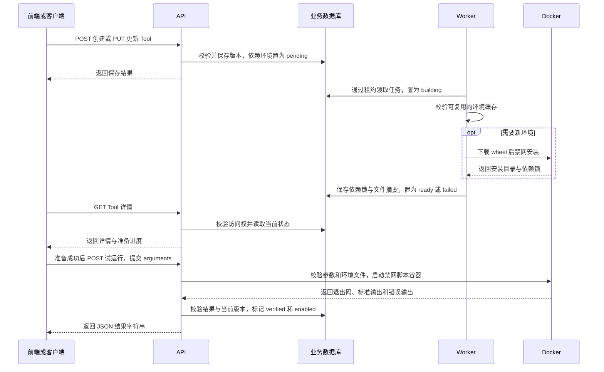

# Y-Point 服务端

Y-Point 智能助手平台后端。需求见 `y-point-dev.txt`；开发进度、验收结果和待办事项统一记录在 `y-point-server-todo.md`，前端任务见 `y-point-web-todo.md`。本文件说明当前代码的运行方式、模块职责和业务接口。

## 核心业务概览

管理员登录后可配置供应商和模型。登录用户可创建自己的 Agent、Skill 和 Tool，或使用被指定共享的 Agent 创建独立会话进行多轮对话，也可直接提交不关联 Agent 的文本 Run。两种入口都创建持久化 Run，由独立 worker 调用 DeepAgents，保存检查点、最终消息和可重放事件。会话、附件、产物和运行按实际使用者隔离。浏览器通过快照与 SSE 游标恢复运行进度，最终回答以消息接口为准。

| 业务环节 | 当前能力 |
| --- | --- |
| 身份与模型 | 用户、会话和资源授权；供应商名称唯一、凭据加密及冲突回滚；模型接入、能力探测、用量及估算成本记录。 |
| Agent 与对话 | Agent 配置版本和运行快照；多会话隔离、多轮检查点续聊、指定用户共享与撤权；无需 Agent 的独立文本 Run；长会话摘要和窗口预算。 |
| Skill | 私有或公开的说明型 Skill；版本化文本包、ZIP 导入导出、Agent 多选关联及 Run 版本固定；运行时按需读取并复核权限，支持关联 Tool 的自然名称映射。 |
| Tool | 私有或公开的 Python/Bash 脚本及 MCP 工具；Agent 可直接关联多个 Tool，无需 Skill；Python 依赖按版本准备、锁定并支持离线 wheel，脚本在 Docker 沙箱试运行后发布，调用时复核用户授权并记录脱敏状态。 |
| Tool 治理 | MCP 凭据轮换、清除与撤销；传输及发现限额；跨进程调用与依赖准备名额；外部写幂等契约验收及结果不明禁止重放；资源核对和存储预算。 |
| Run 执行 | 数据库队列、幂等提交、租约与心跳、取消/超时/失败终态、审批基础协议、模型及工具预算；worker 故障后按条件恢复已完成的无工具运行。 |
| 文件与产物 | 私有上传和授权下载；TXT、PDF、DOCX、XLSX 等附件上下文及图片输入；模型生成常见格式文件、会话内按需读取旧产物并记录来源关系。 |
| 实时与恢复 | 持久化事件、SSE、快照和游标补发；助手消息关联产物，上传附件保留在用户消息中。 |

核心业务闭环：认证与资源授权后，用户通过 Agent 会话或独立文本入口提交 Run；业务事务保存输入、排队状态和首个事件，worker 领取后按模型配置执行并持续写入事件。完成时保存最终消息和检查点引用，生成文件与助手消息关联；前端按事件游标追平过程，再从消息接口读取最终结果。上传文件正文留在私有存储，下载时重新校验所有权和有效期；Skill 文本包另存于业务数据库。

功能进度、验收证据和待完成事项见 `y-point-server-todo.md`。

## 本地运行

使用 Python 3.12。`uv` 从锁文件安装依赖；默认读取 `.env.development`，可用不提交到 Git 的 `.env.development.local` 覆盖本机配置。`.env.example` 是配置项说明，不是可直接启动的环境文件。开发环境默认使用项目根目录的 SQLite `y_point.db`，也可通过 `DB_BACKEND` 选择 MySQL 或 PostgreSQL。

在项目根目录安装依赖后，运行 `make dev` 即可同时启动 API、worker 和前端：

```bash
uv sync --group dev
npm --prefix web install
uv run alembic upgrade head
make dev
```

前端默认地址为 `http://127.0.0.1:5173`；若端口被占用，`make dev` 会选择下一个空闲端口并打印实际地址。API 地址为 `http://127.0.0.1:7769`，前端 `/api/v1` 请求会代理到该 API。重复运行 `make dev` 会先停止本项目旧的 API、worker 和前端开发进程，待其退出后再启动新进程；按 Ctrl-C 也会清理本轮进程。若 7769 被其他程序占用，脚本仍会报错，不会终止该程序。独立运行前端时仍默认代理到 8000，可通过 `API_PROXY_TARGET` 指定其他 API 地址。

只需后端时，可单独启动 API 和 worker：

```bash
uv sync --group dev
uv run alembic upgrade head
uv run uvicorn app.main:app --reload
```

对话运行还需要单独启动 worker；API 进程只接收请求并读取结果。SQLite 检查点默认保存在 `.run-private/checkpoints.sqlite`，重启 worker 时应继续使用原文件，以保留已有会话上下文。

Worker 的标准输出、错误输出及继承标准流的子进程输出统一写入项目根目录的 `.logs/worker.log`，因此 `make dev` 的终端只显示 API 和前端日志。日志默认限制为 50 MiB（52,428,800 字节），超限时在原文件中清理最早内容，通常保留约 45 MiB 的最新日志后继续写入，不生成备份日志；启动时也会收缩已有超限文件。可用 `tail -f .logs/worker.log` 查看执行日志。生产环境可在 `.env.production` 或进程环境中设置 `WORKER_LOG_FILE=/path/to/worker.log`、`WORKER_LOG_MAX_BYTES=52428800`；容量必须为正整数字节数，相对路径按项目根目录解析，目录会自动创建。修改后重启 worker 生效，`make dev` 的正常停止流程会刷新并收尾日志。

```bash
uv run python -m app.cli.run_worker
uv run pytest -q
uv run alembic check
```

`GET /api/v1/health` 只检查 API；根入口与该接口统一返回 `{"code":200,"message":"操作成功","data":{"status":"ok"}}`，健康探针读取 `data.status`。`GET /api/v1/health/worker` 在有有效 worker 心跳时返回 HTTP 200，否则返回 503。Worker 停止时新 Run 仍可进入队列，但不会执行。管理员可从 `GET /api/v1/runs/workers/status` 查看心跳、排队量和过期租约。开发接口文档位于 `/docs`。Redis 由 `REDIS_ENABLED` 控制，本地启动不依赖 Redis。

开发环境的 `SECRET_KEY` 应通过私有配置覆盖占位值，至少使用 32 字节随机值；修改后重启服务，旧访问令牌会失效。供应商凭据使用独立的 Fernet `CREDENTIAL_ENCRYPTION_KEY` 加密，丢失或更换该密钥后已有凭据无法解密。生成密钥可运行：

```bash
uv run python -c "from cryptography.fernet import Fernet; print(Fernet.generate_key().decode())"
```

## 模块与数据边界

| 模块 | 职责 |
| --- | --- |
| `app/api/v1`、`app/schemas` | HTTP 路由、Bearer 授权、请求校验、公开响应和 SSE 协议。 |
| `app/services/model_adapter.py` | 将已启用的供应商与模型配置转换为 LangChain 聊天模型。 |
| `app/services/run_manager.py` | Run 状态、幂等键、租约、消息和单调事件序号的业务事务。 |
| `app/services/agent_access.py` | Agent 所有者与指定用户授权检查，供会话、Run、SSE 和 worker 复用。 |
| `app/services/run_dispatcher.py`、`run_executor.py` | 扫描排队任务，校验用户和模型，执行 DeepAgents、工具授权、取消与预算。 |
| `app/services/runtime_adapter.py` | 配置 DeepAgents 工具、检查点线程和长会话摘要；摘要调用计入 Run 预算。 |
| `app/services/runtime_checkpoint.py` | 打开独立的 LangGraph SQLite 或 PostgreSQL Checkpointer。 |
| `app/services/artifact_store.py`、`message_attachments.py`、`attachment_text.py` | 私有文件存储、消息附件引用、常见文件文本提取和清理。 |
| `app/services/artifact_renderers.py`、`worker_tools.py` | 生成常见格式文件，按会话授权列出或读取旧产物，并装配本轮已授权用户 Tool。 |
| `app/services/user_tools.py`、`tool_environments.py` | Tool 定义、授权、版本快照、自然名称映射，以及依赖准备任务、锁和缓存校验。 |
| `app/services/script_sandbox.py`、`mcp_tools.py` | 在 Docker 中执行脚本，通过 MCP Streamable HTTP 发现和调用远端工具。 |
| `app/core/enums.py` | 跨模块业务类型、状态、角色、可见性和策略的统一枚举。 |
| `app/models`、`app/db`、`migrations/versions` | 业务表、数据库连接及 Alembic 迁移。 |

业务库保存用户、Agent、会话、Run、可见消息、事件和文件元数据。Checkpointer 按 `thread_id` 保存 LangGraph 状态，可能包含历史消息和工具结果；它与业务库不是同一个事务，也不能用可见消息表直接重建。文件正文在私有本地目录或 S3，不放入消息表或 SSE。进程心跳与 Run 租约心跳分别记录；反向代理和进程管理器应分别监测 API 与 worker。

### 核心业务关系

| 对象 | 关系与用途 |
| --- | --- |
| Agent、共享、会话 | Agent 归创建者所有；`yp_agent_share` 只授权指定用户使用配置。被授权用户创建并拥有自己的会话、Run 和文件，不继承 Agent 所有者的会话或文件。会话通常沿用同一个 `thread_id`；若从未完成过回答且所有历史 Run 均已终结、未调用工具，下一轮可切换新线程，旧 Run 与检查点保留。 |
| Run、消息 | 每次发送创建一个 Run 和一条用户消息；Run 保存提交时的 Agent 配置快照、状态和预算。完成后追加助手消息。会话消息接口按消息 ID 顺序组成前端对话列表，单轮消息接口只查看指定 Run。 |
| 事件、检查点 | Run 事件按 Run 内序号记录排队、运行、文本增量、工具和终态，供快照与 SSE 恢复；Checkpointer 保存模型内部状态。事件流不替代最终消息。 |
| 上传附件 | 上传文件先写入 `yp_artifact` 和私有存储；提交 Run 时，用户消息通过 `yp_agent_message_attachment` 保存有序引用及是否进入模型上下文。前端从用户消息的 `attachments` 展示原文件。 |
| 生成产物 | 模型调用工具后，文件以 `pending` 暂存并关联 Run；Run 完成时发布为 `ready`，写入 `artifact_published`。前端从对应助手消息的 `artifacts` 展示预览或下载入口，文件内容通过独立授权下载接口获取。`context_artifact_ids` 列出本轮提供的上传参考文件，`read_source_artifact_ids` 列出生成前工具成功读取的旧产物。 |

页面恢复以会话 `messages` 为对话展示来源，以 Run `snapshot` 和 SSE 追平进行中的状态；无需对每条消息再单独请求产物列表。文件引用的 `available` 只表示当前元数据状态，真正下载仍逐次检查所有权和期限。

前端在用户消息的 `attachments` 展示上传文件，在助手消息的 `artifacts` 展示生成文件；两者的 `artifact_id` 都可用于授权下载。`included_in_context` 表示该上传文件是否在本轮交给模型。`context_artifact_ids` 是本轮提供的上传文件 ID；`read_source_artifact_ids` 是生成前由 `read_generated_artifact` 成功读取的同会话旧产物 ID，按首次读取顺序保存到 `yp_artifact_source`，源文件删除或过期后仍保留历史关系。产物详情与列表也返回这两个数组。读取记录不证明模型实际采用了哪些文件、段落或数据，也不等同于已有单值 `source_artifact_id` 的显式来源声明；逐项来源核对仍需要更细的引用证据。

## 认证与模型配置

首次部署先迁移数据库，再创建首位管理员。命令交互读取密码；密码至少 12 位，包含大小写字母和数字，UTF-8 编码不超过 72 字节。已有有效管理员时不能重复初始化。

```bash
uv run python -m app.cli.create_admin admin --mail admin@example.com
```

`POST /api/v1/auth/login` 使用用户名或邮箱及密码，返回访问令牌和轮换式刷新令牌。访问令牌有效期 7 天，刷新令牌有效期 30 天；服务端仅保存刷新令牌的 SHA-256 摘要。`POST /api/v1/auth/refresh`、`POST /api/v1/auth/logout`、`GET/PUT /api/v1/auth/me`、`POST /api/v1/auth/password` 管理会话与个人资料。每次 Bearer 请求都会核对用户状态、令牌版本和登录会话。普通用户只能访问自己的资源或被指定共享的 Agent；管理员可通过 `/api/v1/users` 管理用户，并读取 `/api/v1/users/audit/events`。成功响应统一包含 `code`、`message` 和可选的 `data`，业务错误保留相应 HTTP 状态与错误码。

管理员通过 `/api/v1/providers` 管理供应商连接，通过 `/api/v1/models` 管理模型。`GET /api/v1/providers/kinds` 返回各类型的配置字段；支持 `openai_compatible`、`openai`、`anthropic`、`ollama`、`azure_openai`、`gemini` 和 `bedrock`。Ollama 可使用 `http://127.0.0.1:11434/v1`。模型记录外部 ID、能力、上下文窗口以及每百万 Token 的输入/输出价格；人工填写或导入的能力不等于已验证能力。

模型录入通常依次调用：

1. `POST /api/v1/providers` 创建连接；`POST /api/v1/providers/{provider_id}/test` 检查发现能力，`GET /api/v1/providers/{provider_id}/available-models` 读取候选模型。供应商不提供模型列表时可手动录入外部 ID。
2. `POST /api/v1/models/import` 批量导入，或 `POST /api/v1/models` 单独创建；导入请求最多 100 个模型。
3. `POST /api/v1/models/{model_id}/test` 测试最小文本调用；`POST /api/v1/models/{model_id}/capabilities/test` 逐项验证 `text`、`streaming`、`tools`、`structured_output`、`vision` 或 `reasoning_summary`。探测可能产生上游费用。

密钥和自定义请求头加密保存，接口只返回是否已配置，不回传明文。模型测试和 Runtime 调用写入 `yp_model_call_record`，记录可得的用量、耗时、估算成本及脱敏故障类别，不保存提示词、回答、推理内容或凭据。估算成本依赖上游用量和配置单价，不等于供应商账单。只有启用且符合能力要求的模型可用于 Agent；活跃 Agent 引用模型时，管理接口拒绝停用或删除模型、修改其外部 ID/能力/窗口，以及停用或改动其供应商连接参数。可先更新 Agent 的默认模型；旧会话的模型切换边界见下文。

管理员配置供应商和模型并完成文本能力验证后，登录用户通过 `GET /api/v1/models/available` 获取新建 Agent 的默认模型选项，再将所选模型 ID 提交给 Agent 创建接口。选项仅返回模型 ID、显示名称和上下文窗口；供应商与模型须均启用，已配置的窗口须容纳 Agent 默认输出上限和最低输入空间。未配置窗口的模型仍可列出，Agent 创建或编辑时按实际输出上限再次校验。完整模型目录及供应商配置仅管理员可访问；供应商连接参数更新或文本能力验证失效后，模型会从选项中消失。

登录用户可用 `GET /api/v1/agents/share-targets?query=` 按用户名至少 2 字符前缀搜索共享对象；结果只含本人以外有效用户的 ID、用户名，最多 20 条。Agent 所有者选定对象后，再调用 `POST /api/v1/agents/{agent_id}/shares` 授权；撤权调用 `DELETE /api/v1/agents/{agent_id}/shares/{user_id}`。授权时服务端检查 Agent 所有权与目标用户状态；撤权检查 Agent 所有权和现有授权，并请求取消接收方未结束的运行。共享用户只取得 Agent 安全摘要，自己的会话与文件仍独立。

## 文件存储

`POST /api/v1/artifacts/uploads` 使用 Bearer 和重复的 `multipart/form-data` 字段 `files`，每批 1 至 5 个文件、每个最多 10 MiB。支持 UTF-8 TXT、PDF、DOCX、XLSX、PNG 和 JPEG；图片另限 2 MiB、2048×2048 像素，并检查实际编码、完整解码和 PNG 结束块。上传响应返回文件 ID、名称、MIME、大小和 SHA-256，不返回私有存储键。`GET /api/v1/artifacts/{artifact_id}` 查询元数据，`GET /api/v1/artifacts/{artifact_id}/download` 下载，`DELETE /api/v1/artifacts/{artifact_id}` 撤销访问；每次都重新检查所有权、状态和期限，跨用户按不存在处理。

默认文件正文位于 Git 忽略的 `.run-private/artifacts`，可通过 `ARTIFACT_STORAGE_DIR` 指向私有目录；元数据位于 `yp_artifact`。设置 `ARTIFACT_STORAGE_BACKEND=s3`、`ARTIFACT_S3_BUCKET` 及对应的 endpoint、region、凭据后可使用私有 S3 兼容桶；`ARTIFACT_STORAGE_DIR` 此时仍用于临时校验文件。切换存储后端不会自动迁移已有正文。停写并备份后可用 `uv run python -m app.cli.migrate_artifacts_to_s3` 复制和校验现有文件，再让 API 与 worker 同时切换配置。上传配额由 `ARTIFACT_OWNER_MAX_BYTES` 和 `ARTIFACT_OWNER_MAX_FILES` 控制；部署时应配置代理上传上限、恶意软件扫描与备份/孤儿文件清理策略。

## Run 与 Checkpoint

直接文本运行入口为 `POST /api/v1/runs`；私有 Agent 对话使用下文的会话 Run 入口。一个 Run 有自己的 `run_id`、状态和从 1 开始的事件序号。同一检查点线程不能同时有两个未结束的 Run；重复提交由同一用户的 `request_key` 保护。正常状态为 `queued → running → completed`，取消、超时或故障分别进入 `cancelled`、`timed_out`、`failed`。队列等待、模型执行、工具执行、模型/工具调用次数及 Token/估算成本均可设置上限；Run 创建时固定有效配置，超限写入脱敏 `failure_code`。Token 和成本上限依赖上游用量，不能阻止单次调用在返回用量前超额。

Worker 从业务库领取排队 Run，并在有效租约内调用 DeepAgents。输入和 `queued` 事件与 Run 同事务提交；模型可见文本先写入 `yp_agent_run_event.text_delta`，然后才能经 SSE 发送。LangGraph 在独立 Checkpointer 写状态；完成时最终 `assistant` 消息、Run 的 `completed` 状态、`checkpoint_id` 和终态事件在一个业务事务中提交。前端不能把 `text_delta` 当作最终回答。模型/工具调用失败、取消或租约过期时不自动重做可能有外部副作用的工作；只有检查点能证明无业务工具的 Run 已完成时，worker 才会补写遗漏的最终结果。

`CHECKPOINT_BACKEND` 默认是 `sqlite`，不要求与 `DB_BACKEND` 相同。共享 PostgreSQL 检查点需设置 `CHECKPOINT_BACKEND=postgres` 和 `CHECKPOINT_POSTGRES_DSN`，使用独立且仅 worker 可访问的库；此时不使用 `--checkpoint-db` 文件。切换 Checkpointer 不迁移旧线程，已有会话仍依赖原存储，切换前必须处理未结束 Run 和旧线程。

长会话使用模型目录的 `context_window` 和 Agent 的 `max_output_tokens` 计算输入预算，并预留系统指令及工具描述空间；接近阈值时由 DeepAgents 将较早历史压缩为摘要，最近消息继续保留。摘要模型调用同样计入 Run 的调用次数、Token 和估算成本，受模型超时与预算限制。摘要只改变后续模型看到的检查点上下文，业务库中的用户和助手消息保持原文，可继续供前端按游标读取；压缩后的历史可能丢失细节，文件仍可按需重新读取。图片按每张额外预留约 2048 个输入 Token，摘要提示仅保留图片旁的文字，不重新发送内嵌图片。窗口不足以容纳输出上限及最低输入空间时，Agent 配置返回 409；旧配置、直接 Run 或单轮输入估算超过可用空间时以 `context_window_exceeded` 失败。Token 估算和固定开销不是供应商实际计数的保证。未配置 `context_window` 时仍依赖框架默认摘要阈值，应在模型目录填入经验证的窗口大小。

摘要或普通模型调用失败时，公开消息不追加助手回答。上一轮存在已完成检查点时，若失败 Run 未调用工具，或仅完成当前授权 Skill 的文件读取，下一轮可从该已确认检查点继续；其他工具调用及失败的 Skill 读取不自动回退。从未完成过回答且历史 Run 都已终结、未调用工具的会话，则在下一次提交时切换新检查点线程。切换只影响后续 Run 的模型上下文，会话 ID 与历史消息保持不变，失败轮的输入不会自动带入新线程。无法证明检查点归属或工具副作用安全时仍返回 `checkpoint_mismatch`，需要核对后创建新会话。失败 Run 中已发生的模型调用仍计入预算。

工具事件 `tool_started`、`tool_completed`、`tool_failed` 只公开工具名和关联 ID，不把参数、结果、异常正文或文件内容塞进 SSE。文本文件读取工具只有在 Run 开启且模型工具能力已验证时才可用；`list_text_artifacts` 返回授权文件摘要，`read_text_artifact` 需要所有者审批，执行时再次检查文件和权限。具备工具能力的模型可自行调用生成工具，无需前端传 `publish_answer_artifact`；生成文件先暂存，Run 完成时与助手消息一同发布并写入 `artifact_published`。审批入口为 `GET /api/v1/runs/{run_id}/approval` 与 `POST /api/v1/runs/{run_id}/approval/decision`；拒绝会取消 Run，同意只保存决定，worker 才会根据检查点恢复执行。产物也可用 `GET /api/v1/artifacts?run_id={run_id}` 查询，下载仍走授权文件接口。

具备已验证工具能力的模型还可调用 `list_session_artifacts` 查看本会话最近已发布产物的 ID、名称和类型，再用 `read_generated_artifact` 按指定 ID 读取文本。读取时再次核对当前 Run 租约、用户、会话、产物状态、期限、大小和 SHA-256；TXT、Markdown、HTML、JSON、CSV、PDF、DOCX、XLSX 的可提取文本单次最多 16 KiB。HTML 只提取可见文本；扫描 PDF、复杂嵌入对象及超限文件不能据此完整续编辑。工具结果属于模型内部上下文，不写入公开消息或 SSE，但可能保留在检查点中；删除源文件不会自动清除已有检查点内容。模型仅在判断需要时调用工具，多个候选文件时应先确认目标；服务端不会在每轮自动读取所有产物。依次列出、读取、回答通常至少需要 3 次模型调用和 2 次工具调用；再生成新版文件还需预留额外预算。

| 模型生成工具 | 产物格式 | 输入与边界 |
| --- | --- | --- |
| `create_text_artifact` | `.txt`、`.md`、`.html`、`.json`、`.csv` | TXT/Markdown 保留 UTF-8 正文；HTML 由 Markdown 转换并清洗活动标签；JSON 解析后保存；CSV 限制行列并把公式样式的单元格转为文本。 |
| `create_document_artifact` | `.docx`、`.pdf` | 从 Markdown 风格正文生成标题、段落和列表；输出后重新打开校验。当前不保留复杂表格、图片、模板或精细分页。 |
| `create_spreadsheet_artifact` | `.xlsx` | 模型提供有名称和二维 `rows` 的工作表，最多 5 表、每表 1000 行、总计 10000 个单元格；字符串不作为公式执行，保存后重新打开校验。 |

生成产物单文件最多 10 MiB、每轮最多 5 个；HTML 下载使用附件方式，不作为站内可信页面执行。Agent 会话中，用户明确要求生成或导出文件时，worker 在完成前核对本轮模型工具暂存的产物；若指定 TXT、Markdown、HTML、JSON、CSV、DOCX、PDF 或 XLSX，还会核对格式。首次只有文字且剩余预算足以调用生成工具并回复时，运行时在同一 Run 内最多补一次内部纠正回合；这会增加模型调用与用量，内部提示只保存在检查点，不成为业务消息。校验前不公开本轮文字增量；最终缺失或格式不符则返回 `failed/artifact_required`，不追加助手最终消息，失败后同一会话仍可继续提交。该判定基于明确的文字指令，不能覆盖所有含糊表达；也不会把 `publish_answer_artifact` 的异步 TXT 回答导出当作模型生成的文件。前端仅在助手消息的 `artifacts` 非空时展示产物，并以授权下载接口确认当前可用性。生成文件的实际类型由服务端校验，不能只依据扩展名展示预览。

## Skill 管理与运行时授权

用户通过 `POST /api/v1/skills` 提交相对路径到 UTF-8 文本内容的 `files` 映射，包根目录必须包含带 YAML frontmatter 的 `SKILL.md`，其中 `name` 和 `description` 为必填项。可选 `category` 和 `visibility`（`private`/`public`，默认私有）。`GET /api/v1/skills` 列出本人 Skill 与其他用户已启用的公开 Skill；`GET/PUT/DELETE /api/v1/skills/{skill_id}` 管理详情、版本和逻辑删除。只有所有者可读取 API 返回的完整 `files`、编辑或删除；其他用户只能读取公开元数据和下载已启用公开 Skill 的当前版本。修改内容或设置会创建新版本，更新需传 `expected_version`。

`GET /api/v1/skills/template` 下载标准 ZIP 模板，`POST /api/v1/skills/import` 导入 ZIP；导入同名的本人 Skill 会创建新版本，未指定 `visibility` 时保留原可见性。`GET /api/v1/skills/{skill_id}/export` 导出当前版本。导入限制 ZIP 为 1 MiB、最多 32 个文本文件、单文件 128 KiB、总解压量 512 KiB，并拒绝非法路径、重复路径、软链接和特殊文件。响应中的 `manifest` 是每个文件的相对路径、UTF-8 字节数与 SHA-256；`content_hash` 是整个文件映射的摘要。Skill 内容和清单分别保存在业务数据库 `yp_skill_version.files` 与 `manifest` 的 JSON 字段，创建时不在服务器磁盘生成同名实体文件；ZIP 仅在导入导出时生成或读取。

创建或更新 Agent 时可传 `skill_ids`，最多关联 16 个可见、已启用且名称不冲突的 Skill。关联记录固定版本；编辑 Skill 后需重新保存 Agent 关联才能选用新版本。会话提交时再固定一次 Run 所用版本，并按实际使用者复核访问权；worker 装载前和每次读取前继续复核。DeepAgents 只在该 Run 内把已授权文本映射为 `/skills/{name}/{path}` 虚拟文件，并向模型提供 Skill 元数据和受限 `read_file`；新一轮会话会清理旧 Skill 虚拟文件。Skill 读取事件包含名称和版本，不公开文件正文。禁用、删除或转私有后，失去访问权的用户不能在新 Run 中使用该 Skill。

当前 Skill 是说明和静态文本资源，`allowed-tools`、`Bash(...)` 和 `!` 命令替换不会执行，也不会授予服务器命令权限。Skill 可以说明何时使用已授权 Tool，但创建 Agent 时仍须分别关联 Skill 和 Tool。仅在正文提及 `scripts/example.py` 不会创建或执行脚本；需要执行时，应将源码创建为脚本 Tool，并在 Skill 中使用创建时填写的工具名称（如 `get_time`）指导调用。模型读取未打包或未授权的 Skill 路径时会收到 `read_file` 错误消息，且不读取该路径；模型可继续调用合法工具并完成本轮对话。真实权限撤销、运行授权失效或其他检查点异常仍按各自校验规则处理。

例如，已关联 Tool 的名称为 `get_time`，且输入结构不接受参数时，可在 Skill 正文写“需要当前时间时调用 `get_time`，参数为 `{}`，依据工具结果回答”。这是模型按需选择的调用指引，不是命中文本后必然执行。模型无需先加载 Skill，也可直接调用 Agent 已关联且当前用户有权使用的 Tool。

运行时会在已关联 Skill 的 `SKILL.md` 虚拟内容末尾附加本轮可用工具目录，将用户名称、Tool ID、所有者与内部模型名称对应起来；数据库中的原始 Skill 文件和版本摘要不变。模型返回自然名称时，执行器只对本轮授权集合中唯一且不与内置工具、保留名称或其他工具内部名称冲突的名称进行转换，再以内部名称进入审批、执行及审计。两个同名 Tool 不会自动择一，需在 Skill 或对话中明确目标 Tool ID/所有者；未关联或无权访问的 Tool 不会因为正文提及而获得授权。旧 `user_tool_{id}_{name}` 写法仍兼容。`get_time.py` 等文件名可以在 Skill 说明中使用，平台映射会引导模型调用已关联的 `get_time` Tool；正文中的任意 Shell 命令不会被自动解析执行。

## Tool 管理与沙箱

### 接口与发布流程

用户可创建私有或公开的脚本/MCP Tool。Agent 可关联最多 16 个当前有权使用的本人 Tool 或公开启用 Tool，内置 Tool 不受该可见性规则限制；模型可以直接调用关联 Tool，也可以按 Skill 指引选择调用。Agent 关联及 Run 均固定 Tool 版本，编辑 Tool 后需重新保存 Agent 关联才能选用新版。

| 接口 | 职责与使用条件 |
| --- | --- |
| `POST /api/v1/tools` | 创建 `script` 或 `mcp` Tool。脚本先私有创建，初始 `verified=false`、`enabled=false`；MCP 经远端发现后保存定义。 |
| `PUT /api/v1/tools/{tool_id}` | 携带 `expected_version` 创建新版本。脚本源码、参数结构或依赖改变会清除验证并转为私有停用；脚本语言在创建时确定，更新不接受 `script_language`。 |
| `GET /api/v1/tools/{tool_id}` | 查询详情及数据库中的准备状态，不触发下载、安装或脚本执行。所有者可读取源码、依赖和环境信息；其他用户只能查看公开启用 Tool 的元数据。 |
| `POST /api/v1/tools/{tool_id}/test` | 仅创建者可试运行脚本，只接受 `{"arguments":{...}}`。依赖须已就绪，执行成功后设置 `verified=true`、`enabled=true`，随后可通过更新接口公开发布。 |
| `POST /api/v1/tools/{tool_id}/environment/retry` | 所有者提交 `{"expected_version":1}`。失败环境重新排队；已就绪环境通过创建私有停用的新版本重新准备，保留旧版环境记录，仍需重新试运行。 |
| `GET /api/v1/tools/catalog` | 列出可选 Tool 目录。 |
| `GET /api/v1/tools/runs/{run_id}/calls` | 仅向 Run 所有者返回调用版本、状态和脱敏失败类别；终态时未完成的调用标为 `unknown`，不能视为成功或可安全重试。 |

脚本创建参数包含 `name`、`description`、`kind=script`、`input_schema`、`script_language`（`python`/`bash`）和 `source_code`。`input_schema` 必须是对象型 JSON Schema，描述调用参数；无参数脚本可填 `{"type":"object","properties":{},"additionalProperties":false}`。源码通过 JSON 字符串传递，由序列化器处理实际换行；`/test` 不接受源码或语言字段。

Python Tool 通过 `requirements` 声明依赖，前端支持逐行填写或导入 `requirements.txt`。清单最多 32 项，每项 256 字节，支持标准包名、版本约束、extras 和环境标记；拒绝 URL、Git、本地路径及 pip 配置参数。Bash/MCP 不支持 Python 依赖清单。平台不根据 `import` 猜包名，例如导入 `PIL` 时应声明 `Pillow`；空数组表示沿用基础镜像，无需额外环境。

例如创建数字格式化脚本：

```json
{
  "name": "format_number",
  "description": "将数字格式化为易读文本",
  "kind": "script",
  "visibility": "private",
  "input_schema": {
    "type": "object",
    "properties": {},
    "additionalProperties": false
  },
  "script_language": "python",
  "requirements": ["humanize==4.11.0"],
  "source_code": "import json\nimport humanize\nprint(json.dumps({'formatted': humanize.intcomma(1234567)}))"
}
```

### 从保存到执行的调用链



图中的 `pending` 适用于需要新准备依赖的版本。环境状态为 `pending → building → ready/failed`，无额外依赖为 `not_required`；依赖不变时可沿用上一版本的就绪环境。`ready` 只表示依赖已准备，`verified` 表示脚本试运行通过，`enabled` 控制 Tool 当前是否启用。GET 返回的是数据库状态；执行前仍会重新校验环境文件。前端每 2 秒查询等待中或准备中的版本，关闭页面不影响后台任务。

| 阶段 | 核心代码 | 行为 |
| --- | --- | --- |
| 请求与授权 | [tools.py](app/api/v1/tools.py)：`create_tool`、`update_tool`、`get_tool`；[security.py](app/core/security.py)：`get_current_admin` | 开发前端 `/api/v1` 经 Vite 代理到 API。API 验证 Bearer、用户/登录会话及资源访问权；校验参数结构、Python 语法和依赖声明后，将 Tool 与版本分别写入 `yp_user_tool`、`yp_user_tool_version`。 |
| 后台领取 | [run_worker.py](app/cli/run_worker.py)：`_tool_environment_loop`；[tool_environments.py](app/services/tool_environments.py)：`prepare_next_tool_environment` | 独立异步任务扫描当前版本的 `pending` 记录，通过条件更新领取，保存租约和尝试次数，避免重复领取；异常退出后的过期租约标为 `failed/worker_interrupted`，由所有者重试。 |
| 缓存与安装 | `tool_environments.py`：`_build_environment`、`_package_network`、`_run_preparer` | 按依赖声明、实际镜像 ID、CPU 架构和系统识别缓存，校验完整后复用；新环境先下载兼容 wheel，再在禁网容器中按完整版本与 SHA-256 锁安装，发布安装文件清单及独立缓存目录。 |
| 试运行验证 | `tools.py`：`test_tool`；`tool_environments.py`：`require_script_environment`、`_verify_environment` | 仅创建者可调用，先按 JSON Schema 校验参数，再确认环境状态、固定镜像 ID 格式、目录和文件摘要；执行成功后重新确认版本未变化，才写验证状态、启用状态和审计。 |
| 沙箱与响应 | [script_sandbox.py](app/services/script_sandbox.py)：`run_script` | 源码写入临时文件，Docker CLI 启动一次性容器，只读挂载源码和依赖目录；经标准输入传 JSON，检查退出码及标准输出 JSON，再返回序列化的结果字符串。 |
| 正式对话 | [worker_tools.py](app/services/worker_tools.py)：`make_worker_tool_resolver`；[run_executor.py](app/services/run_executor.py)：`AuthorizedToolsMiddleware` | 模型触发 Tool 后，按实际对话用户复核 Run、租约、版本和权限，验证参数与环境，再复用 `run_script`；结果进入模型上下文，调用过程写脱敏事件和审计。 |

依赖环境由固定基础镜像中的 Python 解释器和独立安装目录组成。准备时，`pip download --only-binary=:all:` 获取直接及传递依赖，生成精确版本和 wheel 哈希锁；另一个禁网容器使用 `pip install --no-index --no-deps --ignore-installed --require-hashes --no-compile --target=/site` 安装。已安装文件发布到 `SCRIPT_DEPENDENCY_STORAGE_DIR/<environment_key>/`，版本记录保存依赖锁、镜像 ID 和文件清单。宽泛约束也会复用已有锁定缓存，需要不同版本时应修改约束；新版本不会覆盖旧版环境。

执行时将该目录只读挂载为 `/opt/tool-deps`，并设置 `PYTHONPATH`。Python 在容器内通过 `site.addsitedir('/opt/tool-deps')` 加载依赖，再由 `runpy.run_path('/app/main.py', run_name='__main__')` 执行脚本；`.pth` 等导入行为只发生在最终脚本沙箱中。无额外依赖时直接使用基础镜像执行。

脚本从标准输入读取参数，标准输出须为单个 JSON 值；日志应写标准错误，避免混入结果。例如：

```python
import json
import sys

arguments = json.load(sys.stdin)
result = {
    "ok": True,
    "arguments": arguments,
}
print(json.dumps(result))
```

试运行检查退出码为 0、输出可解析为 JSON，并通过统一响应返回；`data.result` 是 JSON 字符串，例如 `{"code":200,"message":"操作成功","data":{"result":"{\"ok\": true}"}}`。这验证了受限环境中的执行和输出协议，业务结果是否符合预期仍由 Tool 创建者确认。常驻 Web 服务不适用于该任务模式：脚本需在时限内完成并输出 JSON。

### 基础镜像与离线部署

宿主机需安装 Docker CLI、启动 Docker 服务并准备基础镜像。[Dockerfile.sandbox](Dockerfile.sandbox) 使用 Python 3.12，[sandbox/requirements.txt](sandbox/requirements.txt) 固定预装库。镜像通过 `SCRIPT_SANDBOX_IMAGE` 配置，默认 `y-point-script-sandbox:1`；环境准备时固定实际镜像 ID。联网构建命令：

```bash
docker build -f Dockerfile.sandbox -t y-point-script-sandbox:1 .
```

默认下载阶段经临时内部 Docker 网络中的代理访问 `SCRIPT_DEPENDENCY_INDEX_URL` 源站和 `SCRIPT_DEPENDENCY_ALLOWED_HOSTS` 允许的 HTTPS/443 目标，默认包括 `pypi.org`、`files.pythonhosted.org`。包源由维护者统一配置，不接受用户自定义地址；内网包仓库需配置相应 HTTPS 地址及下载域名，当前不支持包源内嵌凭据。安装阶段禁网，只接受兼容 wheel，不执行源码构建或用户安装钩子。

完全离线环境需同时交付基础镜像和用户依赖的完整 wheel 集合。在与目标 Python、Linux 系统及 CPU 架构一致的联网环境准备：

```bash
# 联网环境：基础镜像与完整 wheel 一起交付
mkdir -p .run-private/wheelhouse
docker run --rm --user "$(id -u):$(id -g)" \
  -v "$PWD/.run-private/wheelhouse:/wheels" \
  y-point-script-sandbox:1 \
  python -m pip download --only-binary=:all: --dest=/wheels "humanize==4.11.0"
docker save -o y-point-script-sandbox.tar y-point-script-sandbox:1
# 离线目标环境：导入镜像，并把 wheel 复制到配置的目录
docker load -i y-point-script-sandbox.tar
```

目标环境设置 `SCRIPT_DEPENDENCY_ALLOW_NETWORK=false` 和 `SCRIPT_DEPENDENCY_WHEELHOUSE=/absolute/path/to/wheelhouse`，通过 `--network=none`、`--no-index` 和只读 wheel 目录准备环境。缺少包、版本或兼容 wheel 时返回脱敏失败说明，补齐后重试；无网络且无安装包时无法获取新依赖。需要源码编译、系统动态库或超出资源限制的包，需维护者扩展基础镜像后重新验证。

### 资源、清理与存储边界

| 限制 | 依赖准备 | 脚本执行 |
| --- | --- | --- |
| 网络 | 下载仅经允许的包仓库代理；离线下载与安装均禁网 | 始终禁网 |
| 内存 / CPU / 进程数 | 512 MiB / 1 CPU / 64 | 128 MiB / 1 CPU / 64 |
| 临时目录 | 64 MiB | 8 MiB |
| 时限 | 总计默认 180 秒，配置范围 10～1800 秒 | 试运行 10 秒；正式调用取 Agent 工具时限且最多 30 秒 |
| 文件及数据 | 构建期间周期性检查 512 MiB、20,000 个文件上限，非宿主文件系统硬配额 | 参数结构最多 16 KiB、源码最多 64 KiB、输入/标准输出/错误输出各最多 64 KiB |

准备和执行容器使用非特权用户、只读根文件系统、权限与进程限制；按阶段只挂载所需的准备目录、源码或依赖，不挂载宿主机业务目录或 Docker 管理接口。执行时不安装库，安装 `httpx` 不会开放外部访问；外部服务业务应使用经授权和审批的 MCP Tool。容器内系统信息反映沙箱环境，需要中国标准时间的脚本应明确指定 UTC+08:00。

正常退出使用 Docker `--rm` 清理，取消、超时或异常时尝试强制移除容器并回收代理及临时网络。worker 被强杀时，容器内仍有独立时限；新建容器、代理和网络带部署作用域及到期标签，临时目录有持久化标记。常驻 worker 默认每 60 秒核对，过期后保留 300 秒宽限再回收。历史版本引用的环境始终保留；旧版本未标记资源仍需维护者人工核对。API 和全部 worker 需共享 `SCRIPT_DEPENDENCY_STORAGE_DIR` 并保有固定镜像；新缓存在发布前写入清理标记，并纳入完整性摘要。发布后尚未提交数据库引用的孤立缓存可在过期后回收；有任意历史版本引用的缓存和未标记历史目录继续保留。当前没有跨主机环境分发，也不会按保留期自动淘汰历史版本引用的缓存。备份应包含业务库、环境目录和基础镜像，不要删除仍被历史 Tool/Run 引用的缓存。

### MCP Tool

创建时提交 `kind=mcp`、公网 HTTPS `mcp_url`、远端 `mcp_tool_name`，可选 `mcp_bearer_token`。创建和更新时发现远端工具并固定输入结构；凭据加密保存，仅所有者可读连接详情，响应仅提供 `has_credentials`，不回传凭据明文。公开带凭据连接须设置 `share_credentials=true`。正式调用需要审批，调用时再次发现并核对结构，变化时需发布新版本。

连接使用 SDK 的 `streamable_http_client` 和显式管理的 `httpx.AsyncClient`，统一认证、连接/读取超时及退出清理。仅允许公网 HTTPS，解析结果不得包含私网、回环或保留地址；请求固定到校验后的 IP，保留原 Host 与 TLS 域名，并在传输层拒绝所有 3xx 响应。当前只支持 Streamable HTTP，每个 Tool 保存一个远端定义，无独立连接实体供多个 Tool 统一维护。每次连接在 SDK 解析前累计限制接收 1 MiB，拒绝压缩响应及超预算的声明长度；结果解析后仍保留 64 KiB 上限。发现支持有界分页，默认最多 128 个工具、总量 256 KiB，单个名称/描述/Schema 分别限制为 128 B/4 KiB/16 KiB，并拒绝重复工具名和循环游标。

### M5.1 治理与兼容边界

`041` 增加凭据撤销水位、恢复契约和数据库并发租约；启动 API/worker 前执行 `uv run alembic upgrade head`，并重启常驻 worker。SQLite 业务库可先使用在线备份；历史 MCP 写类型不会自动改成只读或自动获得写契约验收。

- 凭据更新省略 `mcp_bearer_token` 或提交空字符串时保留；非空值替换。`clear_mcp_credentials=true` 清除新版本凭据，与替换互斥。轮换/清除会撤销此前带凭据版本并取消相关 Run。`POST /api/v1/tools/{id}/credentials/revoke` 接收 `expected_version`，无需远端在线即可撤销历史凭据并禁用 Tool；恢复须显式替换或清除后重新发布。撤销共享会阻止旧 Run 继续借用凭据；已发往远端的操作无法撤回。
- MCP 缺少只读声明时默认按外部写处理；管理员可在核对实际能力后显式以 `effect=read` 发布缺少声明的只读工具。远端明确声明写操作时不能降为只读。外部写要求 `recovery_policy=idempotent`、有效的字符串 `idempotency_key_field`，以及管理员通过 `POST /api/v1/tools/{id}/write-contract/verify` 提交该版本的 `expected_version` 和 `evidence_reference`。新版本须重新验收。模型不可自行提供服务端幂等键；结果不明记为 `unknown`，相同调用禁止自动重放。
- 工具调用（含发现与试运行）共用数据库名额：默认全局/用户/Run 为 16/4/2；准备任务另按全局/用户 2/1 限制。工具满额直接返回 429 或 `tool_capacity_exceeded`，准备满额保留排队；审批等待不占名额。正常退出、取消和异常会释放，强杀后按有限租约到期回收。
- 构建在共享文件锁下先预留 512 MiB；默认环境目录预算 8 GiB，磁盘保留 1 GiB，80% 时告警。该机制是应用预算和准入控制，运行中检查也不能代替文件系统硬配额；需要硬磁盘隔离的目标部署须配置专用卷/文件系统配额并验收。缓存必须保留全部历史版本引用。

新增业务入口与权限：

| 入口 | 权限与行为 |
| --- | --- |
| `PUT /api/v1/tools/{tool_id}` | Tool 所有者使用 `expected_version` 发布新版本；支持替换或清除凭据，历史 Agent 仍固定版本，但不能绕过当前撤销及共享规则。 |
| `POST /api/v1/tools/{tool_id}/credentials/revoke` | 仅 Tool 所有者；提交 `expected_version`，无需连接远端即可撤销历史凭据、禁用 Tool 并取消受影响 Run。 |
| `POST /api/v1/tools/{tool_id}/write-contract/verify` | 仅管理员；提交 `expected_version` 与 `evidence_reference`，按固定版本验收写恢复契约，仅保存证据引用的 SHA256。 |
| `uv run python -m app.cli.reconcile_tool_resources` | 服务端运维命令，按部署作用域核对过期容器、代理、网络、目录及终态 Run 的遗留调用，输出清理统计与存储状态。 |

新增配置及默认值见 `.env.example`：

| 配置 | 默认值及用途 |
| --- | --- |
| `MCP_RESPONSE_MAX_BYTES` | `1048576`，每次连接在解析前累计接收上限。 |
| `MCP_DISCOVERY_MAX_TOOLS` / `MCP_DISCOVERY_MAX_BYTES` | `128` / `262144`，发现工具数量及总字节上限。 |
| `TOOL_CALL_GLOBAL_LIMIT` / `TOOL_CALL_USER_LIMIT` / `TOOL_CALL_RUN_LIMIT` | `16` / `4` / `2`，工具调用并发名额。 |
| `TOOL_PREPARATION_GLOBAL_LIMIT` / `TOOL_PREPARATION_USER_LIMIT` | `2` / `1`，依赖准备并发名额。 |
| `TOOL_STORAGE_MAX_BYTES` / `TOOL_STORAGE_MIN_FREE_BYTES` | `8589934592` / `1073741824`，应用存储预算及文件系统最低余量。 |
| `TOOL_RESOURCE_RECONCILE_SECONDS` / `TOOL_RESOURCE_GRACE_SECONDS` | `60` / `300`，周期核对间隔与资源过期宽限。 |

API 和全部 worker 必须使用一致的并发配置、时钟、业务数据库及共享环境目录。工具调用满额在 API 返回 HTTP 429，Run 记录 `tool_capacity_exceeded`；依赖准备满额保留 `pending`。远端连接、鉴权、发现及限流失败统一返回脱敏业务错误，不能将远端 429 与本地容量 429 混为同一语义。

迁移 `041` 新增 `yp_tool_execution_gate`、`yp_tool_execution_lease`，以及 Tool 凭据撤销水位、版本恢复策略、幂等参数和写契约验收字段；全部表间关联不设置外键。历史读版本回填 `safe`，历史写版本回填 `manual` 且未验收，不重写旧内容摘要；同时恢复 `040` 在 MySQL 非空字段变更中丢失的三处中文注释。目标升级前备份业务库与检查点，执行 `uv run alembic upgrade head` 和 `uv run alembic check`，再重启 API 与 worker。回退会移除治理字段及短期租约，不能撤销远端已发生的副作用。

本机验证记录（2026-11-03）：隔离 SQLite 完整回归 `184 passed, 17 skipped`；治理与依赖准备专项 `21 passed`；显式启用的隔离 MySQL/PostgreSQL 迁移、回退重升及独立进程名额争抢 `2 passed`；真实模型、离线 wheel、Docker、独立 worker 和公开 DeepWiki MCP 审批恢复组合链 `1 passed`。专项与完整回归有重叠，不累加为独立用例数；默认跳过项不算验收通过。

治理专项入口为 `uv run --no-sync pytest -q tests/test_m51_governance.py tests/test_tool_environments.py`；真实模型组合链需显式执行 `YPOINT_TEST_OLLAMA_M51=1 uv run --no-sync pytest -q tests/test_m51_live_acceptance.py`，要求本机模型、Docker 镜像和公网 MCP 可用，数据使用隔离临时用户与数据库。凭据协议测试使用真实 MCP SDK 和 FastMCP，仅将底层网络替换为进程内 HTTP，不代表具体公网凭据服务已验收。

当前交付按单机 Docker、固定镜像与 API/worker 共享目录验证；M5/M5.1 尚未总验收，M6 未开始。剩余现场验收包括浏览器双用户完整流程、具体外部写服务的真实幂等/返回丢失、目标平台 wheel 与在线/离线部署，以及目标卷共享/硬配额、容量预算和运维责任。

## Agent 对话业务流程

Agent 所有者调用 `POST /api/v1/agents/{agent_id}/shares` 并传 `{"user_id":2}` 授权指定的有效用户；`GET /api/v1/agents/{agent_id}/shares` 查看授权名单，`DELETE /api/v1/agents/{agent_id}/shares/{user_id}` 撤权。接受方从 `GET /api/v1/agents/shared` 或 `GET /api/v1/agents/shared/{agent_id}` 获取名称、描述、图标、欢迎语及所有者 ID；共享视图不返回系统指令。接受方沿用 `/api/v1/agents/{agent_id}/sessions` 创建和管理自己的会话，文件上传、产物、Run、消息及检查点线程均属于接受方。共享 Agent 不自动授予所有者的附件、产物或其他资源访问权。授权与撤权写入用户操作审计。

撤权立即阻止接受方通过 Agent、会话和 Run 接口访问该 Agent 的配置及既有会话；已排队或等待审批的 Run 取消，执行中的 Run 收到取消请求，worker 停止模型和工具，已建立的 SSE 流关闭。服务端在提交、领取、执行心跳和工具调用时复核授权。接受方自己上传或生成的文件仍归其所有，撤权不转移或删除这些文件；重新授权后可访问自己原有的会话。删除 Agent 会清理其指定用户授权并取消接受方未结束的 Run。

路径中的 `{agent_id}`、`{session_id}`、`{run_id}` 取对应创建响应的 `data.id`，`{artifact_id}` 取上传响应数组中的文件 ID。除浏览器 SSE 外，以下业务请求均使用 Bearer。服务端维护会话当前的 `thread_id`，前端在每轮提交时不需要传它。

### 正常对话与持久化

| 顺序 | 前端调用与关键响应 | 业务数据落库和流转 |
| --- | --- | --- |
| 登录 | `POST /api/v1/auth/login`；取 `data.access_token`。 | 更新用户最近登录时间，创建登录会话和审计记录；后续请求核对用户与会话。 |
| 创建 Agent | `POST /api/v1/agents`，例如 `{"name":"需求助手","default_model_id":1,"system_prompt":"请简洁回答"}`；取 `agent_id`。 | 校验默认模型，创建 `yp_agent_config`，记录所有者、配置、`enabled` 和从 1 开始的版本；写审计。 |
| 创建会话 | `POST /api/v1/agents/{agent_id}/sessions`，例如 `{"title":"需求讨论"}`；取 `session_id`。 | 创建 `yp_agent_session`，保存所有者、Agent 与唯一的当前 `thread_id`，初始未归档、版本 1。不同会话使用不同检查点线程。 |
| 提交本轮 | `POST /api/v1/agents/{agent_id}/sessions/{session_id}/runs`，传 `{"request_key":"turn-1-uuid","input_text":"请记住代号 ALPHA-42"}`；取新 `run_id`。要让模型按需生成文件，只需在 `input_text` 提出格式要求；`publish_answer_artifact:true` 专用于把最终回答额外导出为 `answer.txt`。 | 同一事务内使会话版本递增，并创建 `yp_agent_run`（初始 `queued`、事件序号 1、会话线程及 Agent 配置快照）、`yp_agent_run_message` 的用户消息和 `yp_agent_run_event` 的 `queued` 事件。提交键在同一用户下唯一；每轮使用新键，网络重试沿用原键。 |
| 执行与完成 | `GET /api/v1/runs/{run_id}` 可查询状态；收到 `completed` 后用 `GET /api/v1/runs/{run_id}/messages` 取完整回答。 | Worker 领取后写 `running` 事件，按会话线程读取历史检查点，模型增量写事件表；完成时在一个业务事务中写 `assistant` 消息、`completed` 事件和 `checkpoint_id`。 |
| 继续对话 | 向同一会话提交新 `request_key`，例如 `{"request_key":"turn-2-uuid","input_text":"代号是什么？"}`。 | 新 Run 的事件序号重新从 1 开始，通常沿用会话当前的 `thread_id` 从 Checkpointer 恢复历史；无成功回答且无工具副作用的失败历史可切换新线程。上一轮未终结时拒绝再提交。 |
| 独立文本运行（另一入口） | 无需创建 Agent 或会话，使用 Bearer 调用 `POST /api/v1/runs`，例如 `{"model_id":1,"input_text":"请介绍一下你自己","request_key":"direct-1"}`；取响应 `data.id` 作为 `run_id`。可选传 `thread_id` 续接独立运行的检查点线程。 | 服务端校验模型和供应商，调用与会话入口相同的 Run 创建逻辑，保存排队 Run、用户消息和 `queued` 事件；不保存 Agent 配置快照或会话附件，也不关联 Agent/会话。之后共用 `/api/v1/runs/{run_id}` 的状态、消息、快照和 SSE 接口。会话入口不会通过 HTTP 调用此入口。 |

### 实时流与页面恢复

| 场景 | 接口与前端处理 | 数据来源及边界 |
| --- | --- | --- |
| 浏览器订阅 | 用 Bearer 调用 `POST /api/v1/runs/{run_id}/stream-ticket`，再用同源 `EventSource('/api/v1/runs/{run_id}/stream?after=0')`；通过 `addEventListener('state', ...)` 和 `addEventListener('text_delta', ...)` 处理命名事件。 | 5 分钟 HttpOnly Cookie 只用于该 Run 的 SSE，不新增 Run 或事件；流从已提交的事件表补发，事件 ID 为 `<run_id>:<sequence>`。票据到期后重新签发并按游标续传。 |
| 刷新、切换会话 | `GET /api/v1/agents/{agent_id}/sessions`、`GET /api/v1/agents/{agent_id}/sessions/{session_id}/runs?page=1&page_size=20` 和 `GET /api/v1/agents/{agent_id}/sessions/{session_id}/messages?after=<message_id>&limit=100`。 | 这些查询不创建新 Run。消息使用全局消息 ID 游标，事件使用各 Run 内序号，不能混用；每次提交 Run 也会使会话版本递增。每条助手消息的 `artifacts` 按产物创建顺序返回，前端无需逐个 Run 查询产物。 |
| 追平事件 | `GET /api/v1/runs/{run_id}/snapshot?after=<sequence>&limit=100` 返回 `run`、`events`、`latest_sequence`、`next_after`、`has_more`。逐页追平后订阅 `/stream?after=<next_after>`。 | 每页最多 200 条，快照上界只固定本次读取；按 `<run_id>:<sequence>` 去重。其他 Run 的 `Last-Event-ID` 或超前游标返回 400。 |
| 终态展示 | 收到 `completed`、`failed`、`cancelled`、`timed_out` 后停止加载；完成时读取最终消息，失败时展示 `failure_code`。未启用回答导出时可关闭 `EventSource`。 | 文本增量只是预览，失败时可能没有最终助手消息。模型调用生成工具时，文件与 `completed` 同事务发布，完成后的助手消息直接携带 `artifacts`；前端按其中 `artifact_id` 下载。若 `publish_answer_artifact=true`，worker 还会异步发布 `answer.txt`，可继续等待其 `artifact_published` 后重读消息。文件删除后历史引用保留且 `available=false`，下载返回 404。 |

会话页在提交后立即订阅 SSE，运行中显示已持久化的 `text_delta`，断线后按事件序号去重续接；仅在流连接异常或超时时轮询 Run 状态，避免状态查询先报告完成而中断增量预览。启用 Token/成本预算或明确要求交付文件的 Run 会暂缓公开文本，直到用量或产物验证通过，因此这些运行可能只先显示状态和工具进度，最终内容仍以消息接口为准。

### 附件与操作分支

| 场景 | 接口与前端处理 | 业务数据落库和流转 |
| --- | --- | --- |
| 上传并引用文件 | `POST /api/v1/artifacts/uploads` 上传；会话 Run 提交时传最多 5 个 `artifact_ids`，需要模型读取正文时再传其子集 `context_artifact_ids`。 | 文件元数据写入 `yp_artifact`，原文件在私有存储；用户消息和有序的 `yp_agent_message_attachment` 引用同事务提交。Worker 执行前重验所有权、期限、MIME、大小和哈希，提取选中的 TXT、PDF、DOCX、XLSX 文本；单轮提取后连同文件标识最多 16 KiB。PNG/JPEG 每张最多 2 MiB、2048×2048 像素；每轮最多选择两张，且默认模型须通过 `vision` 能力验证。图片去除元数据后作为多模态块进入模型和私有检查点，不进入公开消息或 SSE；旧检查点可能保留图片内容，删除原文件不会清除旧检查点。超限、加密、损坏或无法读取时 Run 以 `attachment_unavailable` 失败。TXT 原文件在提交时另受 16 KiB 限制；未选中的附件只供展示和下载。 |
| 根据附件生成文件 | 本轮上传文件 ID 同时放入 `artifact_ids` 与 `context_artifact_ids`，`input_text` 写明所需格式；完成后读取会话 `messages`，从助手消息的 `artifacts` 获取生成文件 ID、`context_artifact_ids` 和 `read_source_artifact_ids`。Agent 的 `max_model_calls` 至少预留 2 次供工具调用与最终回复；需要首次未生成时自动纠正，则至少预留 3 次。 | 用户上传文件始终在用户消息的 `attachments`；模型生成文件写入私有存储，先记为 `pending`，完成时改为 `ready` 并与助手消息、事件同事务提交。产物列表和详情也返回本轮参考文件 ID，历史引用在原文件失效后保留。失败或取消后暂存文件不可下载，过期由清理任务回收。模型未调用工具时不会凭代码块自动生成文件。 |
| 继续使用本会话产物 | 用户说“修改刚才生成的文件”时无需把产物 ID 填入 `context_artifact_ids`；模型可先列出本会话产物，再按需读取目标。前端仍可从历史助手消息取得产物 ID，供用户明确指定。 | 产物仍存于私有文件存储，读取工具只访问同一用户、同一会话中已完成 Run 的有效产物，不把全部产物自动加入每轮上下文。成功读取记录在 `yp_run_artifact_read`；其后生成新文件时，将此前读取的旧产物 ID 固定在 `yp_artifact_source`。生成产物 ID 目前不能作为上传附件传给会话提交接口；模型未调用读取工具时，下一轮仅沿用原有检查点历史。 |
| 删除附件 | `DELETE /api/v1/artifacts/{artifact_id}` 后重新读取消息；下载仍用 `GET /api/v1/artifacts/{artifact_id}/download`。 | 文件状态变为 `deleted`，私有正文尽力清理；历史附件快照仍保留，动态 `available=false`，下载及新 Run 引用返回 404。已进入旧检查点的内容不会自动抹除。 |
| 重复提交 | 同一会话、输入、附件顺序、上下文附件选择和回答产物开关使用相同 `request_key` 重试，返回原 `run_id`；改变任一项返回 409。 | 重试不新增 Run、消息或事件，也不再次调用模型；被拒绝的请求不占用提交键。 |
| 取消 | `POST /api/v1/runs/{run_id}/cancel`。排队中直接返回 `cancelled`；运行中先返回 `cancel_requested`，再等待 worker 确认。 | 排队取消写终态事件，不调用模型；worker 重启不会补执行已取消 Run。运行中取消不撤销已发生的外部副作用。 |
| 编辑 Agent | `PUT /api/v1/agents/{agent_id}` 必须传 `expected_version`，旧版本返回 409。 | 原子更新 Agent 并递增版本；已提交 Run 保留创建时的模型、指令、时限和预算快照。修改默认模型后，已有成功对话的旧会话拒绝新提交（409）；使用新模型需创建新会话。 |
| 归档与恢复 | `PUT /api/v1/agents/{agent_id}/sessions/{session_id}`，传 `expected_version` 和 `archived`。 | 会话版本递增；活动 Run 阻止归档，归档后拒绝新提交，恢复后可再次提交。 |
| 会话与用户隔离 | 同一 Agent 的不同会话分别查询消息；访问未共享的 Agent、他人会话、Run 或文件。 | 会话拥有独立 `thread_id`；服务端按所有权和指定共享授权，跨用户资源按不存在处理。若检查点与业务库不一致，后续 Run 可能报 `checkpoint_mismatch`，不能只换提交键假定历史已恢复。 |

## 数据库与测试

SQLAlchemy 模型在 `app/models` 注册，Alembic 以其元数据管理业务表。修改模型后新增迁移；升级目标库前先备份并核对当前版本，再运行 `uv run alembic upgrade head` 和 `uv run alembic check`。应用启动时会检查业务模型需要的表和列；缺少迁移会在启动阶段报错。业务数据可选择 SQLite、MySQL 或 PostgreSQL；Checkpointer 独立配置。跨数据库验证范围和迁移记录见 `y-point-server-todo.md`。

常用验证命令：

```bash
uv run pytest -q
uv run pytest -q tests/test_run_manager.py tests/test_run_executor.py tests/test_agent_sessions.py
uv run alembic check
uvx ruff check app migrations tests scripts sandbox local_run.py
uvx ruff format --check app migrations tests scripts sandbox local_run.py
```

服务端编码规范以 `y-point-server-todo.md` 为准。
