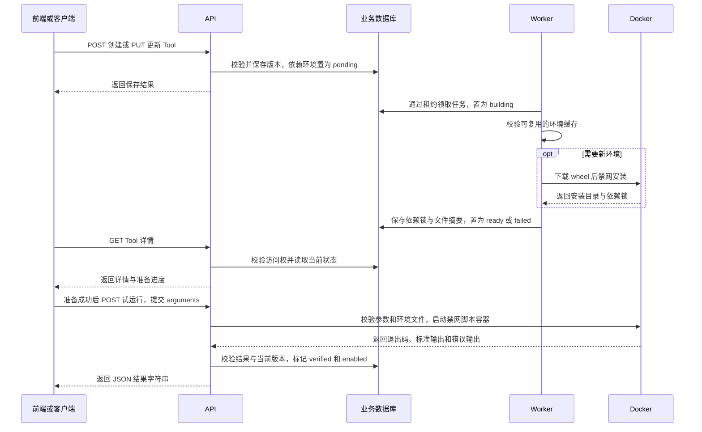
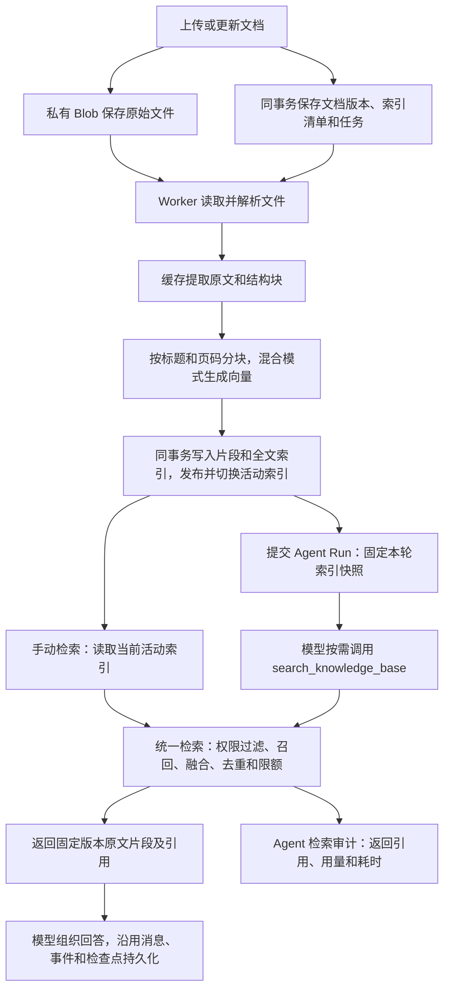

# Y-Point 服务端

Y-Point 智能助手平台后端。需求见 `y-point-dev.txt`；开发进度、验收结果和待办事项统一记录在 `y-point-server-todo.md`，前端任务见 `y-point-web-todo.md`。本文件说明当前代码的运行方式、模块职责和业务接口。

## 核心业务概览

管理员登录后可配置供应商和模型。登录用户可创建自己的 Agent、Skill、Tool 和知识库，或使用被指定共享的 Agent 创建独立会话进行多轮对话，也可直接提交不关联 Agent 的文本 Run。两种入口都创建持久化 Run，由独立 worker 调用 DeepAgents，保存检查点、最终消息和可重放事件。会话、附件、产物和运行按实际使用者隔离。浏览器通过快照与 SSE 游标恢复运行进度，最终回答以消息接口为准。

| 业务环节 | 当前能力 |
| --- | --- |
| 身份与模型 | 用户、会话和资源授权；供应商名称唯一、凭据加密及冲突回滚；模型接入、能力探测、用量及估算成本记录。 |
| Agent 与对话 | Agent 配置版本和运行快照；多会话隔离、多轮检查点续聊、会话内模型切换、指定用户共享与撤权；无需 Agent 的独立文本 Run；长会话摘要和窗口预算。 |
| Skill | 标准文件包工作区，支持草稿/校验/发布、参考资料、完整 ZIP、多个模板独立契约、受管脚本沙箱及 Agent/Run 版本固定。 |
| Tool | 私有或公开的 Python/Bash 脚本及 MCP 工具；Agent 可直接关联多个 Tool，无需 Skill；Python 依赖按版本准备、锁定并支持离线 wheel，脚本在 Docker 沙箱试运行后发布，调用时复核用户授权并记录脱敏状态。 |
| Tool 治理 | MCP 凭据轮换、清除与撤销；传输及发现限额；跨进程调用与依赖准备名额；外部写幂等契约验收及结果不明禁止重放；资源核对和存储预算。 |
| 知识库 | 私有或指定只读共享；文档版本、后台索引、关键词/向量混合检索及固定引用；Agent 检索使用实际用户权限，支持撤权、删除、取消与恢复。 |
| Run 执行 | 数据库队列、幂等提交、租约与心跳、取消/超时/失败终态、审批基础协议、模型及工具预算；worker 故障后按条件恢复已完成的无工具运行。 |
| 文件与产物 | 私有上传和授权下载；TXT、PDF、DOCX、XLSX 等附件上下文及图片输入；模型生成常见格式文件、会话内按需读取旧产物并记录来源关系。 |
| 实时与恢复 | 持久化事件、SSE、快照和游标补发；助手消息关联产物，上传附件保留在用户消息中。 |

核心业务闭环：认证与资源授权后，用户通过 Agent 会话或独立文本入口提交 Run；业务事务保存输入、排队状态和首个事件，worker 领取后按模型配置执行并持续写入事件。完成时保存最终消息和检查点引用，生成文件与助手消息关联；前端按事件游标追平过程，再从消息接口读取最终结果。上传文件正文留在私有存储，下载时重新校验所有权和有效期；Skill 文本包另存于业务数据库。

功能进度、验收证据和待完成事项见 `y-point-server-todo.md`。

## 本地运行

使用 Python 3.12。`uv` 从锁文件安装依赖；默认读取 `.env.development`，可用不提交到 Git 的 `.env.development.local` 覆盖本机配置。`.env.example` 是配置项说明，不是可直接启动的环境文件。开发环境默认使用项目根目录的 SQLite `y_point.db`，也可通过 `DB_BACKEND` 选择 MySQL 或 PostgreSQL。

在项目根目录安装依赖后，运行 `make dev` 即可同时启动 API、worker 和前端：

```bash
uv sync --group dev
npm --prefix web install
uv run alembic upgrade head
make dev
```

前端默认地址为 `http://127.0.0.1:5173`；若端口被占用，`make dev` 会选择下一个空闲端口并打印实际地址。API 地址为 `http://127.0.0.1:7769`，前端 `/api/v1` 请求会代理到该 API。重复运行 `make dev` 会先停止本项目旧的 API、worker 和前端开发进程，待其退出后再启动新进程；按 Ctrl-C 也会清理本轮进程。若 7769 被其他程序占用，脚本仍会报错，不会终止该程序。独立运行前端时仍默认代理到 8000，可通过 `API_PROXY_TARGET` 指定其他 API 地址。

只需后端时，可单独启动 API 和 worker：

```bash
uv sync --group dev
uv run alembic upgrade head
uv run uvicorn app.main:app --reload
```

对话运行还需要单独启动 worker；API 进程只接收请求并读取结果。SQLite 检查点默认保存在 `.run-private/checkpoints.sqlite`，重启 worker 时应继续使用原文件，以保留已有会话上下文。

Worker 的标准输出、错误输出及继承标准流的子进程输出统一写入项目根目录的 `.logs/worker.log`，因此 `make dev` 的终端只显示 API 和前端日志。日志默认限制为 50 MiB（52,428,800 字节），超限时在原文件中清理最早内容，通常保留约 45 MiB 的最新日志后继续写入，不生成备份日志；启动时也会收缩已有超限文件。可用 `tail -f .logs/worker.log` 查看执行日志。生产环境可在 `.env.production` 或进程环境中设置 `WORKER_LOG_FILE=/path/to/worker.log`、`WORKER_LOG_MAX_BYTES=52428800`；容量必须为正整数字节数，相对路径按项目根目录解析，目录会自动创建。修改后重启 worker 生效，`make dev` 的正常停止流程会刷新并收尾日志。

```bash
uv run python -m app.cli.run_worker
uv run pytest -q
uv run alembic check
```

`GET /api/v1/health` 只检查 API；根入口与该接口统一返回 `{"code":200,"message":"操作成功","data":{"status":"ok"}}`，健康探针读取 `data.status`。`GET /api/v1/health/worker` 在有有效 worker 心跳时返回 HTTP 200，否则返回 503。Worker 停止时新 Run 仍可进入队列，但不会执行。管理员可从 `GET /api/v1/runs/workers/status` 查看心跳、排队量和过期租约。开发接口文档位于 `/docs`。Redis 由 `REDIS_ENABLED` 控制，本地启动不依赖 Redis。

开发环境的 `SECRET_KEY` 应通过私有配置覆盖占位值，至少使用 32 字节随机值；修改后重启服务，旧访问令牌会失效。供应商凭据使用独立的 Fernet `CREDENTIAL_ENCRYPTION_KEY` 加密，丢失或更换该密钥后已有凭据无法解密。生成密钥可运行：

```bash
uv run python -c "from cryptography.fernet import Fernet; print(Fernet.generate_key().decode())"
```

## 模块与数据边界

| 模块 | 职责 |
| --- | --- |
| `app/api/v1`、`app/schemas` | HTTP 路由、Bearer 授权、请求校验、公开响应和 SSE 协议。 |
| `app/services/model_adapter.py` | 将已启用的供应商与模型配置转换为 LangChain 聊天模型。 |
| `app/services/run_manager.py` | Run 状态、幂等键、租约、消息和单调事件序号的业务事务。 |
| `app/services/agent_access.py` | Agent 所有者与指定用户授权检查，供会话、Run、SSE 和 worker 复用。 |
| `app/services/run_dispatcher.py`、`run_executor.py` | 扫描排队任务，校验用户和模型，执行 DeepAgents、工具授权、取消与预算。 |
| `app/services/runtime_adapter.py` | 配置 DeepAgents 工具、检查点线程和长会话摘要；摘要调用计入 Run 预算。 |
| `app/services/runtime_checkpoint.py` | 打开独立的 LangGraph SQLite 或 PostgreSQL Checkpointer。 |
| `app/services/artifact_store.py`、`message_attachments.py`、`attachment_text.py` | 私有文件存储、消息附件引用、常见文件文本提取和清理。 |
| `app/services/artifact_renderers.py`、`worker_tools.py` | 生成常见格式文件，按会话授权列出或读取旧产物，并装配本轮已授权用户 Tool。 |
| `app/services/user_tools.py`、`tool_environments.py` | Tool 定义、授权、版本快照、自然名称映射，以及依赖准备任务、锁和缓存校验。 |
| `app/services/script_sandbox.py`、`mcp_tools.py` | 在 Docker 中执行脚本，通过 MCP Streamable HTTP 发现和调用远端工具。 |
| `app/services/knowledge.py`、`knowledge_jobs.py` | 知识库授权、完整索引代、检索审计，以及可恢复的后台解析和原子发布。 |
| `app/services/knowledge_parser.py`、`knowledge_backend.py`、`embedding_adapter.py` | 文档结构与偏移、原生全文/向量后端、独立嵌入协议和维度验证。 |
| `app/core/enums.py` | 跨模块业务类型、状态、角色、可见性和策略的统一枚举。 |
| `app/models`、`app/db`、`migrations/versions` | 业务表、数据库连接及 Alembic 迁移。 |

业务库保存用户、Agent、会话、Run、可见消息、事件和文件元数据。Checkpointer 按 `thread_id` 保存 LangGraph 状态，可能包含历史消息和工具结果；它与业务库不是同一个事务；可见消息只能重建受限的文字上下文，不能还原完整执行状态。文件正文在私有本地目录或 S3，不放入消息表或 SSE。进程心跳与 Run 租约心跳分别记录；反向代理和进程管理器应分别监测 API 与 worker。

### 核心业务关系

| 对象 | 关系与用途 |
| --- | --- |
| Agent、共享、会话 | Agent 归创建者所有；`yp_agent_share` 只授权指定用户使用配置。被授权用户创建并拥有自己的会话、Run 和文件，不继承 Agent 所有者的会话或文件。新会话继承 Agent 默认模型，之后独立保存当前模型；显式切换时更换 `thread_id` 并携带已完成文字历史。当前线程尚未完成过回答且其中历史 Run 均已终结、未调用工具时，下一轮也可更换线程恢复；旧 Run 与检查点保留。 |
| Run、消息 | 每次发送创建一个 Run 和一条用户消息；Run 保存提交时的 Agent 配置快照、状态和预算。完成后追加助手消息。会话消息接口按消息 ID 顺序组成前端对话列表，单轮消息接口只查看指定 Run。 |
| 事件、检查点 | Run 事件按 Run 内序号记录排队、运行、文本增量、工具和终态，供快照与 SSE 恢复；Checkpointer 保存模型内部状态。事件流不替代最终消息。 |
| 上传附件 | 上传文件先写入 `yp_artifact` 和私有存储；提交 Run 时，用户消息通过 `yp_agent_message_attachment` 保存有序引用及是否进入模型上下文。前端从用户消息的 `attachments` 展示原文件。 |
| 生成产物 | 模型调用工具后，文件以 `pending` 暂存并关联 Run；Run 完成时发布为 `ready`，写入 `artifact_published`。前端从对应助手消息的 `artifacts` 展示预览或下载入口，文件内容通过独立授权下载接口获取。`context_artifact_ids` 列出本轮提供的上传参考文件，`read_source_artifact_ids` 列出生成前工具成功读取的旧产物。 |

页面恢复以会话 `messages` 为对话展示来源，以 Run `snapshot` 和 SSE 追平进行中的状态；无需对每条消息再单独请求产物列表。文件引用的 `available` 只表示当前元数据状态，真正下载仍逐次检查所有权和期限。

前端在用户消息的 `attachments` 展示上传文件，在助手消息的 `artifacts` 展示生成文件；两者的 `artifact_id` 都可用于授权下载。`included_in_context` 表示该上传文件是否在本轮交给模型。`context_artifact_ids` 是本轮提供的上传文件 ID；`read_source_artifact_ids` 是生成前由 `read_generated_artifact` 成功读取的同会话旧产物 ID，按首次读取顺序保存到 `yp_artifact_source`，源文件删除或过期后仍保留历史关系。产物详情与列表也返回这两个数组。读取记录不证明模型实际采用了哪些文件、段落或数据，也不等同于已有单值 `source_artifact_id` 的显式来源声明；逐项来源核对仍需要更细的引用证据。

## 认证与模型配置

首次部署先迁移数据库，再创建首位管理员。命令交互读取密码；密码至少 12 位，包含大小写字母和数字，UTF-8 编码不超过 72 字节。已有有效管理员时不能重复初始化。

```bash
uv run python -m app.cli.create_admin admin --mail admin@example.com
```

`POST /api/v1/auth/login` 使用用户名或邮箱及密码，返回访问令牌和轮换式刷新令牌。访问令牌有效期 7 天，刷新令牌有效期 30 天；服务端仅保存刷新令牌的 SHA-256 摘要。`POST /api/v1/auth/refresh`、`POST /api/v1/auth/logout`、`GET/PUT /api/v1/auth/me`、`POST /api/v1/auth/password` 管理会话与个人资料。每次 Bearer 请求都会核对用户状态、令牌版本和登录会话。普通用户只能访问自己的资源或被指定共享的 Agent；管理员可通过 `/api/v1/users` 管理用户，并读取 `/api/v1/users/audit/events`。成功响应统一包含 `code`、`message` 和可选的 `data`，业务错误保留相应 HTTP 状态与错误码。

管理员通过 `/api/v1/providers` 管理供应商连接，通过 `/api/v1/models` 管理模型。`GET /api/v1/providers/kinds` 返回各类型的配置字段；支持 `openai_compatible`、`openai`、`anthropic`、`ollama`、`azure_openai`、`gemini` 和 `bedrock`。Ollama 可使用 `http://127.0.0.1:11434/v1`。模型记录外部 ID、能力、上下文窗口以及每百万 Token 的输入/输出价格；人工填写或导入的能力不等于已验证能力。

模型录入通常依次调用：

1. `POST /api/v1/providers` 创建连接；`POST /api/v1/providers/{provider_id}/test` 检查发现能力，`GET /api/v1/providers/{provider_id}/available-models` 读取候选模型。供应商不提供模型列表时可手动录入外部 ID。
2. `POST /api/v1/models/import` 批量导入，或 `POST /api/v1/models` 单独创建；导入请求最多 100 个模型。
3. `POST /api/v1/models/{model_id}/test` 测试最小文本调用；`POST /api/v1/models/{model_id}/capabilities/test` 逐项验证 `text`、`streaming`、`tools`、`structured_output`、`vision` 或 `reasoning_summary`。探测可能产生上游费用。

密钥和自定义请求头加密保存，接口只返回是否已配置，不回传明文。模型测试和 Runtime 调用写入 `yp_model_call_record`，记录可得的用量、耗时、估算成本及脱敏故障类别，不保存提示词、回答、推理内容或凭据。估算成本依赖上游用量和配置单价，不等于供应商账单。只有启用且符合能力要求的模型可用于 Agent；活跃 Agent 引用模型时，管理接口拒绝停用或删除模型、修改其外部 ID/能力/窗口，以及停用或改动其供应商连接参数。可先更新 Agent 的默认模型；旧会话的模型切换边界见下文。

管理员配置供应商和模型并完成文本能力验证后，登录用户通过 `GET /api/v1/models/available` 获取新建 Agent 的默认模型选项，再将所选模型 ID 提交给 Agent 创建接口。选项仅返回模型 ID、显示名称和上下文窗口；供应商与模型须均启用，已配置的窗口须容纳 Agent 默认输出上限和最低输入空间。未配置窗口的模型仍可列出，Agent 创建或编辑时按实际输出上限再次校验。完整模型目录及供应商配置仅管理员可访问；供应商连接参数更新或文本能力验证失效后，模型会从选项中消失。

登录用户可用 `GET /api/v1/agents/share-targets?query=` 按用户名至少 2 字符前缀搜索共享对象；结果只含本人以外有效用户的 ID、用户名，最多 20 条。Agent 所有者选定对象后，再调用 `POST /api/v1/agents/{agent_id}/shares` 授权；撤权调用 `DELETE /api/v1/agents/{agent_id}/shares/{user_id}`。授权时服务端检查 Agent 所有权与目标用户状态；撤权检查 Agent 所有权和现有授权，并请求取消接收方未结束的运行。共享用户只取得 Agent 安全摘要，自己的会话与文件仍独立。

## 文件存储

`POST /api/v1/artifacts/uploads` 使用 Bearer 和重复的 `multipart/form-data` 字段 `files`，每批 1 至 5 个文件、每个最多 10 MiB。支持 UTF-8 TXT/Markdown、PDF、DOCX、XLSX、PNG 和 JPEG；图片另限 2 MiB、2048×2048 像素，并检查实际编码、完整解码和 PNG 结束块。上传响应返回文件 ID、名称、MIME、大小和 SHA-256，不返回私有存储键。`GET /api/v1/artifacts/{artifact_id}` 查询元数据，`GET /api/v1/artifacts/{artifact_id}/download` 下载，`DELETE /api/v1/artifacts/{artifact_id}` 撤销访问；每次都重新检查所有权、状态和期限，跨用户按不存在处理。

默认文件正文位于 Git 忽略的 `.run-private/artifacts`，可通过 `ARTIFACT_STORAGE_DIR` 指向私有目录；元数据位于 `yp_artifact`。设置 `ARTIFACT_STORAGE_BACKEND=s3`、`ARTIFACT_S3_BUCKET` 及对应的 endpoint、region、凭据后可使用私有 S3 兼容桶；`ARTIFACT_STORAGE_DIR` 此时仍用于临时校验文件。切换存储后端不会自动迁移已有正文。停写并备份后可用 `uv run python -m app.cli.migrate_artifacts_to_s3` 复制和校验现有文件，再让 API 与 worker 同时切换配置。上传配额由 `ARTIFACT_OWNER_MAX_BYTES` 和 `ARTIFACT_OWNER_MAX_FILES` 控制；部署时应配置代理上传上限、恶意软件扫描与备份/孤儿文件清理策略。

## Run 与 Checkpoint

直接文本运行入口为 `POST /api/v1/runs`；私有 Agent 对话使用下文的会话 Run 入口。一个 Run 有自己的 `run_id`、状态和从 1 开始的事件序号。同一检查点线程不能同时有两个未结束的 Run；重复提交由同一用户的 `request_key` 保护。正常状态为 `queued → running → completed`，取消、超时或故障分别进入 `cancelled`、`timed_out`、`failed`。队列等待、模型执行、工具执行、模型/工具调用次数及 Token/估算成本均可设置上限；Run 创建时固定有效配置，超限写入脱敏 `failure_code`。Token 和成本上限依赖上游用量，不能阻止单次调用在返回用量前超额。

Worker 从业务库领取排队 Run，并在有效租约内调用 DeepAgents。输入和 `queued` 事件与 Run 同事务提交；模型可见文本先写入 `yp_agent_run_event.text_delta`，然后才能经 SSE 发送。LangGraph 在独立 Checkpointer 写状态；完成时最终 `assistant` 消息、Run 的 `completed` 状态、`checkpoint_id` 和终态事件在一个业务事务中提交。前端不能把 `text_delta` 当作最终回答。模型/工具调用失败、取消或租约过期时不自动重做可能有外部副作用的工作；只有检查点能证明无业务工具的 Run 已完成时，worker 才会补写遗漏的最终结果。

`CHECKPOINT_BACKEND` 默认是 `sqlite`，不要求与 `DB_BACKEND` 相同。共享 PostgreSQL 检查点需设置 `CHECKPOINT_BACKEND=postgres` 和 `CHECKPOINT_POSTGRES_DSN`，使用独立且仅 worker 可访问的库；此时不使用 `--checkpoint-db` 文件。切换 Checkpointer 不迁移旧线程，已有会话仍依赖原存储，切换前必须处理未结束 Run 和旧线程。

长会话使用模型目录的 `context_window` 和 Agent 的 `max_output_tokens` 计算输入预算，并预留系统指令及工具描述空间；接近阈值时由 DeepAgents 将较早历史压缩为摘要，最近消息继续保留。摘要模型调用同样计入 Run 的调用次数、Token 和估算成本，受模型超时与预算限制。摘要只改变后续模型看到的检查点上下文，业务库中的用户和助手消息保持原文，可继续供前端按游标读取；压缩后的历史可能丢失细节，文件仍可按需重新读取。图片按每张额外预留约 2048 个输入 Token，摘要提示仅保留图片旁的文字，不重新发送内嵌图片。窗口不足以容纳输出上限及最低输入空间时，Agent 配置返回 409；旧配置、直接 Run 或单轮输入估算超过可用空间时以 `context_window_exceeded` 失败。Token 估算和固定开销不是供应商实际计数的保证。未配置 `context_window` 时仍依赖框架默认摘要阈值，应在模型目录填入经验证的窗口大小。

摘要或普通模型调用失败时，公开消息不追加助手回答。上一轮存在已完成检查点时，若失败 Run 未调用工具，或仅完成当前授权 Skill 的文件读取，下一轮可从该已确认检查点继续；其他工具调用及失败的 Skill 读取不自动回退。当前执行线程尚未完成过回答且其中历史 Run 都已终结、未调用工具时，下一次提交会更换检查点线程；若会话在其他线程已有成功轮次，仍按模型切换规则携带可见文字历史。切换只影响后续 Run 的模型上下文，会话 ID 与历史消息保持不变，失败轮的输入不会自动带入新线程。无法证明检查点归属或工具副作用安全时仍返回 `checkpoint_mismatch`，需要核对后创建新会话。失败 Run 中已发生的模型调用仍计入预算。

工具事件 `tool_started`、`tool_completed`、`tool_failed` 只公开工具名和关联 ID，不把参数、结果、异常正文或文件内容塞进 SSE。文本文件读取工具只有在 Run 开启且模型工具能力已验证时才可用；`list_text_artifacts` 返回授权文件摘要，`read_text_artifact` 需要所有者审批，执行时再次检查文件和权限。具备工具能力的模型可自行调用生成工具，无需前端传 `publish_answer_artifact`；生成文件先暂存，Run 完成时与助手消息一同发布并写入 `artifact_published`。审批入口为 `GET /api/v1/runs/{run_id}/approval` 与 `POST /api/v1/runs/{run_id}/approval/decision`；拒绝会取消 Run，同意只保存决定，worker 才会根据检查点恢复执行。产物也可用 `GET /api/v1/artifacts?run_id={run_id}` 查询，下载仍走授权文件接口。

具备已验证工具能力的模型还可调用 `list_session_artifacts` 查看本会话最近已发布产物的 ID、名称和类型，再用 `read_generated_artifact` 按指定 ID 读取文本。读取时再次核对当前 Run 租约、用户、会话、产物状态、期限、大小和 SHA-256；TXT、Markdown、HTML、JSON、CSV、PDF、DOCX、XLSX 的可提取文本单次最多 16 KiB。HTML 只提取可见文本；扫描 PDF、复杂嵌入对象及超限文件不能据此完整续编辑。工具结果属于模型内部上下文，不写入公开消息或 SSE，但可能保留在检查点中；删除源文件不会自动清除已有检查点内容。模型仅在判断需要时调用工具，多个候选文件时应先确认目标；服务端不会在每轮自动读取所有产物。依次列出、读取、回答通常至少需要 3 次模型调用和 2 次工具调用；再生成新版文件还需预留额外预算。

| 模型生成工具 | 产物格式 | 输入与边界 |
| --- | --- | --- |
| `create_text_artifact` | `.txt`、`.md`、`.html`、`.json`、`.csv` | TXT/Markdown 保留 UTF-8 正文；HTML 由 Markdown 转换并清洗活动标签；JSON 解析后保存；CSV 限制行列并把公式样式的单元格转为文本。 |
| `create_document_artifact` | `.docx`、`.pdf` | 从 Markdown 风格正文生成标题、段落和列表；输出后重新打开校验。当前不保留复杂表格、图片、模板或精细分页。 |
| `create_spreadsheet_artifact` | `.xlsx` | 模型提供有名称和二维 `rows` 的工作表，最多 5 表、每表 1000 行、总计 10000 个单元格；字符串不作为公式执行，保存后重新打开校验。 |
| `render_skill_document` | `.docx` | 按本轮固定 Skill 版本的模板及独立字段契约渲染；有多个模板时必须指定 `template_name`。适用流程、模板发布和版本规则见下文“对话附件与 Skill 固定模板产物”。 |

生成产物单文件最多 10 MiB、每轮最多 5 个；HTML 下载使用附件方式，不作为站内可信页面执行。Agent 会话中，用户明确要求生成或导出文件时，worker 在完成前核对本轮模型工具暂存的产物；若指定 TXT、Markdown、HTML、JSON、CSV、DOCX、PDF 或 XLSX，还会核对格式。首次只有文字且剩余预算足以调用生成工具并回复时，运行时在同一 Run 内最多补一次内部纠正回合；这会增加模型调用与用量，内部提示只保存在检查点，不成为业务消息。校验前不公开本轮文字增量；最终缺失或格式不符则返回 `failed/artifact_required`，不追加助手最终消息，失败后同一会话仍可继续提交。该判定基于明确的文字指令，不能覆盖所有含糊表达；也不会把 `publish_answer_artifact` 的异步 TXT 回答导出当作模型生成的文件。前端仅在助手消息的 `artifacts` 非空时展示产物，并以授权下载接口确认当前可用性。生成文件的实际类型由服务端校验，不能只依据扩展名展示预览。

### 会话内模型切换

Agent 的 `default_model_id` 只决定新会话的初始模型；`yp_agent_session.model_id` 保存当前会话的选择，`yp_agent_run.model_id` 固定每轮实际使用的模型。修改 Agent 默认模型不会改变旧会话。用户在输入框上方选择模型，确认后从下一条消息开始持续生效；历史助手回复继续标明所属 Run 的模型。目录名称与供应商名称取当前目录，模型 ID 来自历史 Run，名称不是不可变快照。

历史会话的模型字段为空时，服务端按“最近完成 Run 的模型 → 最近 Run 的模型 → Agent 默认模型”解析；只读查询不回写数据库，新提交会固定解析出的会话模型。部署时先执行 `uv run alembic upgrade head`，再确保 API 与 worker 加载同一版本代码并沿用原检查点存储。

| 接口 | 模型选择契约 |
| --- | --- |
| `GET /api/v1/agents/{agent_id}/sessions/{session_id}` | 返回会话当前 `model_id` 与 `version`。 |
| `GET /api/v1/agents/{agent_id}/sessions/{session_id}/models` | 返回已验证文本模型的名称、供应商、已验证能力、窗口，以及 `selectable/reason/notice`；不返回凭据或连接配置。 |
| `PUT /api/v1/agents/{agent_id}/sessions/{session_id}` | 提交 `expected_version` 和 `model_id`；只修改本人的当前会话，不修改 Agent 或历史 Run。 |
| `POST /api/v1/agents/{agent_id}/sessions/{session_id}/runs` | 使用会话当前模型；可携带 `model_id`、`expected_session_version` 防止过期页面误用模型。这两个参数用于校验，不执行切换。 |
| `GET /api/v1/agents/{agent_id}/sessions/{session_id}/messages` | 每条消息附带所属 Run 的 `model_id` 及当前目录的 `model_name/provider_name`；目录缺失时保留 Run 模型 ID。 |

切换请求示例：

```json
{
  "expected_version": 3,
  "model_id": 2
}
```

会话有排队、执行、等待审批或取消中的 Run 时禁止切换；归档会话和停用 Agent 同样不可切换。服务端复核使用者对 Agent 的访问权、会话所有权、模型及供应商状态、文本能力、窗口与成本价格；配置了 Tool、Skill 或知识库时还要求已验证工具调用能力。当前模型失效时明确报错，用户可选择其他可用模型，不自动回退到 Agent 默认模型。本轮附件仍按目标模型的视觉能力及既有格式、大小规则校验。

显式切换到不同模型时，业务事务更新会话模型、版本和执行线程，保留会话 ID、历史消息、旧 Run 与检查点。新线程首次运行时，`session_models.handoff_messages()` 从同一用户、Agent 和会话中读取本轮之前已完成的可见文字消息，转换为新的用户/助手消息，再交给运行时。迁移最多携带最近 100 个完成轮次、262144 个字符，按完整轮次从最近向前保留；超过容量时向模型加入省略说明，后续仍受目标模型窗口、摘要和预算限制，不能保证保留全部早期细节。

每轮构建运行时时，系统提示都会补入当前 Run 模型的 ID、目录名称和上游 `external_id`，并提示模型不要沿用历史助手的自我介绍。该提示同样作用于已经切换过的现有线程，保留 Agent 的业务角色和原有消息。目录名称表示平台接入配置，不能作为底层训练身份的独立认证；模型回答“我是谁”也不能证明路由。核对切换是否生效，应关联 `yp_agent_run.model_id`、`yp_model_call_record` 中同一 `run_id` 的 `provider_id/external_id`，必要时核对检查点响应元数据或供应商日志。

历史附件正文、图片、工具原始结果、供应商专用状态和旧审批不自动迁移；失败或取消轮次的输入也不导入。需要文件时重新附加，或让具备工具能力的模型通过现有会话文件工具重新授权读取旧产物。知识库使用本轮快照与当前授权重新检索，历史工具动作不会因切换重放。跨供应商切换会把保留的文字历史发送给目标供应商，界面确认框会事先说明。

会话更新与提交均使用版本比较，所有线程中的活动 Run 都阻止切换；当前及历史会话线程不能通过独立 `POST /runs` 复用。相同提交键和相同请求重试优先返回原 Run，即使之后会话已切换模型；若显式携带的模型与原 Run 不一致，则返回 409。原有客户端不传新增校验字段时仍可提交，但会话仍使用自身保存的模型。

冲突保留 HTTP 409 和业务码 `10005`，并以 `data.reason` 区分 `session_busy`、`session_archived`、`session_version_changed`、`session_model_changed`、`model_unavailable`、`model_capability_mismatch`、`model_context_insufficient` 和 `model_pricing_missing`。收到版本或选择冲突后应刷新会话与运行状态，保留输入草稿后再提交。

### 对话产物内容预览

助手消息的生成产物卡片提供眼睛图标「预览」，点击后打开预览抽屉；桌面使用宽面板，手机占满可用宽度。抽屉内可下载原件，文本与 Markdown 可复制正文，关闭后保留对话位置。预览按需请求，每次打开重新授权，不在浏览器持久化正文；旧产物只要文件仍有效，也可以直接预览，无需重新生成。

| 产物格式 | 预览方式 |
| --- | --- |
| TXT、JSON | 保留文本换行；JSON 在长度允许时缩进展示，不执行内容。 |
| Markdown | 展示标题、列表、表格及代码块，保留代码复制；外部图片不会自动加载。 |
| HTML | 服务端按标签白名单清洗，再由无权限沙箱与 CSP 隔离展示；不执行脚本或加载外部资源。 |
| DOCX | 按正文顺序展示标题、段落和表格；图片、页眉页脚及精细排版须下载原件查看。 |
| PDF | 按页展示可提取的文字；扫描页、图片和原始版式须下载原件查看。 |
| CSV、XLSX | 展示行列内容；XLSX 支持切换工作表，不计算公式、不加载外部链接，图表与样式以原件为准。 |

`GET /api/v1/artifacts/{artifact_id}/preview` 沿用下载接口的文件所有权、状态、逻辑删除和有效期校验，返回 `artifact_id/filename/media_type/kind/content/sheets/truncated/notice`。展示方式以服务端核验的媒体类型及返回的 `kind` 为准，不依据文件名推断。接口复用私有本地/S3 存储读取，不生成公共链接、不新增预览文件或数据库表，响应带 `Cache-Control: no-store`。未登录返回 401；不存在、跨用户、未发布、已删除或过期的文件返回 404；不支持的格式返回 415，内容解析失败返回 422；抽屉内保留错误说明、重试和原件下载入口。

预览最多读取 10 MiB 原文件，正文共享 100000 字符预算；PDF 最多 20 页；表格最多 5 张工作表，每表 200 行、50 列，总计 5000 个单元格。超限通过 `truncated=true` 和界面提示说明仅展示部分内容，完整内容仍通过原件下载。Office 解析前限制 ZIP 条目和解压体积；解析在后台线程执行。预览不会更改文件、消息、Run 状态或模型上下文。

### 对话中的 Skill、Tool 与知识库调用状态

会话助手回复在正文上方展示本轮实际调用的类型、名称与状态。名称和结果来自已持久化的 `tool_started/tool_completed/tool_failed` 事件，不依据回答文字或 Agent 关联配置推断。Skill 展示事件中的名称及版本，用户 Tool 展示调用时名称；知识库检索展示本轮固定且有索引的检索目标名称，按当前权限过滤，已删除或撤权的名称替换为不可用提示。知识库名称使用当前可访问名称，不是调用时名称的历史快照。

`GET /api/v1/runs/{run_id}/calls` 返回按首次事件顺序排列的 `call_id/kind/name/status/sequence`，每次复核运行所有权与 Agent 当前访问权。会话 `GET /api/v1/agents/{agent_id}/sessions/{session_id}/messages` 的每条消息同时携带所属运行的 `calls` 数组，按页批量查询，不逐条回放完整文本事件；用户消息也携带该摘要，以便没有最终助手回答的失败轮次恢复调用记录。前端仅在助手一侧展示，运行时由工具事件触发重读并定时补齐，完成后以消息内摘要恢复历史。同名工具的多次调用按关联 ID 分别保留，不混并成功和失败。

调用摘要按需读取既有 `yp_agent_run_event`、`yp_agent_run` 及本轮知识库关联和当前授权资源，不新增摘要表，也不需要数据库迁移。没有可汇总调用事件的运行返回 `data: []`，会话消息对应 `calls: []`；旧运行仅能恢复已保存的事件，不补造历史调用。独立摘要接口使用 `Cache-Control: no-store`；运行不存在、跨所有者或 Agent 当前授权已撤销时返回 HTTP 404。

状态为 `running`（执行中）、`succeeded`（成功）、`failed`（失败）和 `interrupted`（结果未确认）。只有开始事件而运行已终结时显示结果未确认，不能据整轮成功或失败猜测调用结果；已成功工具不会因后续模型失败而改为失败。Skill 成功表示对应文件读取完成；知识库成功表示检索调用完成，无命中仍可成功，也不证明最终回答使用了检索片段。摘要不返回工具参数、工具结果、查询正文、文档原文或凭据；原有知识引用详情仍通过独立授权接口查看。

## Skill 文件包与运行时授权

Skill 以 `SKILL.md` 为入口，组织指令、参考资料、脚本和产物模板。前端 `/skills` 为资源列表，打开条目进入 `/skills/{id}` 独立工作区；桌面使用文件树与编辑/预览区，手机使用栏目导航。工作区包含文件、概览与设置、执行配置、脚本试运行、版本历史。用户在此维护 Skill，日常对话直接提出任务，由模型根据正文选择资料、工具和模板。

```text
my-skill/
├── SKILL.md                       # 必需，YAML frontmatter 含 name 和 description
├── references/                    # 按需读取的参考材料
├── scripts/                       # Python/Bash 脚本及辅助源码
├── assets/
│   ├── templates/                 # DOCX 产物模板
│   ├── schemas/                   # 每个模板的 JSON Schema
│   └── examples/                  # 示例输入或静态资源
├── y-point.yaml                   # 需要模板或可执行脚本时提供
└── README.md                      # 可选，使用说明
```

**编辑与发布**：新建和 ZIP 导入先生成私有草稿，未发布不能关联 Agent。文本编辑、批量文件/目录上传、重命名、删除只影响草稿；`SKILL.md` 必须保留。每次写入使用 `expected_revision` 比较并交换，过期编辑返回 HTTP 409，界面保留未保存文字以便处理冲突。校验检查入口元信息、完整路径清单、模板字段和脚本验证状态；发布在同一事务中固定全部资源、模板及脚本，生成不可变版本。设置的可见性、分组和启用状态随发布生效。历史版本可查看、导出、与草稿比较正文，或恢复到草稿再发布。

**资源与存储**：包内名称是相对逻辑路径，不是服务器目录。正文仍使用 `.run-private/artifacts` 或私有 S3，文件元数据与摘要在 `yp_artifact`（`source=skill_resource`）；`yp_skill_draft` 保存草稿清单/修订号/基准版本，`yp_skill_version_file` 保存发布版本到文件的关联，`yp_skill_version.manifest` 固定完整文件摘要，`files` 保存运行所需的文本视图。本地正文以随机 `storage_key` 保存，实际路径为 `ARTIFACT_STORAGE_DIR/<storage_key>`；不会按页面文件名在磁盘直接创建同名目录树。草稿或发布清单把包内路径映射到 `artifact_id`，再由 `yp_artifact.storage_key` 定位文件；对象存储后端沿用相同关系。`yp_skill_script` 另外记录包摘要、脚本路径与内部 Tool/版本的关系。资源无普通会话附件的默认有效期。被替换且从未发布的草稿文件进入既有过期清理；已发布资源继续保留，支持历史 Agent/Run。下载和预览逐次核对 Skill 授权、文件状态、长度与 SHA-256，不暴露存储键；文本和代码可以编辑/复制，Markdown、DOCX/PDF/XLSX 内容及 PNG/JPEG 可预览，复杂版式以原件下载为准。

**ZIP 与限制**：完整导入/导出携带二进制模板和字段契约，可在根目录直接放 `SKILL.md`，或包含一个 Skill 根文件夹。完整包最多 128 个文件、32 MiB，单个资源最多 10 MiB、UTF-8 文本最多 128 KiB；实际 DOCX 模板仍最多 2 MiB、每版本最多 10 个。导入拒绝加密、链接、目录逃逸、隐藏路径、重复或大小写冲突以及文件/目录冲突。工作区批量上传和 ZIP 导入在 multipart 解析前限制总请求 33 MiB。下载标准模板可得到目录示例与配置说明。

接口均需 Bearer；草稿写入和历史管理仅限所有者，其他用户只能查看、下载已启用公开 Skill 的当前发布版本。

| 接口 | 用途与关键参数 |
| --- | --- |
| `POST /api/v1/skills/packages` | 用 `name`、`description` 创建未发布草稿。 |
| `POST /api/v1/skills/packages/import` | `file` 上传完整 ZIP，创建新草稿；同名返回冲突。 |
| `GET /api/v1/skills/{id}/workspace` | 当前元数据、本人草稿和有权查看的发布历史。 |
| `POST /api/v1/skills/{id}/draft` | 打开草稿；`from_version` 加当前 `expected_revision` 可恢复历史。 |
| `PUT /api/v1/skills/{id}/draft` | 携带 `expected_revision`，批量更新 `files`、`renames`、`delete_paths` 和待发布设置。 |
| `POST /api/v1/skills/{id}/draft/files` | 重复 `files`、按上传顺序的路径 JSON 数组 `paths`、`expected_revision`。 |
| `POST /api/v1/skills/{id}/draft/import` | `file`、`expected_revision`，原子替换完整草稿。 |
| `POST /api/v1/skills/{id}/draft/validate`、`/publish` | 携带 `expected_revision` 校验或原子发布；未通过校验时禁止发布。 |
| `GET /api/v1/skills/{id}/files`、`/files/preview` | `path` 指定资源，`version` 不填读本人草稿，填写则读获授权发布版本。`files` 支持 `download=true`。 |
| `POST /api/v1/skills/{id}/draft/scripts/prepare`、`/test` | `expected_revision`、脚本 `path`、JSON 对象 `arguments`；准备依赖或试运行精确包。 |
| `GET /api/v1/skills/{id}/versions/{version}/export` | 完整版本 ZIP；`GET /skills/{id}/export` 同样支持当前文件包完整导出。 |

旧 `POST /skills`、`POST /skills/import` 和文字更新/独立模板接口继续兼容旧文字包，原有文字 ZIP 的限制保持不变。旧 Skill 打开工作区时只在草稿中转换资源，历史发布版和 Agent 关联不改写。切换为完整文件包后，文字更新和独立模板发布接口返回 409，提示在工作区编辑，避免覆盖丢失二进制资源；新版 ZIP 请使用完整包接口。

### 使用模式与产物选择

每个 Skill 只要求根目录的 `SKILL.md`；`references/`、`scripts/`、`assets/` 和 `y-point.yaml` 按任务选择，不要求创建空目录或给纯说明型 Skill 配置报告模板。`SKILL.md` 的 `description` 描述适用场景，正文写清资料来源、执行步骤、输出要求和完成标准。

| 使用模式 | 所需资源与配置 | 调用与交付方式 |
| --- | --- | --- |
| 纯说明型，如会议纪要整理 | 只有 `SKILL.md` | 模型按步骤直接在对话回复，无须脚本或文件产物。 |
| 参考资料型，如服务台 FAQ | `SKILL.md` 与 `references/*.md` | 按需读取资料后回答；未提供的事实明确说明，引用文件不等于建立知识库索引。 |
| 仅脚本型，如精确文本统计 | `scripts/*.py` 或 `.sh`，以及 `y-point.yaml.scripts` | 模型从正文的运行时映射选择受管脚本，传 JSON 输入，取得实际结果再回答。 |
| 脚本读取资源，如固定库存汇总 | 脚本、`assets/` 内 CSV/JSON 等及脚本配置 | 脚本读取沙箱中只读挂载的固定包；数据可全部来自包内，无须用户上传附件。 |
| 正文直接生成文档，如固定章节周报 | `SKILL.md`，可选章节说明 | 模型把完整正文交给 `create_document_artifact` 生成 DOCX/PDF，或交给 `create_text_artifact` 生成 Markdown 等文本文件；无须报告字段 Schema。 |
| 固定 DOCX 或多模板报告 | `assets/templates/*.docx`、匹配的字段 Schema、`y-point.yaml.templates` | 模型按正文选择模板，并组织 `report_data` 调用 `render_skill_document`；用户无须在对话页面选择模板或手填字段。 |
| 用户附件审查 | 固定审查指令/清单，用户在对话上传每次变化的材料 | 读取获授权附件后审查，按要求直接回复或生成文件；用户附件不需要并入 Skill 包。 |
| 外部工具或知识库协作 | 正文中的调用步骤，以及 Agent 显式关联的 Tool/知识库 | 外部 Tool 依赖可在 `required_tools` 声明；实际授权、验证和索引可用性分别检查，不由 Skill 自动授予。 |

脚本的 `input_schema` 与报告字段 Schema 是两类契约。前者约束工具输入，后者约束固定 DOCX 模板的占位字段；`review.schema.json` 只是命名示例，并非每个 Skill 的必需文件。无业务输入的脚本仍使用对象型输入契约，例如：

```yaml
scripts:
  scripts/summary.py:
    description: 读取包内固定资料并汇总，不接收业务参数
    input_schema:
      type: object
      properties: {}
      additionalProperties: false
    requirements: []
    requires_approval: false
```

该脚本的试运行和正式调用参数都是 `{}`。脚本通过标准输入读取 JSON，通过标准输出返回单个有界 JSON 值；统计和取数以实际返回为准。脚本试运行验证绑定整个包，即使只修改参考资料或 CSV，也需重新验证后发布。

“不需要用户传参”不表示内部工具没有参数：正文生成文档仍需模型传入 `filename` 与 `content`，模板生成仍需模型组织字段。通用文档生成适合固定章节及基础标题、段落、列表；严格复用既有 Word 版式时使用模板流程，当前不能把无占位符的静态 DOCX 放入 `assets/templates/` 后跳过字段契约自动写入任意正文。模板也可以只约定一个正文字符串字段，但仍需匹配的 Schema。脚本在临时目录写出的文件不会自动成为会话产物，需由内置文件生成或模板工具交付。

创建时先保存正文与实际资源，仅登记存在的脚本和模板；没有执行能力的 Skill 不用填写执行配置。有脚本则先准备依赖、试运行，通过后校验发布；“准备完成”不等于“已验证”。Agent 关联已发布启用版本，用户新建会话后直接描述任务，需要附件时再上传。以真实调用记录和可下载产物判断完成，不以模型声明“已执行/已生成”作为成功证据。

### 执行配置与脚本

`SKILL.md` 负责描述何时使用、取数步骤、参考路径、模板选择及缺失事实处理。`y-point.yaml` 声明机器可验证的资源关系，正文中提及路径本身不会授予执行权限。配置只支持以下三类；JSON 对象也是合法的 YAML。

```yaml
templates:
  assets/templates/review.docx: assets/schemas/review.schema.json
  assets/templates/summary.docx: assets/schemas/summary.schema.json
scripts:
  scripts/validate.py:
    description: 检查结构化审查结果
    input_schema:
      type: object
      properties:
        title:
          type: string
      required: [title]
    requirements: []
    requires_approval: false
required_tools:
  - func1
```

模板与 Schema 也可在执行配置页逐个关联。配置中的脚本必须位于 `scripts/` 且为 Python/Bash 文本，每个包最多 8 个，输入契约为对象型 JSON Schema；Python pip 依赖复用既有固定版本/锁定与离线 wheel 机制。先准备依赖，worker 完成后试运行，验证通过才可发布。试运行的验证绑定整个文件包摘要；任何正文、参考材料、模板或配置文件变化后都须重新验证，单纯设置变更可复用同一包验证。依赖失败可以在工作区重新准备。

包内脚本经 `yp_skill_script` 关联内部托管 Tool/版本，隐藏于独立 Tool 目录，不能手工关联或修改。运行时复用 Tool 的审批、并发、超时、调用预算与 `ToolInvocation` 审计；脚本只读挂载 Run 固定的整个包，可导入同目录辅助源码并以 `/app` 为工作目录读取相对路径。沙箱无网络、只读根文件系统、非特权运行，只有有界临时目录可写；输入/输出均为最多 64 KiB 的 JSON，不自动把临时文件发布为产物。需要文档时可将实际结果交给通用文档工具，或组织字段交给固定模板工具；普通文本/表格产物继续使用已有产物工具。

`required_tools` 最多声明 16 个外部 Tool 名称；它们必须在 Agent 配置中显式关联、当前可访问且名称唯一，在 Agent 保存和 Run 提交时检查。配置不自动授予业务工具、MCP 或宿主机命令权限；`allowed-tools`、`Bash(...)` 和 `!` 命令替换不会被自动执行。未登记脚本仅作为只读资源。

### Agent 关联与对话调用

Agent 最多关联 16 个已发布、可见、已启用且名称不冲突的 Skill，`yp_agent_skill` 固定版本；重新保存关联才使用新发布版本。提交对话后 `yp_run_skill` 再固定本轮版本，包内脚本同步生成 `yp_run_tool`；现有 Run 不随编辑或发布漂移。worker 和每次资源/脚本调用仍复核当前授权，禁用、删除或转私有会撤销不再满足条件的访问。

DeepAgents 在本轮受控虚拟空间提供 `/skills/{name}/{path}`，先通过 Skill 元信息匹配任务，再按需 `read_file` 读取正文和参考文件；二进制资源由受控模板工具使用。服务端在虚拟 `SKILL.md` 末尾附加固定资源目录、模板与字段契约以及包内脚本工具名映射，不修改原文件和版本摘要。脚本调用摘要显示 `Skill 名称@版本 / scripts/路径` 及真实成功/失败状态，产物保留模板来源快照。

外部 Tool 仍可不依赖 Skill 独立使用。例如显式关联的工具名称是 `get_time`，可在正文写“需要时间时调用 get_time，参数为 {}”。模型读取正文不保证每次都调用全部工具。平台仅对本轮唯一且不与保留名称冲突的自然名称生成调用别名；重名需要明确 Tool ID/所有者，未授权 Tool 不因正文提及而可用。

### 对话附件与 Skill 固定模板产物

Skill 正文定义何时使用、取数步骤和产物要求；模板是该 Skill 不可变版本中的资源。用户在对话中提出任务，模型根据任务读取对应 Skill，再调用正文指定的业务工具获取数据或读取用户材料，最后按模板生成文件。对话页面无需选择报告 Skill，关联但未使用的 Skill 不强制生成产物。

使用流程：

1. 在 Skill 页面编写适用场景、取数步骤、模板文件名、字段含义及缺失信息处理规则。例如正文写明“调用 func1 工具获取数据，按照 xxx_template.docx 模板生成报告”。
2. 在文件工作区批量上传实际 DOCX 到 `assets/templates/`，把各自的报告字段 JSON Schema 放入 `assets/schemas/`，在执行配置中逐个关联。每个版本最多 10 个模板、单个最多 2 MiB。Word 模板使用 `{{ title }}`、`{{ summary }}` 等占位符；正文、模板和字段契约一起校验并原子发布。仅在正文中写文件名不会读取服务器本地文件或外部 URL。
3. 在 Agent 中重新保存该 Skill 关联，固定包含模板的版本，并关联正文需要的业务工具；选择已验证 `tools` 能力的模型。之后更新正文或模板，已有 Agent 绑定和已提交 Run 继续使用原版本。
4. 用户正常发送业务任务。若任务需要本地材料，可在输入区添加或拖入文件，勾选“供模型读取”；支持 TXT、Markdown、PDF、DOCX、XLSX、PNG/JPEG，每轮最多 5 个、单个最多 10 MiB。若数据来自业务工具，则无需上传附件。
5. worker 固定本轮 Skill 版本，模型按任务读取 `SKILL.md`。正文附带该版本所有模板文件名、Skill ID、各自字段契约及受控生成方式；模型按正文的适用条件选取模板，调用实际授权的业务工具或读取材料，组织所选模板的报告字段。上传多个模板不代表每次任务都要生成全部模板。
6. 模型调用 `render_skill_document(skill_id, report_data, filename, template_name="assets/templates/xxx_template.docx")`；有多个模板时必须提供 `template_name`，单模板可省略。服务端核对本轮绑定版本及当前授权，校验结构化字段，使用私有模板填充 DOCX，保留正文、表格、页眉页脚及样式。
7. 成功读取模板 Skill 正文后，运行会登记该 Skill 的模板交付要求。每个已执行模板 Skill 至少须交付一个来源匹配的 DOCX；具体需生成哪些报告由正文和任务要求决定。文字、通用 DOCX 和其他版本模板不能替代。缺少产物时在预算内进行一次纠正尝试，仍未交付则明确失败。完成后发布文件，助手消息提供来源、预览和下载。

Skill 正文示例（`func1` 应是已关联且可用的业务工具名称；运行时会提供实际调用名称）：

```markdown
## 适用场景
用户要求生成合同审查报告时使用。

## 执行步骤
1. 调用 func1 获取合同数据；用户已上传合同时，结合其提供的材料核对事实。
2. 合同审查使用 xxx_template.docx，title 为报告标题，summary 为审查结论，findings 为逐条发现。若另有上传的其他模板，写明各自用途和选择条件；生成时通过 template_name 指定对应文件名。
3. 缺失数据明确标注“待补充”，不得编造事实。报告完成后返回可下载文件。
```

模板字段契约示例：

```json
{
  "type": "object",
  "properties": {
    "title": { "type": "string", "maxLength": 100 },
    "summary": { "type": "string", "maxLength": 2000 },
    "findings": {
      "type": "array",
      "maxItems": 20,
      "items": {
        "type": "object",
        "properties": {
          "note": { "type": "string", "maxLength": 500 }
        },
        "required": ["note"]
      }
    }
  },
  "required": ["title", "summary", "findings"]
}
```

模板支持字段替换、条件和单层数组循环，可保留模板原有的正文、表格、页眉页脚和样式。表格行可使用 docxtpl 的 `` / `` 控制行，内容行填入 `{{ item.note }}`；控制标记分别放在独立行。模板最多 2 MiB，拒绝宏、活动/嵌入对象和外部资源；正文、页眉、页脚执行表达式白名单、单层循环和 XML 输出预算检查。字段契约不接受远程引用和任意复杂规则；数组最多 100 项、单个字符串最多 8000 字符，结构化报告数据最多 64 KiB。用户须按实际报告设置更小的字段上限；复杂 Word 排版仍需用自己的真实模板验收。

文档属性、脚注、尾注及其他不受上述 AST/预算检查的部件不支持模板语法，静态内容可以保留；发布时拒绝这些位置的动态标记。独立模板接口在 multipart 解析前限制请求总量 21 MiB，完整包接口为 33 MiB；配额不足返回明确业务 400，并回滚资源和版本。

| 操作 | 接口与契约 |
| --- | --- |
| 批量发布模板 | `POST /api/v1/skills/{skill_id}/templates`，multipart 字段为 `expected_version`、重复的 DOCX `files` 与 JSON 字符串 `fields_schema`。后者以原始文件名为键、独立 JSON Schema 为值，例如 `{"A_template.docx": {...}, "B_template.docx": {...}}`。先校验整批再原子发布；任一文件或字段无效则整批失败。仅所有者可发布，版本冲突 409。 |
| 兼容单模板接口 | `POST /api/v1/skills/{skill_id}/template` 继续接受 `expected_version`、单个 JSON Schema `fields_schema` 和 DOCX `file`，保留旧替换语义。版本已有多个模板时返回 409，须改用批量接口，避免误删其他模板。 |
| 获取模板信息 | 所有者读取 `GET /api/v1/skills/{skill_id}` 的 `report_templates` 列表，每项包含 `template_key`、文件 ID、名称、SHA-256 和独立字段契约；仅有一个模板时仍提供兼容字段 `report_template`。原始模板通过现有文件下载接口授权下载。 |
| 上传与发送前检查 | 先 `POST /api/v1/artifacts/uploads`，再 `POST /api/v1/agents/{agent_id}/sessions/{session_id}/attachments/check`。检查请求仅接受 `artifact_ids` / `context_artifact_ids` 两个列表，上下文 ID 必须属于消息附件且不重复；核对所有权、有效期、当前会话模型能力、完整文本可读性及总字节预算。成功返回 `valid`、`context_bytes`、`max_context_bytes`，不创建 Run 或调用模型。 |
| 提交任务 | 使用原会话 `/runs` 提交消息、模型预期值及可选附件，服务端固定 Skill 版本。模型按需读取 Skill 后自动登记模板交付要求；重试仍比较原始消息、模型、附件和产物设置，不将运行中新增的交付要求作为用户提交参数。 |
| 报告预览与下载 | 完成后从消息 `artifacts` 取 ID，使用现有 `/artifacts/{id}/preview` 和 `/download`；预览是正文展示，下载保留生成文件原件。 |

附件预检查只说明当前状态允许提交；实际 `/runs` 仍接收完整消息、模型、幂等键和附件参数，并再次强制校验，worker 执行前继续检查内容与授权。不能将预检查响应作为绕过正式提交校验的凭据。图片上下文最多两张，要求当前模型已验证视觉能力。

数据链路为：`SkillVersion` → `yp_skill_template(skill_id, skill_version, template_key, artifact_id, fields_schema)` → 本轮 `yp_run_skill` 版本快照 → 模型读取正文并登记 `required_report` → 业务工具取数/可选用户材料 → 字段校验/沙箱渲染 → `yp_artifact` 暂存 → Run 完成发布 → 助手消息。模板正文沿用私有文件存储，`yp_artifact.source=skill_resource`，不随普通上传保留期过期，受所有者文件配额约束；历史版本资源不能通过通用文件删除接口单独移除。文字版本更新沿用全部模板关联，替换模板创建新资源。文件名按 Unicode NFC 和不区分大小写规范化，每个版本内唯一，禁止使用目录路径；多个模板未指定名称或名称不存在时明确报错，不自动猜测。模板报告在 `yp_artifact.template_source` 保存 Skill 名称/ID/版本、模板文件名/键、模板文件 ID/摘要和结构化数据摘要；消息中的 `context_artifact_ids` 继续记录本轮提供的材料。这些是生成来源记录，不代表模型已正确审查全部事实或实际引用每一段材料。

当前文本上下文提取后的正文连同文件标识合计最多 **16 KiB**；发送前与 worker 使用同一提取预算，超限明确拒绝，不静默截断。长材料需拆分或使用知识库；知识库检索只召回相关片段，也不能等同于逐页全文审查。扫描 PDF 的 OCR、长文档分段读取与覆盖证明、完整 Word 分页版式预览尚未提供。完整 Skill ZIP 可携带模板及字段契约跨环境迁移；脚本执行环境及其试运行验证不会随 ZIP 迁移，需在目标环境重新准备并验证。

## Tool 管理与沙箱

### 接口与发布流程

用户可创建私有或公开的脚本/MCP Tool。Agent 可关联最多 16 个当前有权使用的本人 Tool 或公开启用 Tool，内置 Tool 不受该可见性规则限制；模型可以直接调用关联 Tool，也可以按 Skill 指引选择调用。Agent 关联及 Run 均固定 Tool 版本，编辑 Tool 后需重新保存 Agent 关联才能选用新版。

| 接口 | 职责与使用条件 |
| --- | --- |
| `POST /api/v1/tools` | 创建 `script` 或 `mcp` Tool。脚本先私有创建，初始 `verified=false`、`enabled=false`；MCP 经远端发现后保存定义。 |
| `PUT /api/v1/tools/{tool_id}` | 携带 `expected_version` 创建新版本。脚本源码、参数结构或依赖改变会清除验证并转为私有停用；脚本语言在创建时确定，更新不接受 `script_language`。 |
| `GET /api/v1/tools/{tool_id}` | 查询详情及数据库中的准备状态，不触发下载、安装或脚本执行。所有者可读取源码、依赖和环境信息；其他用户只能查看公开启用 Tool 的元数据。 |
| `POST /api/v1/tools/{tool_id}/test` | 仅创建者可试运行脚本，只接受 `{"arguments":{...}}`。依赖须已就绪，执行成功后设置 `verified=true`、`enabled=true`，随后可通过更新接口公开发布。 |
| `POST /api/v1/tools/{tool_id}/environment/retry` | 所有者提交 `{"expected_version":1}`。失败环境重新排队；已就绪环境通过创建私有停用的新版本重新准备，保留旧版环境记录，仍需重新试运行。 |
| `GET /api/v1/tools/catalog` | 列出可选 Tool 目录。 |
| `GET /api/v1/tools/runs/{run_id}/calls` | 仅向 Run 所有者返回调用版本、状态和脱敏失败类别；终态时未完成的调用标为 `unknown`，不能视为成功或可安全重试。 |

脚本创建参数包含 `name`、`description`、`kind=script`、`input_schema`、`script_language`（`python`/`bash`）和 `source_code`。`input_schema` 必须是对象型 JSON Schema，描述调用参数；无参数脚本可填 `{"type":"object","properties":{},"additionalProperties":false}`。源码通过 JSON 字符串传递，由序列化器处理实际换行；`/test` 不接受源码或语言字段。

Python Tool 通过 `requirements` 声明依赖，前端支持逐行填写或导入 `requirements.txt`。清单最多 32 项，每项 256 字节，支持标准包名、版本约束、extras 和环境标记；拒绝 URL、Git、本地路径及 pip 配置参数。Bash/MCP 不支持 Python 依赖清单。平台不根据 `import` 猜包名，例如导入 `PIL` 时应声明 `Pillow`；空数组表示沿用基础镜像，无需额外环境。

例如创建数字格式化脚本：

```json
{
  "name": "format_number",
  "description": "将数字格式化为易读文本",
  "kind": "script",
  "visibility": "private",
  "input_schema": {
    "type": "object",
    "properties": {},
    "additionalProperties": false
  },
  "script_language": "python",
  "requirements": ["humanize==4.11.0"],
  "source_code": "import json\nimport humanize\nprint(json.dumps({'formatted': humanize.intcomma(1234567)}))"
}
```

### 从保存到执行的调用链



图中的 `pending` 适用于需要新准备依赖的版本。环境状态为 `pending → building → ready/failed`，无额外依赖为 `not_required`；依赖不变时可沿用上一版本的就绪环境。`ready` 只表示依赖已准备，`verified` 表示脚本试运行通过，`enabled` 控制 Tool 当前是否启用。GET 返回的是数据库状态；执行前仍会重新校验环境文件。前端每 2 秒查询等待中或准备中的版本，关闭页面不影响后台任务。

| 阶段 | 核心代码 | 行为 |
| --- | --- | --- |
| 请求与授权 | [tools.py](app/api/v1/tools.py)：`create_tool`、`update_tool`、`get_tool`；[security.py](app/core/security.py)：`get_current_admin` | 开发前端 `/api/v1` 经 Vite 代理到 API。API 验证 Bearer、用户/登录会话及资源访问权；校验参数结构、Python 语法和依赖声明后，将 Tool 与版本分别写入 `yp_user_tool`、`yp_user_tool_version`。 |
| 后台领取 | [run_worker.py](app/cli/run_worker.py)：`_tool_environment_loop`；[tool_environments.py](app/services/tool_environments.py)：`prepare_next_tool_environment` | 独立异步任务扫描当前版本的 `pending` 记录，通过条件更新领取，保存租约和尝试次数，避免重复领取；异常退出后的过期租约标为 `failed/worker_interrupted`，由所有者重试。 |
| 缓存与安装 | `tool_environments.py`：`_build_environment`、`_package_network`、`_run_preparer` | 按依赖声明、实际镜像 ID、CPU 架构和系统识别缓存，校验完整后复用；新环境先下载兼容 wheel，再在禁网容器中按完整版本与 SHA-256 锁安装，发布安装文件清单及独立缓存目录。 |
| 试运行验证 | `tools.py`：`test_tool`；`tool_environments.py`：`require_script_environment`、`_verify_environment` | 仅创建者可调用，先按 JSON Schema 校验参数，再确认环境状态、固定镜像 ID 格式、目录和文件摘要；执行成功后重新确认版本未变化，才写验证状态、启用状态和审计。 |
| 沙箱与响应 | [script_sandbox.py](app/services/script_sandbox.py)：`run_script` | 源码写入临时文件，Docker CLI 启动一次性容器，只读挂载源码和依赖目录；经标准输入传 JSON，检查退出码及标准输出 JSON，再返回序列化的结果字符串。 |
| 正式对话 | [worker_tools.py](app/services/worker_tools.py)：`make_worker_tool_resolver`；[run_executor.py](app/services/run_executor.py)：`AuthorizedToolsMiddleware` | 模型触发 Tool 后，按实际对话用户复核 Run、租约、版本和权限，验证参数与环境，再复用 `run_script`；结果进入模型上下文，调用过程写脱敏事件和审计。 |

依赖环境由固定基础镜像中的 Python 解释器和独立安装目录组成。准备时，`pip download --only-binary=:all:` 获取直接及传递依赖，生成精确版本和 wheel 哈希锁；另一个禁网容器使用 `pip install --no-index --no-deps --ignore-installed --require-hashes --no-compile --target=/site` 安装。已安装文件发布到 `SCRIPT_DEPENDENCY_STORAGE_DIR/<environment_key>/`，版本记录保存依赖锁、镜像 ID 和文件清单。宽泛约束也会复用已有锁定缓存，需要不同版本时应修改约束；新版本不会覆盖旧版环境。

执行时将该目录只读挂载为 `/opt/tool-deps`，并设置 `PYTHONPATH`。Python 在容器内通过 `site.addsitedir('/opt/tool-deps')` 加载依赖，再由 `runpy.run_path('/app/main.py', run_name='__main__')` 执行脚本；`.pth` 等导入行为只发生在最终脚本沙箱中。无额外依赖时直接使用基础镜像执行。

脚本从标准输入读取参数，标准输出须为单个 JSON 值；日志应写标准错误，避免混入结果。例如：

```python
import json
import sys

arguments = json.load(sys.stdin)
result = {
    "ok": True,
    "arguments": arguments,
}
print(json.dumps(result))
```

试运行检查退出码为 0、输出可解析为 JSON，并通过统一响应返回；`data.result` 是 JSON 字符串，例如 `{"code":200,"message":"操作成功","data":{"result":"{\"ok\": true}"}}`。这验证了受限环境中的执行和输出协议，业务结果是否符合预期仍由 Tool 创建者确认。常驻 Web 服务不适用于该任务模式：脚本需在时限内完成并输出 JSON。

### 基础镜像与离线部署

宿主机需安装 Docker CLI、启动 Docker 服务并准备基础镜像。[Dockerfile.sandbox](Dockerfile.sandbox) 使用 Python 3.12，[sandbox/requirements.txt](sandbox/requirements.txt) 固定预装库。镜像通过 `SCRIPT_SANDBOX_IMAGE` 配置，默认 `y-point-script-sandbox:1`；环境准备时固定实际镜像 ID。联网构建命令：

```bash
docker build -f Dockerfile.sandbox -t y-point-script-sandbox:1 .
```

默认下载阶段经临时内部 Docker 网络中的代理访问 `SCRIPT_DEPENDENCY_INDEX_URL` 源站和 `SCRIPT_DEPENDENCY_ALLOWED_HOSTS` 允许的 HTTPS/443 目标，默认包括 `pypi.org`、`files.pythonhosted.org`。包源由维护者统一配置，不接受用户自定义地址；内网包仓库需配置相应 HTTPS 地址及下载域名，当前不支持包源内嵌凭据。安装阶段禁网，只接受兼容 wheel，不执行源码构建或用户安装钩子。

完全离线环境需同时交付基础镜像和用户依赖的完整 wheel 集合。在与目标 Python、Linux 系统及 CPU 架构一致的联网环境准备：

```bash
# 联网环境：基础镜像与完整 wheel 一起交付
mkdir -p .run-private/wheelhouse
docker run --rm --user "$(id -u):$(id -g)" \
  -v "$PWD/.run-private/wheelhouse:/wheels" \
  y-point-script-sandbox:1 \
  python -m pip download --only-binary=:all: --dest=/wheels "humanize==4.11.0"
docker save -o y-point-script-sandbox.tar y-point-script-sandbox:1
# 离线目标环境：导入镜像，并把 wheel 复制到配置的目录
docker load -i y-point-script-sandbox.tar
```

目标环境设置 `SCRIPT_DEPENDENCY_ALLOW_NETWORK=false` 和 `SCRIPT_DEPENDENCY_WHEELHOUSE=/absolute/path/to/wheelhouse`，通过 `--network=none`、`--no-index` 和只读 wheel 目录准备环境。缺少包、版本或兼容 wheel 时返回脱敏失败说明，补齐后重试；无网络且无安装包时无法获取新依赖。需要源码编译、系统动态库或超出资源限制的包，需维护者扩展基础镜像后重新验证。

### 资源、清理与存储边界

| 限制 | 依赖准备 | 脚本执行 |
| --- | --- | --- |
| 网络 | 下载仅经允许的包仓库代理；离线下载与安装均禁网 | 始终禁网 |
| 内存 / CPU / 进程数 | 512 MiB / 1 CPU / 64 | 128 MiB / 1 CPU / 64 |
| 临时目录 | 64 MiB | 8 MiB |
| 时限 | 总计默认 180 秒，配置范围 10～1800 秒 | 试运行 10 秒；正式调用取 Agent 工具时限且最多 30 秒 |
| 文件及数据 | 构建期间周期性检查 512 MiB、20,000 个文件上限，非宿主文件系统硬配额 | 参数结构最多 16 KiB、源码最多 64 KiB、输入/标准输出/错误输出各最多 64 KiB |

准备和执行容器使用非特权用户、只读根文件系统、权限与进程限制；按阶段只挂载所需的准备目录、源码或依赖，不挂载宿主机业务目录或 Docker 管理接口。执行时不安装库，安装 `httpx` 不会开放外部访问；外部服务业务应使用经授权和审批的 MCP Tool。容器内系统信息反映沙箱环境，需要中国标准时间的脚本应明确指定 UTC+08:00。

正常退出使用 Docker `--rm` 清理，取消、超时或异常时尝试强制移除容器并回收代理及临时网络。worker 被强杀时，容器内仍有独立时限；新建容器、代理和网络带部署作用域及到期标签，临时目录有持久化标记。常驻 worker 默认每 60 秒核对，过期后保留 300 秒宽限再回收。历史版本引用的环境始终保留；旧版本未标记资源仍需维护者人工核对。API 和全部 worker 需共享 `SCRIPT_DEPENDENCY_STORAGE_DIR` 并保有固定镜像；新缓存在发布前写入清理标记，并纳入完整性摘要。发布后尚未提交数据库引用的孤立缓存可在过期后回收；有任意历史版本引用的缓存和未标记历史目录继续保留。当前没有跨主机环境分发，也不会按保留期自动淘汰历史版本引用的缓存。备份应包含业务库、环境目录和基础镜像，不要删除仍被历史 Tool/Run 引用的缓存。

### MCP Tool

创建时提交 `kind=mcp`、公网 HTTPS `mcp_url`、远端 `mcp_tool_name`，可选 `mcp_bearer_token`。创建和更新时发现远端工具并固定输入结构；凭据加密保存，仅所有者可读连接详情，响应仅提供 `has_credentials`，不回传凭据明文。公开带凭据连接须设置 `share_credentials=true`。正式调用需要审批，调用时再次发现并核对结构，变化时需发布新版本。

连接使用 SDK 的 `streamable_http_client` 和显式管理的 `httpx.AsyncClient`，统一认证、连接/读取超时及退出清理。仅允许公网 HTTPS，解析结果不得包含私网、回环或保留地址；请求固定到校验后的 IP，保留原 Host 与 TLS 域名，并在传输层拒绝所有 3xx 响应。当前只支持 Streamable HTTP，每个 Tool 保存一个远端定义，无独立连接实体供多个 Tool 统一维护。每次连接在 SDK 解析前累计限制接收 1 MiB，拒绝压缩响应及超预算的声明长度；结果解析后仍保留 64 KiB 上限。发现支持有界分页，默认最多 128 个工具、总量 256 KiB，单个名称/描述/Schema 分别限制为 128 B/4 KiB/16 KiB，并拒绝重复工具名和循环游标。

### M5.1 治理与兼容边界

`041` 增加凭据撤销水位、恢复契约和数据库并发租约；启动 API/worker 前执行 `uv run alembic upgrade head`，并重启常驻 worker。SQLite 业务库可先使用在线备份；历史 MCP 写类型不会自动改成只读或自动获得写契约验收。

- 凭据更新省略 `mcp_bearer_token` 或提交空字符串时保留；非空值替换。`clear_mcp_credentials=true` 清除新版本凭据，与替换互斥。轮换/清除会撤销此前带凭据版本并取消相关 Run。`POST /api/v1/tools/{id}/credentials/revoke` 接收 `expected_version`，无需远端在线即可撤销历史凭据并禁用 Tool；恢复须显式替换或清除后重新发布。撤销共享会阻止旧 Run 继续借用凭据；已发往远端的操作无法撤回。
- MCP 缺少只读声明时默认按外部写处理；管理员可在核对实际能力后显式以 `effect=read` 发布缺少声明的只读工具。远端明确声明写操作时不能降为只读。外部写要求 `recovery_policy=idempotent`、有效的字符串 `idempotency_key_field`，以及管理员通过 `POST /api/v1/tools/{id}/write-contract/verify` 提交该版本的 `expected_version` 和 `evidence_reference`。新版本须重新验收。模型不可自行提供服务端幂等键；结果不明记为 `unknown`，相同调用禁止自动重放。
- 工具调用（含发现与试运行）共用数据库名额：默认全局/用户/Run 为 16/4/2；准备任务另按全局/用户 2/1 限制。工具满额直接返回 429 或 `tool_capacity_exceeded`，准备满额保留排队；审批等待不占名额。正常退出、取消和异常会释放，强杀后按有限租约到期回收。
- 构建在共享文件锁下先预留 512 MiB；默认环境目录预算 8 GiB，磁盘保留 1 GiB，80% 时告警。该机制是应用预算和准入控制，运行中检查也不能代替文件系统硬配额；需要硬磁盘隔离的目标部署须配置专用卷/文件系统配额并验收。缓存必须保留全部历史版本引用。

治理接口与权限：

| 入口 | 权限与行为 |
| --- | --- |
| `PUT /api/v1/tools/{tool_id}` | Tool 所有者使用 `expected_version` 发布新版本；支持替换或清除凭据，历史 Agent 仍固定版本，但不能绕过当前撤销及共享规则。 |
| `POST /api/v1/tools/{tool_id}/credentials/revoke` | 仅 Tool 所有者；提交 `expected_version`，无需连接远端即可撤销历史凭据、禁用 Tool 并取消受影响 Run。 |
| `POST /api/v1/tools/{tool_id}/write-contract/verify` | 仅管理员；提交 `expected_version` 与 `evidence_reference`，按固定版本验收写恢复契约，仅保存证据引用的 SHA256。 |
| `uv run python -m app.cli.reconcile_tool_resources` | 服务端运维命令，按部署作用域核对过期容器、代理、网络、目录及终态 Run 的遗留调用，输出清理统计与存储状态。 |

配置及默认值见 `.env.example`：

| 配置 | 默认值及用途 |
| --- | --- |
| `MCP_RESPONSE_MAX_BYTES` | `1048576`，每次连接在解析前累计接收上限。 |
| `MCP_DISCOVERY_MAX_TOOLS` / `MCP_DISCOVERY_MAX_BYTES` | `128` / `262144`，发现工具数量及总字节上限。 |
| `TOOL_CALL_GLOBAL_LIMIT` / `TOOL_CALL_USER_LIMIT` / `TOOL_CALL_RUN_LIMIT` | `16` / `4` / `2`，工具调用并发名额。 |
| `TOOL_PREPARATION_GLOBAL_LIMIT` / `TOOL_PREPARATION_USER_LIMIT` | `2` / `1`，依赖准备并发名额。 |
| `TOOL_STORAGE_MAX_BYTES` / `TOOL_STORAGE_MIN_FREE_BYTES` | `8589934592` / `1073741824`，应用存储预算及文件系统最低余量。 |
| `TOOL_RESOURCE_RECONCILE_SECONDS` / `TOOL_RESOURCE_GRACE_SECONDS` | `60` / `300`，周期核对间隔与资源过期宽限。 |

API 和全部 worker 必须使用一致的并发配置、时钟、业务数据库及共享环境目录。工具调用满额在 API 返回 HTTP 429，Run 记录 `tool_capacity_exceeded`；依赖准备满额保留 `pending`。远端连接、鉴权、发现及限流失败统一返回脱敏业务错误，不能将远端 429 与本地容量 429 混为同一语义。

目标升级前备份业务库、检查点和共享环境目录，执行 `uv run alembic upgrade head` 和 `uv run alembic check`，再重启 API 与 worker。历史未通过写恢复契约验收的外部写版本保持禁用；数据库回退不能撤销远端已发生的副作用。

## 知识库与检索

知识库是独立持久资源，默认私有，仅创建者可管理，可向指定的有效用户授予只读权限。Agent 的 `knowledge_base_ids` 最多关联八个库；共享 Agent 只共享配置，接受方必须另有知识库授权。Run 提交时固定当时实际可见的已发布索引，尚无可用索引的库不会在本轮稍后自动切代。每次工具调用、模型嵌入返回后和引用读取都重新检查实际用户、知识库及文档状态。

原始文件复用私有 Artifact/Blob 存储。本地后端默认写入 `ARTIFACT_STORAGE_DIR=.run-private/artifacts`，文件按 `yp_artifact.storage_key` 保存，不以原始文件名组织目录；切换 S3 后由对应桶和前缀保存正文。知识文档不按普通附件的三十天策略到期，仍计入用户文件配额。文档 ID 稳定，更新增加上传版本；原始哈希、文件名、提取原文与分块位置随版本保存。同一库、同一未删除文档的当前文件名和哈希相同时去重；不同库或用户分别保存。已存在的同名文件须使用文档更新接口，删除后可重新上传；通用附件删除接口拒绝直接删除知识原始文件，避免绕过文档与索引生命周期。

### 业务流程与调用链

以“上传《报销制度.md》，再向 Agent 询问报销期限”为例，文件处理和对话检索分开执行。上传成功表示文件及任务已保存，首次索引完成后才能检索；Agent 按需调用工具获取片段，不会在提交 Run 时把整个知识库装入提示词。



1. **上传并排队**：[`_upload_knowledge_document()`](app/api/v1/knowledge.py) 调用 `save_upload()` 校验和保存文件，检查管理权限、配额、同名摘要及 `expected_revision`。[`enqueue_knowledge_index()`](app/services/knowledge.py) 以条件更新递增 revision，固定全库当前文档版本和配置，创建 `BUILDING` 索引及 `UPLOADED` 任务；文件元数据、文档版本和调度意图在同一次数据库提交中保存。异常时回滚数据库并补偿清理文件，Blob 与数据库之间没有跨系统原子事务。
2. **后台构建并发布**：[`_knowledge_loop()`](app/cli/run_worker.py) 经 [`process_next_knowledge_job()`](app/services/knowledge_jobs.py) 领取租约，交给 `_build_knowledge_index()`。解析结果缓存到文档版本；[`chunk_knowledge()`](app/services/knowledge_parser.py) 按标题、页码和长度切块，混合模式通过 [`embed_texts()`](app/services/embedding_adapter.py) 分批生成归一化向量。发布事务再次检查用户、租约、取消状态和最新 revision，再一次性写入片段及全文索引、将索引置为 `READY`、切换 `active_index_id` 并完成任务；失败保留旧活动索引。
3. **手动检索**：搜索接口选择请求时的活动索引，进入 [`search_knowledge()`](app/services/knowledge.py)。服务先过滤授权索引及已删除文档，执行关键词和可选向量召回，以 RRF 融合并去重、截断；远程查询嵌入返回后及交付片段前再次鉴权。引用固定到索引代、文档版本和片段，字符偏移对应规范化提取原文；返回 `score` 是融合后的排序分数，不是直接的余弦相似度。
4. **Agent 回答**：Agent 配置将关联保存到 `AgentKnowledgeBase`，默认聊天模型须通过工具调用能力验证。[`submit_session_run()`](app/api/v1/agent_sessions.py) 在创建 Run 的事务中调用 `snapshot_run_knowledge()`，保存实际用户有权访问的索引快照。[`make_worker_tool_resolver()`](app/services/worker_tools.py) 注册只读、无需审批的工具，[`knowledge_search_tool()`](app/services/knowledge_tool.py) 从本轮快照推导检索范围，仅向模型开放 `query/top_k`。模型自行决定是否调用，工具调用前后复核用户、Run 和租约；返回证据后，回答沿用既有 Run 执行链路保存。

### 版本、落库与一致性

三个版本概念分别承担内容追溯、并发控制和完整视图职责，不能互换：

| 概念 | 保存位置 | 含义 |
| --- | --- | --- |
| 文档上传版本 `version` | `KnowledgeDocumentVersion` | 文档 ID 保持不变，每次内容更新生成新版本，保存对应文件和提取结果。 |
| 知识库版本 `revision` | `KnowledgeBase` | 最新文档清单及配置的期望版本；写请求携带 `expected_revision`，冲突返回 409。 |
| 索引代 `index_id` | `KnowledgeIndex` | 固定完整文档版本清单、分块参数和嵌入模型身份；构建成功后才成为活动索引。 |

例如 revision 已递增到 3，而 `active_index_id` 仍指向 revision 2 的索引，表示新代尚未发布；旧代继续提供检索。Run 固定提交时的索引，即使新代随后发布也不切换；快照固定数据版本，当前权限仍在每次访问时复核。

| 数据位置 | 主要内容与写入时机 |
| --- | --- |
| 私有本地目录 / S3、既有 `yp_artifact` | Blob 保存原始字节；Artifact 保存存储键、所有者、摘要、大小及状态，上传时建立引用。 |
| `yp_knowledge_base`、`yp_knowledge_share` | 知识库配置、revision、活动索引指针，以及指定用户只读授权。 |
| `yp_knowledge_document`、`yp_knowledge_document_version` | 稳定文档及当前版本、每版文件引用；Worker 追加提取原文和结构块缓存。 |
| `yp_knowledge_index`、`yp_knowledge_job` | 排队时保存完整构建快照；运行中分阶段提交状态、租约、尝试次数及嵌入预算和用量。 |
| `yp_knowledge_chunk`、数据库原生全文结构 | 正文片段、关键词、向量、标题、页码及偏移，在发布事务内写入；SQLite FTS 与片段同事务维护。 |
| `yp_agent_knowledge_base`、`yp_run_knowledge_base` | Agent 关联范围，以及 Run 提交时实际可见的固定索引代。 |
| `yp_knowledge_retrieval` | Agent 工具检索交付时记录查询哈希、返回片段引用、数量、字节、耗时及查询嵌入用量。 |
| 既有 Run 消息、事件和 checkpoint 存储 | 保存问题、最终回答、执行事件及恢复状态；业务数据库与 checkpoint 之间沿用既有补偿机制。 |

文档更新接口只提交变化文件，但当前每代索引仍按完整知识库构建，可复用解析缓存，尚未复用未变化片段的嵌入。新代构建期间保留旧代；更新清单导致 revision 变化后，过期任务不能覆盖新代。删除成功提交后，通过逻辑状态阻断所有代的后续检索和引用，再由 Worker 分批清理正文；既有消息和检查点历史不自动抹除。任务中断通过租约回收和有限重试恢复，解析、预算或上游错误保留失败类别，取消优先于恢复。

### 使用与接口

先启动 API 和独立 worker。关键词模式无需嵌入服务；混合模式先由管理员创建嵌入模型，调用 `POST /api/v1/models/{model_id}/embedding-test`，以实际响应验证 `embedding` 能力和维度。通用 `/capabilities/test` 不接受 embedding，聊天、流式或工具能力验证不能替代嵌入验证；探测失败会撤销嵌入标记。模型目录响应中的 `embedding_dimensions` 是探测所得值。适配器支持 Ollama、OpenAI、OpenAI Compatible 和 Azure OpenAI 的嵌入协议；具体上游服务须分别验证。

| 接口（统一以 `/api/v1` 为前缀） | 行为 |
| --- | --- |
| `POST /knowledge-bases`、`GET /knowledge-bases` | 创建、分页列出本人和指定共享的库。 |
| `GET /knowledge-bases/{id}`、`PUT /knowledge-bases/{id}` | 读取详情；提交完整配置与 `expected_revision`，排队创建新索引代。 |
| `DELETE /knowledge-bases/{id}?expected_revision=…` | 删除知识库、立即阻断访问并取消受影响运行，后台清理正文。 |
| `POST/GET /knowledge-bases/{id}/shares`、`DELETE /knowledge-bases/{id}/shares/{user_id}` | 授予、查看或撤销指定用户只读权限；POST 传 `user_id`。 |
| `POST /knowledge-bases/{id}/documents` | multipart 上传 `file`、`expected_revision`，返回文档、最新 revision、任务 ID 和去重标记；新任务返回 HTTP 202。 |
| `PUT /knowledge-bases/{id}/documents/{document_id}` | 以相同 multipart 字段上传该文档的新版本。 |
| `GET /knowledge-bases/{id}/documents`、`DELETE /knowledge-bases/{id}/documents/{document_id}?expected_revision=…` | 列出当前文档；删除成功提交后影响所有代的检索和引用，嵌入配置失效时的现有限制见下方已知问题。 |
| `POST /knowledge-bases/{id}/rebuild` | 传 `expected_revision`，固定当前文档版本清单，返回 HTTP 202 和新任务。 |
| `GET /knowledge-bases/{id}/jobs`、`GET /knowledge-bases/jobs/{job_id}` | 创建者查看任务阶段、履历、跳过记录、尝试次数、用量与脱敏失败类别。 |
| `POST /knowledge-bases/jobs/{job_id}/cancel`、`POST /knowledge-bases/jobs/{job_id}/retry?expected_attempts=…` | 请求取消；仅最新期望代可在尝试上限内重试，过期任务应重建。 |
| `POST /knowledge-bases/{id}/search` | 关键词/混合检索，可限定 Top-K、正文预算、相似度及重排。 |
| `GET /knowledge-bases/{id}/citations/{chunk_id}` | 按固定片段重新鉴权读取原文与位置。 |
| `GET /runs/{run_id}/knowledge-retrievals?after_id=…` | 仅本轮实际使用者分页读取检索审计；每页最多五十项，不返回问题或文档正文。 |

创建混合知识库的请求示例，`embedding_model_id` 须替换为已验证的嵌入模型 ID；PUT 更新还必须提供 `expected_revision`，未填写的配置会使用 Schema 默认值：

```json
{
  "name": "内部制度",
  "description": "差旅及产品资料",
  "search_mode": "hybrid",
  "embedding_model_id": 2,
  "chunk_size": 800,
  "chunk_overlap": 100,
  "embedding_token_budget": 200000,
  "embedding_cost_budget": null
}
```

检索请求示例：

```json
{
  "query": "差旅报销提交期限",
  "top_k": 3,
  "max_bytes": 12000,
  "keyword_only": false,
  "min_similarity": 0.7,
  "rerank": "coverage"
}
```

命中包含 `knowledge_base_id`、`index_id`、`document_id`、`document_version`、`chunk_id`、原文件名和 SHA-256、`start_offset/end_offset`、页码、标题及正文，引用形如 `kb:1:i:2:c:7`。偏移是规范化提取原文的字符位置，正文等于对应子串；PDF 使用实际页号，DOCX 不伪造页码。无候选返回 `no_answer=true`。`keyword_only=true` 可在嵌入服务不可用时显式使用关键词检索。

### 检索方式、阈值与分数

关键词检索和向量检索不会随机二选一。实际分支由**所选索引代保存的 `search_mode`** 与本次 `keyword_only` 决定：

| 索引模式 | 请求参数 | 实际执行 |
| --- | --- | --- |
| `keyword` | `keyword_only=true/false` | 只执行关键词检索，不生成查询向量。 |
| `hybrid` | `keyword_only=true` | 只执行关键词检索，可用于人工降级与对照。 |
| `hybrid` | `keyword_only=false` | 先执行关键词检索，再生成查询向量、召回向量候选，融合两路排名。 |

当前接口没有“只执行向量检索”的开关。把 query 改成自然语言问句不会切换检索模式，`keyword_only=false` 也不表示关闭关键词检索。索引发布前，修改后的知识库配置尚未替换旧活动代；应结合 `active_index_id` 和对应任务核对实际使用的模式。

关键词链路为 `query → knowledge_tokens() → 原生全文匹配 → 候选 chunk_id`：中文按相邻双字切分，拉丁词统一规范化、编码，查询词项使用 OR 匹配。向量链路为 `query → embed_texts() → 查询向量 → 与分块向量计算余弦相似度 → 阈值过滤`。两路都先限制授权范围，片段原文最后从 `yp_knowledge_chunk` 读取。具体实现见 [knowledge_backend.py](app/services/knowledge_backend.py) 和 [search_knowledge()](app/services/knowledge.py)。

`min_similarity` 只过滤向量候选，不过滤关键词结果。向量调用成功但全部候选低于阈值时，最终仍可返回关键词结果；这不是重新选择了检索模式。无候选返回 `no_answer=true`，但 `no_answer=false` 只表示存在返回片段，不能证明片段足以回答问题。两路均成功执行时，稳定的数据、模型与参数通常产生稳定排名；模型变化、索引切换、参数变化或接近阈值的数值差异可能改变结果。Agent 是否调用工具，还受聊天模型的决策影响。

返回的 `score` 是 RRF 排名分数，不是余弦相似度：每路排名从 1 开始，贡献 `1 / (60 + rank)`，同一片段命中两路则累加。`rerank=coverage` 还会增加词项覆盖分，因此不能直接用返回分数与 `min_similarity` 比较。在单个知识库、`rerank=none` 的当前实现下，单路贡献最高为 `1/61 ≈ 0.01639344`；高于这个值可证明两路均有贡献，低于或等于它无法判断该片段的来源，也无法证明没有执行向量检索。

#### 查询嵌入的日志排查

macOS 可监听 Ollama 日志后发起检索请求，按请求时刻核对上游调用：

```bash
tail -n 0 -F ~/.ollama/logs/server.log \
  | grep --line-buffered -E 'POST.*(/v1/embeddings|/api/embed)'
```

命令无输出时通常是在等待新日志，`-n 0` 不显示历史记录；请求结束后查看是否出现状态为 `200` 的 embedding 请求，按 `Ctrl+C` 退出。若仍无输出，可用 `tail -n 50 -F ~/.ollama/logs/server.log` 查看未过滤日志。排查期间避免同时上传、重建或执行其他嵌入请求，防止误认调用来源。

日志中的 embedding `200` 证明上游处理了向量生成请求，需结合请求时刻和当前配置对应到本次查询；它本身不能证明向量候选通过阈值。当前 `/search` 响应没有执行标记、召回来源、候选数或原始相似度字段，仅凭 `index_id` 和低分不能还原完整执行过程。

### 本地 Ollama 接入与任务排查

以已经下载的 `embeddinggemma:latest` 为例，先启动本地 Ollama，再依次配置服务端资源。下表路径均以 `/api/v1` 为前缀，资源 ID 使用实际响应值，不固定为示例中的数字。

| 顺序 | 接口或配置 | 要点 |
| --- | --- | --- |
| 1 | `POST /providers` | 创建本地供应商。`kind=ollama` 可使用 `http://127.0.0.1:11434`；或使用 `kind=openai_compatible`、`base_url=http://127.0.0.1:11434/v1`。 |
| 2 | `POST /models` | 传实际 `provider_id`、`external_id=embeddinggemma:latest`、`display_name`、`capabilities=["embedding"]` 与启用状态。 |
| 3 | `POST /models/{model_id}/embedding-test` | 管理员执行实际探测，验证并保存 embedding 能力和实际维度，不能仅凭声明 capabilities 使用。 |
| 4 | `GET /knowledge-bases/{id}`，再 `PUT /knowledge-bases/{id}` | 携带最新 `expected_revision` 和完整配置，设置 `search_mode=hybrid`、实际 `embedding_model_id`；自动创建新索引代，无须重复上传原文件。 |
| 5 | `GET /knowledge-bases/jobs/{job_id}` | 等待本次返回的新任务完成，再调用 `/search` 对照测试。 |

[embedding_adapter.py](app/services/embedding_adapter.py) 按供应商类型选择协议：`ollama` 调用 `/api/embed`，上述 OpenAI Compatible 配置调用 `/v1/embeddings`，后者出现在日志中也属于正常向量生成。嵌入模型的实际维度以 `embedding-test` 响应为准。聊天模型负责工具调用与组织答案，嵌入模型负责生成向量，两者分别配置。若本地嵌入模型没有输入价格，测试可设置 `embedding_cost_budget=null`，启用费用预算则必须补齐价格。

| 常见问题 | 判断与处理 |
| --- | --- |
| 上传返回 202，是否已经可检索？ | 仅表示文件与任务已保存。轮询返回的 `job_id`；新库等待首代完成，已有库在新代发布前继续使用旧活动索引。 |
| `uploaded`、`attempts=0` 长时间不变？ | 任务尚未被领取。检查独立 worker 是否运行并加载知识任务代码、API/worker 是否连接同一数据库、日志及执行名额；API 自身不会构建索引。 |
| worker 心跳正常，任务却不动？ | `GET /api/v1/health/worker` 只证明有心跳，不能证明当前进程已加载知识任务循环。升级后重启相应 worker，勿仅据心跳判定功能正常。使用 `make dev` 时日志位于 `.logs/worker.log`。 |
| 多久会 `completed`？ | 无固定完成时长，取决于排队、文件解析、模型冷启动、嵌入批次和数据库。查看 `progress`、`attempts`、`lease_expires_at`、`failure_code` 与日志；处理超时和重试边界见“索引、格式与运行边界”。 |
| `completed` 但 `embedding.skipped=true`、tokens 为 0？ | 若该任务使用关键词模式或空库，这是正常行为。切换 hybrid 后应查询新任务；旧任务的阶段与用量不会被改写，不能据旧任务判断新索引是否成功。 |
| `expected_revision` 返回“知识库版本已变化”？ | 重新 GET 当前库，使用其 `revision`；它不是文档版本、索引 ID 或任意目标值。确认当前内容和配置后再提交，避免盲目覆盖。 |
| 原文件和数据库记录在哪里？ | 默认 Blob 位于 `.run-private/artifacts/{storage_key}`，文件元数据在 `yp_artifact`；知识文档、版本、提取文本、分块、向量及任务分布见前文落库表。业务模型由 Alembic 迁移建表。 |
| 模型定义与实际表名是什么关系？ | 知识业务模型在 `app/models/knowledge.py` 定义结构，正式数据库由 Alembic 迁移创建；`__table_name__="knowledge_base"` 等后缀由 [CustomBaseModel](app/models/base.py) 添加统一 `yp_` 前缀。FTS 影子表由 SQLite 自动维护，无需分别定义业务模型。 |
| curl 的 JSON 或 multipart 为什么失败？ | 标准 JSON 不能带 `//` 注释；`curl --form` 让客户端自动生成 multipart `Content-Type` 和 boundary，不手写缺失 boundary 的头。文档示例统一使用 Token 占位符，不粘贴真实凭据。 |

### 从检索到 Agent 问答的接口顺序

手动 `/search` 已返回片段后，后续流程是让 Agent 主动检索并生成回答。无须把这些 hits 手工拼入 Run。以下路径统一以 `/api/v1` 为前缀，普通请求使用 `Authorization: Bearer {{token}}`；`agentId`、`sessionId`、`runId`、`chunkId` 都从实际响应取得。

| 顺序 | 调用接口 | 请求或检查重点 |
| --- | --- | --- |
| 1 | `GET /agents`，再 `GET /agents/{agentId}` | 选择已启用的 Agent，读取 `version`、`knowledge_base_ids`、`default_model_id`。默认聊天模型必须通过工具调用能力验证。 |
| 2 | `PUT /agents/{agentId}` | 传 Agent 的 `expected_version` 和 `knowledge_base_ids`；已关联则跳过。数组替换全部关联，保留其他库时一并传入；这不是知识库的 `expected_revision`。 |
| 3 | `POST /agents/{agentId}/sessions` | 传 `title`，将响应 `data.id` 保存为 `sessionId`；已有适用会话可复用。 |
| 4 | `POST /agents/{agentId}/sessions/{sessionId}/runs` | 提交 `input_text`、`request_key`，保存本次响应的运行 `id`。 |
| 5 | `GET /runs/{runId}`，再 `GET /runs/{runId}/messages` | 等待 `completed` 后读取回答；失败先检查运行详情，不把请求已受理视为已完成。 |
| 6 | `GET /runs/{runId}/knowledge-retrievals` | 查看工具检索交付的 `references`、`hit_count`、`embedding_usage` 与耗时。 |
| 7 | `GET /knowledge-bases/{id}/citations/{chunkId}` | 按回答引用核对原文及位置；引用 `kb:1:i:2:c:16` 中的片段 ID 为 16。 |

Agent 关联请求示例，`expected_version=1` 仅作格式示例，必须替换为刚查询的真实版本：

```json
{
  "expected_version": 1,
  "knowledge_base_ids": [1]
}
```

创建会话可传 `{"title":"员工手册知识库问答测试"}`，随后提交运行：

```json
{
  "input_text": "请先调用知识库检索工具，查询员工手册中的报销时限，再回答：出差回来后，最晚什么时候需要提交费用报销？请给出 citation 引用；没有依据时请明确说明。",
  "request_key": "kb1-reimbursement-test-001"
}
```

同一次提交重试保持 `request_key` 不变；新的问题更换它，并记录新 `runId`。连续追问沿用同一个 `sessionId`，例如“那超过30天才提交呢？超过90天还有例外吗？”，再核对回答与原文。

内置工具只向模型开放 `query/top_k`，使用 `KnowledgeSearchIn` 的默认 `keyword_only=false`、`min_similarity=0.7`、`rerank=none`。手动 `/search` 设置的 `0.5` 不会保存到知识库，也不会自动影响 Agent 检索。聊天模型可能改写查询，不能假定其相似度与手动测试相同。

直接 `/search` 不写 Run 检索审计；Agent 工具才向 `yp_knowledge_retrieval` 写记录。审计列表为空时，应结合 Run 状态和工具事件确认模型是否调用工具或检索是否失败；`hit_count>0` 表示交付了片段，`embedding_usage` 非空表示生成过查询向量，两者都不能单独证明向量候选参与最终排名或答案采用了全部片段。

### 索引、格式与运行边界

上传请求只保存文件和调度意图，解析、分块、嵌入及索引交给 worker。任务持久化 `uploaded → parsing → chunking → embedding → indexing → completed` 与失败、请求取消和取消终态；纯关键词或空库明确记录跳过 embedding。总处理上限 180 秒，解析子进程上限 25 秒，最多三次领取；解析期间限制 CPU 和文件描述符，Linux 同时限制虚拟内存。正常停止 worker 会重新排队未完成任务，强制终止后等待数据库租约过期恢复。重试保留已报告的用量和保守预留，未知上游是否完成时也不会重新获得整份预算。

每代固定完整文档版本清单、分块配置和嵌入身份。文件变更、重建或检索配置变更创建新代，片段、原生全文设施、索引状态及活动指针在一次事务发布，且必须仍是最新期望代。失败或取消保留旧活动索引；Run 已固定的旧代继续用于本轮引用。嵌入模型、维度或供应商连接身份变化必须通过新代切换，不能混用向量空间。历史有效代保留以支撑引用，并受用户文件配额和部署容量管理约束。

支持 UTF-8 TXT、Markdown、带可提取文本的 PDF 和 DOCX。PDF 按文本和页定位，不保证复杂版式或表格重建，最多二百页；扫描或空白页返回 `ocr_required`，不执行自动 OCR。DOCX 保留段落、标题及表格单元格文本，使用标题/字符位置定位。单文件最大 10 MiB，multipart 实际接收上限 11 MiB；每库当前文档最多一百份、原始文件合计 50 MiB，每代最多二千片段；提取原文最多五十万字符。长文按结构分块并重叠，检索合并完全相同的片段正文。

嵌入每批最多十六段、每段最多 8192 UTF-8 字节，实际维度最多 4096；响应最多 4 MiB，验证数量、维度、有限数值与非零范数并归一化。Token 预算在发送前按输入字节数保守预留并跨重试累计，另记录上游实际用量；启用费用预算须配置模型输入价格，费用按该模型币种核算。解析、索引准备与其他依赖准备共用 `TOOL_PREPARATION_*` 名额，HTTP 检索和嵌入探测共用 `TOOL_CALL_*` 名额，Agent 工具复用 Registry 的运行预算和租约。

知识文档上传与更新沿用请求体限额中间件，既检查声明的 `Content-Length`，也累计未声明长度的实际接收字节；超过 11 MiB 的 multipart 请求统一返回 HTTP 413，单文件仍限制为 10 MiB。请求日志对 `query`、`extracted_text`、`evidence_reference` 字段作脱敏处理，查询原文不写入 Run 检索审计。

检索先按授权限定索引和未删除文档，关键词与向量各最多八十个候选，以 RRF（k=60）融合；可选 `coverage` 本地词项覆盖重排。Top-K 最大十段，正文 UTF-8 总预算最大 24000 字节，默认向量相似度阈值 0.7。中文使用稳定二元词项，拉丁长词有界分段，各后端使用一致编码。正文标记为不可信证据；Agent 内置 `search_knowledge_base` 工具仅检索本轮快照，提示模型忽略文档指令、提供引用和无答案说明。SSE 复用脱敏工具开始/结束/失败事件，不携带问题和文档正文；工具返回的片段引用、查询 SHA-256、数量、耗时及嵌入用量保存在独立检索审计中，不代表模型在答案中采用了全部片段。查询嵌入用量与普通聊天模型 token 计数分开保存，原文只经当前授权的检索/引用接口读取。

撤权、用户停用、删除库及成功提交的文档删除立即影响新检索及旧引用，并请求取消受影响运行。后台每轮有界删除原始 Blob、提取原文和片段/全文内容，保留版本与引用审计元数据。已经交付的消息和检查点历史不承诺追溯擦除；恢复执行仍复核当前授权。

### 数据库后端与全文索引

| 业务数据库 | 关键词后端 | 向量后端 |
| --- | --- | --- |
| SQLite | FTS5 | `exact`，授权范围内有界精确余弦。 |
| MySQL | 原生 FULLTEXT | `exact`，不依赖 MySQL 向量扩展。 |
| PostgreSQL | `simple` 全文解析及 GIN | `exact`；可显式选择 `pgvector`。 |

SQLite 数据库中看到的 `yp_knowledge_fts*` 是关键词检索设施，向量实际保存在 `yp_knowledge_chunk.embedding`。应用只显式创建一个 FTS5 虚拟表：

```sql
CREATE VIRTUAL TABLE IF NOT EXISTS yp_knowledge_fts
USING fts5(terms, index_id UNINDEXED, chunk_id UNINDEXED);
```

SQLite 自动创建其余内部影子表，所以代码中没有每张表各自的建表语句或 ORM 模型：

| 表 | 作用 |
| --- | --- |
| `yp_knowledge_fts` | 应用读写入口；`terms` 参与全文匹配，两个 `UNINDEXED` 列保存索引代和片段 ID。 |
| `yp_knowledge_fts_content` | 保存传入虚拟表的列值，`c0/c1/c2` 对应 `terms/index_id/chunk_id`；这里的 content 是检索词项等列值，片段原文在业务分块表。 |
| `yp_knowledge_fts_data` | 保存倒排索引数据块，包括词项及匹配记录、位置等内部编码。 |
| `yp_knowledge_fts_idx` | 保存索引段和词项的页定位信息，辅助定位索引数据。 |
| `yp_knowledge_fts_docsize` | 保存全文记录各列的词项数量，供评分等逻辑使用，不是原文件字节大小。 |
| `yp_knowledge_fts_config` | 保存 FTS5 的持久化配置。 |

正式建表由 [知识库迁移](migrations/versions/042_knowledge.py) 管理；ORM 的 `KnowledgeChunk` 建表事件也调用 [create_native_keyword_index()](app/services/knowledge_backend.py)，供测试等建表场景保持一致。发布时 `write_keyword_rows()` 与片段同事务写入，查询使用 `MATCH` 和 BM25。只通过虚拟表入口维护，不直接修改或单独删除影子表，也不为它们补 `CustomBaseModel`、`__table_name__`；[Alembic 比较规则](migrations/env.py) 已排除这些内部表，避免误生成删除迁移。

切换 PostgreSQL 后不会创建这组表，而是在分块表上创建原生全文索引：

```sql
CREATE INDEX IF NOT EXISTS ix_yp_knowledge_native_terms
ON yp_knowledge_chunk USING gin (to_tsvector('simple', search_terms));
```

它出现在 `yp_knowledge_chunk` 的索引列表中，查询使用 `to_tsvector(...) @@ to_tsquery(...)` 并通过 `ts_rank_cd(...)` 排序；`tsvector` 是全文词项结构，与嵌入模型的语义向量不同。SQLite 切换 PG 需要另行迁移业务数据和私有文件，修改连接配置不会自动搬迁；保留 `search_terms` 后建立 GIN 即可恢复关键词索引，不迁移 SQLite 影子表。关键词索引本身不要求重新生成 embedding，是否能沿用已有向量还须核对迁移后索引保存的模型身份、维度与供应商配置。

默认 `KNOWLEDGE_VECTOR_BACKEND=exact`，每次最多读取一万六千个授权向量。设置 `pgvector` 时须在目标 PostgreSQL 安装并启用 `vector` 扩展；该适配当前用原生余弦距离进行精确排序，未建立 ANN 索引，不承诺大规模向量服务性能。扩展不参与默认迁移，不影响 SQLite/MySQL 启动；选择错误后端会明确拒绝检索。

知识资源表及模型维度字段由 Alembic 迁移管理，表间无数据库外键。升级前备份业务库，运行 `uv run alembic upgrade head` 和 `uv run alembic check`，重启 API、worker 使路由和知识任务循环生效。降级会删除知识表和检索记录，应先备份所需知识数据；私有 Blob 另按存储备份/保留策略管理。

### 已知限制

hybrid 知识库删除文档时会同步创建新索引任务，并重新校验嵌入配置。如果模型停用、被删除或独立验证失效，删除请求可能返回 HTTP 409 / 10005，整个事务回滚，文档仍未删除，关键词检索和旧引用仍可访问。调用方须确认删除请求成功；收到错误时不能将文档显示为已删除。实现见 [delete_knowledge_document()](app/api/v1/knowledge.py) 与 [enqueue_knowledge_index()](app/services/knowledge.py)；处理进度与复现证据见 `y-point-server-todo.md`。

## Agent 对话业务流程

Agent 所有者调用 `POST /api/v1/agents/{agent_id}/shares` 并传 `{"user_id":2}` 授权指定的有效用户；`GET /api/v1/agents/{agent_id}/shares` 查看授权名单，`DELETE /api/v1/agents/{agent_id}/shares/{user_id}` 撤权。接受方从 `GET /api/v1/agents/shared` 或 `GET /api/v1/agents/shared/{agent_id}` 获取名称、描述、图标、欢迎语及所有者 ID；共享视图不返回系统指令。接受方沿用 `/api/v1/agents/{agent_id}/sessions` 创建和管理自己的会话，文件上传、产物、Run、消息及检查点线程均属于接受方。共享 Agent 不自动授予所有者的附件、产物或其他资源访问权。授权与撤权写入用户操作审计。

撤权立即阻止接受方通过 Agent、会话和 Run 接口访问该 Agent 的配置及既有会话；已排队或等待审批的 Run 取消，执行中的 Run 收到取消请求，worker 停止模型和工具，已建立的 SSE 流关闭。服务端在提交、领取、执行心跳和工具调用时复核授权。接受方自己上传或生成的文件仍归其所有，撤权不转移或删除这些文件；重新授权后可访问自己原有的会话。删除 Agent 会清理其指定用户授权并取消接受方未结束的 Run。

路径中的 `{agent_id}`、`{session_id}`、`{run_id}` 取对应创建响应的 `data.id`，`{artifact_id}` 取上传响应数组中的文件 ID。除浏览器 SSE 外，以下业务请求均使用 Bearer。服务端维护会话当前的 `thread_id`，前端在每轮提交时不需要传它。

### 正常对话与持久化

| 顺序 | 前端调用与关键响应 | 业务数据落库和流转 |
| --- | --- | --- |
| 登录 | `POST /api/v1/auth/login`；取 `data.access_token`。 | 更新用户最近登录时间，创建登录会话和审计记录；后续请求核对用户与会话。 |
| 创建 Agent | `POST /api/v1/agents`，例如 `{"name":"需求助手","default_model_id":1,"system_prompt":"请简洁回答"}`；取 `agent_id`。 | 校验默认模型，创建 `yp_agent_config`，记录所有者、配置、`enabled` 和从 1 开始的版本；写审计。 |
| 创建会话 | `POST /api/v1/agents/{agent_id}/sessions`，例如 `{"title":"需求讨论"}`；取 `session_id`。 | 创建 `yp_agent_session`，保存所有者、Agent 与唯一的当前 `thread_id`，初始未归档、版本 1。不同会话使用不同检查点线程。 |
| 提交本轮 | `POST /api/v1/agents/{agent_id}/sessions/{session_id}/runs`，传 `{"request_key":"turn-1-uuid","input_text":"请记住代号 ALPHA-42"}`；取新 `run_id`。要让模型按需生成文件，只需在 `input_text` 提出格式要求；`publish_answer_artifact:true` 专用于把最终回答额外导出为 `answer.txt`。 | 同一事务内使会话版本递增，并创建 `yp_agent_run`（初始 `queued`、事件序号 1、会话线程及 Agent 配置快照）、`yp_agent_run_message` 的用户消息和 `yp_agent_run_event` 的 `queued` 事件。提交键在同一用户下唯一；每轮使用新键，网络重试沿用原键。 |
| 执行与完成 | `GET /api/v1/runs/{run_id}` 可查询状态；收到 `completed` 后用 `GET /api/v1/runs/{run_id}/messages` 取完整回答。 | Worker 领取后写 `running` 事件，按会话线程读取历史检查点，模型增量写事件表；完成时在一个业务事务中写 `assistant` 消息、`completed` 事件和 `checkpoint_id`。 |
| 继续对话 | 向同一会话提交新 `request_key`，例如 `{"request_key":"turn-2-uuid","input_text":"代号是什么？"}`。 | 新 Run 的事件序号重新从 1 开始，通常沿用会话当前的 `thread_id` 从 Checkpointer 恢复历史；无成功回答且无工具副作用的失败历史可切换新线程。上一轮未终结时拒绝再提交。 |
| 独立文本运行（另一入口） | 无需创建 Agent 或会话，使用 Bearer 调用 `POST /api/v1/runs`，例如 `{"model_id":1,"input_text":"请介绍一下你自己","request_key":"direct-1"}`；取响应 `data.id` 作为 `run_id`。可选传 `thread_id` 续接独立运行的检查点线程。 | 服务端校验模型和供应商，调用与会话入口相同的 Run 创建逻辑，保存排队 Run、用户消息和 `queued` 事件；不保存 Agent 配置快照或会话附件，也不关联 Agent/会话。之后共用 `/api/v1/runs/{run_id}` 的状态、消息、快照和 SSE 接口。会话入口不会通过 HTTP 调用此入口。 |

### 失败轮次后的继续对话

已有成功回答的会话在后续 Run 失败、取消或超时后，可以使用新的 `request_key` 提交下一轮。若最新检查点属于同一用户、Agent、会话和线程中已终结的轮次，且该轮没有工具调用，或全部已计数调用均可由只读 Skill 文件开始事件证明，worker 会从更早的已确认检查点分支继续；Skill 读取失败或中断后未写入结束事件也适用。此前已完成的对话上下文保留，失败轮次不会自动重放，旧 Run、事件与检查点保留用于核对。

供应商连接的 `timeout_seconds` 控制 SDK 请求等待，Agent 的 `model_timeout_seconds` 控制本轮执行预算；供应商设置较短时，即使 Agent 预算较长也会提前中断。OpenAI/Anthropic SDK 和 HTTPX 明确报告的请求超时归为 `timed_out/provider_timeout`，执行预算耗尽为 `timed_out/execution_timeout`，工具执行超时为 `timed_out/tool_execution_timeout`；Run、状态事件与调用记录同步保存原因，页面展示可操作的提示。其他模型错误仍为 `failed/model_error`，不向响应暴露原始 SDK 异常、请求头或凭据。连续失败时先查上游响应、供应商超时和 Agent 预算；失败后新一轮使用新 `request_key`，沿用旧键只会返回原失败 Run，不会重新执行。平台不会为超时自动切换模型或重放工具。

普通工具调用、缺失开始事件、重复调用 ID、结束事件不匹配、检查点归属不明或缺少可用的已确认检查点，不适用上述自动回退；无法通过其他既有恢复路径时仍返回 `checkpoint_mismatch`。该故障码不应通过把旧 Run 改回排队或删除检查点来绕过。尚无成功回答且全部历史轮次已终结、没有工具调用的会话，仍按既有规则在新提交时切换检查点线程；已发生或结果未知的外部写入不会因继续对话而自动撤销。

### 实时流与页面恢复

| 场景 | 接口与前端处理 | 数据来源及边界 |
| --- | --- | --- |
| 浏览器订阅 | 用 Bearer 调用 `POST /api/v1/runs/{run_id}/stream-ticket`，再用同源 `EventSource('/api/v1/runs/{run_id}/stream?after=0')`；通过 `addEventListener('state', ...)` 和 `addEventListener('text_delta', ...)` 处理命名事件。 | 5 分钟 HttpOnly Cookie 只用于该 Run 的 SSE，不新增 Run 或事件；流从已提交的事件表补发，事件 ID 为 `<run_id>:<sequence>`。票据到期后重新签发并按游标续传。 |
| 刷新、切换会话 | `GET /api/v1/agents/{agent_id}/sessions`、`GET /api/v1/agents/{agent_id}/sessions/{session_id}/runs?page=1&page_size=20` 和 `GET /api/v1/agents/{agent_id}/sessions/{session_id}/messages?after=<message_id>&limit=100`。 | 这些查询不创建新 Run。消息使用全局消息 ID 游标，事件使用各 Run 内序号，不能混用；每次提交 Run 也会使会话版本递增。每条助手消息的 `artifacts` 按产物创建顺序返回，前端无需逐个 Run 查询产物。 |
| 追平事件 | `GET /api/v1/runs/{run_id}/snapshot?after=<sequence>&limit=100` 返回 `run`、`events`、`latest_sequence`、`next_after`、`has_more`。逐页追平后订阅 `/stream?after=<next_after>`。 | 每页最多 200 条，快照上界只固定本次读取；按 `<run_id>:<sequence>` 去重。其他 Run 的 `Last-Event-ID` 或超前游标返回 400。 |
| 终态展示 | 收到 `completed`、`failed`、`cancelled`、`timed_out` 后停止加载；完成时读取最终消息，失败时展示 `failure_code`。未启用回答导出时可关闭 `EventSource`。 | 文本增量只是预览，失败时可能没有最终助手消息。模型调用生成工具时，文件与 `completed` 同事务发布，完成后的助手消息直接携带 `artifacts`；前端按其中 `artifact_id` 下载。若 `publish_answer_artifact=true`，worker 还会异步发布 `answer.txt`，可继续等待其 `artifact_published` 后重读消息。文件删除后历史引用保留且 `available=false`，下载返回 404。 |

会话页在提交后立即订阅 SSE，运行中显示已持久化的 `text_delta`，断线后按事件序号去重续接；仅在流连接异常或超时时轮询 Run 状态，避免状态查询先报告完成而中断增量预览。启用 Token/成本预算或明确要求交付文件的 Run 会暂缓公开文本，直到用量或产物验证通过，因此这些运行可能只先显示状态和工具进度，最终内容仍以消息接口为准。

### 附件与操作分支

| 场景 | 接口与前端处理 | 业务数据落库和流转 |
| --- | --- | --- |
| 上传并引用文件 | `POST /api/v1/artifacts/uploads` 上传；会话 Run 提交时传最多 5 个 `artifact_ids`，需要模型读取正文时再传其子集 `context_artifact_ids`。 | 文件元数据写入 `yp_artifact`，原文件在私有存储；用户消息和有序的 `yp_agent_message_attachment` 引用同事务提交。Worker 执行前重验所有权、期限、MIME、大小和哈希，提取选中的 TXT/Markdown、PDF、DOCX、XLSX 文本；单轮提取后连同文件标识最多 16 KiB。PNG/JPEG 每张最多 2 MiB、2048×2048 像素；每轮最多选择两张，且本轮会话模型须通过 `vision` 能力验证。图片去除元数据后作为多模态块进入模型和私有检查点，不进入公开消息或 SSE；旧检查点可能保留图片内容，删除原文件不会清除旧检查点。超限、加密、损坏或无法读取时 Run 以 `attachment_unavailable` 失败。TXT 原文件在提交时另受 16 KiB 限制；未选中的附件只供展示和下载。 |
| 根据附件生成文件 | 本轮上传文件 ID 同时放入 `artifact_ids` 与 `context_artifact_ids`，`input_text` 写明所需格式；完成后读取会话 `messages`，从助手消息的 `artifacts` 获取生成文件 ID、`context_artifact_ids` 和 `read_source_artifact_ids`。Agent 的 `max_model_calls` 至少预留 2 次供工具调用与最终回复；需要首次未生成时自动纠正，则至少预留 3 次。 | 用户上传文件始终在用户消息的 `attachments`；模型生成文件写入私有存储，先记为 `pending`，完成时改为 `ready` 并与助手消息、事件同事务提交。产物列表和详情也返回本轮参考文件 ID，历史引用在原文件失效后保留。失败或取消后暂存文件不可下载，过期由清理任务回收。模型未调用工具时不会凭代码块自动生成文件。 |
| 继续使用本会话产物 | 用户说“修改刚才生成的文件”时无需把产物 ID 填入 `context_artifact_ids`；模型可先列出本会话产物，再按需读取目标。前端仍可从历史助手消息取得产物 ID，供用户明确指定。 | 产物仍存于私有文件存储，读取工具只访问同一用户、同一会话中已完成 Run 的有效产物，不把全部产物自动加入每轮上下文。成功读取记录在 `yp_run_artifact_read`；其后生成新文件时，将此前读取的旧产物 ID 固定在 `yp_artifact_source`。生成产物 ID 目前不能作为上传附件传给会话提交接口；模型未调用读取工具时，下一轮仅沿用原有检查点历史。 |
| 删除附件 | `DELETE /api/v1/artifacts/{artifact_id}` 后重新读取消息；下载仍用 `GET /api/v1/artifacts/{artifact_id}/download`。 | 文件状态变为 `deleted`，私有正文尽力清理；历史附件快照仍保留，动态 `available=false`，下载及新 Run 引用返回 404。已进入旧检查点的内容不会自动抹除。 |
| 重复提交 | 同一会话、输入、附件顺序、上下文附件选择和回答产物开关使用相同 `request_key` 重试，返回原 `run_id`；改变任一项返回 409。 | 重试不新增 Run、消息或事件，也不再次调用模型；被拒绝的请求不占用提交键。 |
| 取消 | `POST /api/v1/runs/{run_id}/cancel`。排队中直接返回 `cancelled`；运行中先返回 `cancel_requested`，再等待 worker 确认。 | 排队取消写终态事件，不调用模型；worker 重启不会补执行已取消 Run。运行中取消不撤销已发生的外部副作用。 |
| 编辑 Agent | `PUT /api/v1/agents/{agent_id}` 必须传 `expected_version`，旧版本返回 409。 | 原子更新 Agent 并递增版本；已提交 Run 保留创建时的模型、指令、时限和预算快照。修改默认模型后，已有成功对话的旧会话拒绝新提交（409）；使用新模型需创建新会话。 |
| 归档与恢复 | `PUT /api/v1/agents/{agent_id}/sessions/{session_id}`，传 `expected_version` 和 `archived`。 | 会话版本递增；活动 Run 阻止归档，归档后拒绝新提交，恢复后可再次提交。 |
| 会话与用户隔离 | 同一 Agent 的不同会话分别查询消息；访问未共享的 Agent、他人会话、Run 或文件。 | 会话拥有独立 `thread_id`；服务端按所有权和指定共享授权，跨用户资源按不存在处理。若检查点与业务库不一致，后续 Run 可能报 `checkpoint_mismatch`，不能只换提交键假定历史已恢复。 |

## 数据库与测试

SQLAlchemy 模型在 `app/models` 注册，Alembic 以其元数据管理业务表。修改模型后新增迁移；升级目标库前先备份并核对当前版本，再运行 `uv run alembic upgrade head` 和 `uv run alembic check`。应用启动时会检查业务模型需要的表和列；缺少迁移会在启动阶段报错。业务数据可选择 SQLite、MySQL 或 PostgreSQL；Checkpointer 独立配置。跨数据库验证范围和迁移记录见 `y-point-server-todo.md`。

常用验证命令：

```bash
uv run pytest -q
uv run alembic check
uvx ruff check app migrations tests scripts sandbox local_run.py
uvx ruff format --check app migrations tests scripts sandbox local_run.py
```

服务端编码规范以 `y-point-server-todo.md` 为准。
