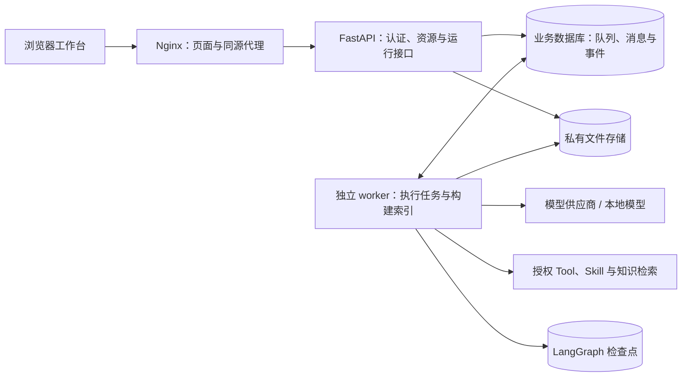

<p align="center">
  
</p>

# Y-Point

**可自行部署的智能助手平台，让 Agent、知识库、工具和文件交付在同一个工作台中协作。**

Y-Point 提供 React 工作台和 FastAPI 服务端。你可以接入模型供应商，创建和共享 Agent，通过多轮对话检索私有资料、调用授权工具，并生成可下载的文件。独立 worker 负责后台执行，消息、运行事件和检查点支持进度追踪与会话恢复。

[快速开始](#快速开始) · [文档](docs/README.md) · [部署手册](docs/deployment-guide.md) · [参与贡献](CONTRIBUTING.md) · [MIT 许可证](LICENSE)

## 核心能力

| 能力 | 说明 |
| --- | --- |
| 多模型接入 | 支持 OpenAI、兼容 OpenAI 协议的服务、Anthropic、Ollama、Azure OpenAI、Gemini 和 Bedrock，提供模型发现、能力验证及用量记录。 |
| Agent 与多轮会话 | 自定义提示词、模型和预算；指定用户共享 Agent，会话、文件和运行按实际用户隔离；支持会话模型切换。 |
| 知识库与可追溯检索 | 处理文本、Office、PDF、HTML 和配置文件，支持本地 OCR、关键词与向量混合检索，区分原文证据与模型解释。 |
| Skill 与报告模板 | 管理可版本固定的 Skill 文件包、参考资料和脚本；通过 DOCX 模板与字段契约交付报告。 |
| Tool 与 MCP | 接入 Python/Bash 脚本及 MCP 工具，提供授权、依赖准备、执行限制和调用记录。 |
| 文件与运行追踪 | 上传对话附件、按需读取历史产物并生成文件；通过 SSE 查看输出、工具调用、耗时及已报告 Token，支持进度恢复与取消。 |

功能与限制详见 [架构与业务概览](docs/architecture.md)、[会话与运行](docs/runs-and-sessions.md) 和 [知识库指南](docs/knowledge-base.md)。

## 快速开始

推荐先使用 Docker 在本机运行完整服务。需要已启动的 Docker Engine/Desktop、Docker Compose 插件 v2.24+ 和 Python 3.12+；无需在宿主机安装项目的 Node/Python 依赖。

```bash
git clone https://github.com/ExileLine/y-point.git
cd y-point

# 首次部署：构建镜像、启动服务，并交互创建首位管理员。
python3 scripts/deploy_all.py --create-admin admin
```

启动后打开 **http://127.0.0.1:18080**，使用刚创建的管理员账号登录。密码在终端中输入，不作为命令参数传递。新部署默认 HTTP，不需要证书；已有部署保留原协议和配置。

首次登录后：

1. 在模型管理中创建供应商连接，录入或发现模型，并验证所需能力。
2. 创建 Agent，选择可用模型；按需关联知识库、Skill 或 Tool。
3. 进入会话，发送消息或上传资料，查看回答、引用和生成文件。

后续更新可重新运行 `python3 scripts/deploy_all.py`，已有管理员无需重复创建。首次构建需要访问基础镜像和依赖源；实际模型使用需要可访问的供应商或本地模型服务。

| 使用场景 | 入口 |
| --- | --- |
| 内网服务器部署、对外端口和可选 HTTPS | [部署手册](docs/deployment-guide.md) |
| 启用本机脚本沙箱 | [沙箱部署说明](docs/deployment-guide.md#可选本机脚本沙箱) |
| 修改代码并启动开发服务 | [本地开发](docs/local-development.md) |
| 手动部署并理解 Dockerfile / Compose | [部署步骤](docs/deployment-guide.md#3-手动部署理解一键脚本执行的步骤) · [逐步讲解](docs/deployment-walkthrough.md) |

## 系统架构



默认 Docker 部署使用 PostgreSQL；本地开发默认使用 SQLite，业务数据库也支持 MySQL。文件正文保存到私有本地目录或 S3。API 与 worker 独立运行，当前主执行链无需 Redis、Celery 或 supervisor。

主要技术：Python 3.12+、FastAPI、SQLAlchemy / Alembic、DeepAgents / LangGraph、React、TypeScript、Ant Design、Vite。模块职责与数据边界见 [架构文档](docs/architecture.md)。

## 文档导航

按任务阅读的完整目录见 **[文档总览](docs/README.md)**。

| 主题 | 文档 |
| --- | --- |
| 安装、开发与部署 | [本地开发](docs/local-development.md) · [部署手册](docs/deployment-guide.md) · [部署配置参考](docs/deployment.md) |
| 配置与模型 | [运行限额与参数](docs/configuration.md) · [认证、授权与模型](docs/authentication-and-models.md) |
| 对话与文件 | [Run、会话与恢复](docs/runs-and-sessions.md) · [文件存储与附件](docs/artifacts.md) |
| 扩展助手能力 | [Skill 与报告模板](docs/skills.md) · [Tool、沙箱与 MCP](docs/tools.md) · [知识库与检索](docs/knowledge-base.md) |
| 开发与验证 | [架构与模块](docs/architecture.md) · [数据库与测试](docs/testing.md) · [贡献指南](CONTRIBUTING.md) |

开发环境启动后可在 API 的 `/docs` 查看交互式接口文档。具体接口、参数、授权和错误边界以专题文档及当前接口契约为准。

## 使用边界

- 自行部署不等于离线运行。模型请求按供应商配置发送，调用可能产生费用；OCR 使用本地引擎，模型能力与实际效果需按任务验证。
- 脚本 Tool 需要显式启用 Docker 沙箱。本机方案让受信任的 API/worker 接入宿主 Docker，正式多租户执行需要单独设计执行引擎与隔离，详见 [权限边界](docs/deployment.md#启用本机真实脚本沙箱)。
- 项目持续迭代。服务健康检查和本机回归有各自的验证范围；正式使用前，需验证实际模型、业务文件、目标容量以及数据库与文件备份恢复。数据、日志和升级要求见 [部署手册](docs/deployment-guide.md)。

## 参与贡献

欢迎通过 [Issues](https://github.com/ExileLine/y-point/issues) 反馈可复现问题、讨论需求，或提交 Pull Request。

开始前请阅读 [贡献指南](CONTRIBUTING.md)，了解开发环境、代码约定、验证方法和提交说明。报告问题时请移除密钥、令牌、私有文档和个人数据。

## 许可证

本项目采用 [MIT License](LICENSE)。
