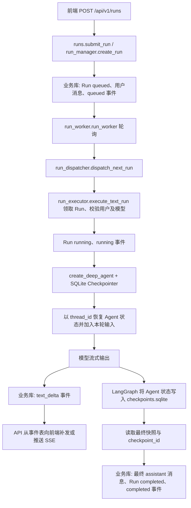

# Y-Point 服务端

Y-Point 智能助手平台后端。需求见 `y-point-dev.txt`，开发与验收清单分别见 `y-point-server-todo.md`、`y-point-web-todo.md`。

## 本地开发

使用 Python 3.12，并通过 `uv sync --group dev` 安装锁定的依赖。默认加载 `.env.development`；数据库类型、连接参数和 Redis 开关以对应环境配置为准。当前开发配置使用项目根目录的 SQLite 数据库 `y_point.db`。`.env.example` 仅说明配置项，不是可直接启动的配置文件；密钥应放在私有环境配置或环境变量中。

开发环境可在不提交的 `.env.development.local` 中设置 `SECRET_KEY`，它会覆盖 `.env.development` 中的占位值。使用至少 32 字节的随机密钥；修改后需重启服务，旧访问令牌会失效。

```bash
uv run alembic upgrade head
uv run uvicorn app.main:app --reload
uv run pytest -q
```

健康检查接口为 `/api/v1/health`，接口文档为 `/docs`。启动时会检查数据库连接；Redis 是否初始化由 `REDIS_ENABLED` 控制。M2 已在独立 MySQL 测试库验证迁移与供应商/模型 HTTP 流程；PostgreSQL 及其他模块的跨数据库兼容性仍需验证。

## M1 认证与用户管理

先运行 `uv run alembic upgrade head`，再创建首位管理员。命令会交互式读取密码，不将密码写入命令历史；密码需为 12 位以上、包含大小写字母和数字，UTF-8 编码不超过 72 字节。已存在有效管理员时，该命令会拒绝再次初始化。

```bash
uv run python -m app.cli.create_admin admin --mail admin@example.com
```

认证接口：`POST /api/v1/auth/login`（`identifier` 可为用户名或邮箱）、`POST /api/v1/auth/refresh`、`POST /api/v1/auth/logout`、`GET/PUT /api/v1/auth/me`、`POST /api/v1/auth/password`。登录返回有效期 7 天的 Bearer JWT 和有效期 30 天的刷新令牌；刷新令牌每次使用后轮换，服务端只保存其 SHA-256 摘要。访问令牌每次请求都会核对数据库中的用户状态、令牌版本和会话，登出、改密、重置密码、停用或变更角色可立即撤销旧令牌。

M1 路由的成功结果使用 `api_response` 返回 `code`、`message` 和可选的 `data`；业务错误使用 `CustomException`，保留对应 HTTP 状态和业务码。退出、改密及重置密码成功时返回 HTTP 200 与成功消息。路由的 OpenAPI `summary` 使用中文。

在 `/docs` 中先调用登录接口，复制响应 `data.access_token`，点击页面右上角 **Authorize** 并只粘贴令牌本身。Swagger UI 会自动添加 `Authorization: Bearer <token>`；直接调用 API 时则需自行发送完整请求头。两个 `PUT` 更新接口仅修改请求体中提供的字段。

管理员接口：`POST/GET /api/v1/users`、`GET/PUT /api/v1/users/{user_id}`、`POST /api/v1/users/{user_id}/reset-password` 和 `GET /api/v1/users/audit/events`。普通用户只能读取或修改自己的资料；管理员可创建、查看、启停用户及调整角色。用户创建和密码重置由管理员设置初始密码，邮件邀请流程尚未实现。连续 5 次登录失败会在 15 分钟内限制该账号和来源 IP。审计记录包含操作、操作者、目标用户和时间，不保存密码或明文令牌。

`SECRET_KEY` 用于签署 JWT，本地配置也应替换为至少 32 字节的随机值；生产和预发布环境的短密钥会阻止服务启动。不要在前端存储或记录明文刷新令牌。当前登录限流以数据库为准，跨数据库高并发领取及 PostgreSQL/MySQL 迁移尚未验证。

## M2 供应商连接与模型目录

M2 的独立开发项已基本完成，可以继续开发 M3；全量验收尚未完成。已交付供应商与模型管理、加密凭据、模型发现和批量导入、最小文本测试、逐项能力探测、脱敏调用记录、用量与估算成本，以及受限故障重试。本地 OpenAI 兼容连接和 Ollama 真实模型已验证；Azure OpenAI、Gemini Developer API、AWS Bedrock 完成适配及模拟测试，仍需真实云服务验收。OpenAI 官方、Anthropic 和 PostgreSQL 的真实验收按当前计划延期；运行时模型调用记录已在 M3 接入基础版本，Agent 引用限制与备用模型切换仍属 M3/M4。详细完成项和待验收项见 `y-point-server-todo.md`。

运行 `uv run alembic upgrade head` 升级到 `006`。管理员可管理 `/api/v1/providers` 供应商连接和 `/api/v1/models` 可选模型，普通用户不能访问这些配置。`GET /api/v1/providers/kinds` 返回各供应商适用的连接字段和建议地址；当前支持 `openai_compatible`、`openai`、`anthropic`、`ollama`、`azure_openai`、`gemini`、`bedrock`。Ollama 可用 `http://127.0.0.1:11434/v1` 且无需 API 密钥。模型保存外部 ID、显示名、能力标签、上下文窗口及每百万 Token 的输入/输出价格，价格币种默认为 `USD`。未填写的能力保存为空列表，人工填写或导入的能力不会自动标为已验证。

使用 API 密钥或自定义请求头前，在私有环境配置中设置独立的 `CREDENTIAL_ENCRYPTION_KEY`。它必须是 Fernet 密钥，可用 `uv run python -c "from cryptography.fernet import Fernet; print(Fernet.generate_key().decode())"` 生成。开发环境的 `.env.development.local` 已设置本机密钥且被 Git 忽略。请保留并备份该密钥：更换或丢失后，已保存的供应商凭据无法解密。API 只返回 `has_api_key` 和 `has_custom_headers`；`PUT` 中省略凭据字段会保留原值，明确传入 `null` 会清除对应凭据。

### 模型录入流程

1. `POST /api/v1/providers` 创建连接。供应商地址支持 HTTP 和 HTTPS；HTTP 会明文传输 API 密钥和自定义请求头，仅适合可信网络。
2. `POST /api/v1/providers/{provider_id}/test` 检查供应商的模型发现能力，返回 `available`、`latency_ms`、`upstream_status_code`、`model_count`、模型 ID 列表 `models`、可选名称映射 `model_names` 和失败类别。`GET /api/v1/providers/{provider_id}/available-models` 返回可供选择的 `external_id`、建议 `display_name` 和 `already_added`；上游未提供名称时以 ID 作为建议名称。
3. 选择模型后调用 `POST /api/v1/models/import`，一次最多提交 100 个模型。请求体示例：

   ```json
   {"provider_id": 1, "models": [{"external_id": "gpt-4o-mini", "capabilities": ["text"]}]}
   ```

   `display_name` 省略时使用模型 ID；能力、上下文和价格可留空。响应的 `created` 包含新增或恢复的模型，`skipped_existing` 列出已录入的模型 ID；重复提交不会重复建模。手动录入列表外模型仍可使用 `POST /api/v1/models`。
4. 按需调用 `POST /api/v1/models/{model_id}/test` 实测最小文本请求，或向 `POST /api/v1/models/{model_id}/capabilities/test` 提交 `{"capability":"text"}`、`{"capability":"streaming"}`、`{"capability":"tools"}`、`{"capability":"structured_output"}`、`{"capability":"vision"}` 或 `{"capability":"reasoning_summary"}` 逐项验证能力；最后通过 `POST /api/v1/models/{model_id}/default` 指定默认模型。探测只在管理员主动请求时运行，可能产生少量费用。

如果供应商没有 `/models` 接口，连接测试和发现接口会返回 `model_list_unavailable`，不会把它误判成密钥无效。此时用 `POST /api/v1/models` 手动录入已知的供应商模型 ID，再调用 `POST /api/v1/models/{model_id}/test` 进行可配置的最小推理探测；响应包含可用性、耗时、上游状态与脱敏故障类别。模型列表接口不可用时，平台无法代替供应商枚举模型。

Azure OpenAI 连接填写资源根地址（如 `https://example.openai.azure.com`）、API Key 和 API 版本；模型的 `external_id` 填部署名称。数据面密钥不能列出部署，发现接口固定返回 `model_list_unavailable`，需手动录入并调用模型测试。Gemini Developer API 连接填写 API Key，服务根地址默认 `https://generativelanguage.googleapis.com`，版本默认为 `v1beta`；发现接口翻页读取支持 `generateContent` 的模型。Bedrock 连接填写 AWS Region，不填写 API Key；服务使用进程的 AWS 凭据链和该区域的 Bedrock 控制面/Converse API。发现接口列出文本基础模型，推理配置文件 ID 可手动录入并单独探测。三类连接目前通过模拟上游和 SDK 配置测试，真实云服务调用待验收。

上游调用失败时，连接测试与发现接口返回故障类别和空列表，不写入模型，也不回传上游原始错误或凭据。模型测试返回 `available`、`latency_ms`、`upstream_status_code` 和脱敏的 `failure`，不返回生成内容。有用量时返回 `input_tokens`、`output_tokens`；仅当用量和每百万 Token 的输入/输出单价均存在时，返回字符串形式的 `estimated_cost` 及 `price_currency`。成本是估算值，不包含供应商折扣或其他计费项目。原有 `/test` 只验证文本聊天调用；逐项接口可验证文本、流式输出、工具调用、固定结构化对象和固定四色图像。公开推理摘要探测仅对 `openai` 类型请求 Responses API 的 `reasoning.summary`，只在完成的响应中存在非空 `summary_text` 时通过；其他类型返回 `unsupported_capability`，不读取或保存隐藏推理内容、公开摘要及正文。该探测目前通过模拟协议测试，尚无 OpenAI 官方真实调用验收。结构化探测采用函数调用模式，验证解析结果是否严格符合固定对象，不代表模型能满足任意业务 JSON Schema。视觉探测通过内嵌 PNG 检查四色象限顺序，不代表复杂图像理解能力；视觉请求最多允许 512 个输出 Token，实际计费由供应商决定。非文本模型可能返回 `invalid_request`。供应商下仍有有效模型时不能删除连接，停用连接会清除其模型的默认标记。

连接、文本和逐项能力探测在上游返回 HTTP `502/503/504` 时会等待约 200 毫秒后最多重试一次；认证失败、无效请求、限流、超时和网络错误不会自动重试。流式探测一旦收到片段，即使随后返回网关错误也不会重试。`latency_ms` 包含等待及重试时间，响应和调用记录只保存最终结果；上游可能对两次请求分别计费。

每次管理员发起的模型文本或逐项能力测试都会写入 `yp_model_call_record`，成功和失败均保存模型/供应商 ID、操作者、耗时、HTTP 状态、脱敏故障类别、可得的 Token 用量与估算成本；不保存提示词、生成正文、推理摘要或凭据。测试响应的 `record_id` 对应此记录。管理员可用 `GET /api/v1/models/{model_id}/calls?page=1&size=20` 分页查看，即使模型随后被逻辑删除，历史仍可查询。逐项探测成功会写入 `verified_capabilities`，失败会撤销该项验证；修改模型能力、模型 ID 或供应商调用配置会清空验证状态。`capabilities_verified` 仅在所有已填写的能力均通过探测时为真；当前可探测文本、流式、工具、结构化输出、视觉和 OpenAI 公开推理摘要。停用的模型或供应商不能发起新测试。M3 文本 Run 的运行时调用也记录在此表，`call_type` 为 `runtime_run`，并带有 `run_id`。

`005` 迁移给模型增加全局唯一的默认占位键；并发设置默认模型时，数据库会阻止两个模型同时成为默认项。停用或删除模型及供应商时同步清除占位键。升级前若已有多个默认标记，迁移保留 ID 最大的一个。

运行时可用 `app.services.model_adapter.build_chat_model(model, provider)` 将有效配置转换为 LangChain 聊天模型，支持 OpenAI、OpenAI 兼容协议、Anthropic、Ollama、Azure OpenAI、Gemini Developer API 及 Bedrock；停用或不匹配的配置会被拒绝。已使用本地连接和模型 `id=1` 实测一种 OpenAI 兼容供应商的文本、流式输出、工具调用及 Token 用量；同一模型的最小调用使用错误密钥时被归类为 `authentication`。另以本机 Ollama 的 `deepseek-r1:1.5b` 实测 `/v1/models` 发现 4 个模型、最小文本调用、LangChain 适配调用，以及文本和流式能力探测，均返回用量；该验证未创建业务库记录，也未检查工具或视觉能力。模型列表仅代表服务端列出该 ID，具体能力仍需逐项探测。OpenAI 官方与 Anthropic 的真实调用、Azure/Gemini/Bedrock 的真实云调用、完整 Agent 编排、Agent 调用记录、非文本模型测试、生产网络边界及 PostgreSQL 迁移仍待验证。

本机 `gemma4:31b-cloud` 又完成模型发现、最小文本、文本、流式、工具、固定结构化输出和四色视觉探测，五项能力均返回 Token 用量；错误模型 ID 被归类为 `model_not_found`，公开摘要按 Ollama 类型返回 `unsupported_capability`。此验证不写入业务数据库，可用 `YPOINT_TEST_OLLAMA_GEMMA4=1 uv run pytest -q tests/test_capability_probe.py::test_live_ollama_gemma4` 重复执行。

M2 数据库验证范围：SQLite 开发库已升级到 `006`；独立 SQLite 库完成 `005 → 006 → 005 → 006` 和迁移差异检查。MySQL 先前已在独立临时库验证 `001 → 005`、`005 → 003 → 005`、ORM 读写和 HTTP 流程；本轮另在独立临时库完成 `001 → 006 → 005 → 006` 与两次迁移差异检查，测试库均已删除。PostgreSQL 当前无可用本地服务，按本轮约定延期验证，不能据此声明 PostgreSQL 兼容。MySQL 的负载与生产部署仍需单独验收。

## M3 运行时开发进度

`015` 迁移新增 `yp_artifact` 文件元数据表。`POST /api/v1/artifacts/uploads` 使用 Bearer 令牌和 `multipart/form-data` 的重复 `files` 字段，一批可上传 1 到 5 个文件，每个最多 10 MiB；当前接受 UTF-8 `.txt`、具有 PDF 签名的 `.pdf`、经 Office 容器结构与解压上限校验的 `.docx`/`.xlsx`。接口返回各文件的 ID、名称、类型、字节数及 SHA-256，不返回私有存储键。`GET /api/v1/artifacts/{artifact_id}` 查询元数据，`GET /api/v1/artifacts/{artifact_id}/download` 下载原文件，`DELETE /api/v1/artifacts/{artifact_id}` 撤销访问并删除文件；每次操作都重新校验登录用户和所有权，跨用户按不存在处理。二进制下载直接返回文件流，其余成功响应遵循 `api_response`。例如上传两个文件：

```bash
curl -H "Authorization: Bearer <access_token>" -F "files=@report.docx" -F "files=@table.xlsx" http://127.0.0.1:7769/api/v1/artifacts/uploads
```

文件正文默认放在 Git 忽略的 `.run-private/artifacts`，可以用 `ARTIFACT_STORAGE_DIR` 指向仅服务进程可访问的私有目录；元数据保存在业务库，文件不写入消息表、事件表或 `checkpoints.sqlite`。新目录权限为 700，文件权限为 600；上传使用随机存储键和临时文件转正，失败批次会回滚业务记录并清理本批文件。部署时还应在反向代理设置上传大小上限，执行恶意软件扫描，并制定备份与孤儿文件清理策略。当前仅交付私有上传/下载基础，文件尚不能作为 Run 输入，模型也不会自动解析文档或生成产物；这些分别安排在 M4 和 M10。升级现有业务库需运行 `uv run alembic upgrade head`；临时 SQLite 库已验证 `015` 升级与迁移差异检查。

M3 已开始验证 DeepAgents 的持久化运行基础。`app.services.runtime_checkpoint` 提供同步和异步 SQLite Checkpointer 上下文入口，由调用方传入独立的文件路径并负责限定访问权限；退出上下文时关闭连接。假模型测试已覆盖审批中断、独立 Python 进程重启后恢复工具执行、后续流式对话，以及异步连接重开恢复。真实 Ollama `gemma4:31b-cloud` 已通过完整 DeepAgents 图的工具调用、流式事件和 Token 用量验证，使用的是内存检查点。可运行：

```bash
uv run pytest -q tests/test_runtime_checkpoint.py
YPOINT_TEST_OLLAMA_M3=1 uv run pytest -q tests/test_runtime_checkpoint.py::test_live_ollama_deep_agent_tool_stream_and_usage
```

`007`/`008` 迁移新增 `yp_agent_run` 与 `yp_agent_run_event`。内部 `run_manager` 在同一事务创建排队运行和首个状态事件，支持提交键幂等、原子领取、心跳租约、审批暂停、取消确认、过期回收及按所有者和游标读取状态事件。取消请求遇到 worker 心跳推进版本号时会重新读取并有限次重试，避免正常竞争导致取消失败。同一用户的后续 Run 可复用检查点线程；跨用户复用及同线程已有未结束运行时的新提交会被拒绝。租约过期会结束当前运行，不自动重做可能产生外部副作用的工作。可运行 `uv run pytest -q tests/test_run_manager.py` 验证这些边界。

`009` 迁移新增 `yp_agent_run_message`，将用户输入与排队任务、最终可见回答与完成状态分别在同一业务事务写入。`run_dispatcher` 从数据库扫描排队 Run，并在领取时校验用户、模型与供应商；`run_executor` 使用 DeepAgents 和独立 SQLite 检查点执行文本任务，续租时响应取消或用户停用。独立开发 worker 在项目目录运行 `uv run python -m app.cli.run_worker` 即可启动，默认检查点文件为 `.run-private/checkpoints.sqlite`，该目录受 Git 忽略且新建时权限为 700；使用 `--once` 只处理一轮。自定义 `--checkpoint-db` 时必须传入真实可写路径，worker 会在领取任务前检查文件可用性。运行前先执行 `uv run alembic upgrade head`；检查点文件包含消息和工具状态，应放在仅执行器可访问的位置。可运行 `uv run pytest -q tests/test_run_executor.py`，或显式设置 `YPOINT_TEST_OLLAMA_M3_RUN=1` 运行其中的本机 Ollama 真实链路测试。

`012` 迁移新增 `yp_run_worker_heartbeat`，用于监测独立 worker 进程。常驻 worker 启动后登记实例 ID，空闲和执行模型时均默认每 5 秒更新心跳，正常退出时标记停止；`--once` 不登记常驻心跳。`GET /api/v1/health/worker` 无需令牌，有未停止且 20 秒内更新的实例时返回 HTTP 200，否则返回 HTTP 503。管理员使用 `GET /api/v1/runs/workers/status` 可查看有效 worker 数、最近心跳、排队 Run 数、最老排队时长及租约过期但尚未回收的 Run 数。`GET /api/v1/health` 只反映 API 存活，不能代表 worker 可用。worker 全部停止时，排队 Run 不会自动执行；重启后才会回收过期租约并继续扫描队列。

心跳只能发现执行器不可用，不能自行重启已经退出的进程。部署时应由 `launchd`、`systemd`、Docker 或 Kubernetes 的进程管理机制负责自动拉起 worker，并监控 `/api/v1/health/worker` 的 HTTP 状态及管理员接口中的排队时长。worker 进程仍有新鲜心跳但队列持续积压时，也应检查模型阻塞、执行容量和数据库故障。业务 Run 的租约心跳与进程心跳分开记录；新 worker 启动后会回收旧执行器遗留的过期 Run。若最新检查点不能证明当前 Run 已完成，则标为 `failed/lease_expired`，不会自动重做可能已发生副作用的调用。worker 启动时及其后每小时会分批清理最后心跳早于 30 天前的进程记录，每批最多 1000 行，失联且未正常退出的实例也会清理；业务 Run、事件与检查点不受影响。真实子进程测试已覆盖模型请求发出后强制终止 worker、租约到期后由新 worker 回收，以及不自动重复上游请求；测试在临时库中加速租约到期。可运行 `uv run pytest -q tests/test_worker_monitor.py` 验证空闲/繁忙心跳、失联判断、进程崩溃回收、历史清理和接口权限。

`013` 迁移为模型调用记录增加可空 `run_id`。文本 Run 实际调用模型后，执行器按本次运行片段写入一条 `runtime_run` 记录；成功结果与 Run 完成状态在同一业务事务中提交，受控失败也保留脱敏故障类别。管理员在现有模型调用记录接口中可按 `run_id` 辨认运行来源。Token 用量从本轮新生成消息的上游 `usage_metadata` 汇总；上游未提供用量时保留空值，仅在输入和输出 Token、模型单价均可得时估算成本。该记录不包含对话正文、凭据或检查点内容，且不等同于已实现 Token/成本预算；执行器意外崩溃时可能来不及写入调用结果，即使最终回答随后从检查点得到补偿也不会虚构调用耗时或补造记录。

`014` 迁移为 Run 增加 `model_timeout_seconds`，既有记录默认 120 秒。创建文本 Run 时可传 1 到 120 秒，例如 `{"model_id":1,"input_text":"你好","model_timeout_seconds":60}`；响应会返回保存的上限，同一 `request_key` 改变上限会报配置冲突。执行器使用该值与自身配置的更短上限，超过时取消模型任务，将 Run 标为 `timed_out`，故障码为 `execution_timeout`。该时限从实际模型生成开始计算，不包含队列等待时间，也不限制 Token 或估算成本。

普通用户使用 Bearer 令牌调用 `POST /api/v1/runs`，请求示例为 `{"model_id":1,"input_text":"你好","request_key":"chat-001"}`。可调用 `GET /api/v1/runs/{run_id}` 查看状态、`GET /api/v1/runs/{run_id}/messages` 获取输入和最终回答、`POST /api/v1/runs/{run_id}/cancel` 请求取消。`GET /api/v1/runs/{run_id}/events?after=0` 按序号补发事件，`GET /api/v1/runs/{run_id}/stream` 使用 Bearer 请求头订阅 SSE；断线重连传 `Last-Event-ID: <run_id>:<sequence>`。SSE 推送已持久化的状态和 `text_delta` 模型文本事件，空闲时有心跳，终态发送完毕后关闭；最终回答仍以消息接口中的完整正文为准。长连接每轮读取前会复核用户、令牌版本、access token 有效期和数据库会话；授权失效时流会关闭，客户端重新认证后可用原事件游标续接。浏览器原生 `EventSource` 无法自定义 Bearer 请求头，当前应使用支持请求头的流式客户端；浏览器原生接入需在 M4 确定认证方式。启动独立 worker 后，新建运行才会进入执行。可运行 `uv run pytest -q tests/test_run_api.py` 验证公开接口及授权边界。

`010` 迁移为运行事件增加可公开的文本片段列。`011` 迁移增加审批请求表：运行时中断若包含待审核工具，系统只保存工具名和由服务端密钥计算的 HMAC-SHA256 参数摘要，不保存原始参数或中断描述。所有者可用 `GET /api/v1/runs/{run_id}/approval` 查询，再向 `POST /api/v1/runs/{run_id}/approval/decision` 发送 `{"decision":"approve"}` 或 `{"decision":"reject"}`；重复、过期和跨用户决定会被拒绝。拒绝会在同一业务事务中将 Run 标为 `cancelled` 并追加 `approval_rejected` 终态事件；同意只保存决定，不在 HTTP 请求中执行工具。独立 worker 会关闭到期的待处理审批并将等待中的运行标为超时。内部调度器在提供工具解析器时可以恢复已批准的 Run；正式 worker 还未配置工具解析器，因此公开文本运行不会触发工具审批。

### 工具审批接口与前后端交互

审批针对配置为“执行前中断”的工具，不是所有工具调用都要人工确认。DeepAgents 可通过 `interrupt_on={"send_email": True}` 指定需要审批的工具；例如只读的 `web_search` 可以直接运行，而向外部发送邮件的 `send_email` 先等待确认。是否需要人工审批与服务端的工具使用授权是两项不同检查：即使不需要审批，工具调用仍须符合权限策略。

以用户要求“将报告发给客户”为例，工具接入后的预期交互如下：

1. 前端创建 Run 并订阅 `/api/v1/runs/{run_id}/stream`。Agent 准备调用需审批的工具时，LangGraph 保存检查点，Run 变为 `waiting_for_approval`，并持久化状态事件和 `pending` 审批请求；前端收到状态事件后展示审批入口。
2. 前端携带 Bearer 令牌调用 `GET /api/v1/runs/{run_id}/approval`，获取当前用户所属 Run 的最新审批请求：`id`、`run_id`、`actions`、`state`、`expires_at` 和 `decided_at`。每项 `action` 只有工具名 `name` 与参数摘要 `arguments_hash`，不含收件人、正文等原始参数；没有审批请求时返回 404。默认到期时长为一小时，未决定而到期的请求会由 worker 标为 `expired`，关联的等待中 Run 变为 `timed_out`。
3. 用户同意或拒绝后，前端调用 `POST /api/v1/runs/{run_id}/approval/decision`，请求体为 `{"decision":"approve"}` 或 `{"decision":"reject"}`。仅 Run 所有者能对尚未过期的 `pending` 请求决定一次；接口返回更新后的审批状态 `approved` 或 `rejected`。重复提交、过期或 Run 状态已变化时返回 409。
4. 用户拒绝后，Run 在同一事务中进入 `cancelled`，SSE 会补发带 `approval_rejected` 故障码的终态事件；前端可关闭等待状态。用户同意后，Run 仍为 `waiting_for_approval`，前端不能将 `approved` 当作工具已执行或回答已完成。内部调度器在提供工具解析器时会再次领取该 Run，重新校验用户和工具授权，并核对检查点 ID、工具名与参数摘要后恢复执行；若又遇到需审批动作，会生成新的审批请求。正式 worker 尚未接入工具解析器，该步骤目前只有假模型内部测试验证。

当前正式 worker 调用执行器时不提供工具解析器。DeepAgents 即使收到 `tools=[]` 也会自动加入文件和子 Agent 等内置工具；执行器用工具白名单中间件从模型请求中移除未授权工具，并在实际调用前再次拒绝。工具解析时还会拒绝与内置工具重名或重复的业务工具。普通文本 Run 因而不会执行工具，也不会触发审批；这两个接口目前用于审批协议基础和测试。内部测试已验证批准后恢复、连续两次审批、撤权、摘要不匹配和内置工具越权时拒绝执行。未来接入工具时，还需要提供经过脱敏且足以让用户判断操作内容的展示信息；只有参数哈希无法让用户核对实际收件人或操作目标。

本地 SQLite 已升级到 `014`。SQLite Checkpointer 会在指定文件中保存完整运行状态，可能包含消息和工具结果；当前仅作为本地开发验证。执行器现在将 `run_id` 和工具数量 `tool_count` 写入检查点元数据。worker 在把过期运行标为失败前，使用不会调用模型的只读图读取最新检查点：仅当其 `run_id` 与当前 Run 相同、`tool_count=0`、图已结束且有最终可见回答、用户仍可用时，才以版本和过期租约条件原子补写业务消息、`completed` 状态与事件。恢复过程不重放模型或工具；取消中的运行、旧版缺少任一标记的检查点、包含业务工具的 Run、错误归属及待执行步骤仍走 `lease_expired`。测试覆盖业务提交前崩溃后的补写与后续续聊，但检查点和业务库仍没有跨库事务，崩溃期间的模型调用记录也可能缺失。工具事件、Token/成本预算、长期保留清理及生产数据库适配仍属后续 M3 开发项，进度见 `y-point-server-todo.md`。

### Run Worker 调用链路

API 服务负责接收请求和查询结果；`run_worker` 是需要单独启动的进程，负责从业务库领取排队任务并调用模型。前端无需启动 worker，但只有 worker 正在运行时，排队中的 Run 才会被执行。下面以第一次提交 `{"model_id":1,"input_text":"我叫小明","request_key":"chat-001"}` 为例：



各模块的职责与关键数据如下：

| 模块 | 职责 |
| --- | --- |
| `app.api.v1.runs.submit_run` | 校验 Bearer 用户及模型可用性，调用 `create_run`，提交创建事务并返回 `run_id`、`thread_id` 和状态。 |
| `app.services.run_manager` | `create_run` 保存排队任务、输入和首个事件；`claim_run` 领取租约；`append_text_delta` 写增量事件；`complete_run` 写最终回答、检查点 ID 和完成状态；`replay_events` 按游标读取事件。 |
| `app.cli.run_worker.run_worker` | 初始化检查点文件，先尝试补偿可证明已完成的过期 Run，再回收其他过期租约与审批，调用调度器扫描排队任务；无任务时按间隔等待。 |
| `app.services.run_dispatcher` | 选择最早的 `queued` Run，重新校验用户、模型及供应商，并通过 `model_adapter` 构造聊天模型。 |
| `app.services.run_executor` | `execute_text_run` 领取 Run、读取本轮输入并构造 DeepAgents；`_stream_model_text` 保存模型增量文本，`_watch_run` 续租并监测取消；结束时读取检查点快照并处理结果。 |
| `app.services.runtime_checkpoint` | 打开并关闭独立的 LangGraph SQLite Checkpointer；默认文件路径由 `run_worker` 指定为 `.run-private/checkpoints.sqlite`。 |
| `app.api.v1.runs.stream_events` | 从已提交的运行事件读取数据，按游标补发 `state` / `text_delta` 并推送 SSE；它不直接读取模型流。 |

`yp_agent_run` 保存任务身份、所属用户、`model_id`、`thread_id`、状态、租约、事件序号及最近的 `checkpoint_id`。`yp_agent_run_message` 保存每轮用户输入和完成后的最终可见回答，供业务查询；`yp_agent_run_event` 保存状态变化和生成期间的 `text_delta`，供 SSE 与断线续传。`checkpoints.sqlite` 保存 LangGraph 按 `thread_id` 管理的 Agent 状态，可能包含历史消息、工具结果及待执行步骤。它与消息表不是内容完全相同的两份副本；worker 只从消息表读取**本轮输入**，历史上下文由 DeepAgents 从检查点恢复。实际送给模型的上下文以 Agent 当前状态为准，不能假定每次都原样发送全部历史记录。

每轮开始调用模型前，执行器会比较检查点中的当前 `checkpoint_id` 与业务库内该线程最近一次已完成 Run 记录的 `checkpoint_id`。若上轮业务事务尚未完成且租约已过期，worker 会先尝试从带有相同 `run_id` 的完整检查点补写最终回答；成功后，下一轮可正常续聊。检查点文件丢失、旧检查点缺少归属标记、图尚未结束或检查点被意外推进时，不能证明答案已完成，仍以 `failed` 和脱敏故障码 `checkpoint_mismatch` 阻止新 Run 使用不一致的上下文。检查点与业务库没有跨库事务，这些不一致情形不会被自动修复，不能仅重试相同的提交键。

正常状态流转是 `queued → running → completed`，每次状态变化都追加事件。生成过程中，`text_delta` 先在业务库提交，然后 SSE 才能发送该片段。LangGraph 在执行过程中写入检查点；执行结束后，worker 读取最终快照及 `checkpoint_id`，再在同一业务事务中保存最终 `assistant` 消息、`completed` 状态和状态事件。因此不能把所有模型输出理解为统一的“先写检查点，再写消息表”：增量文本写在事件表，最终回答写在消息表，检查点与业务库也不是同一个事务。失败、超时或取消会进入 `failed`、`timed_out` 或 `cancelled` 等终态；取消请求先进入 `cancel_requested`。不能仅凭已经收到 `text_delta` 就认为回答已完成。

第二轮对话新建一个 Run，使用新的 `request_key`，并在请求体中传入第一轮返回的 `thread_id`，例如 `{"model_id":1,"thread_id":"<第一轮的 thread_id>","input_text":"我叫什么？","request_key":"chat-002"}`。`request_key` 用于同一用户重复提交时返回已有 Run；新一轮应换一个键。新 Run 有自己的 `run_id` 和从 1 开始的事件序号；相同的 `thread_id` 让 DeepAgents 读取前一轮的检查点状态。同一线程必须等待上一轮进入终态后才能提交下一轮。前端恢复当前 Run 的流式输出时使用该 Run 的事件游标 `after` 或 `Last-Event-ID: <run_id>:<sequence>`；若需要完整的最终回答，读取 `GET /api/v1/runs/{run_id}/messages`。检查点文件丢失时，现有 worker 不会从业务消息表自动重建 Agent 历史上下文。

## 数据库迁移

Alembic 使用 `app.models.base.Base.metadata`，通过 `app.models` 注册模型。首个迁移 `001_initial.py` 创建现有 `Admin` 用户表和 `ApsTask` 定时任务表，表名遵循 `CustomBaseModel` 的前缀配置。`Admin` 是用户模型，后续认证和权限字段应在该模型上扩展，并以新增迁移同步数据库结构。修改模型后可运行 `uv run alembic check` 检查迁移差异。

`002_auth.py` 在 `yp_admin` 上新增角色、令牌版本和最近登录时间及用户名/邮箱唯一索引，另建刷新会话、登录尝试和审计表。已有数据库若存在重复用户名或邮箱，升级前需先清理重复数据，否则唯一索引创建会失败。

认证和审计表只保存用户 ID，不建立数据库外键。业务层在认证与查询时检查用户状态、权限及会话归属；后续删除和清理流程需处理相关记录。表与字段定义均带中文注释。

## Agent 运行时验证

项目锁定 `deepagents==0.7.29`。运行 `uv run pytest -q tests/test_deepagents_spike.py` 验证本地假模型的工具、Skill、流式事件、检查点、审批恢复与取消。实测版本、事件形态和待验证的真实模型/持久化能力见 `docs/deepagents-compatibility.md`。
