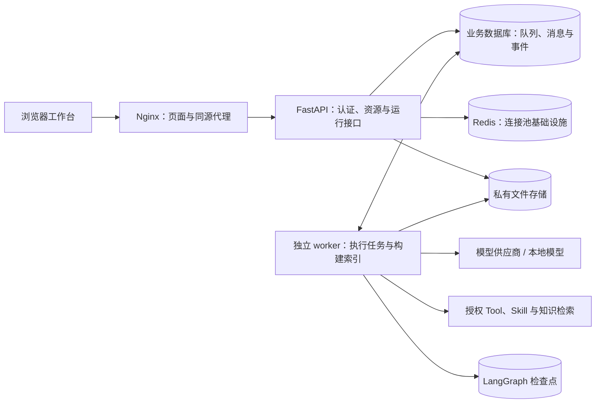

<p align="center">
  
</p>

# Y-Point

**可自行部署的智能助手平台，让 Agent、知识库、工具和文件交付在同一个工作台中协作。**

Y-Point 提供 React 工作台和 FastAPI 服务端。你可以接入模型供应商，创建和共享 Agent，通过多轮对话检索私有资料、调用授权工具，并生成可下载的文件。独立 worker 负责后台执行，消息、运行事件和检查点支持进度追踪与会话恢复；AG-UI 1.0 统一对话提交、公开历史、审批恢复及公开思考、工具、Skill 与交付过程。

[快速开始](#快速开始) · [文档](docs/README.md) · [部署手册](docs/deployment-guide.md) · [参与贡献](CONTRIBUTING.md) · [MIT 许可证](LICENSE)

## 核心能力

| 能力 | 说明 |
| --- | --- |
| 多模型接入 | 支持 OpenAI、兼容 OpenAI 协议的服务、Anthropic、Ollama、Azure OpenAI、Gemini 和 Bedrock，提供模型发现、能力验证及用量记录。 |
| Agent 与多轮会话 | 自定义提示词、模型和预算；指定用户共享 Agent，会话、文件和运行按实际用户隔离；支持会话模型切换。 |
| 知识库与可追溯检索 | 处理文本、Office、PDF、HTML 和配置文件，支持本地 OCR、关键词与向量混合检索，区分原文证据与模型解释。 |
| Skill 与报告模板 | 管理可版本固定的 Skill 文件包、参考资料和脚本；通过 DOCX 模板与字段契约交付报告。 |
| Tool 与 MCP | 接入 Python/Bash 脚本及 MCP 工具；MCP 支持 HTTP/HTTPS 与受控 stdio、API Key/Headers、按连接选择工具子集及指定用户共享、Run 内会话复用和跨审批保活，支持按所有者配置审批、对话内固定工具版本放行与撤销、逐项拒绝后继续、工具上下文占用诊断、可配置的工具搜索与 Schema 按需加载，以及大结果私有留存/预览/分段读取；显示名称和调用标识独立，工具版本显式升级，统一展示可调用预检、阻断原因与修复提示，保留执行限制与调用记录。 |
| 文件与运行追踪 | 上传对话附件、按需读取历史产物并生成文件；通过 AG-UI 1.0 + SSE 查看分段公开思考、工具和 Skill 过程、耗时及已报告 Token，支持持久化恢复、审批与取消；AG-UI 可携带会话版本仅提交新消息，公开历史按运行缓存，兼容完整历史提交。 |

功能与限制详见 [架构与业务概览](docs/architecture.md)、[会话与运行](docs/runs-and-sessions.md)、[AG-UI 接口与过程展示](docs/ag-ui.md) 和 [知识库指南](docs/knowledge-base.md)。

## 快速开始

推荐先使用 Docker 在自己控制的本机运行，以下命令包含 Python/Bash Tool 与 Skill 受管脚本所需的沙箱。需要已启动的 Docker Engine/Desktop、Docker Compose 插件 v2.24+ 和 Python 3.12+；无需在宿主机安装项目的 Node/Python 依赖。

```bash
git clone https://github.com/ExileLine/y-point.git
cd y-point

# 首次部署：构建应用和脚本沙箱镜像、启动服务，并交互创建首位管理员。
python3 -m ypoint_cli deploy --sandbox --create-admin admin
```

项目提供三种等价的命令入口，按宿主机环境选择其中一种即可：

| 环境 | 首次部署命令 | 使用条件 |
| --- | --- | --- |
| 仅使用 Docker 部署 | `python3 -m ypoint_cli deploy --sandbox --create-admin admin` | 在源码根目录运行，只需 Python 标准库，无需安装应用依赖。 |
| 使用 uv 的开发环境 | `uv run yp deploy --sandbox --create-admin admin` | 在源码根目录运行，`uv run` 使用项目虚拟环境，可能先同步应用依赖；开发环境可先执行 `uv sync --locked`。 |
| 已激活项目虚拟环境 | `yp deploy --sandbox --create-admin admin` | 已执行 `uv sync --locked` 安装项目，并激活虚拟环境，例如 `source .venv/bin/activate`。 |

三种入口调用同一套 CLI 实现，后续的子命令与参数一致。例如，显式使用 HTTP 部署可执行 `uv run yp deploy --sandbox --http`，也可换用 `yp deploy --sandbox --http` 或 `python3 -m ypoint_cli deploy --sandbox --http`。

**`--sandbox` 是脚本工具和 MCP stdio 容器执行的必要参数**：它为 API/worker 接入宿主 Docker，用于脚本依赖准备、试运行及正式执行；只部署聊天、知识库和内置文件生成时可省略，Python/Bash Tool、Skill 受管脚本与 MCP stdio 将不可用。此方式适用于受信任的本机或单机环境，正式多租户隔离要求见[沙箱部署说明](docs/deployment-guide.md#可选本机脚本沙箱)。

启动后打开 **http://127.0.0.1:18080**，使用刚创建的管理员账号登录。密码在终端中输入，不作为命令参数传递。新部署默认 HTTP，不需要证书；已有部署保留原协议和配置。

首次登录后：

1. 在模型管理中创建供应商连接，录入或发现模型，并验证所需能力。
2. 创建 Agent，选择可用模型；按需关联知识库、Skill 或 Tool。
3. 进入会话，发送消息或上传资料，查看回答、引用和生成文件。

后续更新使用相同入口运行 `deploy --sandbox`，已有管理员无需重复创建。例如，uv 环境执行：

```bash
uv run yp deploy --sandbox
```

纯 Docker 宿主机使用 `python3 -m ypoint_cli deploy --sandbox`；已激活项目虚拟环境时可使用 `yp deploy --sandbox`。**沙箱开关不会自动记住，后续部署继续带 `--sandbox`；遗漏会按基础配置重建服务并移除脚本执行所需的 Docker 接入。** 如果之前已省略它部署，现在重新运行带 `--sandbox` 的命令即可补开，无需再次创建管理员；请在无运行中任务时更新。首次构建需要访问基础镜像和依赖源；实际模型使用需要可访问的供应商或本地模型服务。

| 使用场景 | 入口 |
| --- | --- |
| 内网服务器部署、对外端口和可选 HTTPS | [部署手册](docs/deployment-guide.md) |
| 启用本机脚本沙箱 | [沙箱部署说明](docs/deployment-guide.md#可选本机脚本沙箱) |
| 修改代码并启动开发服务 | [本地开发](docs/local-development.md) |
| 手动部署并理解 Dockerfile / Compose | [部署步骤](docs/deployment-guide.md#3-手动部署理解一键脚本执行的步骤) · [逐步讲解](docs/deployment-walkthrough.md) |

如需部署成功后只保留当前沙箱镜像的 `pinned` 标签，可执行 `python3 -m ypoint_cli deploy --sandbox --http --prune-sandbox-images`；uv 环境可换用 `uv run yp deploy --sandbox --http --prune-sandbox-images`，已激活虚拟环境时可用 `yp deploy --sandbox --http --prune-sandbox-images`。该参数不检查旧 Tool/Run 引用，删除旧镜像可能导致旧版本不可执行；作用于当前 Docker 的全部受管历史标签，多环境共用 Docker 时需特别核对。适用条件和恢复步骤见 [沙箱镜像清理](docs/cli.md#只保留当前沙箱镜像)。已有 HTTPS 部署省略 `--http` 以保留原协议。

## 本地开发

修改代码并启动开发服务时，先按 [本地开发指南](docs/local-development.md) 完成 Python/前端依赖安装、私有配置、数据库迁移及管理员初始化，再在项目根目录运行：

```bash
uv run yp dev
```

已激活项目虚拟环境时也可运行 `yp dev`；模块入口为 `python3 -m ypoint_cli dev`。开发模式需要 uv、应用依赖、Node.js 和前端依赖。该命令统一启动 API、worker 和 Web，按 `Ctrl+C` 停止三项服务；默认 API 端口为 `7769`，Web 从 `5173` 起选择可用端口，以终端输出为准。

## 命令帮助

`yp -h` 查看命令总览；各子命令的参数需分别查看。已安装项目并激活虚拟环境时，可直接执行：

```bash
yp -h                    # 命令总览与公共参数
yp dev -h                # 本地开发服务启动帮助
yp deploy -h             # 一键部署参数，包括沙箱镜像清理选项
yp init -h               # 私有部署配置初始化参数
yp compose -h            # Compose 包装入口的参数与转发方式
yp verify-deployment -h  # 已有部署的检查参数
```

所有帮助命令中的 `-h` 均可写为 `--help`。uv 环境使用 `uv run yp <子命令> -h`；纯 Docker 宿主机在源码根目录使用 `python3 -m ypoint_cli <子命令> -h`，例如 `uv run yp deploy -h` 或 `python3 -m ypoint_cli deploy -h`。查看帮助不会启动服务、执行部署或清理镜像。

三种入口的完整帮助对照见 [查看命令帮助](docs/cli.md#查看命令帮助)；参数含义及 `pyproject.toml` 配置解释见 [统一命令行与项目配置](docs/cli.md)。

## 系统架构



默认 Docker 部署使用 PostgreSQL；本地开发默认使用 SQLite，业务数据库也支持 MySQL。文件正文保存到私有本地目录或 S3。API 与 worker 独立运行，Docker 部署同时提供启用认证和持久化的 Redis；Run 队列仍由数据库承载，无需 Celery 或 supervisor。

主要技术：Python 3.12+、FastAPI、SQLAlchemy / Alembic、DeepAgents / LangGraph、React、TypeScript、Ant Design、Vite。模块职责与数据边界见 [架构文档](docs/architecture.md)。

## 文档导航

按任务阅读的完整目录见 **[文档总览](docs/README.md)**。

| 主题 | 文档 |
| --- | --- |
| 安装、开发与部署 | [统一 CLI 与参数](docs/cli.md) · [本地开发](docs/local-development.md) · [部署手册](docs/deployment-guide.md) · [部署配置参考](docs/deployment.md) |
| 配置与模型 | [运行限额与参数](docs/configuration.md) · [认证、授权与模型](docs/authentication-and-models.md) |
| 对话与文件 | [Run、会话与恢复](docs/runs-and-sessions.md) · [AG-UI 与处理过程](docs/ag-ui.md) · [文件存储与附件](docs/artifacts.md) |
| 扩展助手能力 | [Skill 与报告模板](docs/skills.md) · [Tool、沙箱与 MCP](docs/tools.md) · [知识库与检索](docs/knowledge-base.md) |
| 开发与验证 | [架构与模块](docs/architecture.md) · [数据库与测试](docs/testing.md) · [贡献指南](CONTRIBUTING.md) |

对话提交、审批恢复与公开历史统一使用 AG-UI；当前入口、Run 查询与控制接口及兼容规则见[接口兼容边界](docs/ag-ui.md#接口兼容边界)。

开发环境启动后可在 API 的 `/docs` 查看交互式接口文档。具体接口、参数、授权和错误边界以专题文档及当前接口契约为准。

## 使用边界

- 自行部署不等于离线运行。模型请求按供应商配置发送，调用可能产生费用；OCR 使用本地引擎，模型能力与实际效果需按任务验证。
- 脚本 Tool 需要显式启用 Docker 沙箱。本机方案让受信任的 API/worker 接入宿主 Docker，正式多租户执行需要单独设计执行引擎与隔离，详见 [权限边界](docs/deployment.md#启用本机真实脚本沙箱)。
- 正式使用前，请验证实际模型、业务文件、目标容量以及数据库与文件备份恢复。数据、日志和升级要求见 [部署手册](docs/deployment-guide.md)。

## 参与贡献

欢迎通过 [Issues](https://github.com/ExileLine/y-point/issues) 反馈可复现问题、讨论需求，或提交 Pull Request。

开始前请阅读 [贡献指南](CONTRIBUTING.md)，了解开发环境、代码约定、验证方法和提交说明。报告问题时请移除密钥、令牌、私有文档和个人数据。

## 许可证

本项目采用 [MIT License](LICENSE)。
