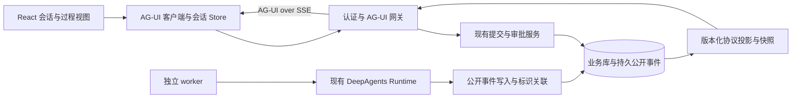

# AG-UI 与会话过程展示改造方案

日期：2026-11-17。状态：方案草案，待评审；本文不表示功能已实现或通过验收。

## 1. 建议与范围

将 Y-Point 的自定义事件协议升级为 AG-UI 1.0，继续使用 HTTP/SSE 作为首期传输。保留数据库任务、独立 worker、资源授权、幂等提交、租约、取消、审批、检查点与文件存储。此次同时改造事件语义、客户端恢复状态与会话过程展示，避免只替换事件名称。

官方已于 2026-09-18 发布冻结的 AG-UI 1.0，实施以 `/spec/1.0` 和锁定 SDK 的实际互操作结果为准；旧版概念页与 SDK main 分支不能替代冻结规范。[S1][S2]

首期交付包括：标准文本/工具/运行事件、公开思考、Skill 活动、知识检索、文件交付、审批、重连与历史回放。动态任意组件生成、浏览器执行工具、子 Agent 图谱和跨设备协同作为后续独立能力，不能借事件升级直接开放。

## 2. 当前实现与具体问题

| 当前实现 | 源码位置 | 对改造的影响 |
| --- | --- | --- |
| 自定义 `state/text_delta/reasoning_delta/tool_started/tool_completed/tool_failed/artifact_published` | `app/core/enums.py`、`app/models/agent_run_event.py` | 缺少标准消息、reasoning 分段、活动和工具生命周期标识 |
| 单 Run 单调序号、数据库回放、SSE `id`、票据 Cookie、定期授权核查 | `app/api/v1/runs.py` | 有成熟可靠性基础，应保留并扩展 |
| worker 调度与 DeepAgents 执行分离 | `app/cli/run_worker.py`、`run_dispatcher.py`、`run_executor.py` | AG-UI 网关应消费持久事件，不能把执行工作搬入请求进程 |
| 模型多次调用的正文和公开思考分别拼接 | `run_executor.py::_stream_model_text`、`web/src/Sessions.tsx` | 无法还原“思考→工具→再次思考→回答”的原始交错结构 |
| 工具事件触发 `/calls` 补读，并有额外轮询 | `web/src/components/RunCalls.tsx` | 正常流中可直接更新卡片，接口保留给历史/修复 |
| 读取 Skill 文件被编码为 `skill:名称@版本` 的工具事件 | `run_executor.py::_execute_authorized_tool_call` | 读取完成不等于技能任务成功，不能直接画成完整 Skill 已执行 |
| 工具公开事件 UUID、运行时调用 ID、执行审计 ID 分别生成 | `run_executor.py`、`run_calls.py` | 必须建立稳定关联，不能在编码器里临时猜测 |
| 最终业务状态写入后可能追加产物发布事件 | `run_manager.py::complete_run`、`runs.py::stream_events` | 标准流终态与文件可用边界需要重整 |
| 公开思考与失败正文从事件恢复，最终回答从业务消息读取 | `run_presentation.py`、`agent_sessions.py` | 新 UI 必须继续区分进行中展示、未完成正文与最终持久消息 |

本轮只进行了源码与文档检查，没有请求真实供应商、执行迁移或运行完整回归。当前图工具不可调用，因此采用必要的直接源码阅读。

## 3. 目标架构



协议层承担事件校验、标识映射、脱敏、编码、恢复及版本兼容；不承担模型执行、工具授权或业务状态机。客户端 Store 统一处理实时、回放和历史修复，页面不再分别维护文本、思考和调用状态。

优先演进现有 `AgentRunEvent`，保留一份权威的公开事件日志。新增记录包含结构化 payload 与明确生命周期事件；新协议事件与游标的关系固定且可回放。若一个旧事件需要投影为多个标准事件，使用确定性的 `(源序号, 子序号)` 游标，或将投影一次性物化；不得在每次订阅时随机生成 ID；事件时间同样来自持久记录，不使用重放时的当前时间。最终采用哪种物理存储由第一阶段 PoC 的恢复与存储成本结果确定，不能并存两个互不校验的权威事件源。

## 4. 标识与生命周期契约

| 标识 | 建议语义 |
| --- | --- |
| `threadId` | 对应用户拥有的业务会话 ID；不使用可能因切换模型或失败恢复而改变的 LangGraph `thread_id` |
| `businessRunId` | 当前 `AgentRun.id`，承载用户一次提交的预算、审批、审计和历史归属 |
| AG-UI `runId` | 一次协议执行尝试；审批暂停以 interrupt 结束当前尝试，继续时生成新 ID，业务 Run 保持不变 |
| `messageId` | 在首次输出前生成并持久化，绑定具体 assistant/tool/reasoning 消息；不依赖前端临时 UUID |
| `toolCallId` | 将模型调用 ID、公开调用 ID 和执行审计 ID 持久关联；每次纠正重试为新的调用，结果不明的外部写不自动重放 |
| `activityId` | 内部活动 ID，映射标准 Activity 的 messageId；用于 Skill、知识检索、报告等活动 |
| 因果关联 | 活动父子关系只在执行器确实掌握因果关系时记录；版本固定关联不等于调用父子关系 |
| 传输游标 | 授权范围内可重放事件的位置，与消息 ID、JSON Patch 版本和业务 Run 版本分别保存 |

建议新增协议执行尝试记录，关联业务 Run、会话、协议 runId、开始/结束与 outcome、被回答的审批 ID，并将事件关联到该尝试。`parentRunId` 用于由另一 Run 生成的 agent 调用，不用来代指审批前一轮；恢复关联由 interruptId 和受控应用 metadata 表达。现有 Run 预算与审计仍按业务 Run 汇总，标准终态 usage 仅记录本次协议尝试的已报告用量，不能在每次恢复后重复发送业务累计值。

多个模型调用必须形成多个独立 reasoning/text 段；不要把恢复后的输出拼入之前已关闭的段。消息 ID 可以在最终业务消息提交前分配，提交时保存公开消息到业务消息的映射。中间 assistant 说明作为过程内容保留，最终回答必须由服务端明确标记；不能根据最后一段文字、标点或工具结束推断。通过标准允许的 result/metadata 或命名空间扩展提供最终业务消息映射，再从消息接口对账，避免把多段过程说明和最终回答重复渲染。历史旧事件缺乏分段信息时，只能提供明确标记的旧记录摘要，不能伪造精确步骤或思考耗时。

## 5. 标准事件与业务扩展

以下按冻结 AG-UI 1.0 定义；SDK 的覆盖仍需 P0 实测。完整约束见配套研究记录。

| 业务信号 | 协议表达 | 展示行为 |
| --- | --- | --- |
| 接受提交与执行终止 | `RUN_STARTED`；成功/审批/取消为 `RUN_FINISHED` 的 success/interrupt/cancelled outcome；运行错误为 `RUN_ERROR` | 排队用公开活动表达，审批暂停与业务最终完成分别处理 |
| assistant 正文 | `TEXT_MESSAGE_START/CONTENT/END` | 以 messageId 合并正文；结束后与业务最终消息对账 |
| 上游显式公开的 reasoning 或摘要 | `REASONING_START/END` 及 `REASONING_MESSAGE_START/CONTENT/END` | 独立思考段；模型未提供时只显示执行状态 |
| 模型请求工具 | `TOOL_CALL_START/ARGS/END` | END 表示参数完整，不是执行成功；ARGS 仅传允许公开的合法参数投影 |
| 工具执行、成功、失败或结果不明 | `TOOL_CALL_RESULT` 带脱敏结果；受控 Activity 表达执行状态 | 1.0 没有可直接替换旧 `tool_failed` 的通用标准失败事件，不把失败伪装成成功 |
| 加载 Skill、读取资料、调用脚本、生成报告 | `ACTIVITY_SNAPSHOT/DELTA`；以 messageId 标识活动，activityType 为 `y-point.skill` 等；真实脚本仍发工具事件 | 过程分组；不能把读完 SKILL.md 标为业务目标完成 |
| 检索及引用 | 标准工具事件 + 受控知识活动 | 展示检索数量、耗时和逐次鉴权的引用入口 |
| 文件可用、发布失败 | 文件活动/命名空间扩展 | 附件与产物卡片独立于回答，不把下载 URL 当公开文件 |
| 应用共享状态 | `STATE_SNAPSHOT/STATE_DELTA`，按需要使用 | 仅同步公开的进度/交付状态，不同步 checkpoint 或完整 ORM |
| 平台特有元数据 | `CUSTOM`，`y-point.*` 命名空间及规范允许位置的 metadata | 业务统计、文件关联、兼容信息；标准 Run usage 优先使用终态 usage；未知非关键扩展按兼容规则处理 |

自定义事件采用固定白名单和版本化结构，例如 `y-point.run.metrics`、`y-point.artifact.available`、`y-point.call.failure`。不设计与标准功能重复的 `y-point.text_delta` 等协议；标准事件的 schema 是封闭对象，不任意添加 `businessRunId` 等顶层字段。未来可生成 UI 只使用注册的组件类型及经过验证的数据；不得从事件执行任意 HTML、JS 或组件源码。

## 6. 公开数据与授权

延续现有仅发布上游显式公开思考的边界。不得读取 checkpoint、模型私有状态或隐藏推理来填补“思考过程”；不把系统提示词、完整 Skill 正文、加密 reasoning/signature 或原始模型响应发送给浏览器。首期明确 `reasoning.encrypted=false`，不宣称支持需要浏览器保存和回传 opaque reasoning 的模式。公开思考能力按实际模型能力声明。

工具内容分为执行数据与可展示数据。定义每类工具的公开 schema：允许公开的参数摘要、结果摘要、计数、文件 ID、受控错误码及必要的引用。工具事件不能为了满足前端组件而复制原始请求和原始结果。需要隐藏的参数在协议契约中明确采用公开投影，通用客户端不能将该投影用于重新执行工具。

所有订阅、快照、历史、活动详情、引用和下载都重新核验所有者及当前授权。撤权时停止流并清除已缓存的受限详情。长连接使用现有同源认证或受控 Bearer；不得将长期令牌放在查询字符串。票据 Cookie 的 Path 必须覆盖新订阅路径，并保持 HTTP/HTTPS 当前配置语义。

## 7. 会话交互设计

设计参考 assistant-ui 的 Run Activity/Chain of Thought 和 AI Elements 的 Reasoning、Tool 组件，吸收过程聚合、逐步展开和明确状态的模式；页面继续使用 Ant Design、lucide-react 与 `--yp-*`，无需引入第二套 UI 框架。[U1][U2][U3][U4][U5]

截至核查日，AI Elements 官方页面提示迁往 shadcn/ui，并计划于 2026 年 11 月底弃用原项目，因此这里只参考交互模式，不把旧包作为新依赖。[U3][U4][U5]

一轮回复分为四部分：当前活动摘要、可展开过程、回答正文、引用/文件与统计。过程不是与回答竞争的长日志墙。

```text
Agent                                  模型名称

[正在生成报告 · 已完成 3 项活动 · 12 秒]       [展开过程]
  ✓ 已加载「施工审查」v4 的说明
  ✓ 已读取上传资料
  ✓ 知识库检索完成 · 找到 6 段资料            [查看来源]
  ↻ 正在执行「生成审查报告」

回答正文持续输出……

[审查报告.docx · 准备中 / 可下载 / 发布失败]
总耗时 · 已报告 Token · 调用记录
```

示例中的“3 项”是已确认完成活动数量，不是预先计划的任务总数，也不是伪造百分比。

### 7.1 思考

- 每次模型调用独立一段，位置与工具活动交错一致。
- 正在进行的段可默认展开或显示限定高度预览；已完成默认折叠。用户手动选择后不被新事件覆盖。
- 使用“模型公开思考”或“思考摘要”说明来源；没有公开内容时仅显示“正在处理”，不能展示虚构分析。
- 只在有明确开始/结束信号时展示思考耗时；旧记录不依据首末文本到达时间声称精确模型思考时长。

### 7.2 Tool / MCP

- 卡片默认显示可读名称、类型、状态、耗时和简短结果；有业务价值时展开脱敏输入/结果。
- 区分“参数生成中、等待审批、等待执行、执行中、成功、失败、结果未确认”。结束生成参数不等于完成执行。
- 并行工具按首次出现顺序稳定排列，状态独立更新；不能把重叠调用耗时求和当作整轮墙钟时间。
- 输入可纠正重试显示为关联的两次调用。外部写结果不明显示核实说明，不提供一键自动重放。
- MCP 与本地脚本共享卡片骨架，通过类型、服务与权限信息区分。

### 7.3 Skill

- Skill 是具有版本的过程上下文。清楚区分“已加载说明”“资料读取”“脚本执行”“模板填充”“文件发布”。
- 第一阶段只将有可靠证据的动作归组；没有明确激活/完成契约时，不显示整个技能的执行百分比或成功状态。
- 分组来源可以是绑定的 Skill 脚本/模板和执行器显式上下文；不能依据“最近读取哪个 Skill”猜测后续工具归属。
- 用户可查看 Skill 名称、固定版本、公开步骤与产物；查看私有资源仍需独立授权。
- 同一动作不重复占据时间线：Skill 文件读取保留真实工具事件供协议和审计使用，但默认折叠进“已加载说明/已读取资料”；知识检索卡片与引用入口也按同一个 toolCallId 关联。

### 7.4 审批、失败和断线

- 审批卡片位于对应工具步骤旁，展示受控说明与同意/拒绝；独立固定提示避免折叠后无法发现待办。
- 断线显示“连接中断，正在同步”，保留已收到内容；不能把断线当 Run 失败。
- 失败保留部分正文并标记“未完成”，展开相应错误活动；从最终消息替换实时预览时不闪白、不重复。
- 自动跟随仅在用户位于底部时启用；用户上翻后显示“有新内容”，不强制滚动。
- 手机单列布局，详情使用现有 Drawer；键盘可展开、焦点可见、状态具有文字/图标。流式逐字内容不反复触发读屏播报，完成/审批/错误使用节制的状态播报。

## 8. 客户端与恢复

正常实时流直接更新工具与活动视图，不再对每个工具事件调用 `/calls`；该接口保留给旧历史、鉴权修复和诊断。

新增独立的协议客户端和 reducer/store，页面只消费 `messages/activities/runStatus/approval/artifacts/metrics` 等视图。实时与历史统一进入同一套状态归并，不在 `Sessions.tsx` 的 effect 中散落协议分支。

恢复顺序：授权→读取一致性快照及高水位→恢复 message/activity/state→从高水位之后补发→接续实时流。快照必须明确是传输恢复基线，不能把 AG-UI `STATE_SNAPSHOT` 当成包含所有消息与游标的万能快照。

冻结 1.0 HTTP/SSE 没有标准重放机制，`Last-Event-ID` 和快照是 Y-Point 的显式扩展；标准 SDK 不会因为事件有 ID 就自动恢复。首期不向普通标准 SSE 客户端宣称自动 resumable，在 custom capability 中说明应用重订阅能力。

重连只恢复订阅，不重新提交 Run。使用游标去重；检测缺口、未知关键事件、非法 Patch 或不匹配的基线后重新获取授权快照，不静默跳过。认证失效、资源撤权、Run 失败、协议不兼容与临时网络故障分别处理，避免永久重试 401/403/404。

状态流采用公开 DTO 和 JSON Patch 时需要记录基线版本；新订阅先发完整基线再应用增量。协议版本、资源版本、游标版本各有独立字段，避免混用当前 `protocol_version=1` 与 AG-UI 1.0 的含义。

正文/思考的渲染按帧或短周期合并，Markdown 和长过程列表增量更新。保持已有上限与截断提示；不能用无界浏览器内存换取完整日志。

## 9. 文件交付与终态

AG-UI 流的结束必须有明确、可验证的交付边界。模型生成文件的发布元数据和最终消息映射应在终态前持久化；适配器不能直接看到当前旧 `state=completed` 就立即发送标准终态，再继续补发同一次执行的文件事件。

回答 TXT 等明确属于终态后的异步导出，采用已声明的“准备中”资源状态与单独资源刷新/通知，不在已经关闭的协议 Run 生命周期里偷偷追加。导出失败独立呈现，不能把已成功回答改为模型失败。重放旧事件时必须按一致性高水位处理其历史顺序。

工具缺少执行结束证据时状态为“结果未确认”；取消不等于外部动作一定未发生。收口时结束公开消息/活动的进行中表现，保留未完成标识；不能伪造工具成功来让时间线全绿。冻结规范允许终态后补充迟到的 `RUN_ERROR`；客户端必须将该协议 Run 改记为失败，但不重新打开 Run，也不继续输出正常内容。已发布资源保留其独立真实状态，reducer 必须区分。

## 10. 接口与 SDK 接入路径

对话只公开一套 AG-UI 提交和审批恢复入口，工作台与外部协议客户端使用同一输入和事件语义。删除旧会话提交、独立模型提交、独立审批决定、旧消息历史、源事件回放及 legacy 流。共享内部业务服务和明确的取消、文件、会话管理接口继续使用。

标准 `RunAgentInput` 的 POST 是唯一对话接入面：以授权的 thread 对应现有会话，校验消息输入与服务端历史版本，然后复用同一幂等提交/任务服务并输出标准事件。标准入口传入的 runId 经长度、唯一性和所有权映射校验后固定到协议尝试；它不自动取得任何业务资源权限，也不能绕过当前 request_key 的同键同输入检查。`messages` 必须作为完整的公开历史输入处理，不能仅取最后一条再偷偷补齐调用方未提供的历史。复用 checkpoint 时先核对输入历史与 checkpoint 所属的可见历史一致；不一致在流开始前返回明确冲突，不能自动合并。若未来接受编辑历史，再单独实现无旧上下文污染的执行路径。客户端提供的 tools、state、context、forwarded properties 均为不可信输入，不能改变服务器授权或覆盖 checkpoint。服务端已有工具集合为准，客户端工具执行能力必须另行授权设计；不支持的请求在流开始前明确拒绝。

标准 POST 流与应用 GET 观察订阅分别定义能力：连接断开本身都不取消已提交的持久业务任务，取消走明确业务接口。标准绑定把无终态断开视为 truncated，允许 producer 继续运行，但不提供回到同一条流的能力；Y-Point 的 GET 恢复扩展则可在鉴权后重新观察持久任务。不能把两种端点的恢复能力混为一谈，也不能从取消请求推断外部副作用已经停止。

标准端点必须固定支持的配置及限制；若只提供标准事件流，应在能力说明中写“AG-UI 事件兼容”，不能声称已经与所有通用客户端完整互操作。Y-Point 页面使用官方协议类型和 Schema，通过标准 SSE 解析器消费 POST；浏览器测试需验证真实分块传输、完整历史、审批恢复和 GET 断线补发。

不直接采用官方 LangGraph HTTP 示例替换现有 worker。Python 编码/类型包与 TS 客户端版本必须在锁文件中固定，并先核验其对冻结 1.0 的覆盖；包名相同不意味着生命周期实现兼容。[S3]

## 11. 分阶段施工与验收

| 阶段 | 交付 | 进入下一阶段的条件 |
| --- | --- | --- |
| P0 契约与 PoC | 锁定 1.0 与 SDK；身份映射、事件样本、审批/取消/恢复/文件终态契约；隔离假模型的官方客户端端到端最小链 | 文本→工具→公开思考→终态可验证；重连不重复执行 |
| P1 服务端事件 | 可版本化日志、消息与调用关联、公开投影、编码、恢复快照、唯一协议读取 | 回放确定、权限正确、所有终态合法、历史兼容、同一业务 Run 的多次审批恢复不重复计费或执行 |
| P2 前端与过程 UI | 协议 reducer、统一 Store、活动摘要/时间线、思考段、工具/Skill/审批/文件卡片 | 桌面/手机、断网恢复、并发工具、失败正文与最终消息一致 |
| P3 完整接入与切换 | 标准 POST 接入、标准流解析、删除重复入口、目标环境回归 | 前端从协议历史构造输入，直接消费 POST 流；审批和恢复完整闭环验收 |

同一个业务 Run 只执行一次，标准 POST 和持久化恢复观察共享唯一事件投影。首次提交直接消费 POST；恢复观察不再次提交。部署时 API、Worker 与前端使用同一代码版本，不保留旧协议切换开关。

建议文件职责：

- `app/schemas/ag_ui.py`：冻结公开协议边界及 Y-Point 扩展 schema。
- `app/services/ag_ui_events.py`：领域事件到标准事件的公开投影、校验与编码。
- `app/services/run_event_projection.py`：恢复快照、游标和历史兼容；根据 PoC 可与前一模块内部合并，不建设无业务差异的空壳层。
- `app/api/v1/ag_ui.py`：认证、输入契约、订阅与 HTTP 媒体协议。
- 现有 `run_manager.py/run_executor.py/runtime_adapter.py/worker_tools.py`：补齐稳定标识和真实生命周期信号，保留业务授权和执行责任。
- `web/src/ag-ui/`：transport、事件 reducer 与恢复客户端。
- `web/src/components/RunActivity.tsx` 等：过程显示；复用现有正文、附件、审批与预览。
- Alembic：按最终数据方案新增迁移，不能改写旧迁移；覆盖 SQLite、PostgreSQL、MySQL。

这些是建议职责，不承诺实施时必须逐文件照搬。

## 12. 验收矩阵

1. 协议：所有事件通过锁定 schema；生命周期顺序合法；终态后不再有同一次执行的正常输出，允许规范限定的迟到错误诊断；官方客户端可解析且状态一致。
2. 内容：多次思考和正文交错、无 reasoning 模型、空文本、工具参数碎片与生成中取消、并行工具、工具失败及纠正重试。
3. 审批：同一业务 Run 多次审批、拒绝、超时、刷新恢复、重复决定、审批开关快照与权限撤销。
4. 恢复：新连接、重复事件、游标缺口、快照分页、高水位竞态、连接中断、API/worker 重启、租约回收和历史旧记录。
5. 安全：双用户、共享 Agent/Skill/知识库撤权、私有 Skill 原文、工具凭据、原始异常、引用与下载逐次授权。
6. 文件：模型生成文件与回答导出、终态前后顺序、准备中/失败/过期/删除、最终消息关联和下载字节一致。
7. 数据库：新增迁移、历史升级、回退重升、SQLite/PostgreSQL/MySQL 差异；跳过项单列。
8. 浏览器：1280/375px、长内容、中文输入、切换会话、上翻阅读、键盘/读屏/减少动画、CPU 与长运行内存。
9. 性能：先以现有场景建立基线，再确定可接受阈值；不在没有测量时承诺首字或数据库写入必然改善。比较改造前后单 Run 事件数量/字节、DB 写入、首个公开输出、页面渲染次数和 `/calls` 请求量；确认正常流不再依赖每次工具事件补读。
10. 真实链路：至少覆盖普通文本、知识检索、Skill 脚本+报告、MCP、人工审批与取消；模拟结果与真实模型/部署验收分别记录。

## 13. 评审时需要确定的产品默认值

建议默认：保留当前品牌和布局；完成过程折叠、当前活动可见；公开思考按需展开；工具展示脱敏摘要，完整原始参数不进入页面；Skill 仅展示可证实的动作；先完成单 Agent/单轮多步骤闭环，再扩展子 Agent。

这些默认值足以启动 P0，无需先引入新的 UI 框架、WebSocket、任务中间件或独立执行服务。正式开发时同步更新前后端清单；方案阶段不修改原有验收勾选。

## 参考资料

- [S1] [AG-UI 1.0 冻结规范](https://docs.ag-ui.com/spec/1.0)。
- [S2] [AG-UI 1.0 发布公告，2026-09-18](https://github.com/ag-ui-protocol/ag-ui/discussions/2792)。
- [S4] [1.0 HTTP + SSE 绑定](https://docs.ag-ui.com/spec/1.0/basic/transports/http-sse)、[运行生命周期](https://docs.ag-ui.com/spec/1.0/events/lifecycle)、[输入历史契约](https://docs.ag-ui.com/spec/1.0/basic/run-input)。
- [S3] 配套研究：[AG-UI 协议、SDK 与集成核实](ag-ui-protocol-research-20261117.md)。
- [U1] [assistant-ui Run Activity](https://www.assistant-ui.com/elements/run-activity)。
- [U2] [assistant-ui Reasoning / Chain of Thought](https://www.assistant-ui.com/docs/ui/reasoning)。
- [U3] [AI Elements Reasoning](https://elements.ai-sdk.dev/components/reasoning)。
- [U4] [AI Elements Tool](https://elements.ai-sdk.dev/components/tool)。
- [U5] [AI Elements Chain of Thought](https://elements.ai-sdk.dev/components/chain-of-thought)。
- [U6] [assistant-ui AG-UI runtime options](https://www.assistant-ui.com/docs/runtimes/ag-ui/runtime-options)：用于核对新运行、恢复已有运行与重新订阅的客户端行为，不能直接照搬其全部 capability。

引用时间为 2026-11-17；参考 UI 模式不表示采用相同依赖或复制其组件源码。
