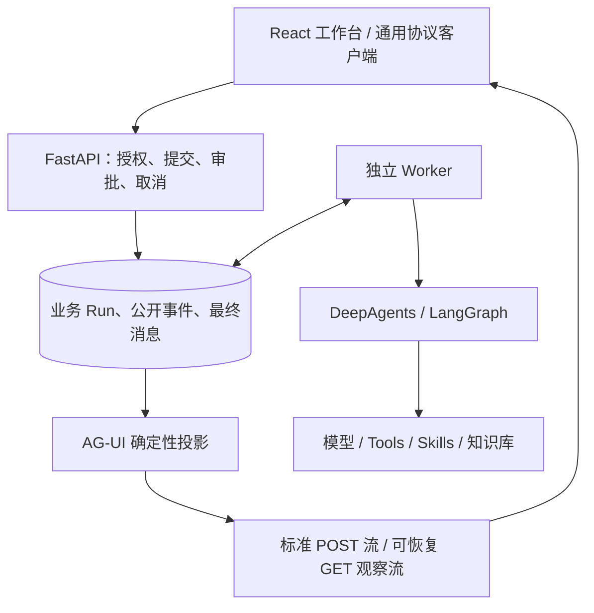

# AG-UI 1.0 与 Agent 处理过程

新会话运行以 AG-UI 1.0 作为公开事件协议，传输继续使用 HTTP/SSE。Python SDK 固定为 `ag-ui-protocol==1.0.0`，TypeScript 类型固定为 `@ag-ui/core@1.0.4`。消息由官方 SDK 校验和编码，协议契约另用仓库内固定的官方 1.0 JSON Schema 验证。

## 执行与事件来源



HTTP 连接只负责提交与观察。断开页面、关闭 EventSource 或客户端超时不会取消 Worker；取消必须调用现有的 `POST /api/v1/runs/{business_run_id}/cancel`。API 和 Worker 需要使用同一代码版本。

业务事件表是唯一事件源。模型边界、公开文本、工具动作和最终交付在业务事务中写入，适配器从这些事件生成标准事件；没有第二份可独立写入的协议日志。投影 ID 由持久化运行身份与源事件确定，回放保留原始时间戳。源事件序号与协议线事件序号分别计数，不能混用。

- AG-UI `threadId` 对应稳定的业务会话 ID；LangGraph 的检查点 `thread_id` 可以因受控恢复或切换模型改变。
- 一次业务 Run 可以经过多次审批。每次中断返回 `RUN_FINISHED(outcome=interrupt)`，继续时开启新的协议 `runId`，仍使用原业务预算和审计。审批续跑不设置 `parentRunId`。
- 每次模型调用分别记录消息边界，公开思考与中间说明可以和工具活动交错。工具协议 ID 与工具执行审计使用同一稳定身份。
- 完成状态、最终助手消息、模型工具生成文件和 `delivery_completed` 屏障在同一事务提交。只有处理交付屏障后才发成功终态。
- `publish_answer_artifact` 的异步 `answer.txt` 导出属于完成后的资源更新，不向已闭合的协议 Run 追加正文或活动。

## 标准 HTTP/SSE 入口

工作台与协议客户端统一使用以下入口。先通过会话管理接口创建会话。打开或恢复会话时，可读取公开历史：

```http
GET /api/v1/agents/{agent_id}/ag-ui/threads/{session_id}
Authorization: Bearer <access_token>
```

响应使用项目的 `api_response` 包装，`data` 含 `threadId`、会话 `version`、标准 `messages`，以及按协议消息 ID 关联的 `messageDetails`。后者补充已授权的文件引用、模型标签、耗时和未完成轮次提示，不重复提供正文。公开历史包含实际发出的助手文本、模型公开思考、工具调用及脱敏结果、活动快照。不会从 checkpoint 补造隐藏历史。

推荐携带已读取的会话版本，只提交一条具有新 ID 的纯文本用户消息。新会话和已有历史的会话均适用：

```http
POST /api/v1/agents/{agent_id}/ag-ui
Authorization: Bearer <access_token>
Content-Type: application/json
Accept: text/event-stream

{
  "threadId": "已存在的业务会话 ID",
  "runId": "client-run-001",
  "protocolVersion": "1.0",
  "messages": [
    {"id": "client-message-001", "role": "user", "content": "请审查资料并生成报告"}
  ],
  "forwardedProps": {
    "expected_session_version": 1,
    "artifact_ids": [],
    "context_artifact_ids": [],
    "publish_answer_artifact": false
  }
}
```

`forwardedProps.expected_session_version` 为非空正整数时启用版本模式；字符串、布尔值、小数和非正整数会被拒绝，不回退旧模式。此时不重建或比对客户端完整历史，附带的旧消息不参与执行；仅最后一条纯文本用户消息被保存为本轮输入。工作台发送前不再请求完整历史，发送成功后的历史刷新仍保留。

未提供会话版本或显式传 `null` 时，继续使用旧的完整历史精确匹配：`messages` 必须是服务器公开历史加本次用户消息。旧客户端不必立即迁移。`GET /api/v1/agents/{agent_id}/ag-ui/capabilities` 的 `custom.yPoint.history` 保留旧默认值，新增 `historyModes` 声明两种模式，`versionCheck` 声明触发字段、消息语义、null 行为及 `resume=false`。

两种模式均继续使用服务器受控检查点，不使用客户端旧消息替换执行历史；客户端消息不会授予工具权限，也不会覆盖系统指令或私有状态。版本仅控制新运行提交，不代表事件历史逐条变化；会话忙、模型预期变化、权限和附件检查仍然有效。

`runId` 长度为 1–96，用于用户范围内的幂等提交；重试须保持输入、用户消息 ID、附件及审批选项。版本模式优先识别原请求，原请求即使携带旧会话版本也可返回原 Run；使用相同 runId 改写输入会被拒绝。用户消息 ID 会被保存，最终助手消息的 ID 与实际发出的协议消息一致。响应头 `X-Y-Point-Run-ID` 返回业务 Run ID，供取消、审批、快照及资源接口使用；`X-Y-Point-After` 是本次标准流开始前的协议线游标，新提交为 0，审批恢复为对应中断游标。标准流的数据帧只包含协议事件，到当前协议 attempt 的成功、错误、取消或审批中断时结束。

当前标准入口支持已有会话、纯文本输入，以及 `forwardedProps` 中的预期模型、会话版本、附件、TXT 回答导出和 `require_mcp_approval` 审批收紧选项。预期模型用于校验页面选择，不切换会话模型。非空客户端 `state/tools/context`、子 Agent 运行、其他 forwardedProps 均明确拒绝。上传文件仍先走平台上传接口。可用能力通过授权的 `GET /api/v1/agents/{agent_id}/ag-ui/capabilities` 查询；不支持加密 reasoning、客户端执行工具、WebSocket 或客户端任意状态同步。

### 接口兼容边界

| 操作 | 当前入口与兼容规则 |
| --- | --- |
| 新对话提交、审批恢复 | 统一使用 `POST /api/v1/agents/{agent_id}/ag-ui`；旧 `POST /api/v1/runs`、`POST /api/v1/agents/{agent_id}/sessions/{session_id}/runs` 和 `POST /api/v1/runs/{run_id}/approval` 已不注册。 |
| 会话公开历史 | 使用 `GET /api/v1/agents/{agent_id}/ag-ui/threads/{session_id}`；旧 `GET /api/v1/agents/{agent_id}/sessions/{session_id}/messages` 已不注册。 |
| 运行读取与控制 | `GET /api/v1/runs/{run_id}`、`GET /api/v1/runs/{run_id}/messages`、`GET /api/v1/runs/{run_id}/approval`、`POST /api/v1/runs/{run_id}/cancel` 继续支持；单轮消息查询不替代会话协议历史。 |
| 会话运行与统计 | `GET /api/v1/agents/{agent_id}/sessions/{session_id}/runs` 和 `GET /api/v1/agents/{agent_id}/sessions/{session_id}/metrics` 继续支持；会话创建、编辑及附件检查仍使用会话管理接口。 |
| 观察与重连 | Run 的 `/ag-ui/snapshot`、`/stream-ticket`、`/stream` 继续支持，使用协议线游标；不承担新对话提交。 |

### 冲突与重试

冲突在开始 SSE 前返回 HTTP 409、业务码 10005，`data.reason` 可供客户端判断：

| reason | 含义与处理 |
| --- | --- |
| `history_mismatch` | 旧模式或审批恢复历史不匹配，读取对应公开快照。 |
| `session_version_changed` | 会话版本过期；`data.version` 为校验时的服务器版本。刷新状态，保留输入，由用户确认后重新发送。 |
| `session_model_changed` | 预期模型已变化；附带校验时会话版本，刷新模型和会话信息。 |
| `session_busy` | 会话仍有未结束运行，等待其结束。 |
| `submission_conflict` | 提交事务竞争，刷新会话状态后确认；响应附带可读取的当前版本。 |
| `request_conflict` | runId 已用于其他会话，或原请求输入、消息身份、附件等被修改。 |
| `message_id_conflict` | 用户消息 ID 无效或与已有公开消息重复。 |
| `protocol_input` | 协议版本、输入选项或其他当前不支持的协议字段。 |

工作台遇版本/模型变化时保留草稿并刷新历史，不自动重新提交；网络失败则保留完整原请求，通过「重试提交」复用原 runId 和消息 ID。不得把所有 409 都当作可自动重试。用户消息 ID 保持唯一性检查；工作台使用随机 UUID4，普通 ID 检查不重放事件。与服务器派生 ID 同类型的规范 UUID5 输入，会额外读取公开历史确认无冲突，冷缓存下可能需要投影，避免放松旧身份约束。

### 公开历史缓存

`yp_agent_run_public_history` 为每个 Run 最多保留一份公开消息派生缓存。首次读取时按固定源事件上界投影，仅对终态 Run 按需写入；后续读取批量关联缓存，要求事件序号和 `PUBLIC_HISTORY_PROJECTION_VERSION` 均匹配。历史数据不做全量预热，投影实现语义变化时须递增该版本。

缓存只保存公开消息，不保存私有检查点；读取入口先检查当前用户权限。运行中及等待审批的 Run 继续按事件重建。审批恢复请求早期中断截面时，不能误用包含后续内容的最终缓存。缓存不替代源事件，也不改变 SSE 线游标；删除缓存可从源事件重建。

缓存减少重复事件投影，但完整历史、文件和交付元数据的读取及响应传输仍随历史规模增加。当前历史接口未提供分页，不承诺固定响应耗时。

### 标准审批恢复

人工审批默认持续等待用户决定，不设置等待截止时间。审批查询的 `expires_at` 及中断 metadata 的 `expiresAt` 可为 `null`；取消、权限失效与 MCP 拥有者或连接丢失仍按运行状态处理。

先读取当前公开历史，使用新的协议运行 ID 回答中断：

```json
{
  "threadId": "业务会话 ID",
  "runId": "client-run-002",
  "messages": [],
  "resume": [
    {
      "interruptId": "RUN_FINISHED 返回的中断 ID",
      "status": "resolved",
      "payload": {"decision": "approve"}
    }
  ]
}
```

审批 payload 可增加 `scope`：省略或 `once` 仅批准本次；`tool` 批准当前同一 MCP 工具并保存会话放行；`all` 批准本次并保存本轮可授予的已选 MCP 工具集合。非 once 仅可与 approve 搭配，使用前读取审批接口的 `allowed_scopes`；部署、本轮及共享强制约束无法覆盖。服务器同时持久化审批 scope 与会话策略，重试时范围也必须相同。工具和连接版本变化不继承旧授权，线程快照的 `approvalPolicy` 提供脱敏摘要，查看与撤销接口见 [会话放行](tools.md#对话内放行与撤销)。

上面的 `messages` 必须替换为中断时的完整公开历史。`decision` 支持 `approve`、`reject_continue`、`stop` 和 `resolve`；旧 `reject` 与 `status=cancelled` 仍停止整轮。`resolve` 必须按动作顺序携带完整 `decisions=[{action_id,decision}]`，每项为 `approve/reject/stop`，任一 stop 优先终止。恢复只接受一条 resume，不能改写参数，仍不接受 forwardedProps；新消息版本模式不改变审批恢复契约。服务器重新验证当前审批 ID 和归属，并将新协议 ID 与决定一起持久化；同一请求重试可重放对应的协议 attempt。工作台使用同一个 AG-UI POST 回答审批；新消息和审批恢复都固定原请求输入及身份后重试。

## 原生工作台的持久化观察扩展

工作台首次提交直接消费 AG-UI POST 返回的 SSE，不同时建立 GET 订阅。审批恢复先将处理过程恢复至 `X-Y-Point-After`，再消费新的 POST 流；两者使用同一 reducer。完整协议输入和消息 ID、runId 在重试时保持不变，避免重复创建运行。

分页快照、票据与 GET 观察流仅承担历史过程、页面刷新、断线恢复及异步资源观察，是 Y-Point 的持久化恢复扩展，不提供第二套对话输入或事件格式。恢复已有运行时：

1. 用 Bearer 请求 `GET /api/v1/runs/{business_run_id}/ag-ui/snapshot?after=0&limit=200`。
2. 保存响应的 `through`，后续页带相同 `through` 与 `next_after`，直至 `has_more=false`。单页最多 500 个线事件。
3. 签发现有 `POST /api/v1/runs/{business_run_id}/stream-ticket`，再订阅 `/api/v1/runs/{business_run_id}/stream?after=<next_after>`。
4. 使用 `onmessage` 读取标准事件，按 SSE `id: <business_run_id>:<wire_sequence>` 去重。重连先从快照追平，再重新签票据和订阅。

快照 `events` 中每项为 `{sequence, event}`；`through` 是冻结的源事件上界，`latest_sequence/next_after` 是协议线游标。服务端拒绝跨 Run、超前或格式错误的游标。源事件序号只用于服务端内部投影，不作为公开回放接口。页面断流后可继续补发；心跳、短期票据、每轮会话与 Agent 授权检查继续保留，长期 token 不进入查询参数。

GET 观察流可以跨越多次审批 attempt。它还有两个命名 SSE 通知：`y-point.resource` 通知结束后的异步回答文件就绪；`y-point.run-state` 通知已中断 attempt 之外的业务取消。二者不属于标准事件，不进入标准 POST 流或协议消息历史。快照的 `resources_complete` 支持结束资源观察，避免完成后持续重连。异步资源仍通过原有授权消息及文件 API 读取。

对话提交、审批恢复、公开消息历史仅使用本页的 AG-UI 接口。独立模型提交、旧会话 Run 提交、旧会话消息历史、独立审批决定、原始事件回放和旧快照接口均不再公开；SSE 不提供协议选择或 legacy 分支。

## 页面与公开边界

处理过程按时间线聚合，回答和文件卡片单独呈现。活动中可展开，完成后默认折叠；用户手动展开/收起的选择不会被后续增量覆盖，审批和错误保留提示。历史过程和实时过程使用同一 reducer，不再随每个工具事件请求 `/calls`。

| 内容 | 协议与显示语义 |
| --- | --- |
| 正文 | `TEXT_MESSAGE_START/CONTENT/END`。中间说明留在过程内，最终回答使用显式 `y-point.answer` 身份关联，失败历史仅显示最后模型片段为未完成回答。 |
| 公开思考 | `REASONING_START/END` 与 `REASONING_MESSAGE_*`。仅来自供应商明确返回的公开文本，不读取隐藏链路、私有检查点、签名或密文。 |
| 工具参数 | `TOOL_CALL_START/ARGS/END`。ARGS 是合法 JSON 的展示投影，明确 `displayOnly/redacted`，不能用来重新执行。END 仅结束参数生成。 |
| 执行状态 | `ACTIVITY_SNAPSHOT(activityType=y-point.call)`，使用 `messageId` 标识活动。实际结果通过 `TOOL_CALL_RESULT` 与状态快照更新，失败只给受控原因。 |
| 外部写结果未知 | 显示“结果未确认”，不伪装成功或提供自动重放。取消中的在途工具也不合成成功结果。 |
| Skill | 根据固定资源和脚本关联标记“已加载技能说明 / 已读取技能资料 / 技能脚本已完成”，显示固定版本；不声称整个 Skill 已完成。 |
| 知识库与 MCP | 工具类型由授权执行元数据确认；知识库来源仍走现有授权证据入口，工具卡片不复制原始检索内容。 |
| 文件 | 运行内发布使用 `y-point.artifact.available`；下载、预览、查看详情始终重新授权。 |
| 用量 | `y-point.run.metrics` 是明确标注业务 Run 范围的累计公开计数。当前不发送可能混入前次审批 attempt 用量的标准终态 usage。 |

## 运行与验证入口

部署与本地开发都应先按[数据库迁移与测试](testing.md)升级数据库，再运行同一版本的 API 与 Worker。当前实现从固定源事件上界重建协议投影，实时连接初始化后增量跟随。终态 Run 的公开消息使用[公开历史缓存](#公开历史缓存)；观察流的大规模投影检查点与压缩仍需按实际事件量评估，保持既有线游标语义。

通用验证命令、专题测试文件及验证环境要求见[测试指南](testing.md#专题回归入口)。

逐项审批的参数绑定、拒绝后的防绕过及 Worker 归属见 [逐项审批](tools.md#逐项审批与拒绝后继续) 和 [Run 内 MCP 会话](tools.md#run-内-mcp-会话与跨审批恢复)。

### MCP 预算与大结果交付补充

公开 Run 响应新增可空 `context_budget`，历史轮次 `metrics` 在存在诊断时带相同数值分解，不包含模型请求原文。AG-UI 工具结果仍只投影公开状态，不广播 MCP 结果正文、凭据、私有存储键或原始错误。大结果按成功响应独立发布私有 Artifact，复用 `y-point.artifact.available` 通知；Run 后续失败不会撤回已保存的成功响应。生成产物引用可带 `tool_result` 和 `sha256`，前端据此显示 MCP 结果及固定快照分页，用户/Run 授权仍在读取端重验。详见 [结果契约](tools.md#mcp-大结果预览保存与分段读取)。
