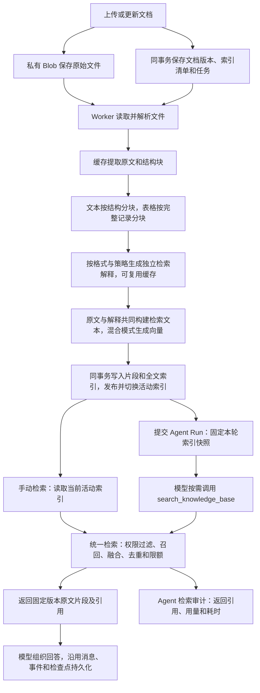

# 知识库与检索

查阅知识库文档处理、OCR、索引、检索、引用、权限和故障恢复。

[文档总览](README.md) · [项目首页](../README.md)

## 知识库与检索

知识库是独立持久资源，默认私有，仅创建者可管理，可向指定的有效用户授予只读权限。Agent 的 `knowledge_base_ids` 最多关联八个库；共享 Agent 只共享配置，接受方必须另有知识库授权。Run 提交时固定当时实际可见的已发布索引，尚无可用索引的库不会在本轮稍后自动切代。每次工具调用、模型嵌入返回后和引用读取都重新检查实际用户、知识库及文档状态。

原始文件复用私有 Artifact/Blob 存储。本地后端默认写入 `ARTIFACT_STORAGE_DIR=.run-private/artifacts`，文件按 `yp_artifact.storage_key` 保存，不以原始文件名组织目录；切换 S3 后由对应桶和前缀保存正文。知识文档不按普通附件的三十天策略到期，仍计入用户文件配额。文档 ID 稳定，更新增加上传版本；原始哈希、文件名、提取原文与分块位置随版本保存。同一库、同一未删除文档的当前文件名、哈希及有效处理选项相同时去重；不同库或用户分别保存。已存在的同名文件须使用文档更新接口，删除后可重新上传；通用附件删除接口拒绝直接删除知识原始文件，避免绕过文档与索引生命周期。

### Agent 知识回答模式

在“我的 Agent → 编辑 → 知识回答模式”选择回答策略，创建与既有 Agent 默认使用“智能融合”。该设置与知识库的关键词/混合检索策略、文档的自动/原文/增强处理方式分别配置。

| 页面选项 | API `knowledge_mode` | 检索与回答行为 |
| --- | --- | --- |
| 智能融合 · 按需检索 | `auto` | 根据当前问题及授权目录判断是否检索。明显无关的历史、日常聊天、通用写作或技术问题直接回答；涉及内部制度、具体业务事实或用户要求查询资料时按需检索。 |
| 仅知识库 · 依据资料回答 | `knowledge_only` | 事实性问题先检索核对，只依据相关知识库证据回答；无命中、证据不足或知识工具不可用时说明资料不足，不以一般知识补全。普通问候、使用方法或澄清请求无需检索。 |

智能融合下，无命中是正常工具结果。一般问题可以自然回答，不必先介绍知识库缺少哪些资料；例如 Agent 绑定差旅制度后收到“怎么看夷陵之战的刘备？”，应直接分析历史问题。若问题是“公司的研发部门审批额度是多少”，则需要实际制度证据，无相关命中时明确说明未找到规定，不凭常识编造内部事实。用户或 Agent 原有系统指令明确要求“仅根据指定资料”时，仍遵守该证据范围；如需自由切换话题，请同时检查自定义系统指令是否要求每轮强制检索。

模型在原有对话请求中选择是否调用 `search_knowledge_base`，不额外发起一次分类模型请求。Worker 提供当前实际用户仍有权限访问的目录摘要：最多八个知识库，每库名称最多 128 字符、用途说明最多 384 字符、本轮固定发布索引中的三个文件名样例各最多 160 字符；不预读文档正文、不生成查询 embedding，也不产生检索审计。目录会计入原模型请求的输入用量，只用于相关性判断，不是命中证据；填写准确的知识库名称和用途说明有助于工具选择，文件名样例不代表完整目录。文档删除、知识库撤权或不可用状态会过滤目录，实际检索继续使用原有逐阶段鉴权。

`POST /api/v1/agents` 可传 `knowledge_mode`，省略为 `auto`；`PUT /api/v1/agents/{id}` 按 `expected_version` 修改，省略保留原值，显式 `null` 或未知取值被拒绝。每次会话提交把模式保存到 Run 的 `agent_knowledge_mode`，配置修改仅影响新提交的轮次；重复 `request_key` 仍返回原轮次及其模式快照。迁移 `054` 为既有配置及历史运行填充 `auto`，不改写旧回答或重建索引。

正文引用必须来自实际相关命中，不能把目录或以前的工具调用当作本轮引用。真实执行过的检索仍保留调用状态、耗时及审计；无命中时可在折叠的“本轮知识检索记录”中看到“未找到相关内容 · 耗时”，不展示空引用按钮。工具成功表示检索完成，不等于命中或最终回答采用了资料。工具选择和回答措辞由对话模型执行这些规则，核对是否检索及是否命中时以调用记录和检索审计为准。

正文来源使用自然中文，例如“来源：《差旅报销管理规定》· 报销流程”；章节、页码和表格位置只能采用实际返回的定位信息。工具返回的 `citation` 字段及 `kb:...` 标识保留为内部定位数据，不要求模型把它们或自编的 `[1]` 编号显示在回答中。历史回答若已有独立或句末的 `citation: [1]`，会话正文将其显示为“来源说明”，点击按需查看本轮实际检索记录，并明确该模型编号未绑定具体原文；不能把 `[1]` 自动对应到本轮第一条片段。若本轮没有检索记录，可回看前文；读取原文仍复核当前权限，撤权后清理已展示的原文。兼容处理同时用于流式正文和失败后保留的正文，不改写数据库中的原始消息，不替换代码块、行内代码、链接、普通数字编号或产物预览内容，无需迁移或重建知识索引。

本地复测可在同一会话依次询问已上传制度中的问题、与资料无关的历史问题、资料未覆盖的公司内部规定；再切换“仅知识库”重复历史问题，检查其说明资料不足。刷新页面并重新发送会生成新请求，旧消息保持原内容。

### 业务流程与调用链

以“上传《报销制度.md》，再向 Agent 询问报销期限”为例，文件处理和对话检索分开执行。上传成功表示文件及任务已保存，首次索引完成后才能检索；Agent 按需调用工具获取片段，不会在提交 Run 时把整个知识库装入提示词。



1. **上传并排队**：[`_upload_knowledge_document()`](../app/api/v1/knowledge.py) 调用 `save_upload()` 校验和保存文件，检查管理权限、配额、同名摘要及 `expected_revision`。[`enqueue_knowledge_index()`](../app/services/knowledge.py) 以条件更新递增 revision，固定全库当前文档版本和配置，创建 `BUILDING` 索引及 `UPLOADED` 任务；文件元数据、文档版本和调度意图在同一次数据库提交中保存。异常时回滚数据库并补偿清理文件，Blob 与数据库之间没有跨系统原子事务。
2. **后台构建并发布**：[`_knowledge_loop()`](../app/cli/run_worker.py) 经 [`process_next_knowledge_job()`](../app/services/knowledge_jobs.py) 领取租约，交给 `_build_knowledge_index()`。解析结果按解析器和文档选项身份缓存到文档版本；[`chunk_knowledge()`](../app/services/knowledge_parser.py) 对文本按标题、页码和长度切块，对表格按完整记录合并，对配置按对象/数组记录分组，对 HTML/PPTX 保留段落、表格及备注边界。支持加工的文档按处理策略通过 [`enrich_knowledge_chunks()`](../app/services/knowledge_enrichment.py) 生成并缓存独立解释，原始数值与原文偏移保持不变；关键词和混合模式的检索输入均可包含解释，混合模式通过 [`embed_texts()`](../app/services/embedding_adapter.py) 分批生成归一化向量。发布事务再次检查用户、租约、取消状态和最新 revision，再一次性写入片段及全文索引、将索引置为 `READY`、切换 `active_index_id` 并完成任务；失败保留旧活动索引。
3. **手动检索**：搜索接口选择请求时的活动索引，进入 [`search_knowledge()`](../app/services/knowledge.py)。服务先过滤授权索引及已删除文档，执行关键词和可选向量召回，以 RRF 融合并去重、截断；远程查询嵌入返回后及交付片段前再次鉴权。引用固定到索引代、文档版本和片段，字符偏移对应规范化提取原文；返回 `score` 是融合后的排序分数，不是直接的余弦相似度。
4. **Agent 回答**：Agent 配置将关联保存到 `AgentKnowledgeBase`，默认聊天模型须通过工具调用能力验证。[`submit_session_run()`](../app/api/v1/agent_sessions.py) 在创建 Run 的事务中调用 `snapshot_run_knowledge()`，保存实际用户有权访问的索引快照。[`make_worker_tool_resolver()`](../app/services/worker_tools.py) 注册只读、无需审批的工具，[`knowledge_search_tool()`](../app/services/knowledge_tool.py) 从本轮快照推导检索范围，仅向模型开放 `query/top_k`。模型自行决定是否调用，工具调用前后复核用户、Run 和租约；返回证据后，回答沿用既有 Run 执行链路保存。

### 版本、落库与一致性

三个版本概念分别承担内容追溯、并发控制和完整视图职责，不能互换：

| 概念 | 保存位置 | 含义 |
| --- | --- | --- |
| 文档上传版本 `version` | `KnowledgeDocumentVersion` | 文档 ID 保持不变，每次内容更新生成新版本，保存对应文件和提取结果。 |
| 知识库版本 `revision` | `KnowledgeBase` | 最新文档清单及配置的期望版本；写请求携带 `expected_revision`，冲突返回 409。 |
| 索引代 `index_id` | `KnowledgeIndex` | 固定完整文档版本清单、分块参数、逐文档处理选项及加工/嵌入模型身份；构建成功后才成为活动索引。 |

例如 revision 已递增到 3，而 `active_index_id` 仍指向 revision 2 的索引，表示新代尚未发布；旧代继续提供检索。Run 固定提交时的索引，即使新代随后发布也不切换；快照固定数据版本，当前权限仍在每次访问时复核。

| 数据位置 | 主要内容与写入时机 |
| --- | --- |
| 私有本地目录 / S3、既有 `yp_artifact` | Blob 保存原始字节；Artifact 保存存储键、所有者、摘要、大小及状态，上传时建立引用。 |
| `yp_knowledge_base`、`yp_knowledge_share` | 知识库配置、revision、活动索引指针，以及指定用户只读授权。 |
| `yp_knowledge_document`、`yp_knowledge_document_version` | 稳定文档及当前版本、每版文件引用；Worker 追加提取原文、结构块和逐页摘要缓存。 |
| `yp_knowledge_index`、`yp_knowledge_job` | 排队时保存完整构建快照，发布时固定逐文档解析摘要；运行中分阶段提交状态、租约、尝试次数及分别统计的加工/嵌入预算和用量。 |
| `yp_knowledge_chunk`、数据库原生全文结构 | 原始证据、表格来源、独立模型解释、检索文本、关键词、向量及偏移，在发布事务内写入；SQLite FTS 与片段同事务维护。 |
| `yp_knowledge_enrichment_cache` | 按不可变文档版本及证据/模型/提示版本摘要保存已校验的解释批次，重试或重建复用；删除文档正文时清理。 |
| `yp_agent_knowledge_base`、`yp_run_knowledge_base` | Agent 关联范围，以及 Run 提交时实际可见的固定索引代。 |
| `yp_knowledge_retrieval` | Agent 工具检索交付时记录查询哈希、返回片段引用、数量、字节、耗时及查询嵌入用量。 |
| 既有 Run 消息、事件和 checkpoint 存储 | 保存问题、最终回答、执行事件及恢复状态；业务数据库与 checkpoint 之间沿用既有补偿机制。 |

文档更新接口只提交变化文件，但当前每代索引仍按完整知识库构建，可复用解析缓存及已完成的模型加工批次，尚未复用未变化片段的嵌入。新代构建期间保留旧代；更新清单导致 revision 变化后，过期任务不能覆盖新代。删除成功提交后，通过逻辑状态阻断所有代的后续检索和引用，再由 Worker 分批清理正文；既有消息和检查点历史不自动抹除。任务中断通过租约回收和有限重试恢复，解析、预算或上游错误保留失败类别，取消优先于恢复。

### 按格式处理与模型加工（2026-11-13 更新）

知识构建采用“原始证据 + 可追溯来源 + 独立检索解释”的结构。解释用于帮助召回业务主题、字段含义及适合检索的问题，不能替代原文或作为计算结果。发布时 `KnowledgeChunk.content` 等于本次提取规范文本 `extracted_text[start_offset:end_offset]`，片段和偏移随索引代固定，后续解析缓存更新不会改写旧片段；`knowledge_notes` 单独保存模型解释，`retrieval_text` 合并两者用于关键词和嵌入。前端的检索、引用、对话检索记录及「加工结果」预览分别展示原始证据与模型解释。

| 文档类型 | 当前处理方式 | 追溯方式与边界 |
| --- | --- | --- |
| TXT / Markdown / DOCX | 沿用文本、标题与长度分块；DOCX 提取段落和表格文字。 | 原文字符偏移、标题；不伪造页码。 |
| XLSX | 优先按 Excel Table，未定义 Table 时按空白行分区；多行/合并表头关联字段，按完整记录分块；可选择可见工作表。 | 工作表、原始表格与表头范围、记录行和实际列字母；排除隐藏工作表及隐藏行列（含分组隐藏列）。 |
| UTF-8 CSV | 识别逗号、分号、Tab 或竖线分隔，处理引号与字段内换行，校验字段数量，按完整记录分块。 | 表头与记录的物理行、列范围；支持 BOM，不猜测非 UTF-8 编码。 |
| PDF | 逐页分类并选择文字层或本地 OCR；识别常规有边框表格，保留完整表格行；简单双栏按列读取。 | 实际页号、区域坐标、页面尺寸、提取方式及 OCR 置信度；可查看带高亮的原页。扫描复杂表格标注布局待核对。 |
| UTF-8 HTML / HTM | 优先 main/role=main，其次 article，再回退到正文；去除导航、脚本、页脚、侧栏及显式隐藏区域，保留文章内标题、段落、代码和表格行。 | 标题路径、元素 ID、DOM 路径、源文件行号；不执行 JS、不加载资源、不推断外部 CSS 或动态生成内容。 |
| UTF-8 JSON / YAML / YML | 按父对象聚合字段，数组元素独立成记录，保留字段路径、类型及文件中的值；不执行环境变量替换。 | JSON Pointer（含 ~0/~1 转义），YAML 另有值定义行号；配置值不等于实际部署运行状态。 |
| PPTX | 按文件中的幻灯片清单次序读取可见页，正文、表格和演讲者备注分别保存，排除隐藏页/对象及页眉页脚等占位符。 | 实际页号、页标题、对象 ID、表格行、正文/备注角色；没有 PPTX 原页图片预览，不识别图表/图片语义。 |

表格的公式不执行、不重新计算，保留公式表达式及文件已有缓存结果；缺少缓存会明确标注“未提供，未计算”。数字可携带原始显示格式，字段不因隐藏列而错位。模型只解释当前证据中的可见主题、字段和单位，不要求它猜测缺失值、汇总金额或跨片段排名；解释仍属于模型生成内容，业务事实以原始证据核对。当前表格区域识别针对常规表格；多张横向排版或不规则报表应先整理结构，不能保证任意工作簿自动还原业务含义。

知识库配置的 `processing_mode` 支持三种值，单文档可覆盖该默认值：

| 策略 | 行为 |
| --- | --- |
| `auto`（默认） | 自动按格式解析。只有明确配置 `processing_model_id` 时，才为 XLSX/CSV，以及含 OCR 内容或已识别表格的 PDF 增加模型解释；纯文字 PDF 与新增 HTML/JSON/YAML/PPTX 不自动加工。未配置时只解析，不隐式选择模型。 |
| `original` | 该策略生效的文档只保留结构化原文，不调用加工模型。 |
| `enhanced` | 为 XLSX/CSV/PDF/HTML/JSON/YAML/PPTX 生成独立解释，必须指定通过文本能力验证且可用的加工模型。TXT/Markdown/DOCX 仍沿用原有处理；PDF 页面提取方式独立设置。 |

`processing_model_id` 独立于 `embedding_model_id` 和 Agent 对话模型。`processing_token_budget`（单次加工 Token 预留上限）与 `embedding_token_budget`（单次索引嵌入 Token 预算）默认均为 `null`，页面留空或 API 传 `null` 表示不限制任务累计 Token；填写时须为 1–2000000 的整数，按每次索引构建的输入/输出或嵌入输入保守预留计算，跨重试累计。`processing_cost_budget` 按加工模型币种限制估算费用，启用前必须填写模型输入和输出价格。加工与嵌入分别记账，任务提供 `processing_call_count`、`processing_tokens`、`processing_reserved_tokens`、`processing_estimated_cost` 和逐次耗时/币种/失败类别的 `processing_usage`；供应商未报告的实际用量显示为未报告，不能把保守预留当成实际消耗。

迁移 `051` 保留已有知识库填写的数值和历史任务快照。已有知识库如需取消累计额度，在「设置 → 分块与索引预算」清空上述两个 Token 字段后「保存并重建」；旧任务的重试继续使用原快照，不会自动套用新配置。取消 Token 预算仍记录预留、实际用量和费用，独立费用预算、模型上下文/单次输出限制、单批大小、文件大小及任务总超时仍生效；并不保证任务只会在触发供应商模型上限时停止。

模型加工每批最多两条证据，按上下文窗口继续缩小，输出最多 2048 Token；单条证据也放不下时明确失败，不截断原始记录。结果须为覆盖本批每条证据的严格 JSON、每条解释最多三百字符；缺失、重复、越界或截断的结果记录为 `invalid_knowledge`。成功批次写入缓存，模型/连接/价格/提示版本或证据变化均使缓存失效。失败、超时和取消请求仍保留预留预算，重试复用已完成批次；失败与取消均不发布半成品，旧活动索引继续可用。

上传/更新的 multipart 可增加 `processing_options` JSON，例如 `{"processing_mode":"enhanced","sheet_names":["报价"],"header_rows":2}`。省略该字段保留既有文档选项，新文档使用默认；`sheet_names=[]` 表示全部可见工作表，`header_rows` 为 1–5，最多选择二十个不同工作表。CSV 不接受工作表选择，非表格不接受工作表或多行表头参数。处理选项变化须通过更新文档生成新版本，保持索引快照与解析缓存对应。

「加工结果」读取已发布活动索引，支持分页；新版本未发布时标记旧版，不重新调用模型，分页期间切代会从新代首页重新读取。当前没有人工确认后才发布的审批步骤。PDF 页面提取与质量控制见下节；HTML 主文、JSON/YAML 配置和 PPTX 幻灯片处理见第三阶段说明。

新增手工验收夹具生成工具 `scripts/generate_knowledge_phase1_fixtures.py`，使用本项目的文件校验器、解析器与分块逻辑生成并校验十七份正常/异常样例，涵盖表头、隐藏数据、公式缓存、CSV 引号和多行、分页及错误输入，不连接业务库、不调用模型。运行 `.venv/bin/python scripts/generate_knowledge_phase1_fixtures.py` 前，`docs/knowledge-phase1-manual/` 中须已有配套 `README.md` 与 `验收记录.md`；脚本仅生成样例和校验清单，打包时读取上述人工文档并输出同名 ZIP，不创建或覆盖它们。

### PDF 按页提取、OCR 与原页核对（第二阶段）

上传或更新 PDF 时，`processing_options.pdf_mode` 可选 `auto`（默认）、`text`、`ocr`。它控制原文提取，与上述模型加工策略独立：

| 页面提取方式 | 当前行为 |
| --- | --- |
| `auto` | 按页识别文字页、扫描页、混合页及空白页。文字页读取文字层；无文字但有图像/绘制内容的页面，以及含较大图片的混合页，执行本地 OCR；混合页整页识别，避免文字重复。 |
| `text` | 只读文字层，不执行 OCR；扫描页返回 `ocr_required`，含文字层的混合页只索引可提取文字，图像内容不进入知识。 |
| `ocr` | 对所有非空白页强制本地 OCR，适合文字层不可用或阅读顺序不符合原件的文件；仍受质量和页数限制。 |

文字层由 pdfplumber 提取；常规有线框表格以完整行保存，标注表号、行号、位置列和单元格值，不执行公式或推算缺失值。简单双栏仅在有稳定中缝时按左列、右列读取，不保证任意报刊或复杂混排的阅读顺序。扫描页由 PDFium 渲染后交给本地 Tesseract；中间图片只写隔离临时目录，超时或取消会终止整组解析/OCR 进程并清理目录。此 OCR 不调用供应商、不产生供应商 Token；模型解释及混合索引嵌入仍按各自配置独立计费。

PDF 提取会合并同一行汉字之间由分词产生的空格，例如将“五 千 元”规范为“五千元”，避免中文金额、部门及期限能识别却无法按连续词检索。英文词间距、数字之间的分隔、标点及换行保留；此处理不补字、不改数值，也不恢复复杂表格关系。当前解析版本为 `pdf-layout-ocr-v2`，已有 PDF 需显式重建并成功发布后应用新规则，旧活动索引和历史引用不会自动改写。

每段 PDF `source_locator` 保存页号、页面类型、`extraction_method`、`bbox`、页面宽高、布局类别及 OCR 置信度。坐标单位为 PDF 点，原点为完整 MediaBox 左上角；原页预览也按完整 MediaBox 渲染，裁剪、旋转和非零原点下沿用同一坐标基准。OCR 行标注 `layout=unverified`、`review_required=true`，不推断扫描表格的列归属、合并单元格关系或图表含义；置信度是识别评分，不是事实准确率。模型解释与 OCR 原文分开，提示词禁止把未核对布局补成确定业务关系。准确的金额、单位和字段关系仍须核对原页。

文档版本新增 `processing_metadata`（迁移 `052`），缓存逐页分类、方法、置信度、块数以及 OCR/空白页统计；索引新增同名快照字段（迁移 `053`），在发布事务内按文档版本固定摘要。`processing-preview` 只读取活动索引的摘要，后台新解析缓存与失败重建不能改变旧代预览。空白页被跳过并计数，整份文档没有有效内容则返回 `ocr_required`；非空页无法生成证据、加密或损坏时明确失败。OCR 的字符加权平均置信度低于阈值，或低分字符占比超过 25%，返回 `ocr_low_confidence`，不通过删除低分词掩盖质量问题。引擎禁用、不可执行或任一配置语言包缺失返回 `ocr_unavailable`；超限、超时沿用 `size_limit`、`timeout`。失败保留旧活动索引。

新接口 `GET /api/v1/knowledge-bases/{id}/citations/{chunk_id}/page-image` 根据授权引用定位不可变原始版本，返回 PNG；不接受任意文件路径或任意页号，不重新 OCR 或调用模型。渲染前后复核当前权限及文档状态，响应 `Cache-Control: no-store`、`X-Content-Type-Options: nosniff`；引用不可访问/非 PDF 为 404，暂不可渲染为 409，并发满额为 429。页面在检索、引用、对话检索记录和加工结果中提供「查看 PDF 原页」，显示区域高亮；关闭、重新聚焦或权限失效时清理旧图像。

API 与 worker 都须 `uv sync` 并升级迁移，执行 OCR 的 worker 还须安装 Tesseract 和配置语言包；默认使用简体中文和英文：

```bash
# macOS
brew install tesseract tesseract-lang
# Debian / Ubuntu
sudo apt-get install tesseract-ocr tesseract-ocr-chi-sim tesseract-ocr-eng
# 应同时列出 chi_sim 与 eng
tesseract --list-langs
```

| 服务端配置（API 与 worker 使用相同值） | 默认值 | 含义 |
| --- | --- | --- |
| `KNOWLEDGE_PDF_OCR_ENABLED` | `true` | 允许使用本地 OCR；关闭时文字层提取仍可用。 |
| `KNOWLEDGE_PDF_OCR_COMMAND` | `tesseract` | 可执行文件名称或绝对路径。 |
| `KNOWLEDGE_PDF_OCR_LANGUAGES` | `chi_sim+eng` | 必须安装其中每种语言，不能静默降为仅英文。 |
| `KNOWLEDGE_PDF_OCR_MIN_CONFIDENCE` | `60` | 页平均置信度门槛，允许 0–100；低分字符占比仍受限制。 |
| `KNOWLEDGE_PDF_OCR_MAX_PAGES` | `20` | 单文件 OCR 页数上限，可设 1–50；文字页不占 OCR 页数。 |
| `KNOWLEDGE_PDF_OCR_DPI` | `180` | OCR 渲染分辨率，可设 120–240；每页仍受 1200 万像素限制。 |

PDF 最多 200 页；单页 OCR 最多 35 秒，整个 PDF 解析最多 120 秒，索引任务总时限仍为 180 秒。原页预览使用 120 DPI；单张 PNG 和 OCR TSV 均最多 8 MiB，PDF 单条证据最多 8192 UTF-8 字节。解析版本、提取选项及 OCR 配置进入缓存指纹；旧 PDF 没有新指纹时会在下次重建重新解析，当前活动代不会自动改写。任务重试沿用排队时快照；配置变更后应创建新重建任务。升级时旧文档摘要为空，重建成功发布后才能展示新来源与原页入口。

手动样例位于 `docs/knowledge-phase2-manual/`，涵盖文字、英文/中文扫描、混合页、表格、双栏及异常文件，共九份 PDF 和操作说明。可运行 `.venv/bin/python -m scripts.generate_knowledge_pdf_fixtures` 重新生成，不连接业务数据库或调用模型；脚本会更新固定说明，人工测试记录请另存。建议先用关键词检索与「保留原文」验证 OCR、原页和失败回退，再配置加工模型验证独立解释。本机补充验收范围、复现修复及可执行回归命令见 `docs/m64-phase2-acceptance-20261113.md`。


### HTML、JSON/YAML 与 PPTX 结构处理（第三阶段，2026-11-13）

本阶段新增知识库专用上传路由，普通对话附件的格式范围保持既有规则。文件仍进入私有 Blob 和文档不可变版本，解析子进程按格式提取规范证据，沿用任务租约、预算、发布事务和权限校验；没有新增数据库字段，迁移 head 仍为 `054`。新格式解析指纹为 `structured-formats-v1`，不复用缺少匹配指纹的旧解析。模型解释提示版本更新为 `document-evidence-v3`，后续重建可能重新加工，不自动改写已发布索引或历史引用。

- **HTML**：选择最外层主文区域，避免 main/article 嵌套重复；文章 header 内的标题保留，全局导航/header/footer 和显式隐藏内容排除。段落按原有行内顺序提取，代码保留缩进；完整表格行带上明确的首行 th 表头，合并单元格标记待核对，嵌套表格明确返回 `invalid_structure`。这是静态 HTML 的确定性主文规则，不保证任意网站均能自动识别正文，不读取 URL 或执行页面。
- **JSON/YAML**：父对象的标量字段按有界批次保存，子对象与数组记录独立，混合数组保持下标次序。路径使用 JSON Pointer；YAML 别名展开后的逻辑路径与原始定义行号分别保留。YAML 布尔隐式类型只识别 true/false，日期和 on/off/yes/no 等文本不隐式转换，不修改其他业务使用的 YAML 规则。重复键、循环别名、合并键、自定义标签、非字符串对象键、多文档 YAML、非法/非有限数值均拒绝；有限、非循环别名支持，但按实际展开量限制。`${VAR}` 等占位符作为文件原值保留，不能从它推断服务器实际配置。
- **PPTX**：根据 `presentation.xml` 的幻灯片关系清单读取实际页序，不按 ZIP 文件名排序。隐藏页跳过且不重编号，分组内隐藏对象不进入正文；正文、表格行、演讲者备注有独立来源。明确声明首行为表头且没有合并的表格行携带列名；合并区域不推测值归属。只访问包内已有 XML，拒绝宏、越界或缺失部件、重复关系、DTD/实体声明。图片、图表、SmartArt 和嵌入对象不作语义解释，复杂版面按对象顺序提取并提示核对原件；不支持 `.ppt`、`.pptm`。

新格式的 `auto` 和 `original` 仅做结构解析，即使知识库已配置加工模型也不自动增加模型调用。需要生成主题、字段含义或适合检索的问题时，显式选择 `enhanced` 并配置已验证的**文本模型**；嵌入模型只负责混合检索向量。解释不能把配置当作运行事实、把备注当作幻灯片正文、或推测未识别图片中的结论。原文与解释分别展示，索引输入可同时包含两者，固定引用始终对应原始提取证据。

HTML/配置解析最多 20000 节点（含别名实际展开量）、深度 48；PPTX 每个 XML 部件也受节点/深度限制。各新格式最多 10000 个规范来源块、合计 500000 字符；单条配置字段/原子记录最多 8192 UTF-8 字节（配置字段组另按 7600 字节分批），正文先按 2000 字符预切再按分块配置处理。HTML/PPTX 每表最多 2000 行、128 列，PPTX 最多 200 页，ZIP 最多 1000 个部件、展开总量 32 MiB。超限明确失败，不静默省略记录。每代最终仍受 2000 片段、180 秒任务时限及现有配额约束；新格式解析子进程沿用 25 秒上限。失败或取消不发布半成品，旧活动代及其来源摘要继续可读；页面显示当前上传版本与已索引版本的差异，撤权或成功删除后旧引用立即失效。

生产运行使用现有 Python 标准库与 PyYAML，**无需安装 LibreOffice、PowerPoint、浏览器或额外 OCR 引擎来解析这四类格式**；PDF OCR 仍按前述要求安装 Tesseract。`python-pptx` 仅加入开发依赖，用于生成真实 OOXML 样例和回归，不是生产解析依赖。API 与 worker 部署相同代码后重启 worker 即可接入新格式。

手工样例及步骤见 `docs/knowledge-phase3-manual/README.md`，可运行 `.venv/bin/python -m scripts.generate_knowledge_phase3_fixtures` 重新生成。建议先新建关键词知识库，依次上传 `policy.html/json/yaml/pptx`，检索「十五个工作日」「财务部」「甲供应商」「原件」，核对标题、配置路径、表格列名和幻灯片备注；再测试异常配置及版本更新。固定检索样本在 `tests/fixtures/m64_format_retrieval.json`，服务端专项 `tests/test_knowledge_formats.py` 通过真实隔离 SQLite 上传/索引/检索检查正确命中和噪声排除，模型调用使用可控假模型验证模式与计量；真实业务语义质量、实际费用、目标 PostgreSQL/MySQL/S3 与 Docker 环境仍需另行验收。

### 知识文档处理的服务端回归

新格式的固定检索样本保存在 `tests/fixtures/m64_format_retrieval.json`。自动化测试直接使用 `scripts` 中的生成函数构造文件，并使用隔离数据库和私有临时目录，不依赖已生成的 `docs` 样例或前端代码；因此仅提交服务端源码、生成器和测试时，仍可运行以下专项：

```bash
uv sync --group dev
.venv/bin/python -m pytest tests/test_knowledge_formats.py tests/test_knowledge_pdf_acceptance.py tests/test_knowledge_deletion.py -q -rs
```

格式专项验证上传、索引、关键词检索、路径/页码与精确原文偏移、缓存复用、共享/撤权、失败更新保留旧代及正常删除；加工调用使用可控假模型验证 auto/original/enhanced 和用量分离。PDF 补充专项执行真实本地 OCR 并核对引用原页；需要安装 Tesseract 及 chi_sim/eng，环境缺失时测试会跳过，不能视为通过。上述检查不调用真实供应商模型，不代替真实业务解释质量、费用及目标数据库/存储环境验收。

### 使用与接口

先启动 API 和独立 worker。关键词模式无需嵌入服务；混合模式先由管理员创建嵌入模型，调用 `POST /api/v1/models/{model_id}/embedding-test`，以实际响应验证 `embedding` 能力和维度。通用 `/capabilities/test` 不接受 embedding，聊天、流式或工具能力验证不能替代嵌入验证；探测失败会撤销嵌入标记。嵌入探测成功时同时记录声明能力与已验证能力，模型目录响应中的 `embedding_dimensions` 是探测所得值。知识库设置的嵌入下拉框包含已声明或已验证 `embedding` 的启用模型，兼容历史上仅保存验证结果的模型；只有已通过验证且有实际维度的模型才能用于混合检索构建。适配器支持 Ollama、OpenAI、OpenAI Compatible 和 Azure OpenAI 的嵌入协议；具体上游服务须分别验证。

| 接口（统一以 `/api/v1` 为前缀） | 行为 |
| --- | --- |
| `POST /knowledge-bases`、`GET /knowledge-bases` | 创建、分页列出本人和指定共享的库。 |
| `GET /knowledge-bases/{id}`、`PUT /knowledge-bases/{id}` | 读取详情；提交完整配置与 `expected_revision`，排队创建新索引代。 |
| `DELETE /knowledge-bases/{id}?expected_revision=…` | 删除知识库、立即阻断访问并取消受影响运行，后台清理正文。 |
| `POST/GET /knowledge-bases/{id}/shares`、`DELETE /knowledge-bases/{id}/shares/{user_id}` | 授予、查看或撤销指定用户只读权限；POST 传 `user_id`。 |
| `POST /knowledge-bases/{id}/documents` | multipart 上传 `file`、`expected_revision` 及可选 `processing_options`，返回文档、最新 revision、任务 ID 和去重标记；新任务返回 HTTP 202。 |
| `PUT /knowledge-bases/{id}/documents/{document_id}` | 以相同 multipart 字段上传该文档的新版本。 |
| `GET /knowledge-bases/{id}/documents`、`DELETE /knowledge-bases/{id}/documents/{document_id}?expected_revision=…` | 列出当前文档；删除立即阻断所有代中的该文档及旧引用，模型失效不再阻断删除；返回是否需要修复配置后重建。 |
| `GET /knowledge-bases/{id}/documents/{document_id}/processing-preview?after=-1&limit=20` | 重新鉴权分页读取已发布原始证据、来源及模型解释，最多五十段；返回当前上传版和已索引版，响应禁止缓存，不触发加工。 |
| `POST /knowledge-bases/{id}/rebuild` | 传 `expected_revision`，固定当前文档版本清单，返回 HTTP 202 和新任务。 |
| `GET /knowledge-bases/{id}/jobs`、`GET /knowledge-bases/jobs/{job_id}` | 创建者查看任务阶段、履历、跳过记录、尝试次数、用量与脱敏失败类别。 |
| `POST /knowledge-bases/jobs/{job_id}/cancel`、`POST /knowledge-bases/jobs/{job_id}/retry?expected_attempts=…` | 请求取消；仅最新期望代可在尝试上限内重试，过期任务应重建。 |
| `POST /knowledge-bases/{id}/search` | 关键词/混合检索，可限定 Top-K、正文预算、相似度及重排。 |
| `GET /knowledge-bases/{id}/citations/{chunk_id}` | 按固定片段重新鉴权读取原文与位置。 |
| `GET /knowledge-bases/{id}/citations/{chunk_id}/page-image` | 按 PDF 引用鉴权读取原页 PNG，含渲染后权限复核，禁止缓存；不重新加工。 |
| `GET /runs/{run_id}/knowledge-retrievals?after_id=…` | 仅本轮实际使用者分页读取检索审计；每页最多五十项，不返回问题或文档正文。 |

创建混合知识库的请求示例，`embedding_model_id` 须替换为已验证的嵌入模型 ID；PUT 更新还必须提供 `expected_revision`，未填写的配置会使用 Schema 默认值：

```json
{
  "name": "内部制度",
  "description": "差旅及产品资料",
  "search_mode": "hybrid",
  "embedding_model_id": 2,
  "chunk_size": 800,
  "chunk_overlap": 100,
  "embedding_token_budget": null,
  "embedding_cost_budget": null,
  "processing_mode": "auto",
  "processing_model_id": null,
  "processing_token_budget": null,
  "processing_cost_budget": null
}
```

检索请求示例：

```json
{
  "query": "差旅报销提交期限",
  "top_k": 3,
  "max_bytes": 12000,
  "keyword_only": false,
  "min_similarity": 0.7,
  "rerank": "coverage"
}
```

命中包含 `knowledge_base_id`、`index_id`、`document_id`、`document_version`、`chunk_id`、原文件名和 SHA-256、`start_offset/end_offset`、页码、标题及正文，引用形如 `kb:1:i:2:c:7`。偏移是该索引构建时规范化提取原文的字符位置，正文等于当次对应子串；PDF 使用实际页号，DOCX 不伪造页码；表格和 PDF 额外返回 `source_locator`，解释额外返回 `knowledge_notes`，正文/解释共同计入检索字节预算。无候选返回 `no_answer=true`。`keyword_only=true` 可在嵌入服务不可用时显式使用关键词检索。

### 检索方式、阈值与分数

关键词检索和向量检索不会随机二选一。实际分支由**所选索引代保存的 `search_mode`** 与本次 `keyword_only` 决定：

| 索引模式 | 请求参数 | 实际执行 |
| --- | --- | --- |
| `keyword` | `keyword_only=true/false` | 只执行关键词检索，不生成查询向量。 |
| `hybrid` | `keyword_only=true` | 只执行关键词检索，可用于人工降级与对照。 |
| `hybrid` | `keyword_only=false` | 先执行关键词检索，再生成查询向量、召回向量候选，融合两路排名。 |

当前接口没有“只执行向量检索”的开关。把 query 改成自然语言问句不会切换检索模式，`keyword_only=false` 也不表示关闭关键词检索。索引发布前，修改后的知识库配置尚未替换旧活动代；应结合 `active_index_id` 和对应任务核对实际使用的模式。

关键词链路为 `query → knowledge_tokens() → 原生全文匹配 → 候选 chunk_id`：中文按相邻双字切分，拉丁词统一规范化、编码，查询词项使用 OR 匹配。向量链路为 `query → embed_texts() → 查询向量 → 与分块向量计算余弦相似度 → 阈值过滤`。两路都先限制授权范围，片段原文最后从 `yp_knowledge_chunk` 读取。具体实现见 [knowledge_backend.py](../app/services/knowledge_backend.py) 和 [search_knowledge()](../app/services/knowledge.py)。

`min_similarity` 只过滤向量候选，不过滤关键词结果。向量调用成功但全部候选低于阈值时，最终仍可返回关键词结果；这不是重新选择了检索模式。无候选返回 `no_answer=true`，但 `no_answer=false` 只表示存在返回片段，不能证明片段足以回答问题。两路均成功执行时，稳定的数据、模型与参数通常产生稳定排名；模型变化、索引切换、参数变化或接近阈值的数值差异可能改变结果。Agent 是否调用工具，还受聊天模型的决策影响。

返回的 `score` 是 RRF 排名分数，不是余弦相似度：每路排名从 1 开始，贡献 `1 / (60 + rank)`，同一片段命中两路则累加。`rerank=coverage` 还会增加词项覆盖分，因此不能直接用返回分数与 `min_similarity` 比较。在单个知识库、`rerank=none` 的当前实现下，单路贡献最高为 `1/61 ≈ 0.01639344`；高于这个值可证明两路均有贡献，低于或等于它无法判断该片段的来源，也无法证明没有执行向量检索。

#### 查询嵌入的日志排查

macOS 可监听 Ollama 日志后发起检索请求，按请求时刻核对上游调用：

```bash
tail -n 0 -F ~/.ollama/logs/server.log \
  | grep --line-buffered -E 'POST.*(/v1/embeddings|/api/embed)'
```

命令无输出时通常是在等待新日志，`-n 0` 不显示历史记录；请求结束后查看是否出现状态为 `200` 的 embedding 请求，按 `Ctrl+C` 退出。若仍无输出，可用 `tail -n 50 -F ~/.ollama/logs/server.log` 查看未过滤日志。排查期间避免同时上传、重建或执行其他嵌入请求，防止误认调用来源。

日志中的 embedding `200` 证明上游处理了向量生成请求，需结合请求时刻和当前配置对应到本次查询；它本身不能证明向量候选通过阈值。当前 `/search` 响应没有执行标记、召回来源、候选数或原始相似度字段，仅凭 `index_id` 和低分不能还原完整执行过程。

### 本地 Ollama 接入与任务排查

以已经下载的 `embeddinggemma:latest` 为例，先启动本地 Ollama，再依次配置服务端资源。下表路径均以 `/api/v1` 为前缀，资源 ID 使用实际响应值，不固定为示例中的数字。

| 顺序 | 接口或配置 | 要点 |
| --- | --- | --- |
| 1 | `POST /providers` | 创建本地供应商。`kind=ollama` 可使用 `http://127.0.0.1:11434`；或使用 `kind=openai_compatible`、`base_url=http://127.0.0.1:11434/v1`。 |
| 2 | `POST /models` | 传实际 `provider_id`、`external_id=embeddinggemma:latest`、`display_name`、`capabilities=["embedding"]` 与启用状态。 |
| 3 | `POST /models/{model_id}/embedding-test` | 管理员执行实际探测，验证并保存 embedding 能力和实际维度，不能仅凭声明 capabilities 使用。 |
| 4 | `GET /knowledge-bases/{id}`，再 `PUT /knowledge-bases/{id}` | 携带最新 `expected_revision` 和完整配置，设置 `search_mode=hybrid`、实际 `embedding_model_id`；自动创建新索引代，无须重复上传原文件。 |
| 5 | `GET /knowledge-bases/jobs/{job_id}` | 等待本次返回的新任务完成，再调用 `/search` 对照测试。 |

[embedding_adapter.py](../app/services/embedding_adapter.py) 按供应商类型选择协议：`ollama` 调用 `/api/embed`，上述 OpenAI Compatible 配置调用 `/v1/embeddings`，后者出现在日志中也属于正常向量生成。嵌入模型的实际维度以 `embedding-test` 响应为准。聊天模型负责工具调用与组织答案，嵌入模型负责生成向量，两者分别配置。若本地嵌入模型没有输入价格，测试可设置 `embedding_cost_budget=null`，启用费用预算则必须补齐价格。

| 常见问题 | 判断与处理 |
| --- | --- |
| 上传返回 202，是否已经可检索？ | 仅表示文件与任务已保存。轮询返回的 `job_id`；新库等待首代完成，已有库在新代发布前继续使用旧活动索引。 |
| `uploaded`、`attempts=0` 长时间不变？ | 任务尚未被领取。检查独立 worker 是否运行并加载知识任务代码、API/worker 是否连接同一数据库、日志及执行名额；API 自身不会构建索引。 |
| worker 心跳正常，任务却不动？ | `GET /api/v1/health/worker` 只证明有心跳，不能证明当前进程已加载知识任务循环。升级后重启相应 worker，勿仅据心跳判定功能正常。使用 `make dev` 时日志位于 `.logs/worker.log`。 |
| 多久会 `completed`？ | 无固定完成时长，取决于排队、文件解析、模型冷启动、嵌入批次和数据库。查看 `progress`、`attempts`、`lease_expires_at`、`failure_code` 与日志；处理超时和重试边界见“索引、格式与运行边界”。 |
| `completed` 但 `embedding.skipped=true`、tokens 为 0？ | 若该任务使用关键词模式或空库，这是正常行为。切换 hybrid 后应查询新任务；旧任务的阶段与用量不会被改写，不能据旧任务判断新索引是否成功。 |
| `expected_revision` 返回“知识库版本已变化”？ | 重新 GET 当前库，使用其 `revision`；它不是文档版本、索引 ID 或任意目标值。确认当前内容和配置后再提交，避免盲目覆盖。 |
| 原文件和数据库记录在哪里？ | 默认 Blob 位于 `.run-private/artifacts/{storage_key}`，文件元数据在 `yp_artifact`；知识文档、版本、提取文本、分块、向量及任务分布见前文落库表。业务模型由 Alembic 迁移建表。 |
| 模型定义与实际表名是什么关系？ | 知识业务模型在 `app/models/knowledge.py` 定义结构，正式数据库由 Alembic 迁移创建；`__table_name__="knowledge_base"` 等后缀由 [CustomBaseModel](../app/models/base.py) 添加统一 `yp_` 前缀。FTS 影子表由 SQLite 自动维护，无需分别定义业务模型。 |
| curl 的 JSON 或 multipart 为什么失败？ | 标准 JSON 不能带 `//` 注释；`curl --form` 让客户端自动生成 multipart `Content-Type` 和 boundary，不手写缺失 boundary 的头。文档示例统一使用 Token 占位符，不粘贴真实凭据。 |

### 从检索到 Agent 问答的接口顺序

手动 `/search` 已返回片段后，后续流程是让 Agent 主动检索并生成回答。无须把这些 hits 手工拼入 Run。以下路径统一以 `/api/v1` 为前缀，普通请求使用 `Authorization: Bearer {{token}}`；`agentId`、`sessionId`、`runId`、`chunkId` 都从实际响应取得。

| 顺序 | 调用接口 | 请求或检查重点 |
| --- | --- | --- |
| 1 | `GET /agents`，再 `GET /agents/{agentId}` | 选择已启用的 Agent，读取 `version`、`knowledge_base_ids`、`default_model_id`。默认聊天模型必须通过工具调用能力验证。 |
| 2 | `PUT /agents/{agentId}` | 传 Agent 的 `expected_version` 和 `knowledge_base_ids`；已关联则跳过。数组替换全部关联，保留其他库时一并传入；这不是知识库的 `expected_revision`。 |
| 3 | `POST /agents/{agentId}/sessions` | 传 `title`，将响应 `data.id` 保存为 `sessionId`；已有适用会话可复用。 |
| 4 | `POST /agents/{agentId}/sessions/{sessionId}/runs` | 提交 `input_text`、`request_key`，保存本次响应的运行 `id`。 |
| 5 | `GET /runs/{runId}`，再 `GET /runs/{runId}/messages` | 等待 `completed` 后读取回答；失败先检查运行详情，不把请求已受理视为已完成。 |
| 6 | `GET /runs/{runId}/knowledge-retrievals` | 查看工具检索交付的 `references`、`hit_count`、`embedding_usage` 与耗时。 |
| 7 | `GET /knowledge-bases/{id}/citations/{chunkId}` | 按回答引用核对原文及位置；引用 `kb:1:i:2:c:16` 中的片段 ID 为 16。 |

Agent 关联请求示例，`expected_version=1` 仅作格式示例，必须替换为刚查询的真实版本：

```json
{
  "expected_version": 1,
  "knowledge_base_ids": [1]
}
```

创建会话可传 `{"title":"员工手册知识库问答测试"}`，随后提交运行：

```json
{
  "input_text": "请先调用知识库检索工具，查询员工手册中的报销时限，再回答：出差回来后，最晚什么时候需要提交费用报销？请注明来源文档及实际章节或页码；没有依据时请明确说明。",
  "request_key": "kb1-reimbursement-test-001"
}
```

同一次提交重试保持 `request_key` 不变；新的问题更换它，并记录新 `runId`。连续追问沿用同一个 `sessionId`，例如“那超过30天才提交呢？超过90天还有例外吗？”，再核对回答与原文。

内置工具只向模型开放 `query/top_k`，使用 `KnowledgeSearchIn` 的默认 `keyword_only=false`、`min_similarity=0.7`、`rerank=none`。手动 `/search` 设置的 `0.5` 不会保存到知识库，也不会自动影响 Agent 检索。聊天模型可能改写查询，不能假定其相似度与手动测试相同。

直接 `/search` 不写 Run 检索审计；Agent 工具才向 `yp_knowledge_retrieval` 写记录。审计列表为空时，应结合 Run 状态和工具事件确认模型是否调用工具或检索是否失败；`hit_count>0` 表示交付了片段，`embedding_usage` 非空表示生成过查询向量，两者都不能单独证明向量候选参与最终排名或答案采用了全部片段。

### 索引、格式与运行边界

上传请求只保存文件和调度意图，解析、分块、嵌入及索引交给 worker。任务持久化 `uploaded → parsing → chunking → enriching → embedding → indexing → completed` 与失败、请求取消和取消终态；未触发模型加工时记录跳过 enriching，纯关键词或空库明确记录跳过 embedding。总处理上限 180 秒，解析子进程上限 25 秒，最多三次领取；解析期间限制 CPU 和文件描述符，Linux 同时限制虚拟内存。正常停止 worker 会重新排队未完成任务，强制终止后等待数据库租约过期恢复。重试保留已报告的用量和保守预留，未知上游是否完成时也不会重新获得整份预算。

每代固定完整文档版本清单、分块配置和嵌入身份。文件变更、重建或检索配置变更创建新代，片段、原生全文设施、索引状态及活动指针在一次事务发布，且必须仍是最新期望代。失败或取消保留旧活动索引；Run 已固定的旧代继续用于本轮引用。嵌入模型、维度或供应商连接身份变化必须通过新代切换，不能混用向量空间。历史有效代保留以支撑引用，并受用户文件配额和部署容量管理约束。

支持 UTF-8 TXT、Markdown、文字或扫描 PDF、DOCX、XLSX、UTF-8 CSV，以及 UTF-8 HTML/HTM、JSON、YAML/YML 与无宏 PPTX。PDF 支持文字层/本地 OCR、页码与区域定位、常规有边框表格提取和原页核对，最多二百页，默认最多二十页 OCR；复杂扫描表格及图表关系需人工核对，质量不足不会发布。空白页跳过并计数，全空文件返回 `ocr_required`。DOCX 保留段落、标题及表格单元格文本，使用标题/字符位置定位。单文件最大 10 MiB，multipart 实际接收上限 11 MiB；每库当前文档最多一百份、原始文件合计 50 MiB，每代最多二千片段；提取原文最多五十万字符。长文按结构分块并重叠，检索合并完全相同的片段正文。XLSX/CSV 表格上限为每表/工作表两万行、二百列、累计十万个单元格；规范记录最多一万条且单条最多两千字符，超限明确失败，不静默舍弃记录。表格可合并完整记录，单条记录可超过较小的 `chunk_size`，但仍不超过两千字符。XLSX 解压后总大小上限 32 MiB，拒绝宏和加密文件。新增 HTML/JSON/YAML/PPTX 使用前述第三阶段的来源块与格式限制，不套用 XLSX/CSV 的两千字符记录限制。

嵌入每批最多十六段、每段最多 8192 UTF-8 字节，实际维度最多 4096；响应最多 4 MiB，验证数量、维度、有限数值与非零范数并归一化。Token 预算可留空以不限制累计量；填写时在发送前按输入字节数保守预留并跨重试累计，留空时仍记录预留和上游实际用量；启用费用预算须配置模型输入价格，费用按该模型币种核算。解析、索引准备与其他依赖准备共用 `TOOL_PREPARATION_*` 名额，HTTP 检索和嵌入探测共用 `TOOL_CALL_*` 名额，Agent 工具复用 Registry 的运行预算和租约。

知识文档上传与更新沿用请求体限额中间件，既检查声明的 `Content-Length`，也累计未声明长度的实际接收字节；超过 11 MiB 的 multipart 请求统一返回 HTTP 413，单文件仍限制为 10 MiB。请求日志对 `query`、`extracted_text`、`evidence_reference` 字段作脱敏处理，查询原文不写入 Run 检索审计。

检索先按授权限定索引和未删除文档，关键词与向量各最多八十个候选，以 RRF（k=60）融合；可选 `coverage` 本地词项覆盖重排。Top-K 最大十段，正文 UTF-8 总预算最大 24000 字节，默认向量相似度阈值 0.7。中文使用稳定二元词项，拉丁长词有界分段，各后端使用一致编码。正文标记为不可信证据；Agent 内置 `search_knowledge_base` 工具仅检索本轮快照，提示模型忽略文档指令、提供引用和无答案说明。SSE 复用脱敏工具开始/结束/失败事件，不携带问题和文档正文；工具返回的片段引用、查询 SHA-256、数量、耗时及嵌入用量保存在独立检索审计中，不代表模型在答案中采用了全部片段。查询嵌入用量与普通聊天模型 token 计数分开保存，原文只经当前授权的检索/引用接口读取。

撤权、用户停用、删除库及成功提交的文档删除立即影响新检索及旧引用，并请求取消受影响运行。后台每轮有界删除原始 Blob、提取原文和片段/全文内容，保留版本与引用审计元数据。已经交付的消息和检查点历史不承诺追溯擦除；恢复执行仍复核当前授权。

### 数据库后端与全文索引

| 业务数据库 | 关键词后端 | 向量后端 |
| --- | --- | --- |
| SQLite | FTS5 | `exact`，授权范围内有界精确余弦。 |
| MySQL | 原生 FULLTEXT | `exact`，不依赖 MySQL 向量扩展。 |
| PostgreSQL | `simple` 全文解析及 GIN | `exact`；可显式选择 `pgvector`。 |

SQLite 数据库中看到的 `yp_knowledge_fts*` 是关键词检索设施，向量实际保存在 `yp_knowledge_chunk.embedding`。应用只显式创建一个 FTS5 虚拟表：

```sql
CREATE VIRTUAL TABLE IF NOT EXISTS yp_knowledge_fts
USING fts5(terms, index_id UNINDEXED, chunk_id UNINDEXED);
```

SQLite 自动创建其余内部影子表，所以代码中没有每张表各自的建表语句或 ORM 模型：

| 表 | 作用 |
| --- | --- |
| `yp_knowledge_fts` | 应用读写入口；`terms` 参与全文匹配，两个 `UNINDEXED` 列保存索引代和片段 ID。 |
| `yp_knowledge_fts_content` | 保存传入虚拟表的列值，`c0/c1/c2` 对应 `terms/index_id/chunk_id`；这里的 content 是检索词项等列值，片段原文在业务分块表。 |
| `yp_knowledge_fts_data` | 保存倒排索引数据块，包括词项及匹配记录、位置等内部编码。 |
| `yp_knowledge_fts_idx` | 保存索引段和词项的页定位信息，辅助定位索引数据。 |
| `yp_knowledge_fts_docsize` | 保存全文记录各列的词项数量，供评分等逻辑使用，不是原文件字节大小。 |
| `yp_knowledge_fts_config` | 保存 FTS5 的持久化配置。 |

关键词索引随业务表创建和维护；ORM 的 `KnowledgeChunk` 建表事件也调用 [create_native_keyword_index()](../app/services/knowledge_backend.py)，供测试等建表场景保持一致。发布时 `write_keyword_rows()` 与片段同事务写入，查询使用 `MATCH` 和 BM25。只通过虚拟表入口维护，不直接修改或单独删除影子表，也不为它们补 `CustomBaseModel`、`__table_name__`；[Alembic 比较规则](../migrations/env.py) 已排除这些内部表，避免误生成删除迁移。

切换 PostgreSQL 后不会创建这组表，而是在分块表上创建原生全文索引：

```sql
CREATE INDEX IF NOT EXISTS ix_yp_knowledge_native_terms
ON yp_knowledge_chunk USING gin (to_tsvector('simple', search_terms));
```

它出现在 `yp_knowledge_chunk` 的索引列表中，查询使用 `to_tsvector(...) @@ to_tsquery(...)` 并通过 `ts_rank_cd(...)` 排序；`tsvector` 是全文词项结构，与嵌入模型的语义向量不同。SQLite 切换 PG 需要另行迁移业务数据和私有文件，修改连接配置不会自动搬迁；保留 `search_terms` 后建立 GIN 即可恢复关键词索引，不迁移 SQLite 影子表。关键词索引本身不要求重新生成 embedding，是否能沿用已有向量还须核对迁移后索引保存的模型身份、维度与供应商配置。

默认 `KNOWLEDGE_VECTOR_BACKEND=exact`，每次最多读取一万六千个授权向量。设置 `pgvector` 时须在目标 PostgreSQL 安装并启用 `vector` 扩展；该适配当前用原生余弦距离进行精确排序，未建立 ANN 索引，不承诺大规模向量服务性能。扩展不参与默认迁移，不影响 SQLite/MySQL 启动；选择错误后端会明确拒绝检索。

知识资源表及模型维度字段由 Alembic 迁移管理，表间无数据库外键。升级前备份业务库，运行 `uv run alembic upgrade head` 和 `uv run alembic check`，重启 API、worker 使路由和知识任务循环生效。降级会删除知识表和检索记录，应先备份所需知识数据；私有 Blob 另按存储备份/保留策略管理。

### 如何判断是否使用了向量检索

向量检索以本轮固定的已发布索引配置为准：混合模式且未指定 `keyword_only=true` 时，系统使用索引绑定的嵌入模型生成查询向量，默认筛选余弦相似度不低于 `0.7` 的候选；关键词与向量各最多召回八十个候选，以排名倒数融合后按 `top_k`、正文和解释的合计字节预算及原文去重返回。最终 `score` 是融合排名分值，不是余弦相似度。`auto/original/enhanced` 决定文档加工方式，不决定是否启用向量检索；使用向量还须选择混合检索并成功发布索引。

对话的「本轮知识检索记录」和 `GET /runs/{run_id}/knowledge-retrievals` 返回 `embedding_usage`；成功记录中存在查询嵌入用量说明已执行查询向量生成和向量检索分支，但不能证明最终某个引用通过了向量阈值。现有审计仅保留融合后的引用、嵌入用量、耗时和总命中数，未保存逐片段关键词/向量召回来源、原始相似度及两路排名，历史记录无法据此还原当时的逐片段命中来源。检索返回片段也不等于模型最终一定采用了该片段。

SQLite 的 `exact` 已支持向量召回，通过读取已保存的归一化向量逐条计算相似度实现，未建立数据库原生向量加速索引。切换 PostgreSQL 不会自动启用 `pgvector` 或创建 HNSW/IVFFlat；关键词 GIN 索引也不等于向量索引。逐片段召回解释和向量加速索引属于后续开发范围。

### 文档删除与索引恢复

删除文档不依赖加工或嵌入模型的当前可用性。`DELETE /knowledge-bases/{id}/documents/{document_id}?expected_revision=…` 成功后递增知识库 revision，立即阻断所有索引代中的该文档、旧引用、加工预览及 PDF 原页访问，并请求取消旧索引任务与受影响的 Agent 运行；后台继续清理私有原文件、提取原文和片段。剩余文档继续使用既有索引，不重新开放已删除内容。

响应保留 `revision`、`job_id`，并补充 `rebuild_required`、`rebuild_reason`：

- 配置有效时，自动创建新索引任务，`job_id` 为任务 ID、`rebuild_required=false`、`rebuild_reason=null`。
- 加工/嵌入模型或供应商停用、删除、验证失效，或其他索引配置校验不通过时，删除仍返回 HTTP 200；`job_id=null`、`rebuild_required=true`，`rebuild_reason` 返回可读原因。页面提示「文档已删除，索引重建暂缓」，可进入设置修复模型后保存并重建，不会误报已有新任务。
- 此情况下删除最后一份文档会清空活动索引指针，空库检索直接返回无答案，不调用失效的向量模型。仍有文档时保留旧索引；混合检索仍需原向量模型可用，不会静默切换为关键词检索，可显式使用 `keyword_only=true` 核对剩余原文。

版本冲突仍返回 409，未授权或已删除文档仍返回 404；数据库及其他服务异常也不会被转换成删除成功。调用方须以成功响应为准。上传、更新和手动重建继续严格校验模型配置，修复模型后重建不会恢复已删除文档。相关专项可运行 `.venv/bin/python -m pytest tests/test_knowledge_deletion.py -q`；真实业务与目标 PostgreSQL/Docker 环境验收仍需另行开展。
