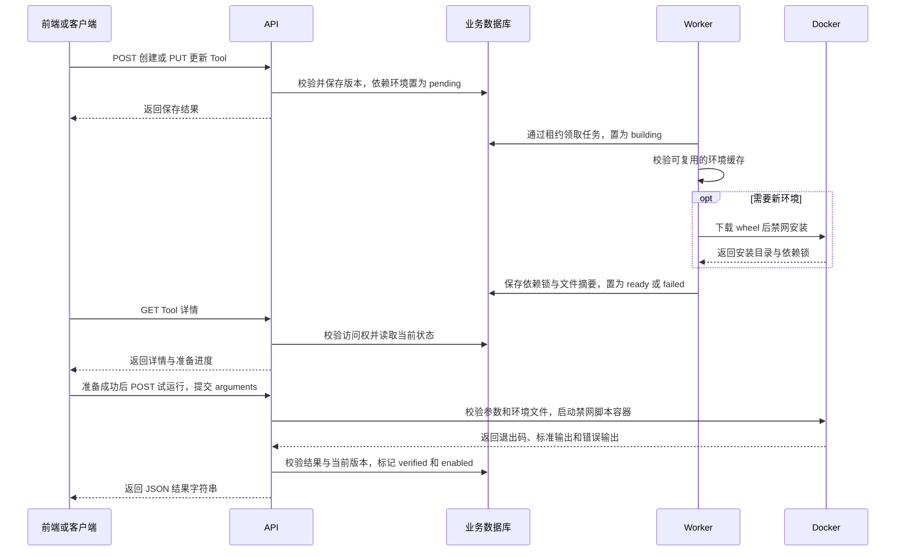

# Tool、脚本沙箱与 MCP

查阅 Tool 接口、依赖准备、执行链、离线部署和治理边界。

[文档总览](README.md) · [项目首页](../README.md)

## Tool 管理与沙箱

### 接口与发布流程

用户可创建私有或公开的脚本/MCP Tool。Agent 可直接关联当前有权使用的本人、公开或指定共享 Tool，也可按连接选择明确授权的已发布工具子集，不设置关联数量上限，内置 Tool 不受该可见性规则限制；模型可以直接调用关联 Tool，也可以按 Skill 指引选择调用。Agent 关联及 Run 均固定 Tool 执行版本；修改源码、连接等执行定义后，需在 Agent 详情中预览并确认工具版本升级。普通 Agent 编辑保留仍选中工具的原版本，新加入的工具采用当前已发布版本。审批设置单独按每轮提交时的当前配置固定；MCP 的策略收紧会影响原先免审批的活动运行，执行版本保持固定。

Tool 的显示名称与调用标识分别保存：

| 字段 | 含义 |
| --- | --- |
| `display_name` | 页面、Agent 选择器及运行过程中的可读名称，支持中文、空格和大小写，去除两端空白后为 1–128 个字符，同一创建者范围内唯一。可以编辑，不改变调用标识或远端函数。 |
| `name` | 不可变内部标识。新建时通常省略，由系统自动生成；已有客户端仍可提交符合原格式的值，未提供显示名称时以此作为显示名称。 |
| `model_name` | 服务端返回的模型调用标识，由 Tool ID 和内部标识组成。模型按此名称调用平台 Tool，修改显示名称不影响已有 Agent/Run 的工具身份。 |
| `mcp_tool_name` | MCP 服务的原始远端函数名，从发现结果选择，按原值调用；与页面显示名称、模型调用标识相互独立。 |

页面新建脚本或 MCP Tool 只需填写显示名称，无需手工编写内部标识。已有工具会保留原调用标识，以原名称回填显示名称；调用事件记录当时的显示名称，随后改名不改写已记录的运行过程。

| 接口 | 职责与使用条件 |
| --- | --- |
| `POST /api/v1/tools` | 创建 `script` 或 `mcp` Tool。脚本先私有创建，初始 `verified=false`、`enabled=false`；MCP 经远端发现后保存定义。 |
| `PUT /api/v1/tools/{tool_id}` | 携带 `expected_version` 创建新版本。脚本源码、参数结构或依赖改变会清除验证并转为私有停用；脚本语言在创建时确定，更新不接受 `script_language`。 |
| `GET /api/v1/tools/{tool_id}` | 查询详情及数据库中的准备状态，不触发下载、安装或脚本执行。所有者可读取源码、依赖和环境信息；其他用户只能查看公开启用 Tool 的元数据。 |
| `POST /api/v1/tools/{tool_id}/test` | 仅创建者可试运行脚本，只接受 `{"arguments":{...}}`。依赖须已就绪，执行成功后设置 `verified=true`、`enabled=true`，随后可通过更新接口公开发布。 |
| `POST /api/v1/tools/{tool_id}/environment/retry` | 所有者提交 `{"expected_version":1}`。失败环境重新排队；已就绪环境通过创建私有停用的新版本重新准备，保留旧版环境记录，仍需重新试运行。 |
| `GET /api/v1/tools/catalog` | 列出可选 Tool 目录。 |
| `GET /api/v1/tools/runs/{run_id}/calls` | 仅向 Run 所有者返回调用版本、状态和脱敏失败类别；终态时未完成的调用标为 `unknown`，不能视为成功或可安全重试。 |

脚本创建参数包含 `display_name`、`description`、`kind=script`、`input_schema`、`script_language`（`python`/`bash`）和 `source_code`。`input_schema` 必须是对象型 JSON Schema，描述调用参数；无参数脚本可填 `{"type":"object","properties":{},"additionalProperties":false}`。源码通过 JSON 字符串传递，由序列化器处理实际换行；`/test` 不接受源码或语言字段。

正式 worker 调用用户脚本或 MCP Tool 前，严格校验该版本的输入 JSON Schema。模型遗漏必填字段、类型不符或包含多余字段时，工具返回 `status=error` 的可修正反馈：`error=invalid_tool_arguments`、`retryable=true` 及最多 8 条字段路径/规则/缺失字段提示，并标明是否截断；不回显输入正文、完整 Schema 或原始校验异常。该次工具尚未执行；模型可使用新的调用 ID 补齐真实数据后再次调用，同一 Run 继续编排。错误调用仍计入工具次数和事件，调用审计记录 `failed/invalid_tool_arguments`，修正成功另记一次成功调用；不自动填入空列表、删除约束或编造审查结果，重试仍受已有模型/工具预算及图步数限制。

`retryable=true` 表示模型可以根据反馈修正后重新调用，不会触发平台按固定次数重放。模型自行决定是否继续，后续调用使用新的调用 ID，受同一 Run 的 `max_model_calls`、`max_tool_calls`、Token/费用预算及 `RUNTIME_RECURSION_LIMIT` 约束；没有单独的“脚本失败自动重试两次”配置。脚本主动拒绝输入的反馈协议见“脚本 Tool 与依赖环境”；生成文件缺失时最多一次内部补救是另一项独立规则。

上述 `invalid_tool_arguments` 反馈仅适用于执行前 Schema 校验；权限失效、依赖配置、脚本崩溃及外部服务错误沿用既有处理，外部写入结果未知仍不能自动重放。已确认未执行的外部写参数错误记录为 `failed`，实际调用后结果不明仍记录 `unknown`。MCP 外部写在校验前仍复核恢复契约并注入服务端幂等键。

Python Tool 通过 `requirements` 声明依赖，前端支持逐行填写或导入 `requirements.txt`。清单最多 32 项，每项 256 字节，支持标准包名、版本约束、extras 和环境标记；拒绝 URL、Git、本地路径及 pip 配置参数。Bash/MCP 不支持 Python 依赖清单。平台不根据 `import` 猜包名，例如导入 `PIL` 时应声明 `Pillow`；空数组表示沿用基础镜像，无需额外环境。

例如创建数字格式化脚本：

```json
{
  "display_name": "数字格式化 Format Number",
  "description": "将数字格式化为易读文本",
  "kind": "script",
  "visibility": "private",
  "input_schema": {
    "type": "object",
    "properties": {},
    "additionalProperties": false
  },
  "script_language": "python",
  "requirements": ["humanize==4.11.0"],
  "source_code": "import json\nimport humanize\nprint(json.dumps({'formatted': humanize.intcomma(1234567)}))"
}
```

### 从保存到执行的调用链



图中的 `pending` 适用于需要新准备依赖的版本。环境状态为 `pending → building → ready/failed`，无额外依赖为 `not_required`；依赖不变时可沿用上一版本的就绪环境。`ready` 只表示依赖已准备，`verified` 表示脚本试运行通过，`enabled` 控制 Tool 当前是否启用。GET 返回的是数据库状态；执行前仍会重新校验环境文件。前端每 2 秒查询等待中或准备中的版本，关闭页面不影响后台任务。

| 阶段 | 核心代码 | 行为 |
| --- | --- | --- |
| 请求与授权 | [tools.py](../app/api/v1/tools.py)：`create_tool`、`update_tool`、`get_tool`；[security.py](../app/core/security.py)：`get_current_admin` | 开发前端 `/api/v1` 经 Vite 代理到 API。API 验证 Bearer、用户/登录会话及资源访问权；校验参数结构、Python 语法和依赖声明后，将 Tool 与版本分别写入 `yp_user_tool`、`yp_user_tool_version`。 |
| 后台领取 | [run_worker.py](../app/cli/run_worker.py)：`_tool_environment_loop`；[tool_environments.py](../app/services/tool_environments.py)：`prepare_next_tool_environment` | 独立异步任务扫描当前版本的 `pending` 记录，通过条件更新领取，保存租约和尝试次数，避免重复领取；异常退出后的过期租约标为 `failed/worker_interrupted`，由所有者重试。 |
| 缓存与安装 | `tool_environments.py`：`_build_environment`、`_package_network`、`_run_preparer` | 按依赖声明、实际镜像 ID、CPU 架构和系统识别缓存，校验完整后复用；新环境先下载兼容 wheel，再在禁网容器中按完整版本与 SHA-256 锁安装，发布安装文件清单及独立缓存目录。 |
| 试运行验证 | `tools.py`：`test_tool`；`tool_environments.py`：`require_script_environment`、`_verify_environment` | 仅创建者可调用，先按 JSON Schema 校验参数，再确认环境状态、固定镜像 ID 格式、目录和文件摘要；执行成功后重新确认版本未变化，才写验证状态、启用状态和审计。 |
| 沙箱与响应 | [script_sandbox.py](../app/services/script_sandbox.py)：`run_script` | 源码写入临时文件，Docker CLI 启动一次性容器，只读挂载源码和依赖目录；经标准输入传 JSON，检查退出码及标准输出 JSON，再返回序列化的结果字符串。 |
| 正式对话 | [worker_tools.py](../app/services/worker_tools.py)：`make_worker_tool_resolver`；[run_executor.py](../app/services/run_executor.py)：`AuthorizedToolsMiddleware` | 模型触发 Tool 后，按实际对话用户复核 Run、租约、版本和权限，验证参数与环境，再复用 `run_script`；结果进入模型上下文，调用过程写脱敏事件和审计。 |

依赖环境由固定基础镜像中的 Python 解释器和独立安装目录组成。准备时，`pip download --only-binary=:all:` 获取直接及传递依赖，生成精确版本和 wheel 哈希锁；另一个禁网容器使用 `pip install --no-index --no-deps --ignore-installed --require-hashes --no-compile --target=/site` 安装。已安装文件发布到 `SCRIPT_DEPENDENCY_STORAGE_DIR/<environment_key>/`，版本记录保存依赖锁、镜像 ID 和文件清单。宽泛约束也会复用已有锁定缓存，需要不同版本时应修改约束；新版本不会覆盖旧版环境。

依赖版本固定的是实际镜像 ID，而不是 `SCRIPT_SANDBOX_IMAGE` 的可变标签。准备环境时会为镜像保存 `y-point-script-sandbox-pinned:<镜像ID的64位摘要>` 标签；一键部署也会在重建沙箱前保留当前镜像，并在构建后保留新镜像，避免旧镜像因失去标签而成为默认悬空清理的目标。这不是镜像备份，强制删除、Docker Desktop 数据重置或清理所有未使用镜像仍可能删除历史版本所需镜像。

执行前同时验证依赖文件和固定镜像是否可用。若文件完整但固定镜像已经缺失，页面仍可能保留先前准备成功的 `ready` 状态，执行会拒绝继续，不会自动换用同名标签的新镜像。此时可以导入包含原镜像 ID 的备份；没有原镜像时，在工具页面重新准备环境，基于当前镜像生成新版本，再试运行，并在智能体设置中重新保存工具绑定。已提交运行仍固定旧版本，应重新发起运行；不要直接修改旧版本的 `environment_image` 或依赖锁。

执行时将该目录只读挂载为 `/opt/tool-deps`，并设置 `PYTHONPATH`。Python 在容器内通过 `site.addsitedir('/opt/tool-deps')` 加载依赖，再由 `runpy.run_path('/app/main.py', run_name='__main__')` 执行脚本；`.pth` 等导入行为只发生在最终脚本沙箱中。无额外依赖时直接使用基础镜像执行。

脚本从标准输入读取参数，标准输出须为单个 JSON 值；日志应写标准错误，避免混入结果。例如：

```python
import json
import sys

arguments = json.load(sys.stdin)
result = {
    "ok": True,
    "arguments": arguments,
}
print(json.dumps(result))
```

只读脚本可通过“标准输出为空、标准错误为一行最多 512 字的可打印 UTF-8 校验提示、退出码为 1”主动拒绝输入。该提示会作为 `status=error`、`error=script_input_rejected`、`retryable=true` 的 ToolMessage 交给模型，供其依据 Skill 规则修正后用新的调用 ID 再调用；提示属于工具公开反馈，不应包含凭据或内部日志。脚本已经执行，调用审计保留 `failed/execution_error`，仍消耗工具预算。写工具不自动修正重试；多行日志、堆栈、超长或非文本错误、非空标准输出、其他退出码及依赖/容器/超时故障继续走原失败处理。

试运行检查退出码为 0、输出可解析为 JSON，并通过统一响应返回；`data.result` 是 JSON 字符串，例如 `{"code":200,"message":"操作成功","data":{"result":"{\"ok\": true}"}}`。这验证了受限环境中的执行和输出协议，业务结果是否符合预期仍由 Tool 创建者确认。常驻 Web 服务不适用于该任务模式：脚本需在时限内完成并输出 JSON。

### 基础镜像与离线部署

宿主机需安装 Docker CLI、启动 Docker 服务并准备基础镜像。[Dockerfile.sandbox](../Dockerfile.sandbox) 使用 Python 3.12，[sandbox/requirements.txt](../sandbox/requirements.txt) 固定预装库。镜像通过 `SCRIPT_SANDBOX_IMAGE` 配置，默认 `y-point-script-sandbox:1`；环境准备时固定实际镜像 ID。联网构建命令：

```bash
docker build -f Dockerfile.sandbox -t y-point-script-sandbox:1 .
```

默认下载阶段经临时内部 Docker 网络中的代理访问 `SCRIPT_DEPENDENCY_INDEX_URL` 源站和 `SCRIPT_DEPENDENCY_ALLOWED_HOSTS` 允许的 HTTPS/443 目标，默认包括 `pypi.org`、`files.pythonhosted.org`。包源由维护者统一配置，不接受用户自定义地址；内网包仓库需配置相应 HTTPS 地址及下载域名，当前不支持包源内嵌凭据。安装阶段禁网，只接受兼容 wheel，不执行源码构建或用户安装钩子。

下载请求的连接或包源临时故障最多重试 2 次，单次网络等待 15 秒；所有尝试仍受 `SCRIPT_DEPENDENCY_BUILD_TIMEOUT_SECONDS`（默认 180 秒）的总时限约束。失败不会自动重新排队；在 Tool 页面点击重试，会重新准备当前失败版本，无须先修改依赖或新建工具。

准备失败时可按 `environment.failure_code` 排查：

| 失败类别 | 排查方向 |
| --- | --- |
| `dependency_network_error` | 包源或下载代理无法连接、DNS 解析失败、TLS 证书错误、连接超时，或包源持续返回 502/503/504。先重试；持续失败时检查 Docker 下载代理到允许仓库域名的连通性。 |
| `dependencies_unavailable` | 包名或版本不存在、当前 Python/Linux/CPU 架构没有兼容 wheel，或离线 wheel 集合不完整。检查声明与安装包；pip 最终的“找不到包”也可能由未识别的上游错误导致。 |
| `image_unavailable` / `configuration_error` | 沙箱镜像、Docker 访问权限、包源配置、离线安装目录或代理脚本挂载异常。 |
| `build_timeout` | 完整准备流程超过总时限，检查网络和依赖规模。 |

worker 日志记录失败版本的 `version_id` 和脱敏 `failure_code`，不记录原始 pip 输出、仓库路径或认证信息。Docker 部署可使用 `python3 -m ypoint_cli compose --sandbox -- logs --tail 100 worker` 查看。既有失败记录不包含原始网络错误，修复网络或配置后需要重新准备，才能获得当前分类结果。

完全离线环境需同时交付基础镜像和用户依赖的完整 wheel 集合。在与目标 Python、Linux 系统及 CPU 架构一致的联网环境准备：

```bash
# 联网环境：基础镜像与完整 wheel 一起交付
mkdir -p .run-private/wheelhouse
docker run --rm --user "$(id -u):$(id -g)" \
  -v "$PWD/.run-private/wheelhouse:/wheels" \
  y-point-script-sandbox:1 \
  python -m pip download --only-binary=:all: --dest=/wheels "humanize==4.11.0"
docker save -o y-point-script-sandbox.tar y-point-script-sandbox:1
# 离线目标环境：导入镜像，并把 wheel 复制到配置的目录
docker load -i y-point-script-sandbox.tar
```

目标环境设置 `SCRIPT_DEPENDENCY_ALLOW_NETWORK=false` 和 `SCRIPT_DEPENDENCY_WHEELHOUSE=/absolute/path/to/wheelhouse`，通过 `--network=none`、`--no-index` 和只读 wheel 目录准备环境。缺少包、版本或兼容 wheel 时返回脱敏失败说明，补齐后重试；无网络且无安装包时无法获取新依赖。需要源码编译、系统动态库或超出资源限制的包，需维护者扩展基础镜像后重新验证。

### 资源、清理与存储边界

| 限制 | 依赖准备 | 脚本执行 |
| --- | --- | --- |
| 网络 | 下载仅经允许的包仓库代理；离线下载与安装均禁网 | 始终禁网 |
| 内存 / CPU / 进程数 | 512 MiB / 1 CPU / 64 | 128 MiB / 1 CPU / 64 |
| 临时目录 | 64 MiB | 8 MiB |
| 时限 | 总计默认 180 秒，配置范围 10～1800 秒 | 试运行按 `SCRIPT_TEST_TIMEOUT_SECONDS`（默认 10 秒）；正式调用取 Agent 工具时限与 `SCRIPT_EXECUTION_TIMEOUT_SECONDS`（默认 30 秒）的较小值 |
| 文件及数据 | 构建期间周期性检查 512 MiB、20,000 个文件上限，非宿主文件系统硬配额 | 参数结构最多 16 KiB、源码最多 64 KiB、输入/标准输出/错误输出各最多 64 KiB |

准备和执行容器使用非特权用户、只读根文件系统、权限与进程限制；按阶段只挂载所需的准备目录、源码或依赖，不挂载宿主机业务目录或 Docker 管理接口。执行时不安装库，安装 `httpx` 不会开放外部访问；外部服务业务应使用经授权的 MCP Tool，并按工具配置决定是否需要人工审批。容器内系统信息反映沙箱环境，需要中国标准时间的脚本应明确指定 UTC+08:00。

正常退出使用 Docker `--rm` 清理，取消、超时或异常时尝试强制移除容器并回收代理及临时网络。worker 被强杀时，容器内仍有独立时限；新建容器、代理和网络带部署作用域及到期标签，临时目录有持久化标记。常驻 worker 默认每 60 秒核对，过期后保留 300 秒宽限再回收。历史版本引用的环境始终保留；旧版本未标记资源仍需维护者人工核对。API 和全部 worker 需共享 `SCRIPT_DEPENDENCY_STORAGE_DIR` 并保有固定镜像；新缓存在发布前写入清理标记，并纳入完整性摘要。发布后尚未提交数据库引用的孤立缓存可在过期后回收；有任意历史版本引用的缓存和未标记历史目录继续保留。当前没有跨主机环境分发，也不会按保留期自动淘汰历史版本引用的缓存。备份应包含业务库、环境目录和基础镜像，不要删除仍被历史 Tool/Run 引用的缓存。

### 调用审批设置

脚本 Tool 继续使用 `requires_approval` 开关：创建默认 `false`，更新省略保留。MCP 使用下述分层审批；旧客户端仍可提交该布尔值，`true` 转为工具 `always`，`false` 转为工具 `writes`，因此旧布尔开关不能表达 `never`；需免审批时显式设置 `approval_mode=never`，仍受部署、Run 与共享使用约束。一次请求不能同时提交 `requires_approval` 与 `approval_mode`。

Agent 固定执行版本，下一轮采用当前发布的审批覆盖，无需仅为审批调整重新绑定 Agent。`yp_run_tool.requires_approval` 和 `approval_policy` 保存本轮有效值及来源。审批放宽不自动放宽已有快照；通过管理接口收紧策略时，原先免审批的相关排队、运行中、待审批任务进入取消流程，已要求审批的快照保留。调用前仍复核当前授权、连接状态和部署限制，不满足时须重新提交。旧快照为空时保留原版本的强审批要求，并应用当前必要约束，不自动同意已有审批。

免审批仍需通过权限、版本、参数、审计和配额检查。`idempotent` 声明还须通过逐版本契约验收；普通非幂等写可以使用 `manual`，按所有者审批方式执行一次。内置 Tool 与 Skill 包脚本保持原策略。

### MCP Tool

先在 Tool 页的「MCP 连接」中创建连接，点击「测试连接并发现工具」，从发现结果点击「添加为 Tool」，确认显示名称、用途、可见性与审批设置并保存。也可从「新建 Tool → MCP」选择已保存连接及远端函数；两条路径共用同一 Tool 编辑与发布流程，地址和凭据只在连接中维护。接口提交 `display_name`、`kind=mcp`、`mcp_connection_id` 和远端 `mcp_tool_name`，内部 `name` 由系统生成。连接本身不是可执行函数，不加入 `/api/v1/tools/catalog`；保存 Tool 后才进入目录并可关联到 Agent。在 Tool 编辑器内打开连接管理时，发现结果的「用于当前 Tool」会回填当前草稿，保留已填写的显示名称、用途和审批设置，保存后生效。同一连接可被多个 Tool 复用；一个 Tool 对应一个远端函数。创建和更新 Tool 时发现远端工具并固定输入结构、连接版本、执行配置及加密凭据。连接仅所有者可管理，凭据不回显；公开带凭据的 Tool 前，须在连接中启用 `share_credentials=true`。连接提供默认审批方式，工具编辑器提供覆盖选项。需要审批时，运行所有者可批准、拒绝本次并继续，或停止整个任务；多项支持明确的逐项决定。旧客户端 `reject` 仍停止整轮，详见下文“逐项审批与拒绝后继续”。调用时重新发现并核对 Schema 和已保存的显式提示，变化时需发布新版本。

#### MCP 审批、声明与可调用状态

连接 `approval_mode` 默认 `writes`，也支持 `always`、`never`；工具默认 `inherit`，可覆盖为上述三种方式。先解析所有者的工具覆盖或连接默认，再应用实际使用者和部署的收紧约束。`never` 表示所有者使用时无需审批，包括没有幂等键的普通写操作；幂等契约只决定恢复语义。部署、Run 和共享使用的强制约束仍然优先。

| 情况 | 有效结果 |
| --- | --- |
| `writes` + 远端只读提示 | 不额外审批，仍受使用者及部署约束 |
| `writes` + 写操作或未知声明 | 审批后可调用 |
| `always` + 任意 MCP 工具 | 默认每次审批；所有者可明确授予本会话固定版本例外 |
| `never` + 所有者使用普通非幂等写 | 可直接调用，结果未知仍不得自动重放 |
| `never` + 已验收幂等写 | 可直接调用，仍受使用者及部署约束 |
| 他人使用写工具或仅凭人工确认/历史声明发布的只读工具 | 使用者须审批，不接受会话放行覆盖；远端明确只读仍按基础配置处理 |
| 本轮 `require_mcp_approval=true` 或部署 `MCP_FORCE_APPROVAL=true` | 全部 MCP 调用均需审批 |

会话输入区可开启「本轮全部 MCP 调用需审批」。AG-UI 提交使用 `forwardedProps.require_mcp_approval`；默认 `false`，只表示不额外收紧，不能放宽所有者设置。提交幂等键相同但该选项不同会返回冲突，重试保持原选项。`approval_policy` 记录所有者方式、来源版本及收紧约束，不包含 URL、密钥或内部启动配置。

`readOnlyHint`、`idempotentHint`、`destructiveHint`、`openWorldHint` 都是远端可选提示，不是平台认证。缺少只读声明记录为 `effect_source=unknown`，执行时按可能写入治理；SDK 补出的默认值不冒充远端显式提示。远端明确非只读不能人工降级。所有者可为缺少声明的私有工具提交 `effect=read` 和非空 `read_only_reason`，记录确认人、理由、时间和执行定义摘要；公开已有确认时，共享使用者仍需审批。

只读确认绑定 Schema、四项显式提示、实际连接配置、远端函数和凭据；相关定义改变后需要重新确认，显示名称或用途变化保留原确认。只读自动使用 `safe`，不等于可以无限重试。API 显式按写操作治理远端只读工具时保留更严格的所有者选择。

目录、创建、更新和详情响应提供按实际使用者计算的 `callability`：`direct`、`approval_required`、`blocked`。阻断时返回稳定 `reason`、说明及修复动作；需要审批仍属于可调用。目录预检针对当前发布版本，历史 Agent 的固定执行版本在运行时单独核对。该状态不探测远端在线情况，调用前还会重新检查。

这些入口和连接分组复用同一服务端预检。响应在 `callability` 外提供带时区的 `callability_checked_at`（判断时间）及 `mcp_connection_version`（此工具固定的连接配置版本，可为空）；时间不是在线探针或有效期承诺，不属于可调用决策的语义字段。创建、更新、依赖环境重试也返回相同摘要。连接分组额外提供当前连接 `version`、指定用户授权 `share_version`（所有者为空），以及 `can_edit`、`allow_credentials`；固定配置版本与当前审批策略版本可能不同，不能混作自动升级依据。

Tool 列表的状态标签可点击或用键盘展开原因、修复动作、策略来源和判断时间。编辑器可单独“刷新发布状态”，刷新保留未保存的输入及原 `expected_version`；远端已发布新版本时提示冲突，避免将旧草稿自动提交到新版。新建尚未保存时显示待发布预检说明。Agent 的直接工具和连接目录提供刷新、加载、失败重试，查询失败保留上次成功目录和已有选择，且标明结果可能过期；初次加载/失败不冒充授权撤销。已选工具状态可展开阅读，旧版绑定明确区分“当前发布版本预检”与“旧版提交时复核”，刷新不会升级关联。


只读 MCP 返回 `isError=true` 时，该次调用仍记为失败，原因码为 `remote_error`；平台将有界的远端错误作为不可信工具结果反馈给模型，允许它修正参数后使用新的调用 ID 再调用，或说明当前无法完成。平台不会自动重发相同请求，也不保证模型一定修正成功。反馈中的远端结果最多 8 KiB，超过时省略；成功大结果改用下文的预览与私有结果引用，错误反馈仍有独立上限。远端正文不写入公开调用事件与审计摘要，按正常工具结果进入私有检查点。外部写工具的执行异常仍中止运行；有平台证据证明业务调用尚未发送时记为失败，发送后无法确认结果时记为未知。工具执行异常导致整轮结束时使用 `tool_error`，页面提示检查失败的工具调用；真正的模型供应商异常仍使用 `model_error`。

#### 对话内放行与撤销

审批接口 `GET /api/v1/runs/{run_id}/approval` 返回 `allowed_scopes`。`once` 表示只批准本次；`tool` 表示批准本次并允许本会话继续使用同一 MCP 工具版本；`all` 表示批准本次并允许本轮已选择且可授予的 MCP 工具集合。多工具审批不提供单工具放行；含内置工具、脚本或强制约束的批次不能扩大为会话放行。工作台仅展示服务端提供的选项。

通过 AG-UI resume 的 payload 发送 `decision=approve` 和可选 `scope=tool|all`；省略 scope 等价于 `once`。会话放行只附带在明确批准全部当前动作的决定中，不与拒绝、停止或逐项 resolve 混用。审批结论和会话策略在同一事务保存，相同审批和精确相同范围可幂等重试；更换范围不能覆盖原决定。

放行绑定实际工具 ID、固定执行版本及定义摘要、当前工具审批版本和连接策略版本，仅当前会话所有者可授予自己的 MCP 工具，不转授工具使用权或凭据。新工具、新执行版本、审批或连接版本变化均需重新确认；内置交互工具、文件操作和 Skill 脚本不受此 MCP 放行影响。普通 `always` 可被明确的会话例外覆盖，部署强制、本轮主动要求和共享使用的强制约束不可覆盖。模型请求前刷新放行集合，真正执行前再核验；已撤销的自动放行不会继续执行。原审批中明确批准的原始调用仍按单次决定处理。

`GET /api/v1/agents/{agent_id}/sessions/{session_id}/approval-policy` 返回脱敏策略，包含 mode、独立 version、已确认工具集合和部署提示；会话详情 `approval_policy` 与公开线程快照 `approvalPolicy` 也返回相同摘要。`allow_all` 仅描述授权时固定的集合，不自动覆盖之后加入的工具。部署 `MCP_SESSION_ALLOW_ALL=false` 禁止新增及继续使用全部允许策略，默认 true；它不影响明确的单工具放行。

`DELETE /api/v1/agents/{agent_id}/sessions/{session_id}/approval-policy?expected_version=2` 撤销全部；追加 `tool_id` 可撤销单个工具。版本不匹配返回 409，防止并发覆盖新授权。撤销不撤回已执行操作或已经明确批准的单次动作。工作台输入区可查看、刷新和撤销策略；授权记录属于该会话，切换会话不继承。授权写入身份审计和 `approval_policy_changed` 运行事件，实际自动放行写入 `mcp_approval_allowed` 事件，不包含工具参数或连接密钥。

旧会话默认无放行，旧审批 scope 默认 `once`，历史决定保持原值。升级步骤见[数据库迁移与测试](testing.md#数据库与测试)；API 与 Worker 须使用一致代码及 MCP 配置。

#### 发现与调用核对

连接发现成功只表示协议握手和工具目录可读取，不代表业务函数执行成功。发布前核对远端函数名、输入 Schema、读写声明和权限；多个函数分别发布为 Tool 并关联到 Agent。依赖前置查询的调用，应使用前置函数实际返回的标识，不猜测或复用示例 ID。

实际调用以持久化调用记录为准：`remote_error` 表示远端返回工具错误，不等于连接或服务不可用。只读纠错使用新的调用 ID，旧结果保留；外部写入结果未知时先核实副作用。
连接使用 SDK 的 `streamable_http_client` 和显式管理的 `httpx.AsyncClient`，统一认证、连接/读取超时及退出清理。支持公网、内网、回环及保留地址上的 `http://` 和 `https://`，分别默认使用 80 和 443，也支持显式指定 1–65535 的端口，例如 `http://mcp.example.com:8080/mcp`。地址中禁止内嵌用户名/密码或 fragment，Bearer/API Key 及敏感 Headers 通过独立字段填写；不按 IP 地址类别限制解析结果，支持 `localhost`、`127.0.0.1`、私网 IPv4 和 IPv6 等端点。请求按原协议和实际端口固定到校验后的 IP，保留包含非默认端口的 Host，HTTPS 保留原 TLS 域名；传输层拒绝协议、主机、端口变化及所有 3xx 响应。API 的发现/发布和 Worker 的正式调用均须能访问配置的地址；Docker 部署中的 `localhost`/`127.0.0.1` 指向各自容器；Docker Desktop 访问宿主机可使用 `host.docker.internal`，其他部署使用容器网络可达的宿主机或服务地址。同时支持以下受控 stdio 传输；两种传输共用 SDK `ClientSession` 的初始化协商、工具发现、Schema 复核、审批、读写治理和结果处理。协议版本由所安装 SDK 与服务端协商，不以传输名称推断协议版本。每次连接在 SDK 解析前累计限制接收 1 MiB，拒绝压缩响应及超预算的声明长度；结果解析后仍保留 64 KiB 上限。发现支持有界分页，默认最多 128 个工具、总量 256 KiB，单个名称/描述/Schema 分别限制为 128 B/4 KiB/16 KiB，并拒绝重复工具名和循环游标。

#### 连接管理与版本

| 接口 | 行为 |
| --- | --- |
| `GET /api/v1/mcp-connections` | 查询自己的连接；返回传输、版本和凭据存在标记，不返回凭据。 |
| `POST /api/v1/mcp-connections` | 创建 HTTP 或受控 stdio 连接；不自动执行远端发现。 |
| `PUT /api/v1/mcp-connections/{id}` | 提交完整配置及 `expected_version`，发布下一连接版本；同传输未提供新凭据时保留现值。 |
| `DELETE /api/v1/mcp-connections/{id}` | 删除并禁止继续使用，取消相关活动运行；保留历史审计。 |
| `POST /api/v1/mcp-connections/{id}/discover` | 使用已保存的凭据发现工具，沿用发现预算与调用容量名额。 |
| `POST /api/v1/mcp-connections/{id}/sync-preview` | 比较远端目录、已发布版本与当前连接配置，只预览不授权。 |
| `POST /api/v1/mcp-connections/{id}/sync` | 提交预览摘要、期望版本、稳定请求 ID 与明确子集，逐项发布或停用远端移除项。 |
| `GET /api/v1/agents/{id}/tool-upgrades` | 所有者预览已关联工具的版本、参数结构、授权与有效审批状态。 |
| `POST /api/v1/agents/{id}/tool-upgrades` | 显式确认选定绑定升级，使用 Agent 期望版本及稳定请求 ID；保留旧 Run 快照。 |
| `GET /api/v1/mcp-connections/stdio-profiles` | 查询管理员允许的启动配置名及凭据环境变量键。 |

普通连接配置更新不会改写旧 Tool 快照。需要采用新配置时，通过工具编辑或同步确认发布新版，再在 Agent 详情确认固定 Tool 版本升级。停用或删除连接、轮换/清除凭据、改变鉴权或租户 Headers、撤销凭据共享会立即限制旧快照，并取消受影响的活动运行；无法撤回已经执行的外部操作。`clear_credentials=true` 与提供新凭据互斥；HTTP 空 token、stdio 空环境变量对象表示保留原凭据。stdio 提供非空环境变量对象时，整体替换该连接的环境变量凭据。

#### 旧版 HTTP Tool 兼容边界

已有直接保存 URL 的 HTTP Tool 及对应 API 请求继续可用；`POST /api/v1/tools/mcp/discover` 已在 OpenAPI 标记为弃用，仅用于旧 HTTP 配置发现。新接入通过 `POST /api/v1/mcp-connections` 创建连接，再使用 `POST /api/v1/mcp-connections/{id}/discover` 发现工具，或使用 `sync-preview` / `sync` 确认发布；已有 Tool 可选择连接并发布新版。共享连接 Tool 不接受同时填写 `mcp_url` 或直接替换凭据，需在连接管理中操作。

#### HTTP 鉴权与 Headers

HTTP 连接支持 `auth_type=none/bearer/api_key`；主密钥分别使用 `bearer_token` 或 `api_key`，API Key 的 Header 名由 `api_key_header` 指定，默认 `X-API-Key`。旧版 Bearer 请求继续兼容。发现、连接测试、发布复核和 Worker 调用共用同一请求头组装入口。

```json
{
  "name": "工单服务",
  "transport": "streamable_http",
  "url": "https://mcp.example.com/mcp",
  "auth_type": "api_key",
  "api_key_header": "X-API-Key",
  "api_key": "replace-with-api-key",
  "headers": {"X-Tenant": "team-a"},
  "sensitive_headers": {"X-Service-Secret": "replace-with-secret"}
}
```

普通 `headers` 保存为执行配置，敏感 Header 值及主密钥加密保存。列表和编辑响应仅返回 Header 名称、鉴权方式及已配置标记，不回显两类 Header 的值。敏感值须放入 `sensitive_headers`；同名字段不能同时放在普通与敏感配置中。主密钥和敏感值不会进入操作回执、公开审计或请求正文日志。

| 更新字段 | 省略或空值 | 显式替换或清除 |
| --- | --- | --- |
| `auth_type` | 省略保留原方式；旧请求提供 Bearer token 时沿用 Bearer 语义 | 切换方式不沿用旧主密钥，需填写对应新密钥 |
| `bearer_token` / `api_key` | 空字符串或省略保留同方式主密钥 | 非空替换；`clear_credentials=true` 清除主密钥和全部敏感 Headers |
| `headers` | 省略保留；页面留空不提交 | 对象整体替换，`{}` 清空普通 Headers |
| `sensitive_headers` | 省略或 `{}` 保留 | 非空值逐项合并替换；`{"X-Secret":null}` 删除该项 |

`clear_credentials=true` 不允许同时提供新秘密。切换 HTTP/stdio 不保留另一传输的秘密。stdio 的 `env` 保持非空对象整体替换、空对象保留的既有语义，不能填写 HTTP 鉴权字段。可以先保存未配置主密钥的连接，实际发现和调用会明确要求补齐。

自定义 Header 名不区分大小写，拒绝大小写重复、普通/敏感冲突、主密钥 Header 冲突及 HTTP/MCP 保留字段。禁止覆盖 `Host`、`Authorization`、`Content-Type`、`Accept`、压缩/长度/连接控制字段、Cookie、来源/代理字段，以及 `Mcp-*`、`Sec-*`、`Proxy-*`、`X-Forwarded-*` 等。自定义项合计最多 16 个，每项值最多 4096 字节且须为非空可打印 ASCII；主密钥最多 8192 字节，组装后的配置请求头总量不超过 16 KiB。固定目标 IP、来源与重定向检查继续生效。

普通租户 Header 变化也会使旧配置失效，即使连接没有密钥。`config_revoked_through` 记录范围撤销，凭据轮换仍由 `credentials_revoked_through` 记录。撤销立即限制旧 Tool/Run，并取消受影响的活动运行；同步预览会列出待重新发布工具。仅修改显示名称不会改变技术标识。

#### 同步发布与 Agent 版本升级

在连接列表点击「同步差异」，检查新增、参数结构/远端声明/执行配置变化、远端移除和无变化。页面提供前后参数结构；人工只读工具的执行定义变化时需重新填写确认理由，或明确改按普通写发布。幂等恢复的新版本需重新验收，也可选择按普通写发布并遵循配置的审批方式。停用工具重新发布后保持停用状态，启用需由所有者另行确认。

确认发布必须提交预览中的连接版本、`preview_hash`、稳定 `request_id` 与 `selections`。下例摘要仅示意，实际须原样使用预览返回值：

```json
{
  "request_id": "sync-client-001",
  "expected_version": 2,
  "preview_hash": "aaaaaaaaaaaaaaaaaaaaaaaaaaaaaaaaaaaaaaaaaaaaaaaaaaaaaaaaaaaaaaaa",
  "selections": [
    {"tool_id": 12, "remote_name": "search", "expected_version": 1, "action": "publish"},
    {"tool_id": 13, "remote_name": "old_search", "expected_version": 1, "action": "disable"}
  ]
}
```

发布时重新发现；连接、远端定义或本地版本变化返回 409，须重新预览。逐项发布使用保存点，一个工具失败不撤销同批已成功项；回执与成功变更在同一事务提交。网络失败时用原 ID 和原内容重试，返回原逐项结果，不重复发布；修改选择或修复失败项后重新预览并使用新 ID。相同 ID 改变内容返回冲突，并发相同请求也不会重复创建版本。

新增工具默认私有，显示名称默认由连接名与函数名组成，技术标识独立生成；同名远端函数在不同连接中有独立稳定映射。连接或工具改名不改写模型标识、Skill 引用、Agent 绑定及历史 Run。远端真正改名表现为旧函数移除、新函数新增，需要分别确认；不会改写旧函数身份。

远端移除项确认后停用，历史版本及审计保留。旧 Run 的本地快照不能保证远端旧接口仍存在；调用时检测到移除或 Schema/声明不兼容会在业务发送前中止，并提示同步发布及确认 Agent 升级。

工具发布后，在 Agent 详情点击「检查工具版本更新」，比较固定版本与目标已发布版本，核对参数结构、授权和审批状态，再选择确认升级。阻断项不能升级，需要审批的工具仍可选择。普通 Agent 编辑保留仍选中工具的固定版本；新增绑定采用当前版本。升级后的新 Run 使用新版，旧 Run 保留原版本且继续受当前撤权和收紧策略约束。共享 Agent 不自动授予私有工具或连接权限。

连接更新保留历史 Tool 的固定版本与执行摘要。升级前备份并按[数据库迁移与测试](testing.md#数据库与测试)完成结构检查；存在 API Key、普通/敏感 Headers 或范围撤销记录时，迁移会阻止无法保留这些约束的回退。回退还会移除操作回执，不能继续依赖原请求 ID 的防重记录。数据库回退不能撤销远端副作用。

#### stdio 受控运行

stdio Server 在 API 或 Worker 发起的独立 Docker 容器中运行，通过标准输入/输出交换换行分帧的 MCP JSON-RPC 消息；标准错误作为日志丢弃并限制字节。平台不执行用户填写的宿主机命令、不自动安装包或拉取镜像。API 和 Worker 均需具备 `--sandbox` 对应的 Docker 接入和相同的管理员启动配置，镜像应提前构建并导入。

维护者在环境配置中设置 `MCP_STDIO_PROFILES`，固定镜像 ID 或带摘要的镜像引用、启动命令、固定参数及可填写的环境变量白名单。例如以下结构中的镜像摘要需要替换为实际镜像：

```json
{
  "local_tools": {
    "image": "your-registry/mcp-server@sha256:<实际64位摘要>",
    "command": ["python", "/app/server.py"],
    "args": [],
    "env_keys": ["API_KEY"]
  }
}
```

然后通过连接 API 创建：

```json
{
  "name": "本地资料服务",
  "transport": "stdio",
  "stdio_profile": "local_tools",
  "args": ["--read-only"],
  "env": {"API_KEY": "仅写入的凭据"},
  "share_credentials": false,
  "enabled": true
}
```

用户只能选择已配置的启动配置、追加有界字符串参数及填写白名单环境变量；敏感值应写入 `env`，不要放在启动参数中。环境变量加密保存，执行时通过权限为 `0600` 的临时 env 文件交给 Docker，不拼入命令行，临时文件在退出时删除。请求日志对 `env` 和 Bearer 字段整体脱敏。

容器固定为非 root、只读根文件系统、无额外 capability、有限 CPU/内存/进程和临时目录，默认且当前仅支持 `--network=none`，不挂载业务目录或 Docker socket。需要外部网络的 MCP 优先使用 Streamable HTTP；当前 stdio 不适用于需要宿主机目录、动态安装依赖或联网的 Server。启动配置发生变化或被移除时，旧执行快照会拒绝运行，需重新发布连接和 Tool。

stdio 在 SDK 解析前限制每行及累计 stdout 字节，stderr 也有累计上限，正式结果按[大结果交付](#mcp-大结果预览保存与分段读取)的留存与预览预算处理。超时、主动取消、非法消息及进程异常均回收容器、管道任务和临时文件；进程被强杀时，沿用工具资源标签和周期清理机制。旧 HTTP + SSE、WebSocket、自定义 MCP 传输及 stdio 网络/文件挂载暂不支持。

### Tool 治理与兼容边界

Tool 治理覆盖凭据撤销、执行许可、外部写恢复契约和数据库并发租约。普通外部写按有效审批策略执行一次，声明幂等恢复的版本另需契约验收；部署与结构检查见[数据库与测试](testing.md)，治理约定见 [Tool 治理契约](m5-governance-contract.md)。

- 凭据更新省略 `mcp_bearer_token` 或提交空字符串时保留；非空值替换。`clear_mcp_credentials=true` 清除新版本凭据，与替换互斥。轮换/清除会撤销此前带凭据版本并取消相关 Run。`POST /api/v1/tools/{id}/credentials/revoke` 接收 `expected_version`，无需远端在线即可撤销历史凭据并禁用 Tool；恢复须显式替换或清除后重新发布。撤销共享会阻止旧 Run 继续借用凭据；已发往远端的操作无法撤回。
- 普通 MCP 写工具可选 `recovery_policy=manual`，无需伪造幂等字段，按有效审批策略调用一次。声明 `idempotent` 时需有效的顶层字符串 `idempotency_key_field`，并由管理员通过 `POST /api/v1/tools/{id}/write-contract/verify` 提交固定版本及证据引用；新发布版本仍需重新验收，旧版本证据不自动继承。模型 Schema 隐藏幂等键，由正式执行上下文注入。发送前的参数、握手、发现或定义复核失败与发送后结果未知分别记录；未知结果不能自动重试，同一调用 ID 禁止重放，同一 Run 中同一 Tool 与相同参数的未知写记录也不能通过换调用 ID 补做。平台防重不保证远端恰好执行一次。
- 工具调用（含发现与试运行）共用数据库名额：默认全局/用户/Run 为 16/4/2；准备任务另按全局/用户 2/1 限制。工具满额直接返回 429 或 `tool_capacity_exceeded`，准备满额保留排队；审批等待不占名额。正常退出、取消和异常会释放，强杀后按有限租约到期回收。
- 构建在共享文件锁下先预留 512 MiB；默认环境目录预算 8 GiB，磁盘保留 1 GiB，80% 时告警。该机制是应用预算和准入控制，运行中检查也不能代替文件系统硬配额；需要硬磁盘隔离的目标部署须配置专用卷/文件系统配额并验收。缓存必须保留全部历史版本引用。

治理接口与权限：

| 入口 | 权限与行为 |
| --- | --- |
| `PUT /api/v1/tools/{tool_id}` | Tool 所有者使用 `expected_version` 发布新版本；支持替换或清除凭据，历史 Agent 仍固定版本，但不能绕过当前撤销及共享规则。 |
| `POST /api/v1/tools/{tool_id}/credentials/revoke` | 仅 Tool 所有者；提交 `expected_version`，无需连接远端即可撤销历史凭据、禁用 Tool 并取消受影响 Run。 |
| `POST /api/v1/tools/{tool_id}/write-contract/verify` | 仅管理员；提交 `expected_version` 与 `evidence_reference`，按固定版本验收写恢复契约，仅保存证据引用的 SHA256。 |
| `uv run python -m app.cli.reconcile_tool_resources` | 服务端运维命令，按部署作用域核对过期容器、代理、网络、目录及终态 Run 的遗留调用，输出清理统计与存储状态。 |

配置及默认值见 `.env.example`：

| 配置 | 默认值及用途 |
| --- | --- |
| `MCP_STDIO_PROFILES` | `{}`，管理员提供的固定镜像/命令/环境变量白名单；空配置不提供 stdio 启动项。 |
| `MCP_RESPONSE_MAX_BYTES` | `1048576`，每次连接在解析前累计接收上限。 |
| `MCP_DISCOVERY_MAX_TOOLS` / `MCP_DISCOVERY_MAX_BYTES` | `128` / `262144`，发现工具数量及总字节上限。 |
| `TOOL_CALL_GLOBAL_LIMIT` / `TOOL_CALL_USER_LIMIT` / `TOOL_CALL_RUN_LIMIT` | `16` / `4` / `2`，工具调用并发名额。 |
| `TOOL_PREPARATION_GLOBAL_LIMIT` / `TOOL_PREPARATION_USER_LIMIT` | `2` / `1`，依赖准备并发名额。 |
| `TOOL_STORAGE_MAX_BYTES` / `TOOL_STORAGE_MIN_FREE_BYTES` | `8589934592` / `1073741824`，应用存储预算及文件系统最低余量。 |
| `TOOL_RESOURCE_RECONCILE_SECONDS` / `TOOL_RESOURCE_GRACE_SECONDS` | `60` / `300`，周期核对间隔与资源过期宽限。 |

API 和全部 worker 必须使用一致的并发配置、时钟、业务数据库及共享环境目录。工具调用满额在 API 返回 HTTP 429，Run 记录 `tool_capacity_exceeded`；依赖准备满额保留 `pending`。远端连接、鉴权、发现及限流失败统一返回脱敏业务错误，不能将远端 429 与本地容量 429 混为同一语义。

升级前备份业务库、检查点和共享环境目录，按[数据库迁移与测试](testing.md#数据库与测试)完成升级与结构检查，再重启 API 与 Worker。普通 `manual` 写版本按有效审批策略执行；声明 `idempotent` 但未验收的版本仍阻断，可验收或发布 `manual` 新版本。回退前停止新任务并核对活动运行、审批证据和授权约束的兼容性；存在使用新策略的活动运行时迁移会阻止回退，允许回退时仍可能丢失策略来源及只读确认证据；数据库回退不能撤销远端副作用。

### 按连接关联 Agent 与指定用户共享

Agent 编辑器的「MCP 连接工具」读取 `GET /api/v1/mcp-connections/catalog`，按连接选择已发布工具。支持选择全部当前可用工具，再移除不需要的项；例如连接有 17 个工具，只保存选中的 10 个。远端新增第 18 个工具、修改连接显示名称或同步发布新版，都不会扩大已有 Agent 的选择。目录失败时保留原选择并显示错误，失效关联可明确移除后保存。

连接目录是面向使用者的摘要，只有连接所有者和指定接收者能看到；公开单个 Tool 不会公开整个连接目录。摘要包含名称、所有者 ID、启用状态、当前连接版本、授权版本、编辑权限标记、凭据借用标记及获授权工具的 ID、显示名称、模型标识、发布版本、固定连接配置版本、可调用状态和判断时间。不返回连接 URL、Headers、凭据、stdio 配置或容器命令。`GET /api/v1/mcp-connections` 和连接配置、发现、发布接口仍只接受所有者。

| 权限 | 授权来源与范围 |
| --- | --- |
| 连接摘要可见 | 自己的连接或显式指定用户共享；工具子集可为空，此时只有摘要。 |
| 工具可执行 | 自己的工具、公开工具或连接共享中明确列出的 `tool_ids`；仍需通过启用状态、版本、审批、配置及凭据撤销检查。 |
| 凭据可借用 | 共享中的 `allow_credentials=true` 只覆盖该用户及该工具子集；不会返回密钥，不必向所有公开用户开放凭据。 |
| 连接配置可编辑 | 仅连接所有者；共享不授予编辑、发现、发布或再共享权限。 |
| Agent 可使用 | 独立的 Agent 共享授权，不自动授予上面任何连接权限。 |

原有公开工具的 `share_credentials` 规则继续有效，与指定用户授权是独立的授权来源；关闭某一来源不会否定另一来源仍然有效的授权。授权收紧时会保守取消该用户受影响的活动 Run；重试新 Run 时重新核对仍然有效的授权。撤销不是撤回已经发生的远端副作用。

连接所有者在 Tool 页「MCP 连接 → 连接共享」搜索指定用户，选择已发布工具子集，并单独选择是否允许借用凭据：

| 接口 | 契约 |
| --- | --- |
| `GET /api/v1/mcp-connections/catalog` | 返回当前用户拥有或显式获共享的安全摘要和工具子集。 |
| `GET /api/v1/mcp-connections/{id}/shares` | 所有者查询指定用户授权，含授权版本。 |
| `PUT /api/v1/mcp-connections/{id}/shares/{user_id}` | 接收 `expected_version`、`tool_ids`、`allow_credentials`；工具子集整体替换，空列表只共享摘要；首次或撤销后重新授权传 `expected_version=0`。 |
| `DELETE /api/v1/mcp-connections/{id}/shares/{user_id}?expected_version=N` | 所有者按授权版本撤销摘要、工具子集和该来源的凭据借用；取消受影响的活动运行。 |

更新与撤销发生版本冲突返回 HTTP 409，请刷新授权再修改；撤销后重授权使用递增版本，旧页面上的撤销请求不能删除新的授权。授权记录保留撤销审计，不复用旧授权版本。接收者只能将明确获授权的工具加入自己的 Agent，不能将该授权转授给自己的 Agent 接收者。

创建或修改 Agent 可同时使用原有 `tool_ids` 和新的 `mcp_connections`：

```json
{
  "name": "工单助手",
  "default_model_id": 1,
  "tool_ids": [101],
  "mcp_connections": [
    {
      "connection_id": 7,
      "tools": [
        {"tool_id": 101, "tool_version": 2},
        {"tool_id": 102, "tool_version": 1}
      ]
    }
  ]
}
```

同一工具同版本只进入 Run 一次；直接关联与连接选择不同版本返回 409，提示统一版本。重复连接或连接子集中的重复工具被拒绝。`tool_ids` 响应仍只表示直接关联；`mcp_connections` 单独返回连接来源与固定版本，旧客户端省略新字段时保留已有连接选择。修改时 `mcp_connections=[]` 清除关联，`null` 不合法。已有绑定不允许通过普通编辑更改版本；详情中的工具版本升级会同步更新该工具的直接和连接绑定。旧 Run 始终保留原快照。

Agent 保存和 Run 提交均校验实际使用者的权限。通过连接选择的工具在正式 AG-UI 提交时展开为具体 Tool、版本、执行摘要、审批与授权来源快照。缺少连接或工具子集权限时，提交返回含连接 ID、工具 ID 和修复建议的错误，不静默省略该连接选择；执行前和审批恢复仍重新检查。历史直接绑定保留原有共享过滤兼容行为。连接选择同时纳入模型工具能力和 Skill 外部工具依赖校验。

旧直接绑定与历史执行摘要保持原值。共享记录、连接绑定及 Run 的连接授权来源属于持久化权限与审计数据，包括已撤销的授权；存在这些记录时迁移会阻止有损回退，须先备份并按迁移要求转换或迁出。部署按[数据库迁移与测试](testing.md#数据库与测试)先升级结构，再协调更新 API 与 Worker。

### 逐项审批与拒绝后继续

运行所有者可对单项点击“同意执行”“拒绝本次并继续”或“停止整个任务”。多项审批必须逐项选择后才能“提交逐项决定”；也可明确选择“同意全部执行”或“全部拒绝并继续”。一项批准不会默认批准其他项。任一逐项决定为停止时，整批未执行项都不再执行；此前已完成的操作不会回滚。逐项批准统一生效后，不同连接可以并行，同连接按授权复核完成后的入队顺序串行，不承诺模型并行调用数组的顺序。

审批仍绑定检查点、原调用 ID、精确参数 HMAC、固定 Tool 版本及执行摘要。公开 `action_id` 是这些事实的 HMAC，不等于执行授权。操作预览仅展示白名单目标 ID、数量或不含用户信息/路径/查询串的 URL 主机；自由文本、凭据和未知参数不回传。文件目标仍按审批人的当前权限解析名称。

AG-UI `resume.payload` 的项目扩展：

| `decision` | 行为 |
| --- | --- |
| `approve` | 明确批准全部当前动作，兼容旧客户端。 |
| `reject` | 保留旧语义：拒绝并取消整轮，绝不静默改成继续。 |
| `stop` | 明确停止整轮。 |
| `reject_continue` | 拒绝当前批次全部动作并恢复模型，工具未执行。 |
| `resolve` | 携带 `decisions=[{action_id,decision}]`，须完整、顺序一致，逐项为 `approve`、`reject` 或 `stop`。 |

相同审批 ID、相同协议 runId 与精确相同决定可幂等重连；反向决定、旧审批错配、缺项、错序或过期都返回冲突。`status=cancelled` 仍映射旧版停止。`resolved` 表示已保存含拒绝的继续决定，不表示工具已经完成；Worker 仍重新核对检查点、原版本与当前授权。

拒绝结果作为 ToolMessage 交回模型，记录 `user_rejected` 调用事件。此 Run 封锁被拒绝的工具、相同连接/相同端点的同名远端函数，以及后续用户写工具（含脚本），避免更换调用 ID、参数或替代工具绕过拒绝；本批精确批准的原调用除外。封锁项不再提供给模型；即使模型主动生成，也在调用前阻断。若业务确实需要重新授权，明确发起新 Run。内置文件生成等本地交付能力保持原权限检查。

有拒绝的最终回答附加根据持久化事件计算的记录，区分已完成调用、已拒绝且未执行、结果未知，并说明拒绝不会回滚此前副作用。人工拒绝不消耗一次真实工具执行次数。最终文字不能替代远端业务结果核实。

### Run 内 MCP 会话与跨审批恢复

常驻 Worker 为每个 Run 持有独立协议会话，隔离键包含实际用户、Run、连接、固定连接版本，以及配置/凭据的 HMAC 指纹。相同连接的不同远端函数可以复用一份状态；不同 Run 或用户不能继承。若同一 Run 的同一连接出现不一致的固定连接版本或凭据，不跨版本继承状态，须统一版本并重新发起任务。页面发现和发布预检仍使用短连接，不进入业务 Run 池。

资源生命周期由 `RunMcpSessions` 统一持有。每个连接的 SDK、HTTP 任务组或 stdio 子进程在同一个拥有者任务中进入与退出；同连接的调用串行，仍逐次核对远端 Schema/注解、当前用户及 Tool/连接/凭据授权。每次调用沿用 Agent 与 MCP 单次时限的较小值，排队等待也计入时限。连接累计接收预算仍为 `MCP_RESPONSE_MAX_BYTES`，不会因下一次调用清零；空闲与累计存活、每 Run/Worker 数量上限见配置文档。

审批释放业务执行租约，但保留数据库 `mcp_worker_id` 归属和独立资源心跳。调度器仅让拥有者 Worker 恢复；其他 Worker 可继续领取其他任务。审批截止时间取既有会话剩余空闲、累计时限和原审批 TTL 的最小值。首次 MCP 调用之前的审批尚无会话资源，仍可由任意 Worker 领取。Worker `--once` 退出也会清理会话，因此需要跨审批保活的部署应使用常驻模式。

成功、失败、取消、审批过期、用户/Agent/Tool/连接/凭据撤权、资源预算到期和正常进程退出都会触发回收。拥有者每 2 秒巡检并续约至 30 秒；Worker 崩溃后，其他健康 Worker 将失主 Run 标为 `failed/mcp_session_lost`，不把它重新排队。HTTP 404、传输断开、会话失效或配置改变也不能悄悄新建状态继续原任务。浏览器页签和登录状态不可由数据库检查点还原；核实此前操作后再发起新 Run。

HTTP 会话初始化后、首次业务调用前，将地址、认证、远端会话 ID 和协商协议版本写入加密回收凭单 `yp_run_mcp_resource`。正常退出发送限时 DELETE；确认成功、不存在或服务端不支持 DELETE 后丢弃凭单，其他失败保留给独立回收循环。其他 Worker 使用凭单只发送 DELETE，不初始化、不执行工具；每次最多 8 项，每项最多 3 秒，失败 60 秒后再试，截止后最多再保留 24 小时。初始化返回与凭单落库之间的崩溃窗口、服务端不支持 DELETE、不可达或拒绝旧凭据时，无法保证远端资源立即释放，仍需服务端自己的会话过期策略。平台不把清理请求成功解释为回滚业务。

stdio 正常退出会关闭 stdin、回收管道任务、删除容器和凭据临时目录。强杀宿主时沿用部署作用域与累计截止标签，由现有资源核对回收；默认还有 30 秒标签余量、300 秒宽限和最多一个核对周期，不能把“Run 已结束”称为“孤儿容器已即时消失”。本机受控子进程验证不替代真实 Docker 失主验收。禁网、固定镜像、只读根文件系统和无业务目录挂载继续独立生效。

针对锁定 SDK 1.30.0，平台在超时/取消时按原请求 ID 直接发送 `notifications/cancelled`：HTTP 限时 POST，stdio 持写锁写入并 `drain`，避免只入本地 SDK 队列就退出。初始化请求不发送取消通知。取消和关闭都是尽力控制动作，不撤回远端已发生的副作用；已发送的外部写仍保留结果未知审计，不因会话关闭而自动重放。

旧 `reject` 保留停止整轮的语义；历史未记录的逐项决定不补造。存在新版审批决定、Run 资源归属或待清理凭单时，迁移会阻止有损回退；须先按迁移要求停止任务、完成资源清理并备份或迁出相关记录。业务库升级与所有 API/Worker 的版本切换须安排在同一发布流程。

<a id="静态工具上下文预算"></a>

### 工具上下文预算

Agent 的 Tool 关联不再按 16 个封顶；远端发现数量限制、Skill/知识库关联限制和模型单次输入窗口仍分别生效。17 个小工具可以正常使用，一个巨大的 Schema 也可能超过窗口。默认 `static` 模式向模型提供当前 Run 获准使用的完整静态集合；配置 `MCP_TOOL_SCHEMA_MODE=dynamic` 后，仅在本轮固定授权集合内搜索并按需加载 Schema，详见[工具搜索与按需 Schema](#mcp-工具搜索与按需-schema)。

`context_budget` 随 `GET /api/v1/runs/{run_id}` 返回；会话历史的轮次 `metrics` 同时包含最后一次估算。前端可展开“上下文估算”，查看系统提示、工具 Schema、历史及工具结果、当前输入、参考附件、图片预留的近似 Token 和字节分解，以及输出预留、有效输入上限和超限建议。只保存数值，不保存请求正文或 Schema 内容；组件分解不包含共同消息封装，不能简单当作精确分词结果求和或用于计费。

预算与实际调用使用同一授权过滤，已拒绝或未开放的工具不计入静态集合。沿用 DeepAgents 的历史摘要和有界上下文恢复，在摘要前记录诊断，真正发送前再按最终系统提示、有效历史和工具集合核对；中文工具 Schema 也参与保守估算。当前输入本身已经放不下时直接阻断，不为此额外请求历史摘要；这类早期诊断明确标为 `current_input_lower_bound`，尚未构造的系统提示和工具集合不冒充已计入。窗口未知时仍记录占用，但 `fits=null`，不能承诺供应商会接受；供应商分词、协议封装和图片成本存在差异。

显式输出额度采用 SDK 的窗口 5% 余量及实际输出额度；输出留空时，平台预留登记窗口四分之一，再扣 512 Token，不因此给供应商设置输出参数。已有最小输入校验和摘要触发阈值保持生效。图片在近似计数外另预留每张 2048 Token，这不是供应商实际计价。

### MCP 大结果预览、保存与分段读取

MCP 结果分三层约束，脚本与原有小文本读取工具的 64 KiB 限制保持各自含义：

| 层次 | 默认预算 | 超限处理 |
| --- | --- | --- |
| 传输接收 | `MCP_RESPONSE_MAX_BYTES=1048576` | SDK 解析前限制原始字节；复用连接累计，不因每次调用重置。响应未完整到达时没有成功证据，外部写仍按结果未知治理。 |
| 解码后响应留存 | `MCP_RESULT_MAX_BYTES=8388608` | 对解码后的 JSON 序列化范围再设预算；它不替代传输硬上限，也不是解析器内存配额。完整成功响应已收到但超限时，仅交付预览和限制说明，不保存完整响应，不重做写操作。 |
| 模型可见预览 | `MCP_RESULT_PREVIEW_BYTES=8192` | 小结果保留 JSON 结构；大结果使用有效 JSON 预览、范围声明和结果引用，不能把截断的 JSON 当作完整对象。元数据另有少量固定开销。 |

正式 Worker 仅在收到 `isError=false` 的完整成功响应后保存结果。模型收到 `operation_succeeded=true`、`delivery=stored` 或 `unavailable`、有界 `preview`、`preview_complete=false`、来源、脱敏前响应 JSON 字节和可确认的顶层集合长度；`received_bytes` 不是包含协议封装的网络总字节。保存成功还返回 `artifact_id`、`sha256`、保存字节、总字符数、期限、`read_tool=read_tool_result` 和起始偏移。保存失败、用户配额不足、单 Run 留存名额用尽或解码后预算不足，都只改变交付状态，不将已确认成功的业务操作标为失败。协议成功不证明远端实现了其业务承诺；远端错误或响应未完整到达继续采用原失败/未知语义。

快照保存的是**本次远端响应范围内的完整脱敏 JSON**，不是未过滤的原始报文，也不保证包含整个远端数据集。过滤实际连接凭据、敏感 Header 值及常见认证字段；不为 `isError=true` 原始错误创建产物。嵌入 JSON 文本同样过滤，保留独立远端分页字段如 `nextCursor`/`nextPageToken`；脱敏不能代替服务提供者对业务敏感信息的最小化返回。来源中 `scope=single_response_redacted`、`received_complete=true`、`remote_dataset_complete=null`，不以一页结果推断全量。预览省略值、数组或深层字段时不得据此统计全量数据。

结果复用现有私有 Artifact 存储（本地或私有 S3），仅所有者可读取/下载；共享 Agent、连接或 Tool 不转授结果文件。每 Run 默认最多留存 20 次大结果，累计计算，不因删除旧结果重置；仍计入用户文件数量与容量配额，期限使用 `ARTIFACT_RETENTION_DAYS`，到期沿用产物清理。成功响应生成的结果立即为私有 `ready` 状态并发出产物事件，即使随后模型回答失败，用户仍可核实；它不计作模型按用户要求生成的报告。并发发布使用行锁和 Run 版本竞争，不能突破单 Run 名额。

模型工具 `read_tool_result(artifact_id, expected_sha256, offset=0)` 只读取当前 Run 的已保存结果，不调用远端。用户界面通过以下接口逐段预览：

```text
GET /api/v1/artifacts/{artifact_id}/result-page?expected_sha256=<sha256>&offset=0
```

每页返回合法 JSON 信封，正文是明确标为 `json_text_fragment` 的 `text_fragment` 字符串，附 `offset/end_offset/next_offset/total_characters/sha256`。偏移按 Unicode 字符，单页正文最多为预览预算四分之一的字符数；连续拼接所有片段至 `next_offset=null` 后才可完整解析 JSON。读取重验所有者、状态、期限、哈希和正文完整性；模型读取还重验当前 Run 租约和授权。哈希不符、过期、正文损坏或偏移无效时拒绝，不切换到远端重新查询；模型可修复或重试结果读取，不能因此重做原写操作。浏览器分段显示当前范围，支持继续、上一段、失败重试和私有下载，不将多个页面无界拼进浏览器内存。

快照内容不可变，远端后来变化不改写已保存响应；远端分页仍须按原工具和审批契约继续调用，它可能读到不同时间点的数据，平台不保证跨远端页面的一致性。只有完整处理已保存的相关范围，或取得明确远端聚合，才可对该范围给出全量结论。结果引用过期或保存失败后，不承诺能够恢复原响应。

历史 Run 的预算和结果来源可为空，不补造历史占用或完整性。结果来源用于核实响应快照，存在来源记录时迁移会阻止有损回退，须先备份并迁出；预算属于可重算诊断。部署须协调业务库结构、API 与 Worker 的版本。

## MCP 工具搜索与按需 Schema

默认 `MCP_TOOL_SCHEMA_MODE=static`，保留每次向模型绑定本轮全部有效工具 Schema 的行为。工具较多时，维护者可在 API/Worker 的一致配置中设为 `dynamic`。此设置只改变模型接收哪些 MCP 参数声明；Agent 关联、RunTool 固定版本、当前用户授权、凭据借用、审批和实际执行入口沿用原规则。脚本 Tool、Skill 受管脚本、知识库和内置文件工具仍按原方式绑定。

动态模式在有已授权 MCP 工具时提供普通平台工具 `tool_search`。它不是远端 MCP 方法，也不依赖模型厂商的原生工具搜索功能。模型调用 `tool_search(query, limit=5, offset=0)`，搜索本轮已解析且仍有权限的 MCP Tool 集合；不扫描全站工具、不调用远端发现、不连接未关联的连接，也不执行业务操作。

- `query` 为 1—512 字符，可填用途关键词、显示名称、内部名称、远端函数名或完整模型调用标识；`*` 可列出本轮允许搜索的工具。排序采用本地名称/关键词和中文片段匹配，不提供语义检索承诺。空白查询返回无匹配。
- `limit` 为 1—10，默认 5；`offset` 为非负偏移，最大 100000。此限制仅控制一次加载组大小，不限制 Agent 可关联的工具总数。返回 `results`、`total_matches`、`next_offset` 和 `loaded_names`。
- 搜索结果包含稳定模型标识、Tool ID、Run 固定工具版本、连接 ID、远端函数名和有界用途摘要。不会返回地址、凭据、Headers 或完整参数 Schema。完整 Schema 在下一次模型请求中通过现有模型适配器绑定，不重复塞入工具结果。
- 每次成功搜索替换上一组，包括无匹配时清空旧组。需要多个工具时通过关键词和 `limit` 一次选择；需要换组时顺序搜索。并行搜索按图更新顺序保留最后一组，不合并或无限累加。模型应依据下一次请求实际绑定的 Schema 调用；猜测尚未加载的调用标识只收到未执行反馈。
- 选择保存在图检查点中，绑定当前 Run ID，不依赖某个 Worker 的内存或搜索消息是否被摘要。跨审批恢复会重新核对固定工具版本和权限；同一线程的新 Run 不自动继承上一轮选择。已拒绝工具不进入搜索结果或后续模型绑定；重新搜索不能绕过拒绝。
- 同名远端 `search` 用不同的 `user_tool_<id>_<name>` 区分；模型和 Skill 继续使用原来的稳定标识及唯一名称别名。Skill `required_tools` 的关联校验与授权规则不变；需要 MCP 工具时先按名称搜索，不因 Skill 声明而新增权限。

例如已关联 17 个参数声明较大的 MCP 工具，动态模式首先只绑定搜索入口和其他常驻工具。搜索“订单查询”后，只把匹配的一组 Schema 加入下一次请求；换成“库存查询”会替换该组。加载后仍核算系统、历史、附件、输出预留和完整 Schema；单个巨型 Schema 超限仍会在发送模型前拒绝。已成功或结果未知的写操作不会因换组而自动重做。

`tool_search` 消耗既有工具调用次数，搜索后的模型请求消耗模型调用次数，均沿用运行限额、超时、审计与取消规则。上下文诊断在动态模式额外返回可选 `tool_loading`：`mode=dynamic`、`available_mcp_tools`（本轮固定集合数量，包含本轮后来拒绝的项）、`loaded_mcp_tools`（本次实际绑定数量）；只保存数值，不保存搜索正文或 Schema。历史记录没有该字段时展示保持兼容。

普通函数调用是共享接口，实际供应商仍须具备并验证工具调用能力；本地适配器/受控模型通过不等于目标供应商的搜索质量或工具选择效果已验收。默认静态模式可作为兼容选择；切换配置需 API/Worker 一致生效，建议从新 Run 验证，跨进程检查点沿用现有部署要求。动态加载选择保存在既有图检查点中。
