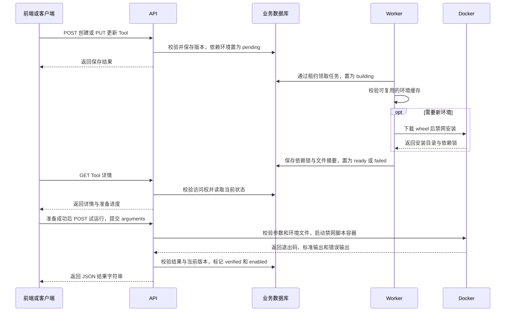

# Tool、脚本沙箱与 MCP

查阅 Tool 接口、依赖准备、执行链、离线部署和治理边界。

[文档总览](README.md) · [项目首页](../README.md)

## Tool 管理与沙箱

### 接口与发布流程

用户可创建私有或公开的脚本/MCP Tool。Agent 可关联最多 16 个当前有权使用的本人 Tool 或公开启用 Tool，内置 Tool 不受该可见性规则限制；模型可以直接调用关联 Tool，也可以按 Skill 指引选择调用。Agent 关联及 Run 均固定 Tool 版本，编辑 Tool 后需重新保存 Agent 关联才能选用新版。

| 接口 | 职责与使用条件 |
| --- | --- |
| `POST /api/v1/tools` | 创建 `script` 或 `mcp` Tool。脚本先私有创建，初始 `verified=false`、`enabled=false`；MCP 经远端发现后保存定义。 |
| `PUT /api/v1/tools/{tool_id}` | 携带 `expected_version` 创建新版本。脚本源码、参数结构或依赖改变会清除验证并转为私有停用；脚本语言在创建时确定，更新不接受 `script_language`。 |
| `GET /api/v1/tools/{tool_id}` | 查询详情及数据库中的准备状态，不触发下载、安装或脚本执行。所有者可读取源码、依赖和环境信息；其他用户只能查看公开启用 Tool 的元数据。 |
| `POST /api/v1/tools/{tool_id}/test` | 仅创建者可试运行脚本，只接受 `{"arguments":{...}}`。依赖须已就绪，执行成功后设置 `verified=true`、`enabled=true`，随后可通过更新接口公开发布。 |
| `POST /api/v1/tools/{tool_id}/environment/retry` | 所有者提交 `{"expected_version":1}`。失败环境重新排队；已就绪环境通过创建私有停用的新版本重新准备，保留旧版环境记录，仍需重新试运行。 |
| `GET /api/v1/tools/catalog` | 列出可选 Tool 目录。 |
| `GET /api/v1/tools/runs/{run_id}/calls` | 仅向 Run 所有者返回调用版本、状态和脱敏失败类别；终态时未完成的调用标为 `unknown`，不能视为成功或可安全重试。 |

脚本创建参数包含 `name`、`description`、`kind=script`、`input_schema`、`script_language`（`python`/`bash`）和 `source_code`。`input_schema` 必须是对象型 JSON Schema，描述调用参数；无参数脚本可填 `{"type":"object","properties":{},"additionalProperties":false}`。源码通过 JSON 字符串传递，由序列化器处理实际换行；`/test` 不接受源码或语言字段。

正式 worker 调用用户脚本或 MCP Tool 前，严格校验该版本的输入 JSON Schema。模型遗漏必填字段、类型不符或包含多余字段时，工具返回 `status=error` 的可修正反馈：`error=invalid_tool_arguments`、`retryable=true` 及最多 8 条字段路径/规则/缺失字段提示，并标明是否截断；不回显输入正文、完整 Schema 或原始校验异常。该次工具尚未执行；模型可使用新的调用 ID 补齐真实数据后再次调用，同一 Run 继续编排。错误调用仍计入工具次数和事件，调用审计记录 `failed/invalid_tool_arguments`，修正成功另记一次成功调用；不自动填入空列表、删除约束或编造审查结果，重试仍受已有模型/工具预算及图步数限制。

`retryable=true` 表示模型可以根据反馈修正后重新调用，不会触发平台按固定次数重放。模型自行决定是否继续，后续调用使用新的调用 ID，受同一 Run 的 `max_model_calls`、`max_tool_calls`、Token/费用预算及 `RUNTIME_RECURSION_LIMIT` 约束；没有单独的“脚本失败自动重试两次”配置。脚本主动拒绝输入的反馈协议见“脚本 Tool 与依赖环境”；生成文件缺失时最多一次内部补救是另一项独立规则。

上述 `invalid_tool_arguments` 反馈仅适用于执行前 Schema 校验；权限失效、依赖配置、脚本崩溃及外部服务错误沿用既有处理，外部写入结果未知仍不能自动重放。已确认未执行的外部写参数错误记录为 `failed`，实际调用后结果不明仍记录 `unknown`。MCP 外部写在校验前仍复核恢复契约并注入服务端幂等键。

Python Tool 通过 `requirements` 声明依赖，前端支持逐行填写或导入 `requirements.txt`。清单最多 32 项，每项 256 字节，支持标准包名、版本约束、extras 和环境标记；拒绝 URL、Git、本地路径及 pip 配置参数。Bash/MCP 不支持 Python 依赖清单。平台不根据 `import` 猜包名，例如导入 `PIL` 时应声明 `Pillow`；空数组表示沿用基础镜像，无需额外环境。

例如创建数字格式化脚本：

```json
{
  "name": "format_number",
  "description": "将数字格式化为易读文本",
  "kind": "script",
  "visibility": "private",
  "input_schema": {
    "type": "object",
    "properties": {},
    "additionalProperties": false
  },
  "script_language": "python",
  "requirements": ["humanize==4.11.0"],
  "source_code": "import json\nimport humanize\nprint(json.dumps({'formatted': humanize.intcomma(1234567)}))"
}
```

### 从保存到执行的调用链



图中的 `pending` 适用于需要新准备依赖的版本。环境状态为 `pending → building → ready/failed`，无额外依赖为 `not_required`；依赖不变时可沿用上一版本的就绪环境。`ready` 只表示依赖已准备，`verified` 表示脚本试运行通过，`enabled` 控制 Tool 当前是否启用。GET 返回的是数据库状态；执行前仍会重新校验环境文件。前端每 2 秒查询等待中或准备中的版本，关闭页面不影响后台任务。

| 阶段 | 核心代码 | 行为 |
| --- | --- | --- |
| 请求与授权 | [tools.py](../app/api/v1/tools.py)：`create_tool`、`update_tool`、`get_tool`；[security.py](../app/core/security.py)：`get_current_admin` | 开发前端 `/api/v1` 经 Vite 代理到 API。API 验证 Bearer、用户/登录会话及资源访问权；校验参数结构、Python 语法和依赖声明后，将 Tool 与版本分别写入 `yp_user_tool`、`yp_user_tool_version`。 |
| 后台领取 | [run_worker.py](../app/cli/run_worker.py)：`_tool_environment_loop`；[tool_environments.py](../app/services/tool_environments.py)：`prepare_next_tool_environment` | 独立异步任务扫描当前版本的 `pending` 记录，通过条件更新领取，保存租约和尝试次数，避免重复领取；异常退出后的过期租约标为 `failed/worker_interrupted`，由所有者重试。 |
| 缓存与安装 | `tool_environments.py`：`_build_environment`、`_package_network`、`_run_preparer` | 按依赖声明、实际镜像 ID、CPU 架构和系统识别缓存，校验完整后复用；新环境先下载兼容 wheel，再在禁网容器中按完整版本与 SHA-256 锁安装，发布安装文件清单及独立缓存目录。 |
| 试运行验证 | `tools.py`：`test_tool`；`tool_environments.py`：`require_script_environment`、`_verify_environment` | 仅创建者可调用，先按 JSON Schema 校验参数，再确认环境状态、固定镜像 ID 格式、目录和文件摘要；执行成功后重新确认版本未变化，才写验证状态、启用状态和审计。 |
| 沙箱与响应 | [script_sandbox.py](../app/services/script_sandbox.py)：`run_script` | 源码写入临时文件，Docker CLI 启动一次性容器，只读挂载源码和依赖目录；经标准输入传 JSON，检查退出码及标准输出 JSON，再返回序列化的结果字符串。 |
| 正式对话 | [worker_tools.py](../app/services/worker_tools.py)：`make_worker_tool_resolver`；[run_executor.py](../app/services/run_executor.py)：`AuthorizedToolsMiddleware` | 模型触发 Tool 后，按实际对话用户复核 Run、租约、版本和权限，验证参数与环境，再复用 `run_script`；结果进入模型上下文，调用过程写脱敏事件和审计。 |

依赖环境由固定基础镜像中的 Python 解释器和独立安装目录组成。准备时，`pip download --only-binary=:all:` 获取直接及传递依赖，生成精确版本和 wheel 哈希锁；另一个禁网容器使用 `pip install --no-index --no-deps --ignore-installed --require-hashes --no-compile --target=/site` 安装。已安装文件发布到 `SCRIPT_DEPENDENCY_STORAGE_DIR/<environment_key>/`，版本记录保存依赖锁、镜像 ID 和文件清单。宽泛约束也会复用已有锁定缓存，需要不同版本时应修改约束；新版本不会覆盖旧版环境。

执行时将该目录只读挂载为 `/opt/tool-deps`，并设置 `PYTHONPATH`。Python 在容器内通过 `site.addsitedir('/opt/tool-deps')` 加载依赖，再由 `runpy.run_path('/app/main.py', run_name='__main__')` 执行脚本；`.pth` 等导入行为只发生在最终脚本沙箱中。无额外依赖时直接使用基础镜像执行。

脚本从标准输入读取参数，标准输出须为单个 JSON 值；日志应写标准错误，避免混入结果。例如：

```python
import json
import sys

arguments = json.load(sys.stdin)
result = {
    "ok": True,
    "arguments": arguments,
}
print(json.dumps(result))
```

只读脚本可通过“标准输出为空、标准错误为一行最多 512 字的可打印 UTF-8 校验提示、退出码为 1”主动拒绝输入。该提示会作为 `status=error`、`error=script_input_rejected`、`retryable=true` 的 ToolMessage 交给模型，供其依据 Skill 规则修正后用新的调用 ID 再调用；提示属于工具公开反馈，不应包含凭据或内部日志。脚本已经执行，调用审计保留 `failed/execution_error`，仍消耗工具预算。写工具不自动修正重试；多行日志、堆栈、超长或非文本错误、非空标准输出、其他退出码及依赖/容器/超时故障继续走原失败处理。

试运行检查退出码为 0、输出可解析为 JSON，并通过统一响应返回；`data.result` 是 JSON 字符串，例如 `{"code":200,"message":"操作成功","data":{"result":"{\"ok\": true}"}}`。这验证了受限环境中的执行和输出协议，业务结果是否符合预期仍由 Tool 创建者确认。常驻 Web 服务不适用于该任务模式：脚本需在时限内完成并输出 JSON。

### 基础镜像与离线部署

宿主机需安装 Docker CLI、启动 Docker 服务并准备基础镜像。[Dockerfile.sandbox](../Dockerfile.sandbox) 使用 Python 3.12，[sandbox/requirements.txt](../sandbox/requirements.txt) 固定预装库。镜像通过 `SCRIPT_SANDBOX_IMAGE` 配置，默认 `y-point-script-sandbox:1`；环境准备时固定实际镜像 ID。联网构建命令：

```bash
docker build -f Dockerfile.sandbox -t y-point-script-sandbox:1 .
```

默认下载阶段经临时内部 Docker 网络中的代理访问 `SCRIPT_DEPENDENCY_INDEX_URL` 源站和 `SCRIPT_DEPENDENCY_ALLOWED_HOSTS` 允许的 HTTPS/443 目标，默认包括 `pypi.org`、`files.pythonhosted.org`。包源由维护者统一配置，不接受用户自定义地址；内网包仓库需配置相应 HTTPS 地址及下载域名，当前不支持包源内嵌凭据。安装阶段禁网，只接受兼容 wheel，不执行源码构建或用户安装钩子。

完全离线环境需同时交付基础镜像和用户依赖的完整 wheel 集合。在与目标 Python、Linux 系统及 CPU 架构一致的联网环境准备：

```bash
# 联网环境：基础镜像与完整 wheel 一起交付
mkdir -p .run-private/wheelhouse
docker run --rm --user "$(id -u):$(id -g)" \
  -v "$PWD/.run-private/wheelhouse:/wheels" \
  y-point-script-sandbox:1 \
  python -m pip download --only-binary=:all: --dest=/wheels "humanize==4.11.0"
docker save -o y-point-script-sandbox.tar y-point-script-sandbox:1
# 离线目标环境：导入镜像，并把 wheel 复制到配置的目录
docker load -i y-point-script-sandbox.tar
```

目标环境设置 `SCRIPT_DEPENDENCY_ALLOW_NETWORK=false` 和 `SCRIPT_DEPENDENCY_WHEELHOUSE=/absolute/path/to/wheelhouse`，通过 `--network=none`、`--no-index` 和只读 wheel 目录准备环境。缺少包、版本或兼容 wheel 时返回脱敏失败说明，补齐后重试；无网络且无安装包时无法获取新依赖。需要源码编译、系统动态库或超出资源限制的包，需维护者扩展基础镜像后重新验证。

### 资源、清理与存储边界

| 限制 | 依赖准备 | 脚本执行 |
| --- | --- | --- |
| 网络 | 下载仅经允许的包仓库代理；离线下载与安装均禁网 | 始终禁网 |
| 内存 / CPU / 进程数 | 512 MiB / 1 CPU / 64 | 128 MiB / 1 CPU / 64 |
| 临时目录 | 64 MiB | 8 MiB |
| 时限 | 总计默认 180 秒，配置范围 10～1800 秒 | 试运行按 `SCRIPT_TEST_TIMEOUT_SECONDS`（默认 10 秒）；正式调用取 Agent 工具时限与 `SCRIPT_EXECUTION_TIMEOUT_SECONDS`（默认 30 秒）的较小值 |
| 文件及数据 | 构建期间周期性检查 512 MiB、20,000 个文件上限，非宿主文件系统硬配额 | 参数结构最多 16 KiB、源码最多 64 KiB、输入/标准输出/错误输出各最多 64 KiB |

准备和执行容器使用非特权用户、只读根文件系统、权限与进程限制；按阶段只挂载所需的准备目录、源码或依赖，不挂载宿主机业务目录或 Docker 管理接口。执行时不安装库，安装 `httpx` 不会开放外部访问；外部服务业务应使用经授权和审批的 MCP Tool。容器内系统信息反映沙箱环境，需要中国标准时间的脚本应明确指定 UTC+08:00。

正常退出使用 Docker `--rm` 清理，取消、超时或异常时尝试强制移除容器并回收代理及临时网络。worker 被强杀时，容器内仍有独立时限；新建容器、代理和网络带部署作用域及到期标签，临时目录有持久化标记。常驻 worker 默认每 60 秒核对，过期后保留 300 秒宽限再回收。历史版本引用的环境始终保留；旧版本未标记资源仍需维护者人工核对。API 和全部 worker 需共享 `SCRIPT_DEPENDENCY_STORAGE_DIR` 并保有固定镜像；新缓存在发布前写入清理标记，并纳入完整性摘要。发布后尚未提交数据库引用的孤立缓存可在过期后回收；有任意历史版本引用的缓存和未标记历史目录继续保留。当前没有跨主机环境分发，也不会按保留期自动淘汰历史版本引用的缓存。备份应包含业务库、环境目录和基础镜像，不要删除仍被历史 Tool/Run 引用的缓存。

### MCP Tool

创建时提交 `kind=mcp`、公网 HTTPS `mcp_url`、远端 `mcp_tool_name`，可选 `mcp_bearer_token`。创建和更新时发现远端工具并固定输入结构；凭据加密保存，仅所有者可读连接详情，响应仅提供 `has_credentials`，不回传凭据明文。公开带凭据连接须设置 `share_credentials=true`。正式调用需要审批，调用时再次发现并核对结构，变化时需发布新版本。

连接使用 SDK 的 `streamable_http_client` 和显式管理的 `httpx.AsyncClient`，统一认证、连接/读取超时及退出清理。仅允许公网 HTTPS，解析结果不得包含私网、回环或保留地址；请求固定到校验后的 IP，保留原 Host 与 TLS 域名，并在传输层拒绝所有 3xx 响应。当前只支持 Streamable HTTP，每个 Tool 保存一个远端定义，无独立连接实体供多个 Tool 统一维护。每次连接在 SDK 解析前累计限制接收 1 MiB，拒绝压缩响应及超预算的声明长度；结果解析后仍保留 64 KiB 上限。发现支持有界分页，默认最多 128 个工具、总量 256 KiB，单个名称/描述/Schema 分别限制为 128 B/4 KiB/16 KiB，并拒绝重复工具名和循环游标。

### Tool 治理与兼容边界

Tool 治理覆盖凭据撤销、外部写恢复契约和数据库并发租约。外部写类型须显式核对能力与恢复契约后启用；部署与结构检查见[数据库与测试](testing.md)，治理约定见 [Tool 治理契约](m5-governance-contract.md)。

- 凭据更新省略 `mcp_bearer_token` 或提交空字符串时保留；非空值替换。`clear_mcp_credentials=true` 清除新版本凭据，与替换互斥。轮换/清除会撤销此前带凭据版本并取消相关 Run。`POST /api/v1/tools/{id}/credentials/revoke` 接收 `expected_version`，无需远端在线即可撤销历史凭据并禁用 Tool；恢复须显式替换或清除后重新发布。撤销共享会阻止旧 Run 继续借用凭据；已发往远端的操作无法撤回。
- MCP 缺少只读声明时默认按外部写处理；管理员可在核对实际能力后显式以 `effect=read` 发布缺少声明的只读工具。远端明确声明写操作时不能降为只读。外部写要求 `recovery_policy=idempotent`、有效的字符串 `idempotency_key_field`，以及管理员通过 `POST /api/v1/tools/{id}/write-contract/verify` 提交该版本的 `expected_version` 和 `evidence_reference`。新版本须重新验收。模型不可自行提供服务端幂等键；结果不明记为 `unknown`，相同调用禁止自动重放。
- 工具调用（含发现与试运行）共用数据库名额：默认全局/用户/Run 为 16/4/2；准备任务另按全局/用户 2/1 限制。工具满额直接返回 429 或 `tool_capacity_exceeded`，准备满额保留排队；审批等待不占名额。正常退出、取消和异常会释放，强杀后按有限租约到期回收。
- 构建在共享文件锁下先预留 512 MiB；默认环境目录预算 8 GiB，磁盘保留 1 GiB，80% 时告警。该机制是应用预算和准入控制，运行中检查也不能代替文件系统硬配额；需要硬磁盘隔离的目标部署须配置专用卷/文件系统配额并验收。缓存必须保留全部历史版本引用。

治理接口与权限：

| 入口 | 权限与行为 |
| --- | --- |
| `PUT /api/v1/tools/{tool_id}` | Tool 所有者使用 `expected_version` 发布新版本；支持替换或清除凭据，历史 Agent 仍固定版本，但不能绕过当前撤销及共享规则。 |
| `POST /api/v1/tools/{tool_id}/credentials/revoke` | 仅 Tool 所有者；提交 `expected_version`，无需连接远端即可撤销历史凭据、禁用 Tool 并取消受影响 Run。 |
| `POST /api/v1/tools/{tool_id}/write-contract/verify` | 仅管理员；提交 `expected_version` 与 `evidence_reference`，按固定版本验收写恢复契约，仅保存证据引用的 SHA256。 |
| `uv run python -m app.cli.reconcile_tool_resources` | 服务端运维命令，按部署作用域核对过期容器、代理、网络、目录及终态 Run 的遗留调用，输出清理统计与存储状态。 |

配置及默认值见 `.env.example`：

| 配置 | 默认值及用途 |
| --- | --- |
| `MCP_RESPONSE_MAX_BYTES` | `1048576`，每次连接在解析前累计接收上限。 |
| `MCP_DISCOVERY_MAX_TOOLS` / `MCP_DISCOVERY_MAX_BYTES` | `128` / `262144`，发现工具数量及总字节上限。 |
| `TOOL_CALL_GLOBAL_LIMIT` / `TOOL_CALL_USER_LIMIT` / `TOOL_CALL_RUN_LIMIT` | `16` / `4` / `2`，工具调用并发名额。 |
| `TOOL_PREPARATION_GLOBAL_LIMIT` / `TOOL_PREPARATION_USER_LIMIT` | `2` / `1`，依赖准备并发名额。 |
| `TOOL_STORAGE_MAX_BYTES` / `TOOL_STORAGE_MIN_FREE_BYTES` | `8589934592` / `1073741824`，应用存储预算及文件系统最低余量。 |
| `TOOL_RESOURCE_RECONCILE_SECONDS` / `TOOL_RESOURCE_GRACE_SECONDS` | `60` / `300`，周期核对间隔与资源过期宽限。 |

API 和全部 worker 必须使用一致的并发配置、时钟、业务数据库及共享环境目录。工具调用满额在 API 返回 HTTP 429，Run 记录 `tool_capacity_exceeded`；依赖准备满额保留 `pending`。远端连接、鉴权、发现及限流失败统一返回脱敏业务错误，不能将远端 429 与本地容量 429 混为同一语义。

目标升级前备份业务库、检查点和共享环境目录，执行 `uv run alembic upgrade head` 和 `uv run alembic check`，再重启 API 与 worker。历史未通过写恢复契约验收的外部写版本保持禁用；数据库回退不能撤销远端已发生的副作用。
